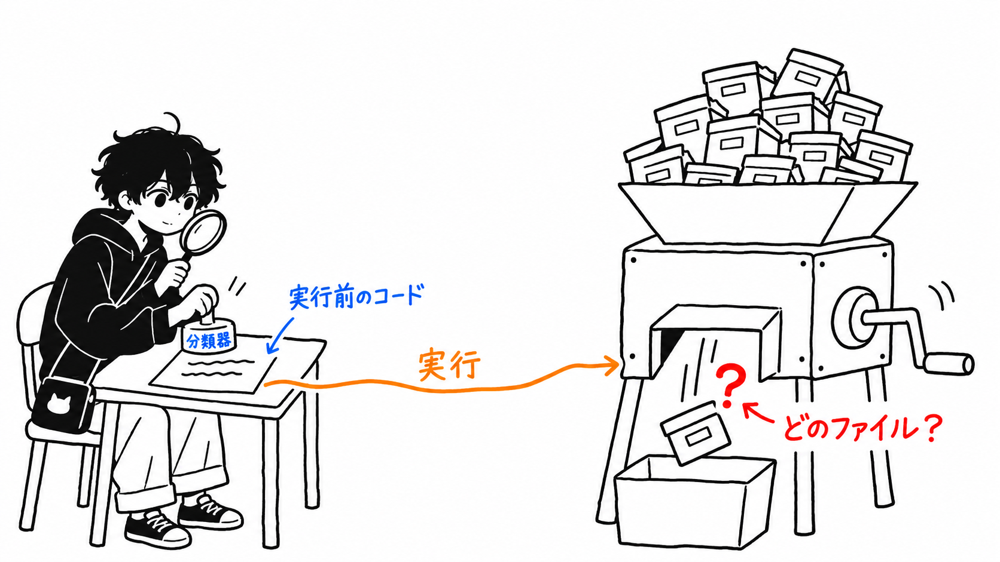
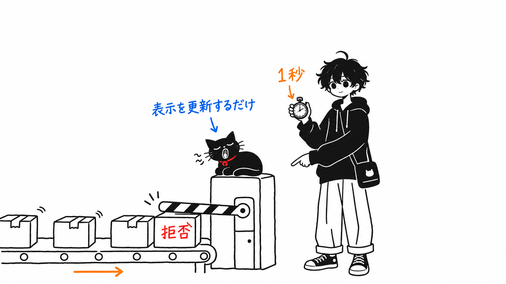
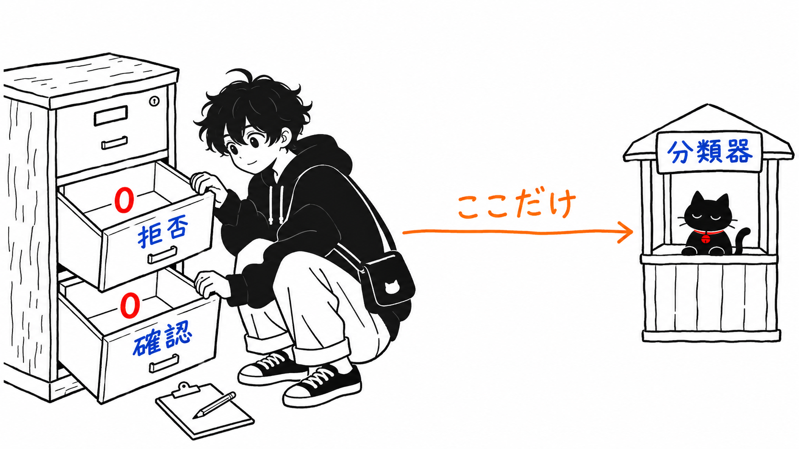

Anthropic の開発者向け公式アカウント（@claudedevs）が、2026年11月17日（UTC）に Code Mode を紹介しました。

> Check out Code Mode, a new, experimental way for Claude Code to work with tools. Claude writes scripts that chain your tools together in sophisticated ways, and it can answer you while long commands are still running.
>
> （Code Mode を試してほしい。Claude Code がツールを使う、新しい実験的なやり方だ。Claude がツールを高度に組み合わせるスクリプトを書き、長いコマンドが走っている間も返事ができる。）

投稿は短い紹介文と、オンにする環境変数、ドキュメントへのリンクだけだったので、リンク先を読みました。そして、自分の Claude Code の設定と1項目ずつ照らしました。

先に結論だけ書くと、こうです。

> Code Mode では、auto mode の分類器が見るのが「1回ずつのツール呼び出し」から「呼び出しをまとめたコード」に変わります。分類器は、実行中に決まる値（検索結果から取ったパスなど）を見ません。私の環境には deny と ask の規則が1つも無く、止める判断はほぼ auto mode の分類器に任せているので、いちばん影響を受ける側でした。もう1つ、タイムアウト1秒の hook があると、一度コードが走ったあとは、hook が1秒を超えたツール呼び出しが拒否されるようになることも分かりました。

---

## この記事について

読んだのはドキュメント「Run tool calls from code with Code Mode」の本文です。リンク先の権限・permission modes・hooks のページは読んでいません。

私の位置も書いておきます。手元の Claude Code は v2.1.326 で、ドキュメントの版の要件（v2.1.323 以降）は満たしています。ただ、この記事のために Code Mode をオンにしてはいません。以下はドキュメントと自分の設定ファイルを並べて読んだ結果で、実際の動作は確かめていません。

## Code Mode がやること

ふだんの Claude Code は、Bash や Read や Edit を1回ずつ呼び、結果を読んでから次を決めます。Code Mode では、Claude が JavaScript を書き、その中でツールを呼びます。ドキュメントの例はこうです。

```javascript
const files = await $`rg -l "function retryPolicy" src`.text();
const target = files.trim().split("\n")[0];
await edit(target, "maxAttempts: 3", "maxAttempts: 5");
({ edited: target, tests: $`npm test -- retryPolicy`.nothrow() });
```

探す、直す、テストを流す、を1つのコードでやり、最後の行で Claude が読む分だけを返す。会話には diff のようなツール呼び出しが表示され、コードそのものは `Ctrl+O` で開くトランスクリプトの中に畳まれています。

向いている仕事として、多くのファイルにまたがる同じ変更、読む前に絞り込みたい検索、同時に流せる独立したコマンドが挙がっています。オンにするには環境変数 `CLAUDE_CODE_EXPERIMENTAL_CODE_MODE=1` を設定します。

この「読む分だけを返す」は、私が今プラグインでやらせていることに近いです。私の環境では、大きな出力を Read や Bash でそのまま読もうとするとプラグインの hook に止められ、サンドボックスで処理して答えだけを出すように言われます。Code Mode は、それを Claude Code 本体の側でやる仕組みに見えます。

ただ、ドキュメントの起動しない理由の表には「it doesn't yet work with the plugin」「it doesn't yet work with an installed mod」があります。ツール呼び出しを検査・書き換えするプラグインを入れている私の環境で、そもそも起動するかは分かりません。

## 分類器は実行時に決まる値を見ない

本題は権限の節です。コードの中のツール呼び出しは、1つずつ deny と ask の規則、PreToolUse の hook を、ふだんどおりのツール名で通ります。変わるのは auto mode の分類器です。

> the classifier reviews each piece of code before it runs, not each tool call. It doesn't see values computed at run time, such as a path taken from search output, so keep rules or hooks for calls you must control.
>
> （分類器は、ツール呼び出しを1つずつではなく、コードを実行前に1回まとめて見る。実行中に計算される値、たとえば検索の出力から取ったパスは見えない。だから、必ず制御したい呼び出しには規則か hook を残しておくこと。）

上の例で言えば、分類器が見るのは「`rg` の結果の1行目を編集する」というコードです。どのファイルが編集されるかは、`rg` が走るまで決まりません。ふだんの auto mode は呼び出しごとに見ているので、Edit のファイル名も見えているはずだと私は思っていますが、permission modes のページは読んでいないので推測です。



ここで自分の設定を開きました。`~/.claude/settings.json` の `defaultMode` は `auto` で、`allow` は空、`deny` と `ask` はありません。ほかの設定ファイル（`settings.local.json`）に `allow` はいくつかありますが、`deny` と `ask` はどこにもありません。つまり、何かを止める規則は1つも書いておらず、止める判断はほぼ分類器に任せています。ドキュメントが「規則か hook を残しておけ」と言う、その規則が無い側です。

ドキュメントは別の注意も書いています。Bash の規則はコマンドの文字列で照合するので、規則に一致しない形で同じことができる。これは Code Mode に限らない、と。Code Mode では、`app` フォルダでの `git push` が、hook には `cd 'app' && git push` として届くことがある。規則や hook を足すなら、複合コマンドを分けて確かめる書き方にする必要があります。

## タイムアウト1秒の hook

もう1つ、読んでいて手が止まったのはトラブルシューティングの節です。

> **`the hook did not finish`**: your hook timed out on a call from code, or on any other tool call once Claude has run code in the session.
>
> （「the hook did not finish」：コードからの呼び出しで hook がタイムアウトした。または、セッションで一度でもコードが走ったあとの、ほかのツール呼び出しでタイムアウトした。）

この場合、PreToolUse の hook が判定を返さなかったとして、呼び出しは拒否されます。`onFailure` を設定していなくても、です。

`settings.json` の PreToolUse には、すべてのツールに掛かる hook が1つあり、`timeout` は1秒です。名前と表示の文言からすると、デスクトップのペットの表示を更新するための hook で、権限の判断はしていないと思っています（スクリプトの中身は読んでいません）。ドキュメントのとおりなら、Code Mode では一度コードが走ったあと、この hook が1秒を超えた呼び出しは拒否されます。止めるつもりの無い hook が、止める側に回る。実際にどのくらいの頻度で1秒を超えているかは測っていません。プラグイン由来の hook のタイムアウトも確かめていません。



ドキュメントの処方は、タイムアウトを延ばすか、`"onFailure": "continue"` を付けることです。表示を更新するだけの hook なら、後者が合っていると思います。

UserPromptSubmit の hook も、バックグラウンドでコードが走るときはコードの出力に対しても動くそうです。私の環境には、`settings.json` の1つと、プラグインが入れている文脈を足す hook があります。どちらかが止める判定を返すことがあるかは、確かめていません。

## 私の見解

判定を守るには、判定を変更の手の届かない場所に置くことがよく言われます。Code Mode のドキュメントを読んで、判定にはもう1つ条件があると思いました。判定するものが見えていることです。

Code Mode の分類器は、引数が決まる前のコードを見ます。見ているのは計画で、実際の行為ではありません。計画が正しくても、`rg` が予想外のファイルを返せば、行為は変わります。一方で規則と hook は、コードの中の呼び出しにも1つずつ掛かります。ドキュメントが「規則か hook を残せ」と書くのは、実際の値を見られるのがそちらだからだと私は読みました。ドキュメントはコードそのものを検査する手も挙げていて、`REPL`（コードを実行するツール）に PreToolUse の hook を掛け、`tool_input.code` を読めばよいそうです。ただ、それも分類器と同じく計画を見る手段です。

一方で、置き場所の守り方はしっかりしていました。`CLAUDE_CODE_EXPERIMENTAL_CODE_MODE` はプロジェクトの設定ファイルに書いても無視されるので、クローンしたリポジトリが勝手に Code Mode をオンにすることはできない。組織の管理者は managed settings で止められるが、オンにはできない。オンにできるのは本人だけです。

なので私の結論は、Code Mode を試すかどうかの前に、分類器に任せている範囲を数えることです。私の場合は、止める判断のほぼ全部でした。少なくとも、実行時の値で行き先が変わるもの（`git push`、`rm`、外部への送信）は、deny や ask の規則か hook に移してから試すつもりです。

## 1つだけ持ち帰るなら

Code Mode をオンにする前に、`permissions` の `deny` と `ask` を数える。0なら、止めたいものを止めるのは、実行時に決まる値を見ない分類器だけになります。hook の `timeout` は、その次に見ます。



出典: ClaudeDevs（@claudedevs）の[投稿](https://x.com/claudedevs/status/2122801681939234950)（2026年11月17日 UTC）。Claude Code Docs「[Run tool calls from code with Code Mode](https://code.claude.com/docs/en/code-mode)」。リンク先の権限・permission modes・hooks・sandboxing のページは読んでいません。Code Mode は実際にはオンにしておらず、hook がタイムアウトしたときの挙動も手元では確かめていません。
