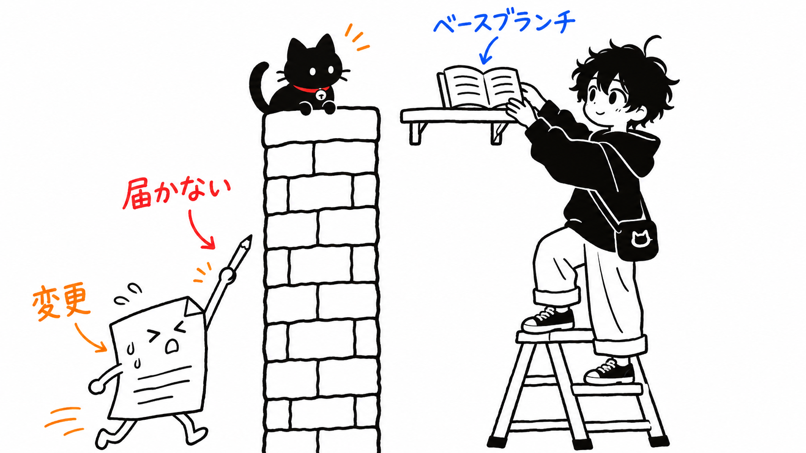
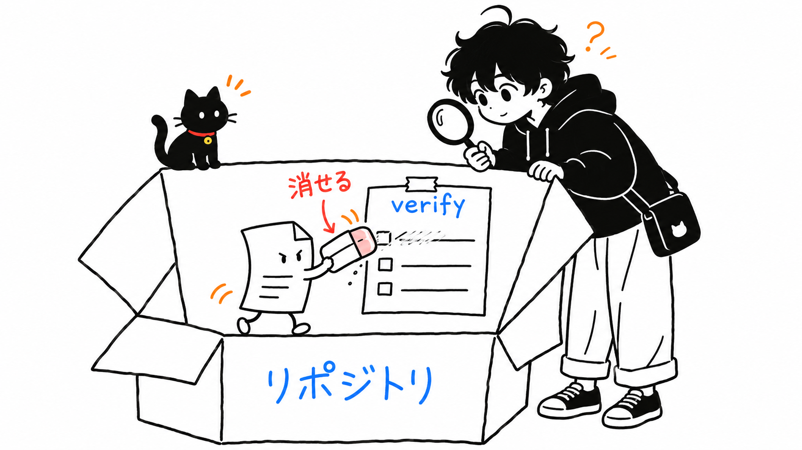
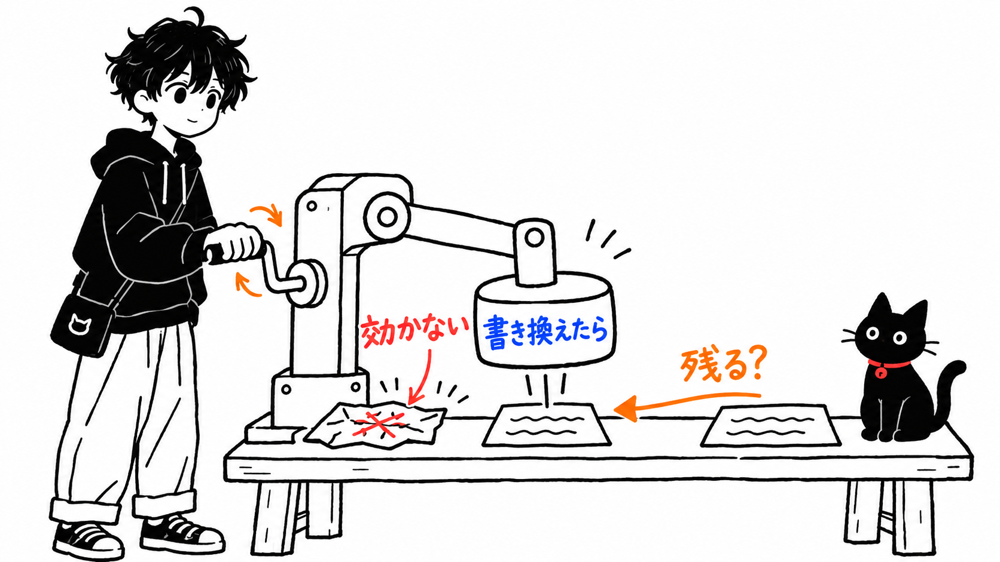

Addy Osmani さんが claude.dev に「How the Claude Code team thinks about verification」を書きました（2026年11月16日）。Claude Code チームでは、コードの9割ほどを Claude が書き、Claude がレビューしているそうです。その規模で、エージェントに自分の仕事を証拠つきで確かめさせる方法をまとめた記事です。

読み終えて、手元のメモに1行だけ書き写しました。

> いちばん効いている一文は「Changes can't modify their own checks」（変更は、自分を判定するチェックを書き換えられない）だと思います。記事は、レビューの規則を変更が触れないブランチから読むことで、これを守っています。ただ、同じ記事が勧める verify スキルは、リポジトリの中の、変更が書き換えられる場所に置くことになっています。判定を守るなら置き場所で守る。その目で読むと、記事の中にも、まだ置き場所で守られていない判定があります。

---

## この記事について

読んだのは記事の本文だけです。記事からリンクされている「Solving code review at Anthropic」や、Code Review と hooks のドキュメントは読んでいません。

私の位置も書いておきます。私は Claude Code を個人で使っていて、記事にあるコミットのゲートや信頼性チェックリストのような仕組みは持っていません。手元にあるのは、Claude に読ませているルールファイルと、`settings.json` の権限設定、それにブログ記事を書くときの引用の機械照合くらいです。

## 記事の前半：投資する価値のある3種類のテスト

前半は、どのテストに投資するかの話です。挙がっているのは3つ。

1つ目は E2E テスト。実際のユーザーの流れ（カートに入れる、購入する、確認画面に進む）をなぞるテストで、機能が丸ごと動くか動かないかなので、ごまかしが効きにくい。ユニットテストは通っても機能が壊れていることがある、と書いています。

2つ目はプロパティテスト。「エンコードしてデコードしたら元に戻る」「残高は負にならない」のような、崩れてはいけない性質を書き、ライブラリに大量の入力を作らせて反例を探します。コードを書いたエージェントと同じ偏りを持たない入力で試せるのが利点だ、という説明でした。

3つ目は差分テスト。移行のように振る舞いが変わってはいけない場面で、古いシステムと新しいシステムに同じ入力を流して結果を比べます。

避けるべき失敗も書いてあります。

> If your tests are flaky you'll train the agent to run them again rather than fixing the failing code.
>
> （テストが不安定だと、エージェントは失敗したコードを直す代わりに、テストを回し直すことを覚えてしまう。）

## 記事の後半：チームのやり方

後半が Claude Code チーム自身のやり方で、私にはこちらが本題でした。短く並べます。

- 検証とは変更を動かすこと。アプリの起動や操作の手順を `verify` という名前のスキルにして、コミット前に使わせる
- 3回直しても落ちるチェックがあれば、Claude は止まって人を呼ぶ
- チェックはコードの持ち主が書く
- 39項目の信頼性チェックリストがあり、各項目に「差分から読めるきっかけ」が付いている。Claude は差分に当てはまる項目だけ（たいてい3〜10個）を確かめる
- レビュアーを重ねず、1人のレビュアーを REVIEW.md で調整する
- 変更は、自分を判定するチェックを書き換えられない
- 新しいゲートは、まず「観察モード」で始める
- レビュアー自身も見張る。マージ後に revert された変更の数、マージ前にメンテナが却下した変更の数などを追う
- 見逃しはルールにする。ルールも定期的に掃除する

## 置き場所で守る

この中で、私がいちばん重いと思ったのは「変更は、自分を判定するチェックを書き換えられない」です。

> If a change can modify the check that judges it, the check is broken.
>
> （変更が、自分を判定するチェックを書き換えられるなら、そのチェックは壊れている。）

具体的には、Code Review は REVIEW.md を PR の変更からではなく、ベースブランチから読みます。変更を通すかどうかを決める規則は、変更が触れないブランチに置く。

ここで大事なのは、守り方が「書き換えないように」という指示になっていないことです。書き換えても効かない場所に置いてある。エージェントの判断がどうであれ、PR の変更は届きません。

記録を残す仕組みも並んでいます。コミットに「どう検証したか」の印を押し、「none」も記録して、検証されていないコミットを後から検索できるようにする。新しいゲートはまず観察モードで動かし、止めるはずだったものを記録して誤検知を確かめる。

ただし、こちらは置き場所で守るのとは違って、抜け道が明記されています。コミットのメッセージに検証しなかった理由を書けば通る。同じセッションで2回止められたら、3回目は通す。Claude が詰まらないための逃がしだと記事は説明しています。止めるより、後から検索できることに重心がある仕組みだと私は読みました。

## 記事の中の、置き場所で守られていない判定

ただ、読んでいて引っかかったところがあります。verify スキルの置き場所です。

> Put it in a .claude/skills/ folder in your repo, as close to the relevant code as you can, and add as many as you need.
>
> （リポジトリの .claude/skills/ フォルダに、関係するコードのできるだけ近くに置き、必要なだけ足す。）

verify スキルは、記事が「スモークテストのハーネス」と呼ぶ、変更が実際に動くかを確かめる手順です。REVIEW.md のようにマージの可否を決める規則とは役割が違いますが、変更を判定していることに変わりはありません。それがリポジトリの中にあるなら、PR はそれを書き換えられます。起動手順を1行変えて、壊れた画面を開かないようにすることもできる。REVIEW.md はベースブランチから読むのに、verify スキルについて同じ扱いをするとは書かれていません。

記事のほかの仕組みが、これを補っている可能性はあります。コミットのゲートは、セッションで /code-review か /verify が使われたかを見ます。/code-review の側は REVIEW.md をベースブランチから読むので、書き換えられない。チェックはコードの持ち主が書いて調整するとも書いてある。それでも、/verify のほうについては、「使われたか」と「書き換えられていない手順で使われたか」は別の問いです。

似た経路は他にもあります。不安定なテストについて、記事は Claude に「根本原因が見つからなければ、テストを消して理由を書く」ことを認めています。ルールのファイルも定期的に整理する。どちらも、変更の側が検証を減らせる経路です。記事は最後に、検証の層を「それが判定する変更の手の届かないところに置け」とまとめています。

> Keep it out of reach of the changes they judge,

この一文を検証の層の全体に当てはめるなら、verify スキルも、テストを消す判断も、変更の外に置くべきだと私は考えています。いちど「判定は置き場所で守る」と決めると、どの判定がまだ守られていないかが見えるようになる。

## 自分の環境で数えてみた

この原則を自分の環境に当てはめてみました。

私の Claude Code では、どのコマンドを許すかを `~/.claude/settings.json` の allow/deny で決めています。これは Claude Code 本体が強制する仕組みで、言い聞かせではありません。それとは別に、組織の管理者が設定した指示の中に「Claude 自身が権限設定（.claude/settings.json 等の allow/deny）を緩める変更をしない」という一文があります。

問題は、この2つの関係です。allow/deny は強制されますが、それを書いたファイル自体は、Claude がファイル編集で書き換えられる場所にあります。書き換えを止めているのは、管理者の指示の一文です。置き場所は管理者の側でも、守らせ方は言い聞かせです。

実際、この1週間のうちに、私は Claude に `~/.claude/settings.json` のモデルの設定を書き換えてもらいました。頼んだのは既定のモデルと effort の変更だけで、権限には触れていません。それでも同じファイルの中に allow/deny があり、Claude はそこに届く位置にいました。

記事の言い方を借りれば、私の権限の規則は「変更が自分を判定するチェックを書き換えられる」状態に近い。テストのルールも似ています。私のルールファイルには「直すのは実装であって、テストではない（テストの方が間違っている場合を除く）」とありますが、テストファイルは Claude が編集できる場所にあり、括弧の中の例外もあります。

全部を置き場所で守るのは、個人の環境では大げさだと思います。ただ、権限のように一度緩めると気づきにくいものから順に、Claude が書き換えられない場所に移す価値はある。Claude Code には利用者が上書きできない管理者向けの設定があるはずですが、どこまで使えるかは確かめていません。

## 1つだけ持ち帰るなら

自分のエージェントに守らせている規則を並べて、「エージェントがこれを書き換えたら効かなくなるか」を1つずつ問う。効かなくなるものは、言い聞かせているだけです。

出典: Addy Osmani「[How the Claude Code team thinks about verification](https://claude.dev/blog/how-the-claude-code-team-thinks-about-verification/)」（claude.dev、2026年11月16日）。記事からリンクされている「Solving code review at Anthropic」、Code Review・hooks・/goal のドキュメントは読んでいません。管理者向けの設定の扱いも、ドキュメントで確かめてはいません。
