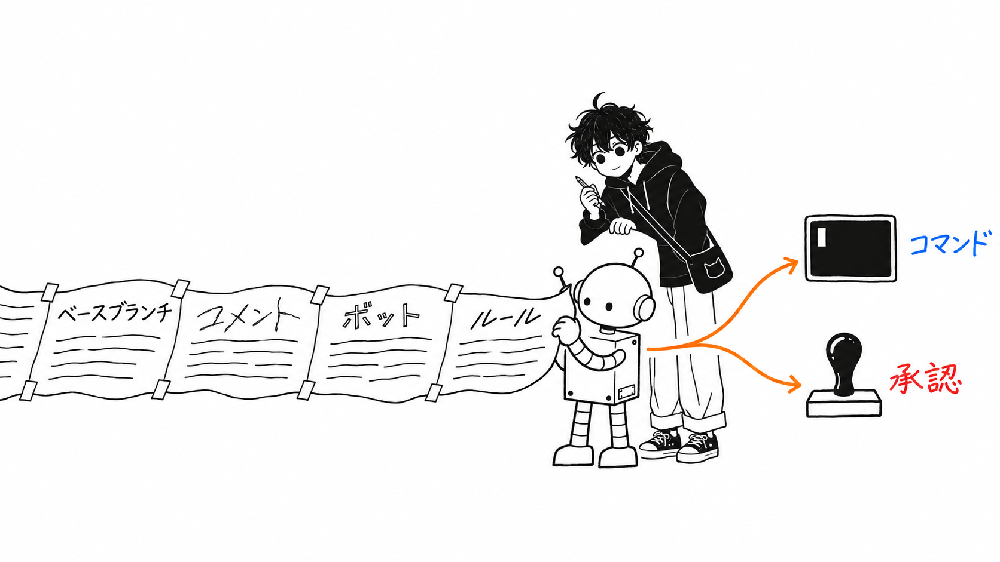
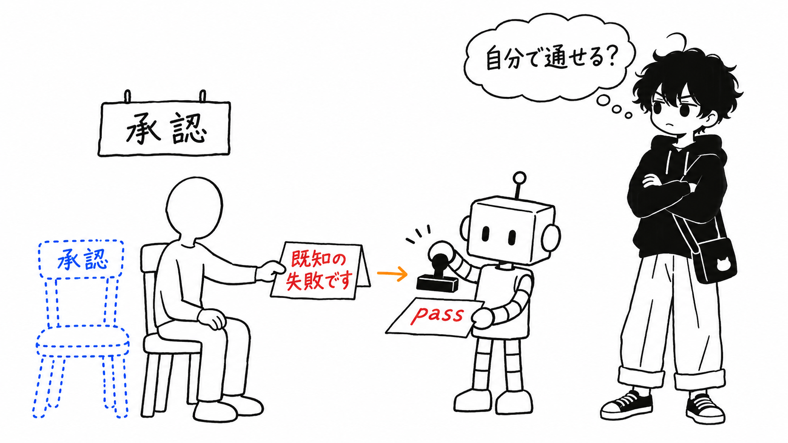
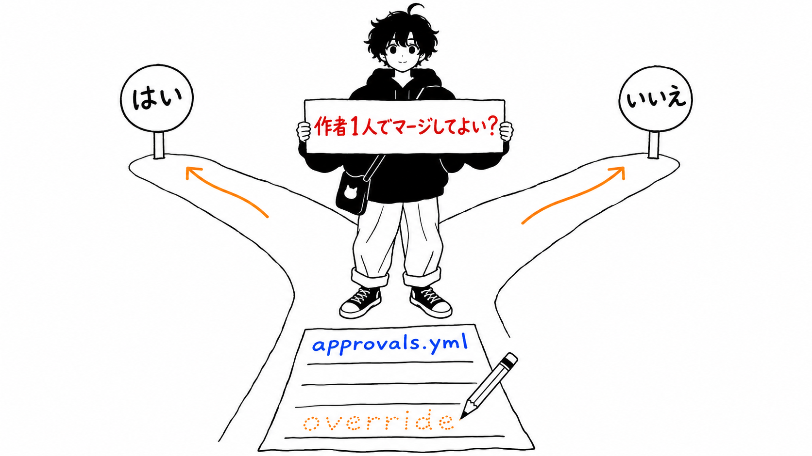

2026年11月25日（UTC）、Claude Code チームの Addy Osmani さんが、X に「A practical guide to shipping with Claude Code」という記事を出しました。リリースしたばかりの Claude Ship の使い方のガイドです。冒頭はこうです。

> We just launched Claude Ship which can review your pull requests, work on fixes and approve the ones your team's policy allows.
>
> （Claude Ship をリリースした。プルリクエストをレビューし、修正に取り組み、チームのポリシーが許すものを承認できる。）

Claude Ship は3つのエージェントでできています。プルリクエストをレビューする Code Review、CI の失敗や競合やレビューの指摘に対応して PR を通る状態に保つ PR Steward、リポジトリに置いたポリシーのファイルに従って承認する Claude Approvals です。一般提供は Code Review だけで、残りの2つはベータです。手元では `/code-review`、`/ship`、`/steward` のコマンドで試せます。

先に結論だけ書くと、こうです。

> ガイドの注意書きのうち、私が重いと思ったのは「エージェントが誰の書いた文字を読み、それで何が動くか」に関わるものです。中でも一番重いのは、Code Review が通れば承認の人数を減らす override の設定です。PR の中の文章でレビューが揺らぎうることをガイド自身が認めていて、しかも残る1席は作者が埋められる。PR の文章の多くは作者が書くので、私は override を「LLM が作者の文章を読んで通したら、作者が自分でマージできる」設定として扱い、作者の自己マージを許してよいパスにだけ置くべきだと考えます。

---

## ざっくり言うと

プログラムを変えるときは、「この変更を入れてよいですか」という申請（プルリクエスト、略して PR）を出し、ほかの人が中身を見て「よし」の承認をしてから本体に入れます。Claude Ship は、この申請を AI が点検し、直し、決めた条件を満たせば承認まで出す仕組みです。

ガイドの例では、承認には2人が要ります。ここに「上書き（override）」の1行を足すと、「AI の点検が通ったら、承認は1人でよい」にできます。ところが、その1人には申請を書いた本人もなれます。そして AI の点検は、申請の中の文章に影響されることがあると、ガイド自身が書いています。申請の文章の多くは本人が書くものです。

つまりこの設定を本番で使うと、本人の書いた申請を AI が読んで通し、本人が自分で承認すれば、ほかの誰も見ないまま入りうる（自動で取り込む設定なら、なおさら）。だから「上書き」の1行は、本人だけで入れてもよい場所にだけ置こう、という話です。

## この記事について

読んだのは X の記事の本文のテキストです。本文に埋め込まれた画像（表や図）は見ていません。表の中身に触れている箇所は、本文の地の文から分かる範囲で書いています。リンク先の Claude Ship の発表記事、各コマンドのドキュメント、Claude Code チームのレビューと検証のブログ記事は読んでいません。

私の位置も書いておきます。このブログは個人のリポジトリで、PR を作らずに main へ直接 push しています。このブログで `/ship` も `/steward` も使ったことはなく、Claude Approvals も試していません。

## 自分の PR、リポジトリ、チームの3段

ガイドの流れは、自分の PR から始めて、リポジトリのルールを書き、最後にチーム全体に広げる、の3段です。

最初の一歩は、push する前に `/code-review` で自分のブランチを見ることです。effort を low から max まで選べて、low は確信の高い指摘だけ、上げるほど広く拾う。`/ship` は、未コミットの変更を `git add -A` のようにコミットし、PR を作り、レビューして、そのあと最大7日間 PR を見張ります。失敗したチェック、競合、レビューのコメントに対応し、マージされるか閉じられたら終わる。同じ問題には最大3回まで push し、それでもだめなら試したことを作者に報告します。

次の段は、繰り返し出てくるものをファイルに書くことです。同じレビューの指摘は CLAUDE.md や REVIEW.md へ、毎回教えているアプリの起動手順は verify のスキルへ、PR の世話の決まりごとは steward のスキルへ。チームの原則として、ルールにするのは少なくとも2つの PR で繰り返したものだけで、ルールを足す PR は人が承認する、とあります。

最後の段が Claude Approvals です。`.claude/approvals.yml` にポリシーを書き、まず observe モードで「承認したならこう判断した」という記録だけを残し、1〜2週間、実際のレビュアーの判断と比べてから強制に移る。

## 重い注意書きは「誰の文字を読むか」の話

ガイドには注意書きがたくさんあります。費用（ultra のレビューは別料金になりうる、見張りは使用量を食う、observe モードでも課金されるレビューがある）や、環境（ノートPCを閉じると見張りが止まる、Windows では見張りが始まらない、worktree を分ける）の話も多い。その中で私が重いと思ったのは、エージェントが誰の書いた文字を読むかに関わるものです。たとえば見張り（watch）について。

> In other words, anyone who has the ability to land changes on the base branch has the ability to run commands on your machine during the watch.
>
> （言い換えると、ベースブランチに変更を入れられる人は誰でも、見張りの間にあなたのマシンでコマンドを実行できる。）

見張りは必要に応じてベースブランチをマージし、テストを走らせる。だから、ベースブランチに書ける人の書いたテストのコードが、自分の資格情報のもとで動く。ガイドは、Claude にはマージしないよう指示してあり、無人のターンでは gh と git のコマンドも制限されると書いたうえで、それでも防げないものを並べています。テストのスクリプトは自分の資格情報で動くこと。ターンの途中で自分がメッセージを打つと、そのターンだけ制限が外れること。auto-merge が有効なら、見張りの修正がマージの最後の一押しになりうること。見張りのコミットはリポジトリの git hooks を通らないこと。

コメントも同じです。`/ship` は既定で、自分、書き込み権限のある人、Claude の GitHub App のコメントを読み、`+name` で指定したボットのコメントも、コードと照らして確かめる主張として扱う。チーム向けの PR Steward についてはこうあります。

> Like any text-parsing agent, it can be fooled by what people say.
>
> （文章を読むエージェントの常として、人の言うことにだまされることがある。）

steward のスキルのファイルも、マージできる人なら誰でも書き換えられるので、CI の変更と同じくらい慎重にレビューせよ、と書いています。

これらを並べると、同じことを言っています。エージェントは、ベースブランチのコード、PR のコメント、ボットの出力、ルールのファイルと、いろいろな人が書いた文字を読む。そして読んだ文字によって、コマンドが走り、コミットが積まれ、承認が出る。

## 私の見解

ガイドの防御の筋は一貫しています。ルールを決めるファイル（.github/、CODEOWNERS、CLAUDE.md、.claude/ など）は、`/ship` も見張りもコミットしない。ルールを足す PR は人が承認する。サンプルのポリシーでも、ルールのファイルの変更には2人の承認を求めています。複数のルールが当たるときは厳しいほうが勝つので、この2人は後で緩めたルールに上書きされません。設定の読み込み元も閉じてあります。Code Review はレビュー対象の PR の中の REVIEW.md を読まず、approvals.yml も steward のスキルもデフォルトブランチから読む。ルールそのものは、エージェントの手から離してある。残る入口は、PR の説明文とコードです。

ただ、承認のところで、この筋が1か所ゆるみます。override です。ガイドのサンプルでは、通常は2人の承認が要るルールに、Code Review が通ったら「1人と Claude の承認」でよい、という override を足せます。ガイドはこの直後に、自分でこう書いています。

> But text in a pull request can sway Claude's review, and when it does, this override lowers what that pull request needs.
>
> （ただし、プルリクエストの中の文章が Claude のレビューを揺らすことがあり、そうなると、この override がその PR に必要なものを引き下げる。）

さらに、サンプルの規則では作者も1席を埋められます。つまり override を置いたパスでは、作者が書いた PR（説明文もコードも作者のものです）を Claude が読んで通せば、残る1席は作者自身で足りる。auto-merge を使っていれば、誰も何もしないまま PR がマージされうる、とガイドも別の箇所で書いています。Claude の承認は GitHub 上で本物の承認として数えられるので、実際にどこまで通るかはブランチ保護の設定しだいです。

ただし、ガイドがこの override を出すのは observe モードのポリシーの中で、目的は「レビューが通ったらどこで必要な承認を下げられるかを見る」ことです。observe のうちは結果を表示するだけで、承認は出ません。作者の自己マージが成り立つのは、observe を外して強制に移してからです。

ここで、レビューに影響する文字を書いているのは、承認されると得をする当人です。ベースブランチの書き込み権限や、コメントの書き込み権限の話とは、ここが違います。そこでは、信頼できる共同作業者に限れ、という対策が効きます。override では、信頼の対象である作者その人が、レビューの入力を書いている。悪意がなくても、「このテストの失敗は既知です」と PR の説明に書くだけで、レビューの判断は変わりうると私は思います。

だから私は、override を「レビュー付きの承認」ではなく、「LLM の読みを条件にした作者の自己マージ」として扱うべきだと考えます。置いてよいのは、もともと作者の自己マージを許してもいいパスだけです。ドキュメントの誤字や、生成ファイルのような場所。そうでないパスには、ガイドが強制の前に置けと言っている、if も override も無いルール（作者以外の人を1人必ず要求するもの）を置く。ガイドも強制に移す段で、auto-merge と作者だけが満たせるポリシーを組み合わせるなら、それでよいかをパスごとに決めて書き残せ、と言っています。私の違いは、それを「auto-merge を使うなら」の条件付きではなく、override を残したまま observe を外すすべてのパスで先に答える、という点だけです。

自分の環境についても1つ。ガイドは、リポジトリの `.claude/settings.json` に Bash の PreToolUse か PermissionRequest の hook があると見張りが始まらない、と書いています。私は Bash の出力を圧縮する PreToolUse の hook を、リポジトリではなくユーザー設定（`~/.claude/settings.json`）に置いています。ユーザー設定の hook でも見張りが止まるのかは、ガイドには書かれておらず、私も試していません。

## 1つだけ持ち帰るなら

override を残したまま observe を外す前に、そのパスについて「作者が1人でマージしてよいか」を答える。はいと言えないなら、そのパスの override は外し、作者以外の人を必ず要求するルールを置く。

出典: Addy Osmani「[A practical guide to shipping with Claude Code](https://x.com/i/article/2125456204969512961)」と紹介の[投稿](https://x.com/addyosmani/status/2125492213903978917)（X、2026年11月25日 UTC）。本文中の画像、リンク先の発表記事やドキュメントは読んでいません。`/ship` と Claude Approvals は試していません。
