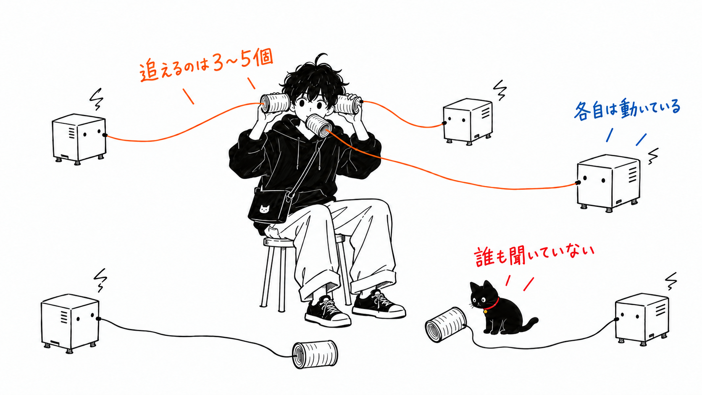
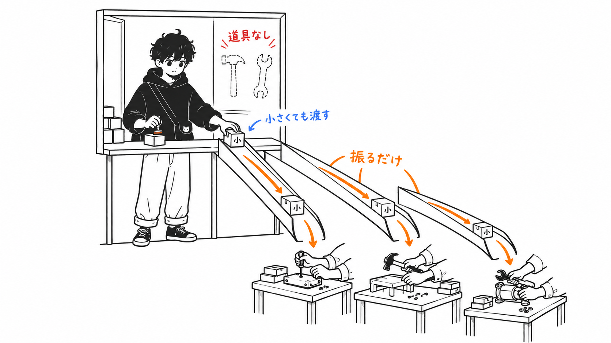
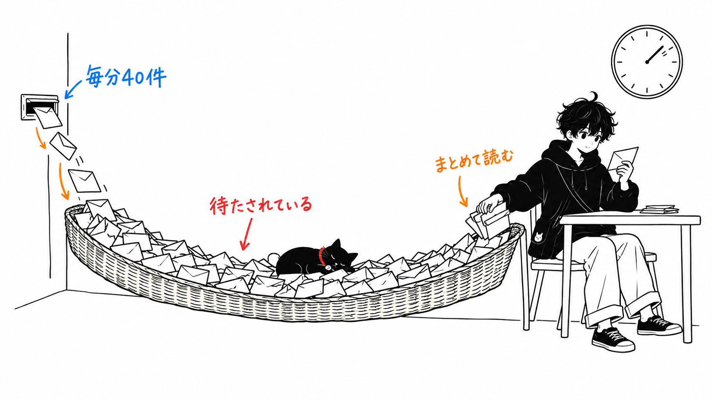
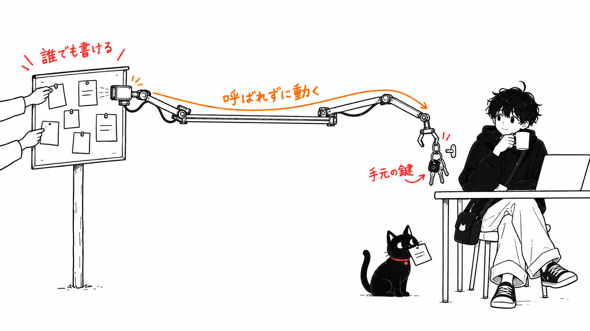

先に結論だけ書くと、こうです。

> DeepSeek Harness チームが X に出した Super-agent の設計メモは、「自分でやるか人に渡すかをモデルに判断させない」ための構成案として読むのがいちばん得るものが多い。単一セッションとの比較実験で差が出たのも、まさにその判断のところです。一方で、誰にも呼ばれていないのにグループチャットを読んで PR を出す、という一番目を引く機能は、本人たちが最後の節で「未解決」と書いたセキュリティ問題の上に立っている。**私はこの順番が逆だと思っています。**

元記事は 2026年11月1日に [@DeepSeekHarness](https://x.com/deepseekharness/status/2116857257245987236) が X の Article として出したものです。冒頭に「原文は中国語、これは機械翻訳」「既存機能の紹介ではなく設計の話」と断り書きがあります。著者は Yujia Qiao さんで、末尾には、一部を実装した `dsh-superagent-prototype` は「DeepSeek の公式プロダクトではない」とも書かれています。

開示しておきます。読んだのは英訳版の本文テキストだけです。図（アーキテクチャ図と実験のグラフ）は取得できず、見ていません。グラフにしか載っていない数字、たとえば単一セッション側のトークン量は、この記事では扱いません。プロトタイプも動かしていません。

---

## ボトルネックは人間の注意力

問題設定は1段落で足ります。

> In our experience, a person can usually follow only 3 to 5 active sessions at once. With these designs, a single task is limited by model capability, but multi-tasking is limited by human attention.
>
> （私たちの経験では、人が同時に追えるアクティブなセッションはふつう3〜5個まで。今の設計では、単一タスクはモデルの能力で頭打ちになるが、マルチタスクは人間の注意力で頭打ちになる。）

だからセッションをユーザーから隠し、「ずっと動いている1つのエージェント」に見せたい。そのための部品として5つ挙がっています。

- 2層構造：人と話して仕事を振るだけの Router と、1タスクずつ隔離された Worker
- イベント駆動：チャット・メール・CI・レビューコメントを Trigger として受ける
- 全二重：時間のかかるツールを `start()` / `stop()` の非同期呼び出しにする
- 計算・状態・実行環境の分離：ループはクラウド、状態は DB、実行は手元マシンの軽いデーモン
- Watchdog：本体の外で、Worker が空回りしていないかをモデルで見張る

どれも新発明ではない、と本人たちも書いています。Fast Path / Slow Path、キャッシュとしてのコンテキスト（Inline と Spill）、投機的実行、計算とストレージの分離。計算機システムの古い道具をエージェントに当てはめた、という整理です。私もその読み方でいいと思います。

## 委譲を構造で強制する

いちばん大事なのは 7.1 のアブレーションです。約300件のメッセージ（うち仕事の依頼は約20件）を流し、コーディング作業は「時間を食うだけのツール」で置き換えて、スケジューリングだけを比べています。各5回。

Super-agent は完了時間が p50 12.4分、p95 15.7分。比較相手の「単一セッション＋サブエージェントツール」は、プロンプト次第で振る舞いが割れました。

> With the neutral prompt, the model did not call a subagent in any of the 5 runs.
>
> （中立的なプロンプトでは、5回の実行のどれでもモデルはサブエージェントを呼ばなかった。）

中立プロンプトでは全部を親が自分でやり、新しいメッセージに割り込まれ続けて p95 は 29.5分。委譲優先のプロンプトはこうです。

> Prefer handing each piece of work to a subagent of its own, and do only small things yourself...

こちらでは5回中4回は委譲しました。残る1回は、モデルが仕事を "small" と判断して自分でやり、そこが長い裾になった。プロンプトが「小さいことは自分でやれ」と許しているので、モデルは指示に背いたわけではありません。何が小さいかの判断を、モデルに任せていただけです。

> A single session has to rely on prompt engineering and the model's on-the-spot judgment to decide whether to delegate. The two-level architecture mitigates this problem at the system level instead: the Router does not execute work itself, and each Worker receives only messages from the Threads it subscribes to.

Router は自分でタスクを実行しない設計で、2.1 節には「Bash ツールなしでも動かせる」とあります。仕事を振るツールや文脈を呼び戻すツールは持つけれど、実行手段は持たなくていい。持っていなければ、「これは小さいから自分で」という判断がそもそも起きません。ただ、7.1 の Router が実際にツールを外されていたのか、プロンプトで止められていたのかは本文からは分かりませんでした。

ここが一番うなずいたところです。私は自分の設定に、アプリを設計するときの原則として「ルーティング・リトライ・ステータス判定のように switch で書けるものに LLM の判断を使わない」と書いています。この実験はそれに近い話の実測になっている。プロンプトに「委譲を優先しろ、小さいことは自分で」と書くのは判断をお願いしているだけで、実行手段を渡さないのは判断の余地を消している。5回中1回の外れ値は、お願いの限界がそのまま出たものだと思います。

とはいえ、7.1 はアーキテクチャ全体（Router と Worker の分離、購読とパススルー、Worker の隔離）の比較で、「実行手段を持たせない」だけを切り出した実験ではありません。寄与の大きさの順位は、このデータからはつけられない。

測っていないものもはっきりしています。コーディングは sleep 相当のツールなので、Worker が分かれることで成果物の質がどうなるかは見ていない。コストについても、本文で数字が出ているのはパススルーの有無の比較だけです（パススルーを外すと Router の判断が約30%増え、キャッシュ読み込みが 23.2M から 31.8M トークンへ約37%増える）。単一セッションと比べて何倍使っているかは本文に無く、私はグラフを見られていません。「トークンで速さと安定を買った」という言い方は、値段が書かれていない買い物です。

## Router のバッチ処理は余裕の証拠ではない

7.2 は Router を単体で負荷試験しています。判断が要る Trigger を毎分約1件から約40件まで上げると、平均バッチサイズは 1.0 → 2.8、1リクエストの時間は 2.5秒 → 3.9秒、1判断あたりの償却推論時間は 6.4秒 → 1.6秒。結論は「まだ Router を分割しなくていい」です。

ここは少し引き算をしてみます。以下は私の試算で、元記事にはありません。

毎分40件の判断を、1件あたり1.6秒で処理すると、1分あたり 64秒分の推論が要る。1分は60秒なので、そのまま読むと稼働率は100%を超えます。別の道筋でも数えてみます。40件をバッチ 2.8 件ずつ処理すると毎分約14回のリクエストで、1回 3.9秒なら約56秒。こちらでも9割を超える。

元記事は、このときでも Router は "did not reach its throughput limit" だったと書いています。私の試算とは合いません。「償却推論時間」の定義（1判断が複数リクエストにまたがる分をどう数えたか）や、「約40件」の丸めで説明がつくのかもしれませんが、本文からは判断できませんでした。少なくとも、余裕があると読める数字ではない。

そもそもバッチが大きくなるのは、前の推論中にイベントが溜まったからです。バッチサイズ 2.8 は、イベントが待たされている、という意味でもある。償却時間が下がるのは事実ですが、それは待ち行列ができた結果の効率で、個々のイベントの待ち時間は伸びていると考えられます（元記事は待ち時間を測っていません）。元記事も上限は「コンテキスト長と、1ターンで正確に扱える Trigger 数」で決まると書いているので、矛盾はしていません。ただ「今のチームの規模なら十分」の「今の規模」が毎分40件の手前だ、というのは数字から読み取っておいたほうがいい。

## 自発性を上げるほど攻撃面が広がる

元記事の一番の見せ場は、社内の Super-agent が、公開のグループチャット（public group chats）で誰にも @ されていないのに不具合を見つけ、原因を突き止めて PR を出す、という例です。3.4 節の「黙って再現して直す」ポリシーも同じ方向です。

最後の 8.4 節で、本人たちはこう書いています。

> If a server-side intrusion or a prompt injection compromises the Agent Loop, every endpoint device connected to it could be taken over.
>
> （サーバー側への侵入かプロンプトインジェクションでエージェントループが乗っ取られれば、それにつながったすべての端末が乗っ取られうる。）

> As long as credentials on an endpoint can enter the model's context, normal execution can expose them.

この2つを、さっきの見せ場と並べてみます。

- 入力は、グループチャットの誰かの発言・メール・GitHub のコメント。つまり外の人が書けるもの。
- 呼ばれなくても動く。むしろ呼ばれずに動くのが売り。
- 手元のマシンにはデーモンがいて、コミットしていない変更とローカルの認証情報がある。

自発性を上げるほど、攻撃者が書いた文章で動く機会も増える。3.1 節のイベントフィルタは「送り主・グループ・許可リスト」で絞る Fast Path を持っているので、ここを狭くすれば守れます。でもそれは、さっきの「誰にも呼ばれていないのに拾う」を狭めることとほぼ同じ操作です。

だから私は、8.4 は「今後の課題」の4番目ではなく、BYOM（手元マシンをつなぐ構成）と自発的な Trigger を本番で組み合わせる前提条件だと思っています。元記事の書き方は「この問題を解かないと、ごく小さく信頼できる範囲でしか使えない」で、言っていることは同じです。違うのは置き場所で、私なら2節の前に置く。しかも見せ場の例は公開のグループチャットと利用者グループで、「誰かが不具合を報告したら」動く設定です。小さく信頼できる範囲の外側から入力を受けている例を、一番目立つ場所に置いていることになる。

11月1日に、Cursor のマーケットプレイスに改ざん版の Claude Code 拡張が並んだ件を[書きました](/articles/cursor-tampered-claude-code-extension)。あれは配布経路の話で、こちらは入力経路の話ですが、どちらも「手元のマシンにいるエージェントの権限」に行き着きます。

## 持ち帰るなら1つ

Router に実行手段を渡さない、です。

イベント駆動や計算と状態の分離は、クラウドの常駐環境やデーモンを用意しないと試せません。「司令塔に実行手段を持たせない」は、部品が少なくて済む。親セッションに全部のツールを持たせたまま、プロンプトで委譲を促しているなら、この実験の単一セッション側と同じ形です。中立プロンプトでは5回とも親が自分でやり、委譲を優先させても5回に1回は親が「小さい」と判断して抱え込んだ。私が自分の構成で確かめたわけではありませんが、親のツールを削る方向は試す価値があると思っています。

試していないことも書いておきます。プロトタイプは動かしていないし、Watchdog が「ゴールからの逸脱」をどの程度の精度で見分けるのかは元記事にも数字がありません。
