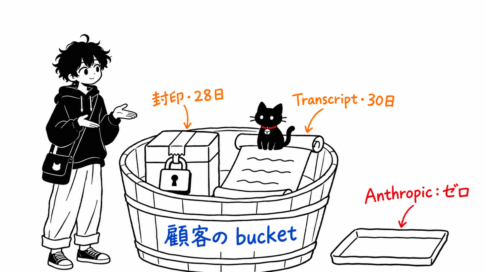
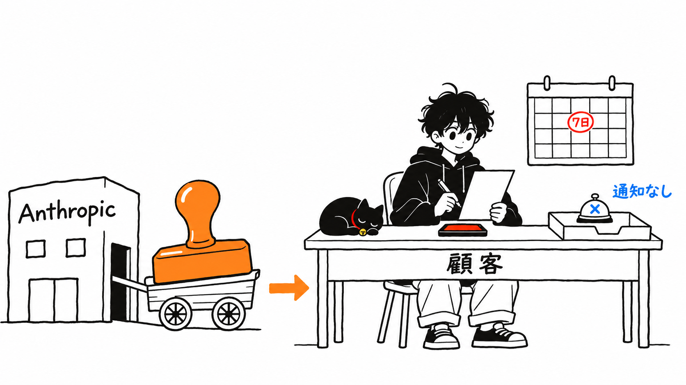
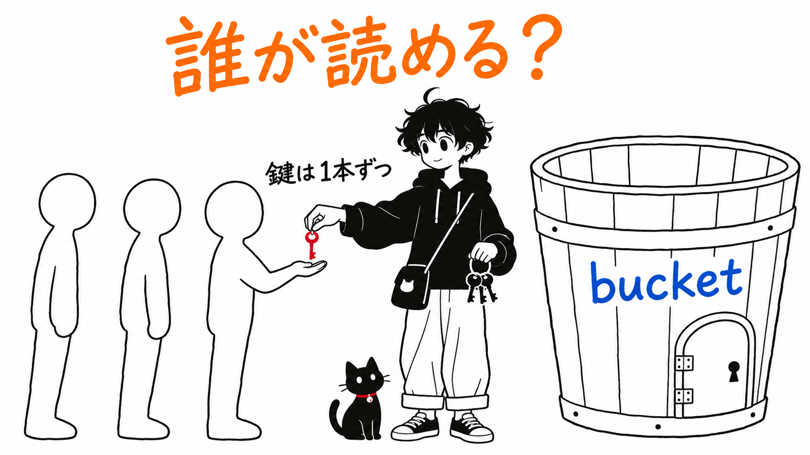

Anthropic が2026年11月23日、Enterprise Frontier Safeguards（EFS）の公開ベータを発表しました。発表記事の見出しは「Zero data retention with Enterprise Frontier Safeguards is now in beta」。冒頭の説明はこうです。

> EFS provides state-of-the-art detection of sophisticated misuse, while remaining compatible with zero data retention (ZDR): neither Anthropic nor any cloud providers retain enterprises' data.
>
> （EFS は、高度な悪用を最先端の精度で検出しながら、データをゼロ保持（ZDR）のまま保てる。Anthropic もクラウド事業者も、企業のデータを保持しない。）

発表記事には、自動監視は顧客が管理するインフラ上のデータを分析する、とあります。ただ、そこに何が残り、誰が読めるのかまでは書いていなかったので、リンク先の開発者ドキュメントまで読みました。

先に結論だけ書くと、こうです。

> EFS の「ゼロ」は、Messages API のプロンプトと応答が Anthropic とクラウド事業者の手元に残らないという意味です。データは顧客の bucket に残ります。顧客が読めない封印された形（最長28日）は必ず、顧客のチームが読める Transcript（最長30日）は設定しだいで。人によるレビューも、Anthropic の担当者から顧客自身のチームに移ります。最上位のモデルを ZDR のまま使う代わりに、読める写しの管理とレビューの責任を顧客が引き受ける仕組みだと読みました。

---

## この記事について

読んだのは発表記事（英語版。日本語版の URL も本文は英語でした）と、開発者ドキュメントの EFS の概要、顧客所有ストレージ、Safety Case のレビュー、Safety Case のファイル形式、FAQ、それにデータ保持のページです。セキュリティのホワイトペーパー、9月の脅威インテリジェンスレポート、Safety Cases API のページは読んでいません。

EFS は試していません。以下はドキュメントを読んだ範囲の話です。

## なぜ EFS が要るのか

発表記事は、既存の ZDR の顧客は分類器（1件ずつのリクエストを即時に審査する仕組み）で守られている、と書きます。ただ、高度な攻撃は多くのリクエストにまたがり、1件ずつ見ると無害に見える。例として、9月の脅威インテリジェンスレポートにある、約50の組織を狙った作戦が挙がっています。AI エージェントが攻撃の作業を並列の多数のエージェントに分け、集めた認証情報をセッションの間に保存していた。1件ずつ見れば、別々の、もっと無害な作業に見えたはずだ、と。

これを捕まえるのが、多くのリクエストにまたがるパターンを見る「自動安全監視」です。見るには、リクエストをどこかに残しておく必要がある。ここが ZDR とぶつかります。

データ保持のページには、もっと直接的な理由が書いてありました。

> These models require 30-day data retention and are not available under ZDR unless expressly authorized by Anthropic.
>
> （これらのモデルは30日間のデータ保持を必要とし、Anthropic が明示的に認めない限り ZDR では使えない。）

「これらのモデル」は Claude Fable と Mythos の 5、5.1、5.2 の6つです。ZDR の契約の企業は、Anthropic の個別の許可がなければ、そのままでは最上位のモデルを使えない。これまでの道は、特定の workspace だけ30日保持にするか、Anthropic 管理のストレージで使うかでした。EFS は、データを顧客の側に置いたまま使う3つ目の道です。

## データは顧客の bucket に残る

EFS では、顧客が自分のクラウドに bucket を用意し、Anthropic にそこへのアクセス権（ロール）を渡します。ドキュメントの「What's stored, and where」の表によると、そこに書かれうるものは3種類あります。封印されたデータ、Transcript、そして Safety Case などのやり取りです。前の2つを見ます。

1つ目は Sealed Safety Data。プロンプト、応答、モデルの推論を、Anthropic の形式で暗号化したものです。

> Your team can't read it, even in storage you own.
>
> （あなたのチームは、自分が所有するストレージの中にあっても、これを読めない。）

自動安全監視のためのデータで、保持期間は最長28日。Claude Platform の S3 では Anthropic が消し、Google Cloud Storage では bucket のライフサイクルのルールで消えます。

2つ目は Transcript。プロンプトと応答の、読める形の写しです。Safety Case を調べるために、顧客のチームが読みます。こちらの保存先の設定は、Claude Platform では任意です。「Not copied to your storage」を選べば、顧客の bucket には写されません（Claude Platform on AWS と、Google Cloud の Anthropic 管理版では必須）。保存先を設定した場合について、ドキュメントは注意書きを付けています。

> The Transcripts might include requests that never lead to a Safety Case, so plan who can read your bucket.
>
> （Transcript には、Safety Case にまったくつながらないリクエストも含まれうる。だから、誰が bucket を読めるかを計画しておくこと。）

Transcript は最長30日で消えます。期限は顧客が延ばせず、bucket のライフサイクルのルールを直接いじるとセットアップの検査に落ちる。長く残したいものは、別のストレージに自分で写せ、とファイル形式のページに書いてあります。

発表記事の「Neither Anthropic nor your cloud provider retains your data」は、この構成の上で正しい言い方です。Anthropic もクラウド事業者も、自分用の写しは持たない。ただし bucket 自体は顧客のクラウドの上にあります。その中身を読むのは、Anthropic の自動監視（封印された側）と、Transcript を保存する設定にした場合の、顧客自身のチームです。

範囲にも注意が要ります。EFS が覆うのは Messages API のリクエストで、code execution のコンテナ、Files API、Batch API の結果、Managed Agents のセッションは対象外です。また Anthropic は、プロンプトと応答を含まない Safety Case のやり取りの記録を持ちます。

## レビューの担当が顧客に移る

既存の仕組みでは、自動監視が引っかけたものを Anthropic の少人数の専門チームが見ることがあります。EFS ではこの Anthropic Human Review が常にオフで、代わりに顧客のチームが Safety Case をレビューします。

Safety Case にはプロンプトも応答も入っていません。入っているのは、状態、時刻、ポリシーの分類、関係する Transcript の識別子などです。顧客のチームは、bucket の Transcript か Safety Cases API で中身を読み、自分たちのログと突き合わせて原因を調べ、`violation` か `no_violation` かを返します。期限は7暦日で、有効な応答がないまま過ぎると Safety Case は閉じられ、応答のない状態が続けばアクセスを止められることもある、とドキュメントは書いています。しかも、Anthropic は新しい Safety Case ができても自動では知らせないので、bucket を見張るか、API をポーリングする必要があります。

負担を大げさに書くのは公平ではないので、ドキュメントの但し書きも並べておきます。Safety Case はほとんどの組織でまれだと見込まれていて、24時間体制は求められていない。応答は「時間単位ではなく日単位」でよく、毎営業日だれかが確認するキューに通知を流せばいい、とあります。自動監視が明白で意図的な害を見つけたときの停止も、範囲は1人のユーザーまで絞れる、と書かれています。

## 私の見解

発表記事の3つの保証のうち、2つ目はこうでした。

> No operator human review. Neither Anthropic nor your cloud provider personnel access your inputs and outputs. Only automated safety monitoring can access this data.
>
> （運用者による人のレビューなし。Anthropic の担当者もクラウド事業者の担当者も、あなたの入力と出力にアクセスしない。このデータにアクセスできるのは自動安全監視だけだ。）

この保証が言っているのは Anthropic とクラウド事業者の人のことで、顧客の社内は含みません。だから抜け穴ではありません。ただ、人のレビューは無くなったのではなく、Anthropic の担当者から、顧客の社内の担当者に移りました。

私はこの移動自体は筋が通っていると思います。医療や金融や法律の会社にとって、外部の会社の人が自社のデータを読むことと、自社のセキュリティチームが読むことは、まったく違う。発表記事の Wells Fargo の CISO の言葉（ログは Wells の管理する環境に、Wells の管理する鍵で置かれる）が求めているのは、まさにこれです。

ただ、社内の担当者が読めるということは、社員が Claude に送ったプロンプトを、社内の誰かが読めるということでもあります。bucket に Transcript を保存するなら、Safety Case にならなかった普通のリクエストも含めて、最長30日。Transcript の保存は Claude Platform では任意ですが、私は多くの会社がオンにすると見ています。Safety Case には中身が入っておらず、bucket に写しがなければ、7日以内の調査は API で読む前提になるからです（ここは私の推測で、ドキュメントにそう書いてあるわけではありません）。

比べる相手も確かめておきます。最上位のモデルを使う他の道は、Anthropic に30日分の写しを持たせることでした。EFS はそれを、顧客の bucket の中の写しに置き換える。写しが無くなるわけではなく、持ち主が変わるだけです。持ち主が変わると、Anthropic のレビュアーの代わりに、自社の誰が読めるかを決める仕事が生まれる。ドキュメントが「誰が bucket を読めるかを計画しておけ」とわざわざ書いているのは、ここが導入のときの新しい論点になるからだと思います。

もう1つは運用です。通知は来ないので自分で見張り、まれとはいえ来たら7日以内に原因を調べて返す。毎営業日確認する担当は、誰かが持たなければならない。

導入を決める人が読むべきなのは、発表記事より、ドキュメントの「What's stored, and where」の表のほうだと思います。

## 1つだけ持ち帰るなら

EFS を入れる前に決めることは2つです。Transcript を bucket に保存するか、するなら自社の誰がその prefix を読めるか。そして Safety Case を毎営業日、誰が見るか。

出典: Anthropic「[Zero data retention with Enterprise Frontier Safeguards is now in beta](https://claude.com/resources/articles/zero-data-retention-with-enterprise-frontier-safeguards)」（claude.com、2026年11月23日）。Claude Platform Docs の「[Enterprise Frontier Safeguards](https://platform.claude.com/docs/en/manage-claude/enterprise-frontier-safeguards/overview)」「[Customer-owned storage](https://platform.claude.com/docs/en/manage-claude/enterprise-frontier-safeguards/customer-owned-storage)」「[Review Safety Cases](https://platform.claude.com/docs/en/manage-claude/enterprise-frontier-safeguards/flagged-cases)」「[Safety Case files](https://platform.claude.com/docs/en/manage-claude/enterprise-frontier-safeguards/safety-case-files)」「[FAQ](https://platform.claude.com/docs/en/manage-claude/enterprise-frontier-safeguards/faq)」「[API and data retention](https://platform.claude.com/docs/en/manage-claude/api-and-data-retention)」。
