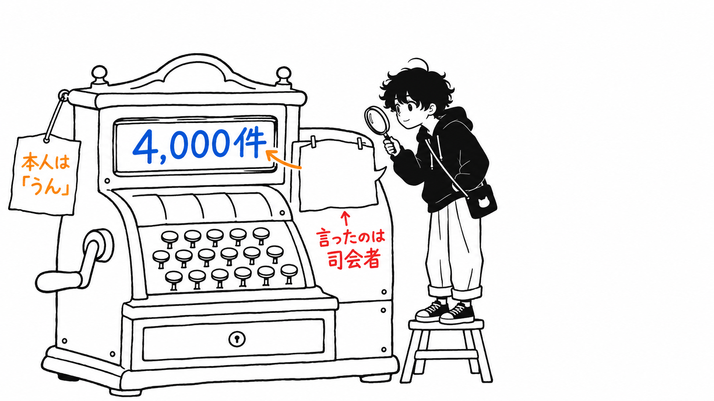
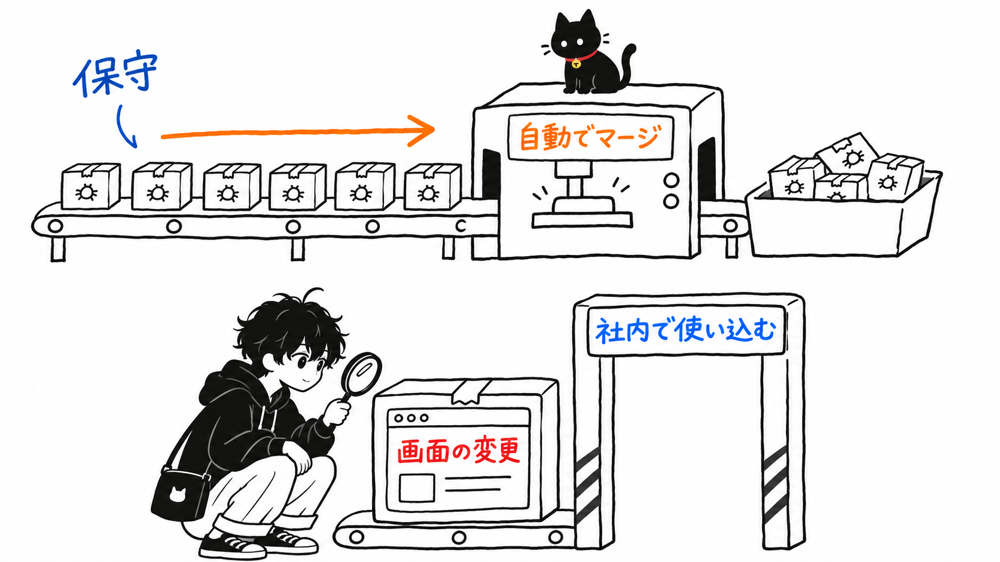
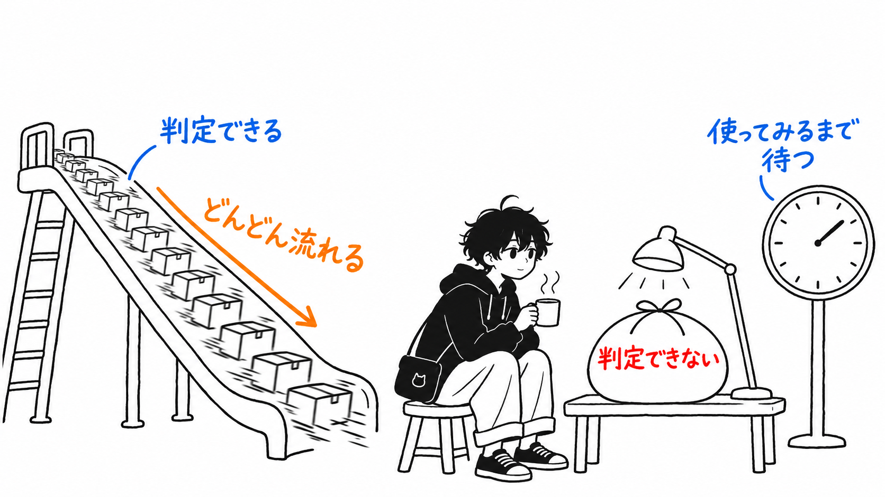

「Grok Bot のローレン・タン氏、月間4000件のプルリクエストを処理——ボトルネックは『何を作るか』の決定に移行」という見出しを見かけました。英語の元記事は BigGo Finance の「Grok Bot's Lauren Tan Runs 4,000 Pull Requests a Month — and Says the Bottleneck Is Now Deciding What to Build」で、そのさらに元は Y Combinator のポッドキャスト Lightcone の回「[The Rise Of AI Coworkers](https://www.youtube.com/watch?v=y1-9yeYLJUo)」（2026年11月14日、約60分）です。動画の英語字幕を取って、見出しの2つの主張を元の発言と照らしました。

先に結論だけ書くと、こうです。

> 「月4,000件」は、司会者が「今は4,000件を超えている」と言い、Lauren Tan さんが「Yeah」と答えた数字です。「ボトルネックは何を作るかの決定」と言ったのは、同席した Roman Ugarte さんでした。そして番組で語られていたのは、仕事を2種類に分ける話です。Lauren Tan さんのエージェントはバグ修正や性能改善のような保守に向けられ、自動でマージされる。ユーザーが毎日触る画面の変更は、社内で使い込んで支持されたものしか出さない。「何を作るか」が詰まっているのは後者の側で、見出しはこの2つを1つにまとめています。

---

## この記事について

照らしたのは、YouTube の自動生成の英語字幕です。字幕に話者の表示は無いので、誰の発言かは前後の文脈（「Lauren and I」と言っている、など）で判断しました。以下の引用は字幕からで、自動字幕の聞き取り違い（製品名の綴りなど）は直してあります。音声は全部は聞いていません。

私の位置も書いておきます。この記事のために Grok Bot や、Lauren Tan さんが公開しているスキル集 pstack は動かしていません。字幕と記事を読んだだけです。PR の件数は本人たちの申告で、私には確かめようがありません。

## 「4,000件」は司会者の言葉

番組の22分ごろ、司会者が Lauren Tan さんにこう聞きます。

> I think when you did that presentation that had over four million views on your dev process, you were pushing about 2,000 plus PRs per month and now you're like over 4,000.
>
> （400万回以上再生された開発プロセスの発表のときは、月に2,000件以上の PR を出していたと思う。今は4,000件を超えているくらい？）

返事は「Yeah」だけで、すぐに自分のワークフローの実演に移ります。後半で Roman Ugarte さんも「Lauren is putting up 4,000 PRs a month」と言っています。本人が否定していないので申告として扱ってよいと思いますが、本人が数えて示した数字ではありません。

件数は以前にも語られています。2026年9月1日の中国語メディア（新智元）の記事では「先月1,000件以上、8月は倍が目標」。400万回再生の発表の時期は、字幕からは分かりません。どの数字にも、PR の大きさや差し戻しの率は付いていません。

## 「何を作るかがボトルネック」は Ugarte さんの言葉

見出しの後半の発言は、52分ごろの Roman Ugarte さんのものです。

> And I think what we've started to see be the bottleneck is less the time or engineering resourcing going into developing these ideas and features. And actually it's more alignment among us as a team of like what do we want the product roadmap to be?
>
> （ボトルネックになり始めているのは、アイデアや機能を作る時間や人手ではない。むしろ、製品のロードマップをどうしたいかについて、チームの中で考えをそろえることだ。）

続けて、議論の最中に誰かが「それなら週末に作った PR があるよ」と言い出すことが、しょっちゅうあると話しています。

> So, the stuff is built, but we don't want to merge all of that because it's going to lead to a bit of a Frankensteiny product with like random side projects.
>
> （だから物はできている。でも全部はマージしたくない。思いつきの寄せ集めで、ちょっとフランケンシュタインみたいな製品になるからだ。）

BigGo の記事は、見出しとリードではこの主張を Lauren Tan さんに帰しています（リードは「according to Lauren Tan」）。本文の別の段落では、この話を Ugarte さんの議論として書いていて、チームが製品のまとまりを守るために出すものを絞っている、とも書いています。ずれているのは、見出しとリードです。

Lauren Tan さん本人も、近い趣旨のことは言っています。55分ごろ、速く作れても、思いつく機能を全部出すべきではない、そこで人間の判断とセンスが要る、と。ただ、「ボトルネック」という言い方はしていません。

## 2種類の仕事

見出しから抜け落ちたのは、その間で語られていた具体例です。

司会者に「何を出して何を出さないか、どう決めているのか」と聞かれて、Ugarte さんはまず Lauren Tan さんが作った仕組みを挙げます。製品の中、サポート窓口、X から、毎日数千件の利用者の声を取り込む。多くは小さなバグで、彼女のエージェントの仕組みが再現して、直して、マージする。

> And so in a lot of cases, Lauren's factory just fixes it like repros, fixes, merges. No one thinks about it.
>
> （だから多くの場合、Lauren のファクトリーがただ直す。再現して、直して、マージする。誰も気にしない。）

そのうえで、そう扱ってはいけない変更もあると続けます。利用者が毎日見る画面を変えるときです。起きるたびにボタンの位置が変わっていたら、使う側は嫌になる。だから社内で長めに使い込み、社内で支持されないものは出さない。支持が割れても出さない。

Lauren Tan さんも、自分のエージェントの仕組みは新機能の開発には向けず、性能やバグ、利用者の小さな不満を直す保守の側に向けていると話しています。

つまり、自動で回してマージまでさせているのは、直すべきことがはっきりしている保守の仕事です。「何を作るか」がボトルネックになっているのは、新しい機能や画面の変更のほうです。見出しは、この2つを「4,000件処理している人が、何を作るかで詰まっている」という1つの話にしています。

## Lauren Tan さんが時間を使って話していたこと

番組で Lauren Tan さんがいちばん時間を使っていたのは、エージェントに PR を自分でマージさせるまでの準備の話でした。

> I've gotten to a point where I essentially have my agents merge their own pull requests
>
> （エージェントに自分の PR をマージさせるところまで来た。）

その直前に、そこに一晩でたどり着くのはかなり難しく、適切なスキルを用意し、コードベースに良いガードレールと制約を入れて、人間のコードレビューに使うはずだった時間をコードベースと静的解析とツールに埋め込む必要がある、と言っています。

画面に出していたのは逆三角形の図でした。いちばん多く投資するのはコードベースと静的解析で、その上にルールやスキル、最後に少しだけ人のレビューが乗る。例は Grok Bot のデスクトップアプリ（Electron）です。描画スレッドで重い処理をすると画面がカクつくので、それをレビューで見つけるのをやめ、メインスレッドと描画スレッドの間の import を禁じる lint ルールにした。

> We don't want to have to catch it in code review. We'll actually build it as like a lint rule.
>
> （それをコードレビューで捕まえなくて済むようにしたい。lint ルールとして作ってしまう。）

別のモデルにレビューさせ合う手法からは少し距離を置いた、とも話していました。レビューするエージェントは製品の目標や今後の方針を知らず、良い指摘とそうでない指摘を見分けきれないので、過剰に合わせ込む危険がある、という理由です。

## 私の見解

1つ目は、件数は分母と一緒でないと読めないということです。4,000件のうち、何件がマージされ、何件が差し戻されたのか。番組の中にこの数字はありません。同じ週に Anthropic の Claude Code チームが出した検証の記事では、マージ後に revert された変更の数と、マージ前にメンテナが却下した変更の数を追っていると書いていました。生産量を語るなら、少なくともこの2つが要ると私は考えています。

2つ目は、自動化の線をどこに引いたかです。このチームの線は、作業の種類で引かれていました。バグ修正や性能のように「直った」と判定できるものは、再現と修正とマージまで任せる。画面の変更のように、良し悪しを社内で使ってみるまで判定できないものは、人が時間をかける。Lauren Tan さんの lint ルールの話も同じ線の上にあると思います。判定できる形に書けたものから、人の手を離していく。

この線で見ると、「何を作るか」がボトルネックになったのは自然な結果です。判定できる仕事はどんどん流れるようになり、判定できない仕事だけが人の前に残る。チームには「社内で支持されないものは出さない」という基準がありますが、支持されるかどうかは使ってみないと分からない。その分の時間は、件数をいくら増やしても縮みません。

## 1つだけ持ち帰るなら

「月○件の PR」という数字を見たら、それがどの種類の仕事の件数かを探す。このチームの場合、件数を稼いでいるのは判定できる保守の仕事で、詰まっているのは判定できない新機能の側でした。

出典: Y Combinator「[The Rise Of AI Coworkers](https://www.youtube.com/watch?v=y1-9yeYLJUo)」（Lightcone、2026年11月14日、YouTube の自動生成英語字幕で確認）。BigGo Finance「[Grok Bot's Lauren Tan Runs 4,000 Pull Requests a Month — and Says the Bottleneck Is Now Deciding What to Build](https://finance.biggo.com/news/e075716ae1e521f9)」。件数の推移は新智元の記事（[智源社区の転載](https://hub.baai.ac.cn/view/57615)、2026年9月1日）から。Claude Code チームの記事は Addy Osmani「[How the Claude Code team thinks about verification](https://claude.dev/blog/how-the-claude-code-team-thinks-about-verification/)」（claude.dev、2026年11月16日）。冒頭の日本語の見出しは、どの媒体のものかを確かめていません。番組の音声は全部は聞いておらず、Lauren Tan さんの以前の発表動画も見ていません。
