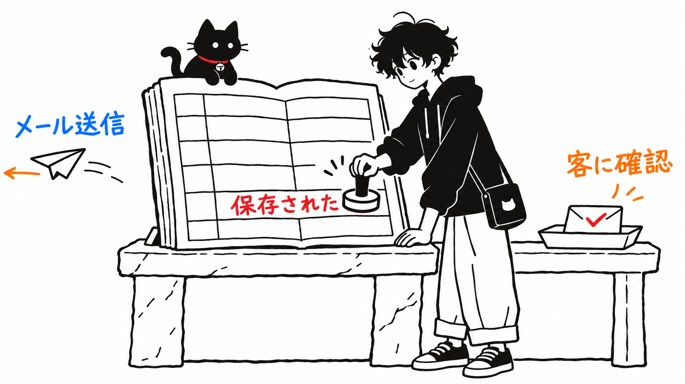
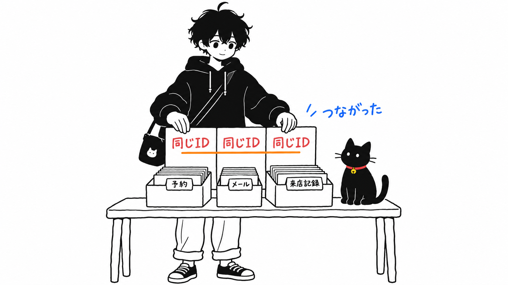
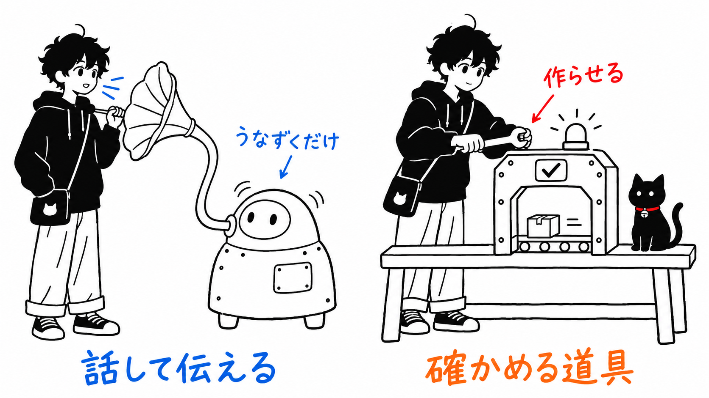

先に結論だけ書くと、こうです。

> 記事の骨組みは「目標と手順を分けて、手順をボットに話し、確かめ方と情報の出どころも教え、決まったきっかけで動かす」です。私がいちばん効いていると思ったのは、目立たない2か所でした。「メールを送っただけでは予約は終わっていない」という完了の定義と、アプリをまたいで同じ ID があると助かるという段落です。どちらも、仕事が終わったかを外から判定できる形に近づける話で、Lauren Tan さんが自分の開発で lint ルールに投資していたのと同じ方向を向いています。一方で、確かめ方の項目は「話して伝える」形で示されていて、完了を判定する仕組みを作る話は出てきません。私が足すならそこです。

---

## この記事について

読んだのは、Grok Bot を作っている Lauren Tan さん（@poteto）が2026年11月18日（UTC）に出した X の記事「Automate Anything with Grok Bot」と、その紹介の投稿です。

> I think a lot of people aren't using Grok Bot to its full potential, because knowing how to automate things is actually quite a difficult skill to learn.
>
> （多くの人が Grok Bot の力を出し切れていないと思う。物事を自動化するやり方を知ること自体が、身につけるのがかなり難しい技術だからだ。）

宛先は、コードを書かない人です。少し前に、同じ Lauren Tan さんがポッドキャストで話した自分の開発のやり方について記事を書いたところだったので、2つを並べて読みました。

私の位置も書いておきます。私は Grok Bot を使ったことがありません。記事の最後で勧められている Dr Eggbot（ボットを設計するボット）も入れていません。私の自動化の相手は Claude Code で、使っているのはルールファイルと hook です。Lauren Tan さんは Grok Bot の中の人なので、記事は製品の使い方の手引きでもあります。

## 記事の流れ

順に並べると、こうなります。

1. 自動化は考え方で、目標と手順の2つでできている（アップルパイを焼く、パンクしたタイヤを替える）
2. まず目標から。手順を目標と取り違えない。フォームを埋めることやメールを送ることは目標ではなく、手順の1段にすぎない
3. 手順は、音声入力で思いつくまま話して渡す。いつもの手順、気をつけていること、使うアプリ、確かめ方、情報の出どころ、反応をもらう場所
4. 自分が考えずにやっている判断も教える
5. ボットが自分で反応を集めて、改善できるようにする
6. きっかけ（メール、メッセージ、定期実行）を決めて、自動で動かす。Grok Bot ではこれを routine と呼ぶ

目標・手順・判断を教える段には、ボットにそのまま言えばよい文例が付いています。たとえば手順を渡したあとは、すぐに実行させず、まず言い直させる。

> I want you to think about how you can take this over completely from me. Before you begin, restate what you think my goal and process is in simple English so I can give you feedback and confirm it.
>
> （これを私から完全に引き継ぐにはどうすればいいか考えてほしい。始める前に、私の目標と手順をあなたがどう理解したか、平易な言葉で言い直して。こちらで確認して直すから。）

前半は、人に仕事を引き継ぐときの手順とほぼ同じです。違うのは、手順にこだわりすぎるな、ボットはもっと効率のよいやり方を見つけるかもしれない、と書いているところで、手順そのものの見直しまでボットに任せる前提になっています。

## 「メールを送っただけでは終わっていない」

私が読んでいて手が止まったのは、「考え方を教える」の節にある予約の例です。

> A booking also isn't finished just because an email was sent. The appointment needs to be saved correctly and the customer needs a confirmation.
>
> （予約は、メールを送ったから終わり、ではない。予約がきちんと保存され、客への確認も必要だ。）

続けて、メールと予約システムで時刻が食い違ったらどちらを信じるか、詳細を待っている間はそれを記録しておき、あとで再開したときに予約を二重に作らないように、と書いています。

ここには、完了の定義と、どちらを正とするかと、同じ処理を2回走らせても壊れないことが、短く入っています。記事はこれを1段落で済ませていますが、私はこの段落が記事の中でいちばん重いと思いました。「メールを送った」はボットが自分で言えることで、「予約が保存され、客に確認が行った」は外の記録で確かめられることだからです。記事自身は「外の記録で確かめよ」とまでは書いていません。そう読むのは私です。

## ID の段落

もう1つは、ボットに自分で改善させる節の、最後の段落です。

> If you use multiple apps and services, having unique and consistent IDs across all these tools will help you bring that data together so bot can fully understand what's going on.
>
> （複数のアプリやサービスを使っているなら、どのツールでも一意で一貫した ID があると、データをつなげられて、ボットが何が起きているかを十分に把握できる。）

その手前の段落では、データがあるほどボットは助けになる、と書いています。例は車の修理店です。客が来た時刻、受付と話せた時刻、鍵を預かった時刻、作業の開始と終了を記録しておけば、待ち時間を計算して原因を探れる。Yelp に「長く待たされた」と書かれたとき、その日の記録と突き合わせられる。

記事の言い方は「データとつながりがあるほど助かる」ですが、私はもう一歩先が大事だと考えています。同じ ID でつながったデータがあると、さっきの「予約が保存され、客に確認が行った」を、ボット自身の報告ではなく、予約システムとメールの記録を突き合わせて判定できるようになります。完了を外から確かめるための土台が、ID です。

## 私の見解

前に書いた記事では、Lauren Tan さんがポッドキャストで話していた自分の開発のやり方を取り上げました。エージェントに自分の PR をマージさせるために、人のレビューで捕まえていた問題を lint ルールや静的解析に移していく、という話です。

> We don't want to have to catch it in code review. We'll actually build it as like a lint rule.
>
> （それをコードレビューで捕まえなくて済むようにしたい。lint ルールとして作ってしまう。）

今回の記事も、同じ人が同じことを、コードを書かない人に向けて言っているように読めます。違うのは道具です。開発では、確かめ方を lint ルールという機械が判定できる形に書いていた。この記事では、確かめ方は手順の6項目の1つ（How you check that the work was done right）で、音声で話して伝えることになっています。

話して伝えた確かめ方は、ボットが覚えて守るものです。記事は、メールや SNS、Yelp のレビュー、その日の記録をボットに見させて改善につなげる道も示していますが、それは起きたあとに気づく手段です。予約の例と ID の段落は、確かめ方を外から判定できる形にする手がかりなのに、記事はそこまでは言っていません。

もう1つ気になったのは、ボットに自分を改善させる節です。見出しは「Let your bots improve themselves」で、ボット自身が改善すると読めます。一方で本文の具体例では、ボットは反応を集めて「改善を提案する」となっていて、手順を自分で書き換えるとまでは書いていません。どちらの線なのかは、記事からは決められません。私は提案までにとどめるべきだと考えています。手順と、その確かめ方を同じボットが書き換えられると、確かめ方が手順に合わせて緩むことがあり得るからです。採るかどうかは人が決める。

コードを書かない人に「確かめ方は機械が判定できる形に」と言っても届かない、という反論はあると思います。ただ、記事にはすでに手がかりがあります。Grok Bot はデータを集めるための道具やアプリを作れる、と記事自身が書いている。来店時刻を記録するアプリを作らせられるなら、「予約が保存されたか」を確かめる小さな仕組みも作らせられるはずです。確かめ方を話すだけでなく、確かめる道具を作らせる。私が足すならそこです。

## 1つだけ持ち帰るなら

ボットに仕事を任せるときは、手順より先に「終わった」の定義を書く。それも、ボットの報告ではなく、外の記録で確かめられる形で。記事の予約の例は、その定義の書き方として使えます。

出典: Lauren Tan（@poteto）「[Automate Anything with Grok Bot](https://x.com/i/article/2122921713864171520)」と紹介の[投稿](https://x.com/poteto/status/2123159537016533493)（X、2026年11月18日 UTC）。lint ルールの発言は Y Combinator「[The Rise Of AI Coworkers](https://www.youtube.com/watch?v=y1-9yeYLJUo)」（Lightcone、2026年11月14日、YouTube の自動生成英語字幕で確認）から。Grok Bot と Dr Eggbot は使っていません。
