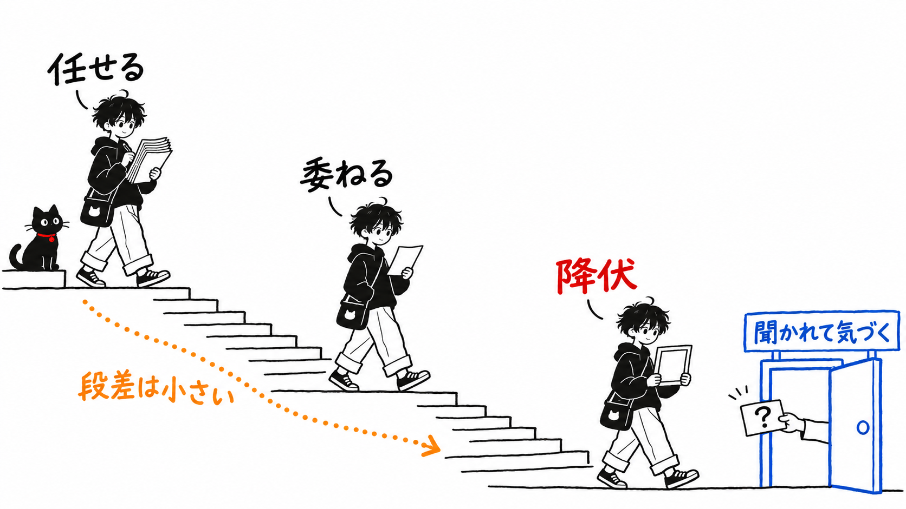
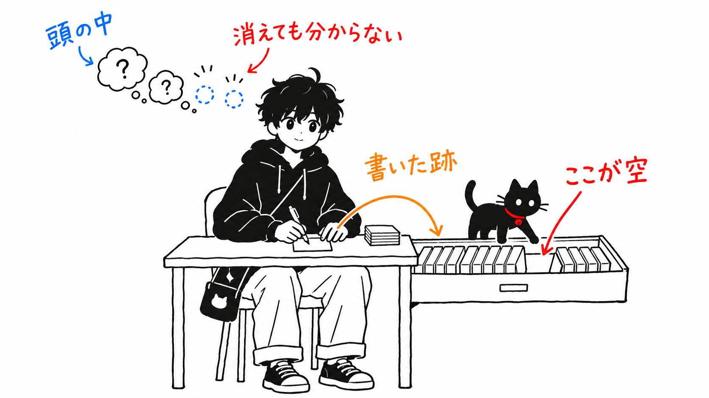
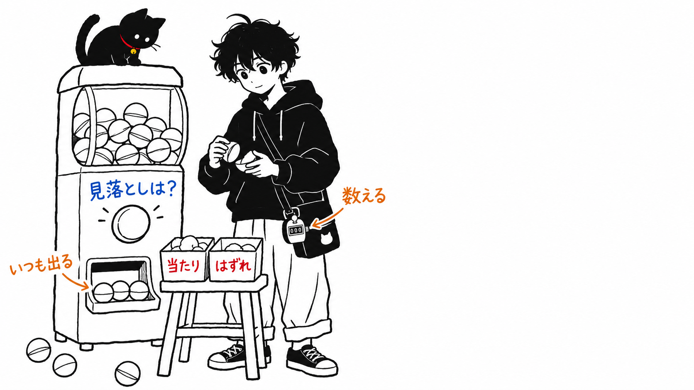

Addy Osmani さんの新しい記事に、こういう一文があります。

> Before I run an agent on any non-trivial task, I write down, even just in my head, what I think the answer might be.
>
> （自明でないタスクをエージェントに渡す前に、答えはこうだろうと思うものを書き留める。頭の中でだけでもいい。）

私が引っかかったのは「頭の中でだけでもいい」の部分です。先に結論を書きます。

> この記事が描く「降伏」は、本人が気づかないうちに少しずつ進む。そうであれば、処方箋のうち頭の中だけで済むもの（自分への問い）も、降伏と一緒に、飛ばしたことに気づかれないまま抜け落ちていくはずです。効くのは、ファイルやログやテストのように**後から誰かが見られる跡を残す習慣**のほうで、「頭の中でだけでもいい」は削ったほうがいい、と私は考えています。

元記事は Addy Osmani さんが2026年11月3日に [X の Article](https://x.com/addyosmani/status/2117512471930167377) として出した「Critical thinking when agents do the work」です。

開示しておきます。本文は fxtwitter の API 経由でテキストとして読みました。本文末尾に埋め込まれた画像が1つあり、それは見ていません。本文からリンクされている論文やブログ（「認知的降伏」の論文、Margaret-Anne Storey さんの記事など）も開いていません。記事の中の手法を自分で試して効果を測ったわけでもありません。

---

## 3段階の坂道

記事の骨組みは、エージェントへの任せ方を3段に分けたところです。

> At the top: cognitive offloading, the act of delegating tasks to the AI, but maintaining ownership of the result. I do this all day. You should, too. In the middle: deferral, where the output of the tool becomes your new input; the result has ceased to be a hypothesis. At the bottom: cognitive surrender - the AI's output quietly becomes your own, you feel no need to check it.
>
> （一番上は認知的オフロード。作業は AI に任せるが、結果の持ち主は自分のまま。私は一日中これをやっているし、あなたもやるべきだ。真ん中は委ね（deferral）。ツールの出力がそのまま次の自分の入力になり、結果はもう仮説ではなくなっている。一番下は認知的降伏。AI の出力が静かに自分のものになり、確かめる必要すら感じない。）

「認知的降伏（cognitive surrender）」は Wharton の Steven Shaw さんと Gideon Nave さんの言葉だそうです。

この3段に私は異論がありません。大事なのは、人がこの坂をどう下りるかの説明です。

> The transition is rarely observed, because the steps are each gradual and seem reasonable. You read the last answer well, so you skim the next one. You just scan the skeleton of the one after that. Then you get asked about a line and can't explain it, even with your agent's help.
>
> （この移行はめったに観察されない。一歩一歩が緩やかで、どれももっともらしいからだ。前の答えをちゃんと読んだから、次は流し読みする。その次は骨組みだけ眺める。そしてある行について聞かれ、エージェントの助けを借りても説明できない。）

降伏がどこで見つかるかについては、もう1つ書いてあります。

> It's usually discovered when you try to apply a mental model of the system and it doesn't exist.
>
> （たいていは、システムのメンタルモデルを当てはめようとして、それが存在しないと分かったときに発覚する。）

つまり本人の内側からは見えない。見つかるのは、誰かに聞かれたときか、変更しようとして手が止まったときで、どちらも外から突かれて初めて分かります。この2つの引用が、後の私の読み方の前提になります。

## 処方箋を「跡が残るか」で分ける

記事の後半は処方箋です。自分への問いが6つ、検証の習慣、レビューの仕方、プロンプトの書き方、週や月ごとの練習と続きます。量が多いので、私なりに1本の軸で並べ直しました。**実行したかどうかが、後から本人以外にも確かめられるか**です。

| 処方箋 | 跡 |
| --- | --- |
| 依頼する前に答えの予想を立てる（「頭の中でだけでもいい」） | 残らない |
| 「考える手伝いか、考えるのを肩代わりさせているか」を自問する | 残らない |
| 「これが間違いだとしたら何が真であるはずか」を考えて確かめに行く | 確かめた結果は残る |
| 複数のモデルに反対側を論じさせる | 出力は残る |
| 「保守する人の前で賭けられるか」を自問する | 残らない |
| 「もう練習していないことは何か」を自問する | 残らない（月1回書き出す習慣のほうは残る） |
| 「検証済み」の定義を先に決める | 書けば残る |
| 完了の条件をテスト・スクリーンショット・ログにする | 残る |
| 新しいコンテキストのサブエージェントに自己批評させ、ループに組み込む | 残る |
| 下した判断と置いた前提をエージェントに列挙させる | 残る |
| 変更の報告書の最後にクイズを付け、満点でなければマージしない | 出題は残る。合否は自己申告 |
| 基準に満たなかった理由を設定・フック・テストに書く | 残る |

6つの問いのうち4つは、頭の中で完結します。そして、ここが私の主張の中心です。

前の節で引いたとおり、降伏は「一歩一歩がもっともらしい」まま進み、本人には観察されない。だとすると、頭の中の問いは、降伏が進んだ人ほど飛ばすし、飛ばしたことを本人が覚えていない。前回ちゃんと問うたから今回は軽く、次は省略。記事が流し読みについて書いたのと同じ坂を、問いのほうも下りるはずです。

逆に、表で「残る」としたものは、飛ばせば跡が欠けます。予想を書いたメモが無い、決定の一覧が無い、クイズの記録が無い。欠けていることは、本人がぼんやりしていても、ファイルを見れば分かる。ただしこれは、そこにあるはずだと決めてある跡に限った話です。反対側の議論を読んだかどうかのように、無くても誰も困らない跡は、欠けても気づかれません。

先回りして断っておくと、この軸が測るのは「やったか」で、「ちゃんと考えたか」ではありません。形だけの予想メモでも跡は跡です。元記事自身が "You can also surrender verification." と書いているとおり、跡を残す作業も降伏しえます。それでも、空のメモは後から読めば空だと分かる。頭の中で省いた問いは、それすら分かりません。

Osmani さん自身も、この区別に半分気づいていると思います。サブエージェントによる自己批評については、こう書いています。

> it's worth baking that into the loop so it runs every time, not just when you remember.
>
> （ループに組み込んでおく価値がある。思い出したときだけでなく、毎回走るように。）

「思い出したときだけでなく」。この理屈は、6つの問いにもそのまま当てはまるはずです。それなのに問いのほうは「自分に問う」のまま置かれていて、最初の問いには「頭の中でだけでもいい」と添えてある。

面白いのは記事の締めです。

> Before you ask, write down what you think will happen, and after the agent is done, write down one thing it didn't check.
>
> （依頼する前に、何が起きると思うかを書き出す。エージェントが終わったら、それが確かめなかったことを1つ書き出す。）

最後の提案では「頭の中でだけでもいい」が付いていません。Osmani さんが冒頭の一文を撤回したわけではなく、この "write down" も頭の中を含む意味かもしれません。それでも私は、ここは文字どおり紙かファイルに書く、と読むほうが正しいと思います。冒頭の一文を書き直すなら「頭の中でだけでもいい」を削る。それだけで、問いが表の「残る」側に移ります。

## 「Did I miss anything?」の当たりの数は書かれていない

もう1つ、記事の中で私が一番疑っている箇所があります。

> I still ask at the end "Did I miss anything?" That sounds silly, but so often, when I finish some complex feature work using a frontier model, look at it, review it, and then ask, "Did I miss anything?" It will then come back with two or three more things. That's why I always ask.
>
> （最後に「何か見落としはある？」と聞く。ばかげて聞こえるが、フロンティアモデルで複雑な機能を作り終えて、眺めて、レビューしたあとにそう聞くと、たいてい2〜3個の項目が返ってくる。だから私はいつも聞く。）

たいてい2〜3個返ってくる。でも、その2〜3個のうち本当に見落としだったものが何個あったかは、書かれていません。

ここからは推測です。「見落としは？」と聞かれたモデルが「ありません」と返すことは少ないと思います。何かを挙げるのが、聞かれたことへの素直な応え方だからです。そうだとすると、2〜3個返ってくることは、見落としがあったことの証拠になりません。見落としがゼロの日にも、同じように2〜3個返ってくるかもしれない。

記事は同じ文章の中で、テストについてこう書いています。

> When a check goes green, ask what it proved. Then ask what it didn't.
>
> （チェックが緑になったら、それが何を証明したかを問え。次に、何を証明しなかったかを問え。）

同じことを「Did I miss anything?」にも向けるべきだと思います。この質問はどんな日でも何かを返すので、返ってきた事実そのものは何も証明しない。確かめるなら、返ってきた項目を1つずつ「本当に直す必要があったか」で仕分けて、何割が当たりだったかを数えることになります。私はまだ数えていませんが、数えないまま「いつも聞く」を続けると、それ自体が記事の言う降伏の入り口になると思います。

## 持ち帰るなら1つ

自分への問いは、紙かファイルに書く。

降伏は本人に見えないまま進む、と記事は書いています。見えないものを、本人の記憶と自制で止めるのは筋が悪い。Osmani さんが締めに置いた「依頼の前に予想を書き、終わったら確かめなかったことを1つ書く」は、2行のテキストで済みますし、書いたかどうかを後から自分でも他人でも確かめられる。6つの問いをすべて覚えておくより、この2行をファイルに残すほうが、私は続くと思います。

全部の依頼でやる必要はありません。元記事も "Where the stakes are low, feel free to delegate entirely." と書いていて、外れても安く済む依頼まで書けとは言っていません。冒頭の一文がそもそも "any non-trivial task" に限っているので、その範囲で、頭の中ではなくファイルに書く。私が変えたいのはそこだけです。

## 出典

- Addy Osmani「Critical thinking when agents do the work」X Article、2026年11月3日 https://x.com/addyosmani/status/2117512471930167377
