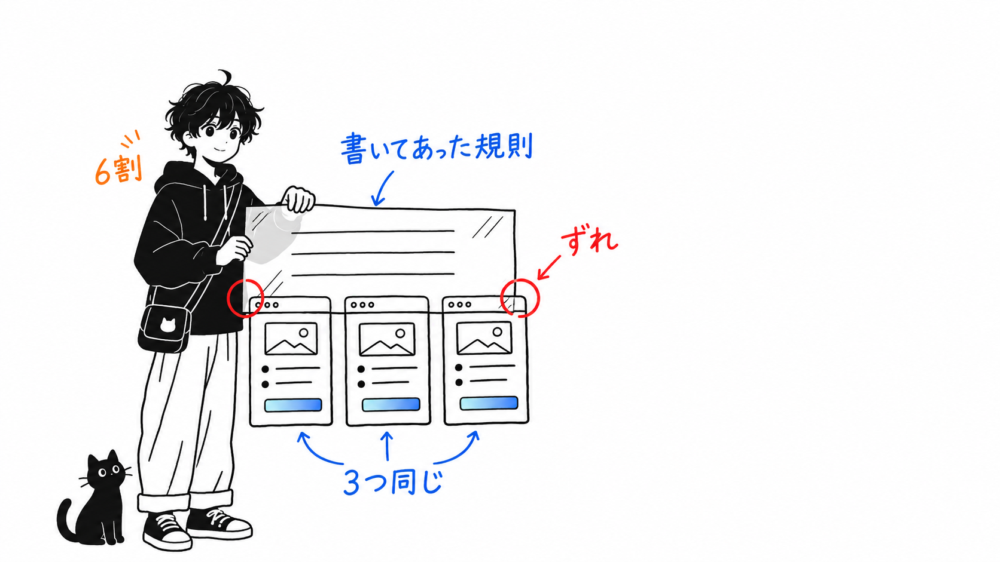
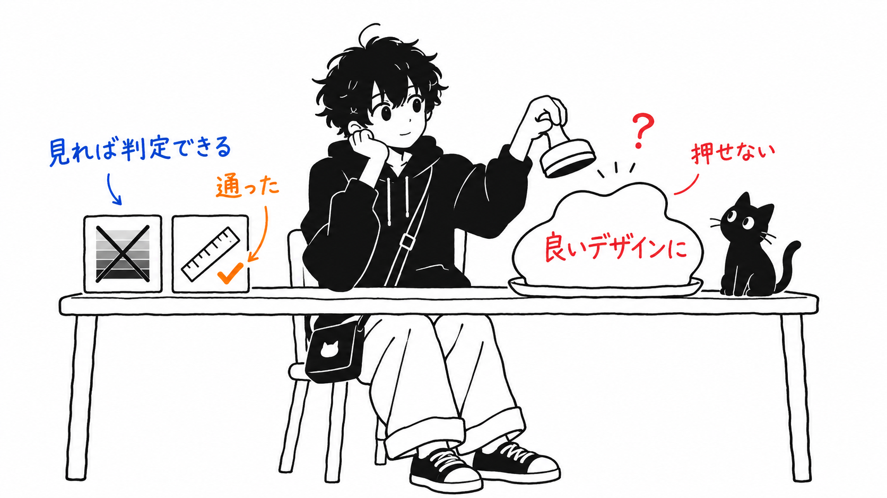
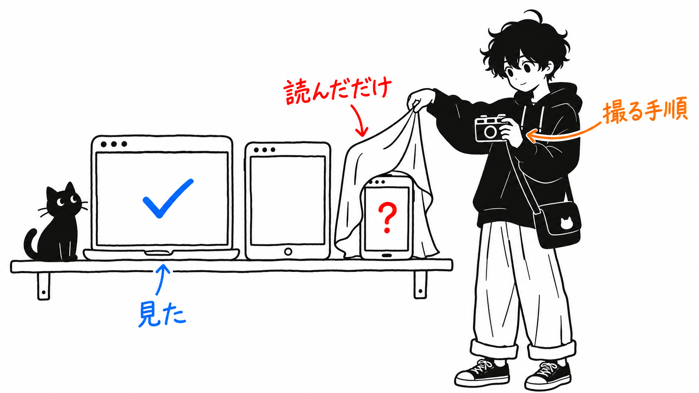

「Claude Fable 5.2 はプロダクトデザイナーを置き換えられるか」という UX Planet の記事（Nick Babich、2026年11月10日）を読もうとして、メンバー限定で冒頭しか読めませんでした。代わりに、近い問いに自分のサイトで答えた記事を見つけました。paddo さんの「[One-Shot Taste: Redesigning This Blog with Claude Fable 5](https://paddo.dev/blog/one-shot-taste/)」（2026年7月4日）です。モデルは以前の Fable 5 で、問いも「一発のデモは、既存サイトの実作業でも通用するか」と少し違います。

先に結論だけ書くと、こうです。

> paddo さんの見積もりでは、Fable 5 のリデザインの6割は、すでに書いてあった設計書をサイトに守らせる作業でした。サイトは人間の手では設計書を守れていなかった。私はここから、「デザイナーを置き換えられるか」は「判定できる形で書かれた設計書があるか」で大きく変わると読みました。残った人間の仕事として挙がっているスマホ幅の確認も、モデルに確認の手順を渡せば一部は任せられる見込みがあると考えています。

---

## この記事について

読んだのは paddo さんの記事だけです。記事が引いている Claire Vo さんの検証、Michal Malewicz さんの実案件での検証、Hacker News のスレッドは、paddo さんの引用で読んだだけで元を見ていません。UX Planet の記事は冒頭の3文しか読めていないので、その結論には触れません。

私の位置も書いておきます。この記事のために Fable にデザインをさせて試してはいません。このブログのリポジトリには、デザインの設計書に当たるファイルもありません。後半で比べるのは、このブログの「文章」の規則のほうです。

## バズったデモと、その外側

記事の前半は、6月9日からの1週間の X の様子です。1文からランディングページを一発で作る、macOS 風の Web OS を1つの HTML に収める、といったデモが並びました。デザイナーに10年教えてきた Meng To さんの投稿が引かれています。

> Claude Fable 5 is a monster for creating landing pages.
>
> （Claude Fable 5 はランディングページを作るのにとんでもなく強い。）

paddo さんの見立ては、デモは本物だが餌だ、というものです。一発のデモには制約が無い。既存のブランドも、古い CSS も、自分のサイトに意見を持つ人もいない。白紙から始めれば、強い「いつもの作風」は天才に見える。

反対側の声も引かれています。Claire Vo さんはプロダクトデザインを一発で作らせて、「AI のやっつけ仕事ですらない、根本的にひどいデザイン」と書いた。そして paddo さんが「自分の1週間をそのまま言い当てていた」と書くのが、HN のコメントです。一発の UI はまだいまひとつだが、モデルは

> can keep a design system together much better without veering off into random tailwind classes.
>
> （でたらめな Tailwind のクラスに逸れずに、デザインシステムをずっとうまくまとめておける。）

## 最初に出てきたのは「起訴状」だった

paddo さんのブログには、書かれた設計書があります。ダーク専用、アクセントはシアン、ピクセルアート風の装飾、光る効果は「勝ち取ったときだけで、ばらまかない」、表示用のピクセルフォントは小さなラベル専用。

> The first thing Fable 5 produced was not a redesign. It was a charge sheet.
>
> （Fable 5 が最初に出したのはリデザインではなかった。起訴状だった。）

サイトは自分の設計書に違反していました。設計書が禁じるグラデーションのボタン、箇条書きの点にまでかかった光る効果、上限を超える大きさで使われたピクセルフォント、階層を約束しているのに同じ作りのカード格子が3つ。

そのあとのリデザインは、paddo さんの見積もりで6割が「もう書いてあった規則を守らせること」、4割が新しい手でした。カーソルに反応して漂う蛍光の点の背景、同じカードの格子をやめて番号つきの一覧にする、など。記事の締めはこうです。

> The phosphor field behind the title above you is the model’s idea. The rules that kept it cyan instead of purple-gradient are mine.
>
> （タイトルの後ろの蛍光の点はモデルのアイデアだ。それを紫のグラデーションではなくシアンに留めた規則は、私のものだ。）

## 置き換わったのは、規則を守らせる手間

「置き換えられるか」に、この記録から言えることを書きます。ここからは私の読みです。

6割の作業は、規則を守らせることでした。その規則は paddo さんが前に書いたものですが、3年分の CSS が溜まるうちに、サイトのほうは守れていませんでした。モデルがやったのは、人が守り損ねていた規則とサイトを突き合わせて、ずれを挙げて直すことです。規則を書いたのは paddo さんで、リデザインで紫のグラデーションを避けられたのも、本人によれば「アイデンティティが書き留められ、守られたから」。白紙から出すと、いつもの作風に集まると書いています。

だから私は、「デザイナーを置き換えられるか」という問いは、そのままでは答えにくいと思います。答えやすい形にするなら「規則を書いて、それを譲らない人がいるか」です。いるなら、規則を守らせる手間はモデルにかなり任せられる。人の手では守り切れなかった分まで拾ってくれる。いないなら、モデルはいつもの作風に戻っていく。

## このブログの文章で、同じことが起きていた

この記録を読んで、自分のブログで似たことがあったのを思い出しました。デザインではなく、文章の話です。

このブログの記事は、Claude に下書きを手伝わせています。そのとき読ませている文章の規則に、タイトルの節があります。2026年9月に、はてなブログの技術記事80本と、このブログの45本のタイトルを数えて作ったものです。ダッシュで副題を付けたタイトルは、はてなでは6%、このブログでは100%でした。30字以下は、はてなが43%、このブログは0%。

paddo さんのサイトが自分の設計書に違反していたのと似ていて、違うところもあります。paddo さんの規則は先に書いてあり、サイトが守っていなかった。私の場合は、規則がまだどこにも書かれておらず、数えて初めて「全部同じ型だ」と分かりました。数えたあとに「15〜25字」「ダッシュ副題は5本に1本まで」と書いてからは、下書きのたびにその規則が当てられます。

ここで分かったことが1つあります。守らせやすいのは、確かめられる形で書いた規則です。「ダッシュ副題があるか」「30字を超えたか」は、見れば判定できる。paddo さんの規則も、「グラデーションを使わない」「ピクセルフォントは小さいサイズだけ」のように、判定できる形のものが並んでいます。起訴状に載った4つの違反のうち、グラデーションとフォントの大きさはこの種類です。「光る効果は勝ち取ったときだけ」「階層を約束する」はもう少し解釈が要りますが、それでも「箇条書きの点に光は要らない」「同じ作りの格子が3つは階層ではない」という判定に落ちています。

逆に言うと、「良いデザインにして」「AI っぽくない文章にして」のような規則は、守らせようがありません。モデルに任せられる範囲は、こちらが規則をどこまで判定できる形に書けるかで決まる、と私は考えています。

## スマホ幅はモデルに見せていない

paddo さんが「Fable 5 が解決しないこと」に挙げた中で、私が一番気になったのは検証の項目です。

> It screenshotted and checked the desktop build itself; the mobile breakpoints shipped on code review alone.
>
> （デスクトップ版は自分でスクリーンショットを撮って確認した。スマホ幅のレイアウトは、コードレビューだけで出荷された。）

paddo さんはこれを「QA はまだ人間のもの」とまとめています。なぜスマホ幅だけスクリーンショットで確認しなかったのかは、書かれていません。ただ、モデルは自分で見られた画面は確認していて、見ていない画面はコードを読むだけで通っています。

このブログで前に取り上げた Addy Osmani さんの記事も、性能が足りないときに最初にやることとして、モデルが自分の仕事を検証できるようにすることを挙げていました。デザインでも同じことが言えると思います。ブラウザを複数の幅で開いてスクリーンショットを撮るのは、今はスクリプト数行です。その手順を渡せば、スマホ幅もモデルが自分で見る側に入れられる見込みがあります。試していないので、見えたものをモデルが正しく判定できるかまでは分かりません。

もう1つ、記事の最後の項目も書いておきます。paddo さんによれば、Fable 5 は再公開のあと、フラグの付いたリクエストが黙って Opus 4.8 に回されるようになったそうです。「Fable 5 がデザインした」という投稿の一部は、実は Opus の出力かもしれない。デモを見て比べるときは、この不確かさも頭に置いておく必要があります。

## 1つだけ持ち帰るなら

「モデルにデザインを任せられるか」を試す前に、設計書を判定できる形で書き、スマホ幅のスクリーンショットを撮る手順を渡す。任せられる範囲は、その2つに大きく左右されると私は考えています。

出典: paddo「[One-Shot Taste: Redesigning This Blog with Claude Fable 5](https://paddo.dev/blog/one-shot-taste/)」（paddo.dev、2026年7月4日）。Nick Babich「[Can Claude Fable 5.2 Replace Product Designers?](https://uxplanet.org/can-claude-fable-5-2-replace-product-designers-8f0bd3554d12)」（UX Planet、2026年11月10日、メンバー限定のため冒頭のみ読了）。paddo さんが引いている各検証の元記事は読んでいません。
