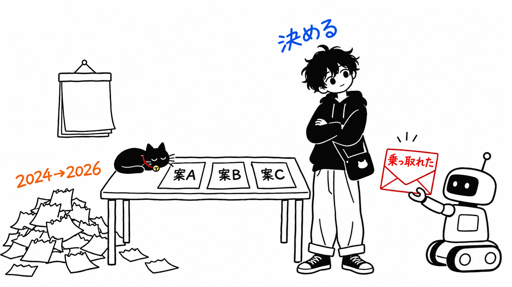
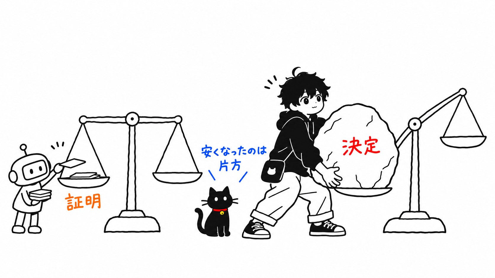
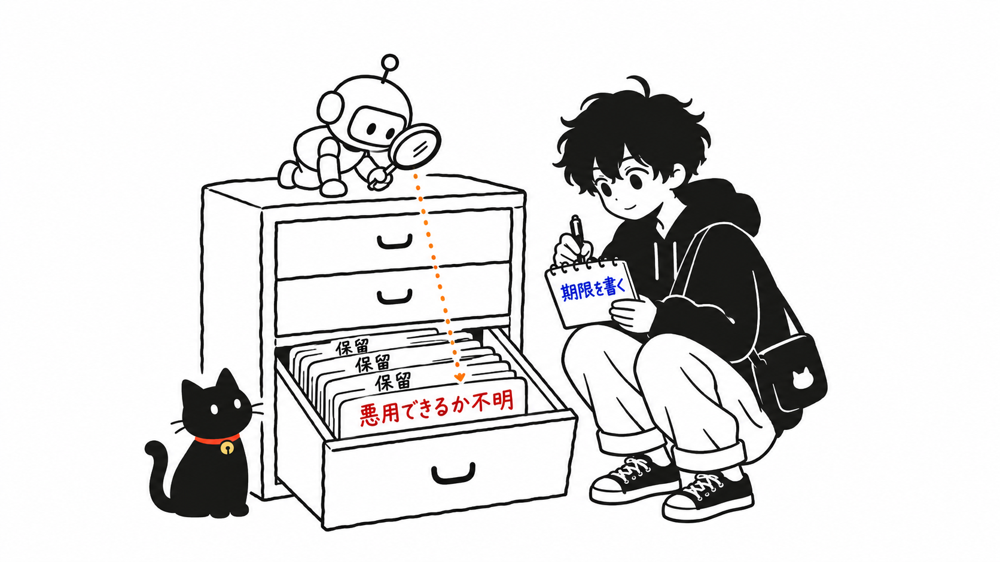

IEEE Spectrum に、PHP2Shell を扱った記事が出ました。副題はこうです。

> AI is forcing us to pay off 40 years of technical debt
>
> （AI は、40年分の技術的負債を返すよう私たちに迫っている。）

Hacker News では1,000ポイントを超え、600件以上のコメントが付きました。返信を多く集めたコメントには「ずっと流砂の上に建ててきた」「オープンソースは誰かが監査してくれるという約束が、AI で本当になる」といったものがあります。

この副題は、PHP Foundation が出した経緯の報告と並べると、合わない箇所があります。先に結論を書きます。

> PHP2Shell の根っこの問題は、2024年に人間の監査の流れの中で見つかっていました。止まっていたのは発見ではなく、複数ある直し方のどれを選ぶかという**決定**です。AI が持ってきたのは、その決定を先送りできなくする「実際に乗っ取れる」という証明でした。返されたのは40年分のコードの負債というより、2年間の決めかねていた判断のほうです。

私は PHP の開発には関わっていません。外から一次資料を並べた立場です。IEEE Spectrum の記事（Dina Genkina さん、2026年11月2日）と、PHP Foundation のブログ（2026年10月21日）は全文を読みました。CVE の技術詳細（php.net の告知）と、Calif・Wiz の技術解説は読んでいません。

---

## IEEE Spectrum の記事が言っていること

記事の筋は3つです。

1つ目。ただのクラッシュとして放置されてきたバグが、AI のおかげで攻撃に使えるものへ格上げされる。Columbia 大学の Suman Jana さんの言葉が引かれています。

> If you look at any at any point of time, there will be a bunch of bug reports that are waiting to be fixed, which are just crashes. Most people don’t take them very seriously
>
> （いつの時点を見ても、直されるのを待っているバグ報告がたくさんあって、それはただのクラッシュだ。たいていの人はそれをあまり真剣に受け取らない。）

2つ目。見つけるのと直すのは非対称で、直すほうが重い。

> There is a fundamental asymmetry in finding bugs and fixing bugs
>
> （バグを見つけることと直すことには、根本的な非対称性がある。）

3つ目。だから守る側にお金と最先端モデルを回すべきで、形式検証で修正側も自動化に近づける、という提案です。Johns Hopkins 大学の Matthew Green さんはそれほど楽観的ではなく、「本当にひどいことが起きるまで誰も直さない」と言っています。

2つ目と3つ目には、私は異論がありません。引っかかるのは1つ目と、それを束ねた副題です。

## PHP Foundation の報告では、2024年に見つかっていた

PHP Foundation のブログは、修正版リリースの当日に出ています。経緯の部分を引きます。

> While fixing one of the issues Quarkslab reported, a PHP core developer contracted by the PHP Foundation found the first signs of the OOM problem behind CVE-2026-109618. In 2024, a potential exploit for the OOM problem was theorized, but no concrete vectors were found and other concrete issues with clear impact overshadowed these concerns.
>
> （Quarkslab が報告した問題の1つを直している最中に、PHP Foundation が契約していたコア開発者が、CVE-2026-109618 の背後にあるメモリ不足（OOM）問題の最初の兆候を見つけた。2024年の時点で悪用の可能性は理論上は考えられていたが、具体的な攻撃経路は見つからず、影響がはっきりした他の具体的な問題の陰に隠れた。）

Quarkslab の監査は、ドイツの Sovereign Tech Agency の資金で OSTIF が組んだ、PHP にとって数年ぶりの外部監査でした。見つけたのは人間で、AI ではありません。

では、なぜ2年近く直らなかったのか。報告はここをはっきり書いています。

> To fix the OOM problem, the PHP security team developed several competing approaches, but each came with its own trade-offs: backward compatibility breaks, new denial-of-service potential, or requiring changes to many third-party extensions which seemed impossible to coordinate. The PHP security team, operating on consensus, struggled to choose between these and feared the repercussions of shipping the wrong choice.
>
> （OOM 問題を直すために、セキュリティチームは競合する複数の案を作った。だがどれにも代償があった。後方互換の破壊、新たなサービス拒否の余地、あるいは多数のサードパーティ拡張の変更が必要で、その調整は不可能に見えた。合意で動くセキュリティチームは、どれを選ぶかで苦しみ、間違った案を出荷したときの影響を恐れた。）

そして自分たちでこう総括しています。

> We won't pretend otherwise: the delay was a structural failure, caused by both the security team's decision process and its lack of resources.
>
> （ごまかすつもりはない。この遅れは構造的な失敗であり、セキュリティチームの意思決定プロセスと人手不足の両方が原因だった。）

直し方の候補はあった。足りなかったのは、どれかに決めることでした。

## AI が持ってきたのは「証明」だった

流れが変わったのは2026年の夏です。

> On August 11th, researcher Ryan A at Calif reported an unconditional remote code execution with the same root cause as the OOM problem we had found in 2024.
>
> （8月11日、Calif の研究者 Ryan A が、2024年に私たちが見つけていた OOM 問題と同じ根本原因による、無条件のリモートコード実行を報告した。）

Calif の監査は OpenAI の Patch the Planet プログラムの一環で、7月30日に始まっています。OpenAI も同じ根本原因を独立に報告し、Wiz も8月24日に別の攻撃経路を報告しました。報告はこう続きます。

> The reports from Calif, OpenAI, and Wiz made the full impact of the OOM problem clear, and from August 11th onward, fixing it became the top priority for all of the PHP Foundation's team working on security.
>
> （Calif、OpenAI、Wiz の報告で OOM 問題の影響の全体像がはっきりし、8月11日以降、修正は PHP Foundation でセキュリティに携わる全員の最優先事項になった。）

8月11日から10月21日のリリースまで71日です。IEEE Spectrum の記事にある「4人のエンジニアが2か月かけてパッチを作った」と、だいたい合います。2024年から止まっていたものが、証明が届いてから10週間で出た。

時間の使われ方を並べるとこうなります。

| 期間 | 何が起きていたか | 誰が |
| --- | --- | --- |
| 2024年 | 監査の修正作業中に OOM 問題の兆候を発見。悪用は理論上のみ | 人間（コア開発者） |
| 2024年〜2026年夏 | 修正案が複数あり、合意で選べず止まっては再開 | 人間（セキュリティチーム） |
| 2026年7月30日〜8月11日 | 監査を始めて12日で、無条件の RCE を報告 | Calif（AI の支援あり） |
| 2026年8月11日〜10月21日 | 最優先で修正、全サポートブランチにリリース | 人間（Foundation のチーム） |

一番長いのは2段目です。そしてそこは AI が速くした段ではありません。

## 「クラッシュは軽く見られてきた」は、この件には当てはまりにくい

IEEE Spectrum の記事は、この件をこう説明しています。

> The bug underlying the PHP2Shell vulnerability was reported to the PHP Foundation as far back as 2024.
>
> （PHP2Shell の脆弱性の根にあるバグは、早くも2024年には PHP Foundation に報告されていた。）

2024年という年は Foundation の報告と合います。ただ Foundation の書き方では、外から「報告された」のではなく、契約コア開発者が監査の修正中に自分で兆候を見つけています。そして記事はそのすぐ後に「通常こういうエラーはクラッシュするだけで危険ではない。だからバグは放置された」とつなげ、Jana さんの「クラッシュは真剣に受け取られない」という一般論に流し込んでいます。

Foundation の報告が書いている理由は違います。悪用は「理論上は考えられていた」。軽く見たのではなく、直し方で詰まっていた。人手が足りず、影響がはっきりした他の問題が先に来た。これは「クラッシュだから放っておいた」とは別の話です。

もう1つ、二次資料（merginit の解説）には、2020年の PHP バグ報告 #78876 が同じ振る舞いの古い記録として挙がっています。開いてみると、これは2019年11月に「Sec Bug」として登録され、CVE-2019-11048 が振られ、2020年5月に Closed になっていました。少なくともこの報告は、クラッシュとして放置されたものではありません。#78876 と今回の根本原因がどこまで同じなのかは、私には確かめられていません（「Calif が後に結び付けた」という記述は二次資料にしかなく、Calif の原文は読んでいません）。

IEEE Spectrum の記事の OOM の説明（「データを入れるのに割り当てたメモリが小さすぎる種類のエラー」）も、Foundation の説明（メモリ上限に「ちょうど悪いタイミングで」達すると、初期化途中のデータが有効なものとして扱われる）とは中身が違います。細部なので深追いはしませんが、副題の「40年」も含めて、記事は PHP2Shell を一般論の入口として使っていて、この件そのものの経緯はあまり追っていない、というのが私の読みです。

---

## 私の見解：減ったのは「証明のコスト」で、決定のコストは減っていない

ここからが本題です。

「40年の技術的負債」という言い方は、古いコードの中に穴が埋まっていて、AI がそれを掘り出している、という絵を描きます。PHP2Shell の経緯が示しているのは、少し違う絵です。穴は見つかっていた。直し方の候補もあった。止まっていたのは「この代償を払ってこの案にする」という決定で、それを動かしたのは「実際に乗っ取れる」という証明でした。

私は、ここで変わったものを「証明のコスト」と呼びたいと思います。2024年には、悪用の可能性は理論上は考えられていたものの、具体的な攻撃経路は見つかりませんでした。エンジンを深く知るコア開発者は少人数で、他の責務も抱えていた。2026年には、監査を始めて12日で無条件の RCE が届いた。Jana さんの言う「すごく特定的で、やるのが苦痛な推論」を、AI が肩代わりした部分です。

公平のために書いておくと、変わったのは証明だけではありません。Foundation は2026年5月に Ecosystem Security Team を作り、7月と9月に人を増やしていました。8月以降に複数人がフルタイムで修正に当たれたのは Foundation の資金があったからだ、とも書いています。遅れの原因として Foundation 自身が挙げたのも「意思決定プロセスと人手不足の両方」です。だから「証明が決定を動かした」は、正確には「体制が整いかけたところに証明が届いた」のかもしれません。それでも、最優先に切り替わった日付が証明の届いた8月11日だったことは、報告にそのまま書かれています。

一方で、決定のコストは下がっていません。Foundation 自身がこう書いています。

> What tools cannot do is decide on the right fix for a long-standing design decision in the engine, weigh the compatibility trade-offs, and review the patch.
>
> （ツールにできないのは、エンジンに長く根付いた設計判断について正しい修正を決め、互換性の代償を量り、パッチをレビューすることだ。）

証明が安くなり、決定の値段は変わらない。そうなると、どうなるか。証明はこれから大量に届きます。Foundation の報告によると、7月1日以降だけで CVE を15件公開し、無効・重複・再現不能だった報告を100件以上処理しています。証明が届くたびに、止まっていた決定が「今すぐ」に変わる。決定を2年寝かせる余裕は、証明が12日で届く世界ではもう無いということです。

IEEE Spectrum の記事は「見つけるのと直すのは非対称だ」と書きました。私はその非対称の中身を、もう一段分けたほうがいいと思います。直す作業のうち、パッチを書く部分は形式検証や LLM で速くなるかもしれない。PHP2Shell の2年で目立つのは、パッチを書く速さより、複数の案のどれにするかが決まらなかったことです（Foundation の言い方では、修正作業は何か月も止まっては再開を繰り返しました）。形式検証は「このパッチは正しい」を証明できても、「後方互換を壊してでもこの案にする」を決めてはくれません。

### 自分のチームの「保留」の理由を見直す

これを自分の現場に持ち帰ると、問いはこうなります。**手元の保留チケットのうち、「悪用できるか分からない」「再現条件が厳しい」を理由に止まっているものはどれか。**

PHP のセキュリティチームが2024年に下した判断は、当時の情報では筋が通っていたと私は思います。具体的な攻撃経路がなく、影響のはっきりした問題が他にあった。人手は限られている。その条件なら後回しは合理的です。問題は、その「攻撃経路がない」という前提の賞味期限が、2026年に急に短くなったことでした。

「悪用できるか分からない」は、もう保留の理由として弱くなっています。もちろん今回の12日は、PHP とセキュリティを深く知る Calif の研究者が AI を使った結果で、誰が頼んでも同じ速さで届くわけではありません。Jana さん自身も「AI が全部ひとりでできるとは言っていない。明らかにできない」と念を押しています。それでも、証明を作れる人の裾野は広がっている、というのが同じ Jana さんの見立てです。「悪用できるか分からない」は、「まだ誰も本気で証明を作りに来ていない」に近づいています。保留にするなら、理由は「悪用されても影響がこの範囲に収まる」のように、証明が届いても崩れない形で書いたほうがいい。

もう1つは、決め方そのものです。PHP のセキュリティチームは、今回のあと「多数決で決められるようにし、妥協を促す」方向にプロセスを変え始めたと書いています。また、難しい代償で修正が詰まった深刻な脆弱性は、今後は Foundation の指導部にもっと早く上がるようにする、とも書いています。合意が取れるまで待つ仕組みは、証明が遅かった時代には待つコストが見えにくかった。今は見えます。

私がこの件で一番重いと思うのはここです。AI が掘り出すのは古いコードの穴だけではなく、組織の中で「決めないまま置いてあるもの」でもある。後者には AI のパッチは効きません。

### 「40年分」と言うと見えなくなるもの

副題に戻ります。「40年分の技術的負債」と言うと、責任は過去の書き手にあることになります。昔の人が雑に書いたコードのツケを、今 AI が取り立てている。

原因が古いのは確かです。Foundation 自身が「エンジンに長く根付いた設計判断」と書いていますし、二次資料によれば影響は PHP 5.4 まで遡ります。その意味で副題は外れていません。

ただ、2024年に問題の兆候を見つけた人も、直し方を考えた人も、決められなかった人も、2024年から2026年の人です。Foundation は遅れを「構造的な失敗」と自分で呼びました。古い設計に穴があったことと、見つけてから2年近く決めきれなかったことは、別の勘定です。「40年」と1本にまとめると、後者が古いコード一般の話に溶けてしまう気がします。

Matthew Green さんは記事の中で「より楽観的でない」と紹介されている人で、「本当にひどいことが起きるまで誰も直さない」「PHP2Shell は本当にひどいと言えるほどではなかった」と言い、ひどいことが起きたら「何にでもお金を出すようになる」と続けています。Green さんが話しているのは資金の動き方ですが、私は決定にも同じことが言えると思います。ひどいことが起きる前に、ひどいことが起き得るという証明は届くようになりました。それを受けて決められるかどうかは、組織の側の話です。

## 持ち帰るなら1つ

保留チケットの理由欄から「悪用できるか分からない」を消して、代わりに「誰がいつまでに決めるか」を書く。

PHP2Shell では、専門家が AI を使って監査を始めてから12日で証明が届きました。一方で、直し方は2年近く決まっていませんでした。決定のほうに期限を付けておかないと、次の証明が届いた日に、2年分の判断を71日でやることになります。

## 出典

- Dina Genkina「The PHP2Shell Vulnerability Heralds Cybersecurity Hell」IEEE Spectrum、2026年11月2日 https://spectrum.ieee.org/ai-in-cybersecurity-php2shell-vulnerability
- The PHP Foundation「Today's PHP Security Release, and How We're Strengthening PHP Security」2026年10月21日 https://thephp.foundation/blog/2026/10/21/todays-php-security-release-and-how-were-strengthening-php-security/
- PHP Bug #78876「Long variables in multipart/form-data cause OOM and temp files are not cleaned」2019年11月28日登録 https://bugs.php.net/bug.php?id=78876
- merginit「PHP2Shell: What Happened, Who Is at Risk, and What PHP Administrators Should Do」https://merginit.com/blog/24102026-php2shell-rce-what-happened-and-what-to-do
- Hacker News のスレッド（2026年11月4日） https://news.ycombinator.com/item?id=50364336
