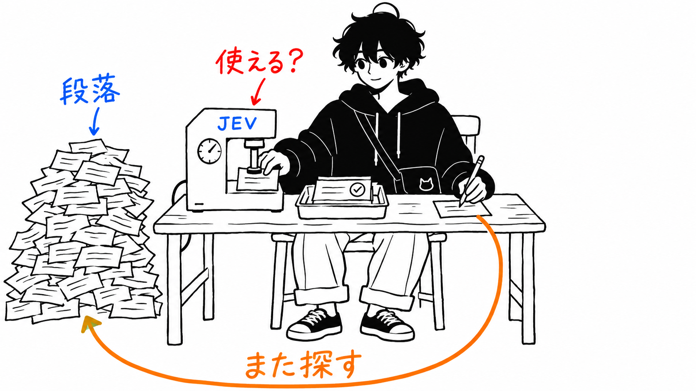
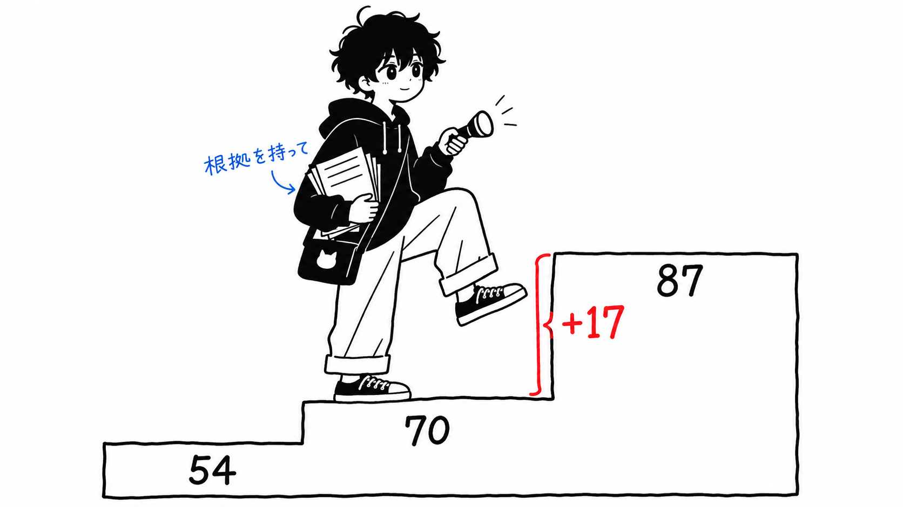
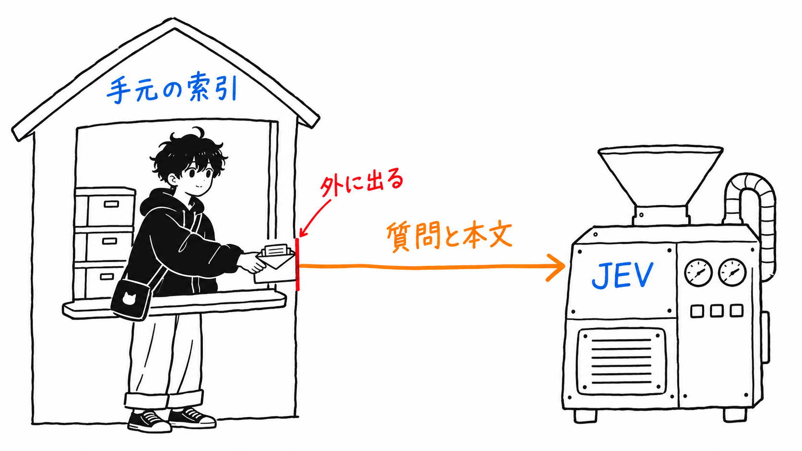

X の記事「RAG这次真死了！SAG2才是本地知识库的神，又快又准又便宜～」（袋鼠帝さん、2026年11月9日）を読みました。中国語圏で知識ベースの構築を仕事にしている人による、SAG2 の紹介記事です。SAG2 はなぜ RAG より強いのか。それを確かめたくて、元の論文まで遡りました。

先に結論だけ書くと、こうです。

> SAG2 は RAG を置き換えるものではありません。RAG の「検索」の部分を、事前の加工から質問時の判定に移したものです。論文が示しているのは多段の質問で根拠の段落を拾える割合（再現率）で、最終的な回答の正しさは測っていません。そして判定に使う JEV は外部の API で、質問と候補の本文はそこへ送られます。「本地知识库」「便宜」は、この2つの条件付きで読む必要があります。

論文の表の上では、比べた相手より強い。ただ、何に対して強いのかがずれて伝わっていると思います。

---

## この記事について

読んだのは、X の記事と、その元になった論文「SAG2: Embedding-Free Multi-Hop Retrieval with BM25 and JEV」（Yuchao Wu、Zleap AI、[arXiv:2610.22588](https://arxiv.org/abs/2610.22588)、2026年10月15日）です。

私の位置を書いておきます。私は SAG2 も、デスクトップ版の SAG Wiki も動かしていません。以下の数字は、7,000倍と4.57時間（X の記事の数字）を除いて論文の表と本文からで、差や1問あたりの値は私がそこから割り算したものです。私が測ったものはありません。論文中で比較元として引かれている SAG 第1版の論文（Wu et al., 2026）と EnterpriseRAG-Bench の論文（Sun et al., 2026）は読んでいません。

論文の図は使っていません。arXiv の許諾が CC ではなく著者に権利が残る形式（arXiv.org perpetual non-exclusive license）なので、必要な数字は表にして書き写しました。

## SAG2 がやっていること

仕組みは短く書けます。索引づくり（X の記事の言う「建库」）ではモデルを一切呼ばず、元の段落に SQLite の全文検索（FTS5）の索引を張るだけ。質問が来たら次を繰り返します。

1. BM25 で候補の段落を取る
2. JEV が、質問とそれまでに集めた根拠を見て、候補ごとに「使える根拠か」を判定する
3. 使える段落から語を拾い、それで次の検索をする

論文の要旨はこう書いています。

> This moves semantic evidence selection to query time, eliminating offline embedding computation, LLM-based event--entity extraction, and dedicated database servers.
>
> （これにより、意味に基づく根拠の選別が質問時に移り、事前の埋め込み計算、LLM による事象・実体の抽出、専用のデータベースサーバーが不要になる。）

JEV は TypeSafe AI が出している判定専用のモデルで、文章は書かず、判定ごとに「はい」の確率を返します。論文の実装では OpenRouter 経由で `typesafe/jev-1.13-20260917` を呼んでいます。

X の記事にある張三の例（A 社が B 社を買収、張三が A 社の CTO、張三が盤古プロジェクトへ）は、この 1→2→3 をそのまま回したものです。

## 論文の数字

3つの多段質問データセット（各1,000問）での段落の再現率です。表から一部を抜きました。単位は%。

| 方法 | MuSiQue R@5 | MuSiQue R@10 | 2Wiki R@10 | HotpotQA R@10 |
| --- | --- | --- | --- | --- |
| BM25 | 47.47 | 54.41 | 71.50 | 86.90 |
| NV-Embed-v2（埋め込み検索） | 68.84 | 77.27 | 80.75 | 97.70 |
| HippoRAG 2（グラフ） | 65.13 | 73.76 | 93.40 | 97.15 |
| SAG（第1版） | 80.36 | 83.37 | 93.57 | 97.70 |
| SAG2 | 80.68 | 86.62 | 97.43 | 99.00 |

R@10 は上位10段落の中に正解の根拠段落がどれだけ入っているかです。いちばん難しい MuSiQue で、埋め込み検索の最良より9ポイント、HippoRAG 2 より13ポイント高い。

51万件の模擬社内文書（メール、チケット、議事録など）を使う EnterpriseRAG-Bench では、文書単位の Recall@10 が 81.10% でした。同じ表の BM25 は 68.4%、ベクトル検索は 46.0% です。

費用の表もあります。MuSiQue の11,656段落の索引づくりが2.36秒、SQLite のファイルが25.87 MiB、事前のモデル呼び出しは0回。質問1,000問ぶんの JEV の料金は 4.33 ドルでした。

## 効いているのは「文脈つきの繰り返し」

私がいちばん読む価値があると思ったのは、MuSiQue でのアブレーション（部品を外した比較）です。

| 構成 | R@10 |
| --- | --- |
| BM25 のみ | 54.41 |
| BM25 + JEV、展開なし | 67.93 |
| BM25 + JEV、1回で多めに判定（判定回数を SAG2 とそろえる） | 69.82 |
| SAG2、集めた根拠を判定に渡さない | 76.25 |
| SAG2（展開2回、根拠を渡す） | 86.62 |

JEV を足しただけでは 68% 前後で止まります。判定の回数を SAG2 と同じだけ使っても、1回で済ませると 69.82%。そこから17ポイントを生んでいるのは、拾った段落の語で検索し直すことと、それまでの根拠を見せて判定させることです。根拠を渡さないだけで10ポイント落ちます。

つまり SAG2 の強さの中心は、BM25 でも JEV 単体でもなく、「見つけたものを手がかりに探し直す」反復にあります。これは RAG と対立する考え方ではありません。IRCoT（推論と検索を交互に行う手法）のような反復型の検索は以前からあり、論文の関連研究にも挙がっています。SAG2 の新しさは、その反復を、事前加工ゼロの語彙索引と安い判定器の組み合わせで回したところです。

だから「SAG2 vs RAG」という比較は、正確には「1回で引く検索 vs 判定しながら繰り返す検索」です。SAG2 で取った段落は、結局 LLM に渡されて回答が作られます。それは RAG です。

## X の記事と論文のずれ

X の記事は熱量があって読みやすいのですが、論文と照らすと言い過ぎの箇所があります。

**「8 项指标全部第一」。** 論文が主張しているのは R@5 と R@10 で最良、までです。表を見ると、MuSiQue の R@1・R@2 と 2Wiki の R@1 では SAG 第1版のほうが高い。論文自身も「SAG retains higher R@1 and R@2 on MuSiQue」と書いています。上位1〜2件に絞る使い方なら、第1版のほうがよい場面が残っています。

**「本地知识库」。** 索引は手元の SQLite ですが、判定は外部の JEV です。X の記事も、設定で JEV のキーを入れること、別の判定モデルに替えられることは書いています。ただ「本地」という言葉からは、データが手元から出ないと読めてしまう。論文は限界の節でこう書いています。

> Consequently, the present system cannot be independently deployed entirely on premises using publicly released model artifacts, even though its retrieval index is local.
>
> （そのため、検索の索引はローカルであっても、現在のシステムは公開されたモデルだけで完全にオンプレミスに展開することはできない。）

続けて、質問と候補の本文をそのサービスへ送る必要がある、と書いています。社外に出せない文書を扱うなら、ここが最初の確認点です。別の判定モデルに替えた場合の精度は、論文では評価されていません。

**「又快又准又便宜」「速度直接提升7000倍」。** 7,000倍は、SAG 第1版の索引づくり4.57時間と SAG2 の2.36秒の比です。4.57時間という数字は SAG2 の論文には出てこず、第1版の論文のものだと X の記事は書いています。私はそちらを確かめていません。

それより大事なのは、計算が消えたのではなく移ったことです。第1版は索引づくりのときに LLM で事象と実体を抜き出していました。SAG2 は質問のたびに JEV を呼びます。論文の数字では、MuSiQue の1,000問で JEV の判定は331,325回、1問あたり約330回です。料金は1問あたり約0.4セントです。ただ、論文は他の方式の質問時の費用と並べていないので、これが比べて安いのかは表からは言えません。応答時間も測られていません。

> Online latency is not reported because service waiting time was not separated from concurrent execution.
>
> （サービスの待ち時間を並行実行から切り分けられなかったため、オンラインの応答時間は報告しない。）

**「LightRAG、MS-GraphRAG、HippoRAG 2 这些图谱方案都没跑完全量」。** SAG2 の論文の EnterpriseRAG-Bench の表には、BM25、ベクトル検索、Bash エージェントの3つしか載っていません。グラフ系が完走しなかったという話は、論文からは確かめられませんでした。ベンチマーク側の論文に書かれているのかもしれませんが、私は読んでいません。

## 比較の条件

数字そのものにも、読むときの注意が論文に書いてあります。

- 3データセットの表の埋め込み検索とグラフ系の数字は、SAG 第1版の論文からの転記です。論文は「The SAG comparison uses different models and implementations」と書いています。
- MuSiQue は手法の開発中にも使われています（「MuSiQue was also used during method development.」）。BM25 との差がいちばん大きい MuSiQue は、調整に使われたデータセットでもあります。
- EnterpriseRAG-Bench は合成のコーパスです。
- MuSiQue の4段の質問（166問）では、上位10件で根拠を全部そろえられた割合が28.31%にとどまります。
- 17ポイントの比較は判定の回数をそろえたもので、トークン数や料金はそろえていない、と論文は断っています。
- 測っているのは検索の再現率だけで、回答の正しさは今後の課題とされています。

> Generalization to an unused split, private organizational corpora, and downstream answer generation remains to be evaluated.
>
> （未使用の分割、非公開の組織内コーパス、下流の回答生成への汎化は、今後評価する必要がある。）

もう1つ、表に無いものがあります。X の記事自身が、全文検索とベクトル検索と再ランキングを組み合わせたハイブリッド検索を「标配」（標準装備）で、今も「最成熟的工业方案」だと書いています。その標準構成、たとえば BM25 と埋め込み検索を混ぜて再ランキングをかけた検索は、論文の比較表に入っていません。SAG2 が勝っている相手は、BM25 単体、埋め込み検索単体、グラフ系です。

## 私の見解

SAG2 を使うか決めるときに見るべきなのは、再現率の表より、次の3つだと思います。

1つ目は、質問と文書の断片を外部の API に送ってよいか。送れないなら、今の SAG2 は選べません。論文もローカルで動く判定モデルを今後の課題としています。

2つ目は、手元の質問で今の検索がどれだけ取りこぼしているか。HotpotQA の R@10 は埋め込み検索でも97.70%で、SAG2 の99.00%との差は1.3ポイントです。差が大きいのは MuSiQue や 2Wiki のように手がかりを何段もたどる質問です。今のハイブリッド検索で取りこぼしが目立たないなら、乗り換える理由は弱いと思います。

3つ目は費用の向きです。SAG2 は索引づくりの費用を0にして、質問ごとに払う形に変えました。事前に一度払う方式と違って、こちらは質問の数に比例して積み上がります。文書は多いが質問は少ない知識ベースなら SAG2 の形が得で、少数の文書に毎日大量の質問が来るなら、どこかで事前加工の方式と逆転するはずです。論文には質問時の費用の比較が無いので、その分かれ目がどこかは自分の数字で計算するしかありません。

このブログで前に書いた Hightouch の記事（「Hightouch の Jev と Opus の二段判定について」）にも Jev が出てきました。同じ名前なので同じ系統のモデルとして読んでいますが、あちらの元記事は Jev の中身を説明しておらず、同一だとは確かめていません。あちらでの Jev は「安くて速く、確率を返す1段目の判定器」で、自信がない分を Opus に回していました。SAG2 は、同じ種類の安い判定器を1問あたり約330回呼ぶ設計です。安い判定器が出てきたことで、「事前に全部加工しておく」以外の選択肢が現実的になった。SAG2 はその1つの形だと私は読みました。

裏返すと、SAG2 の価値は JEV の値段と提供が続くことに乗っています。論文も、評価した版の継続的な提供は提供元しだいだと書いています。

## 1つだけ持ち帰るなら

SAG2 を試す前に、質問と文書の断片を外部の判定 API に送ってよいかを確かめる。それが駄目なら、再現率の表を読む意味はまだありません。

出典: 袋鼠帝「[RAG这次真死了！SAG2才是本地知识库的神，又快又准又便宜～](https://x.com/aikangarooking/status/2119717912546304048)」（X、2026年11月9日）。Yuchao Wu「[SAG2: Embedding-Free Multi-Hop Retrieval with BM25 and JEV](https://arxiv.org/abs/2610.22588)」（arXiv:2610.22588、2026年10月15日）。ベンチマークの再現コードは [Zleap-AI/SAG-Benchmark](https://github.com/Zleap-AI/SAG-Benchmark) にあります。SAG 第1版の論文、EnterpriseRAG-Bench の論文、JEV の公式記事は読んでいません。SAG Wiki は動かしていません。
