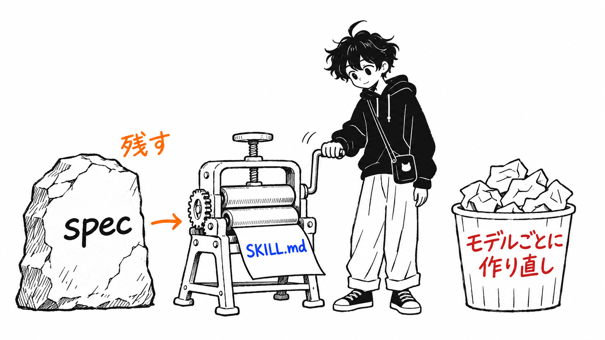
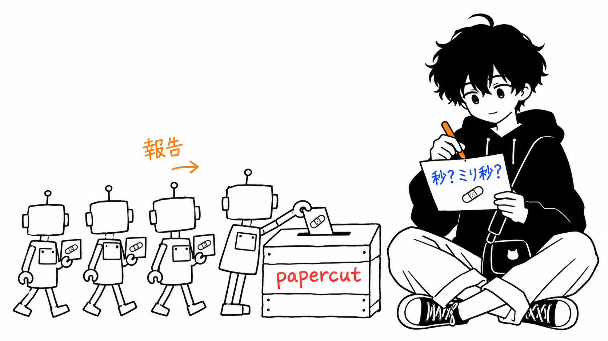
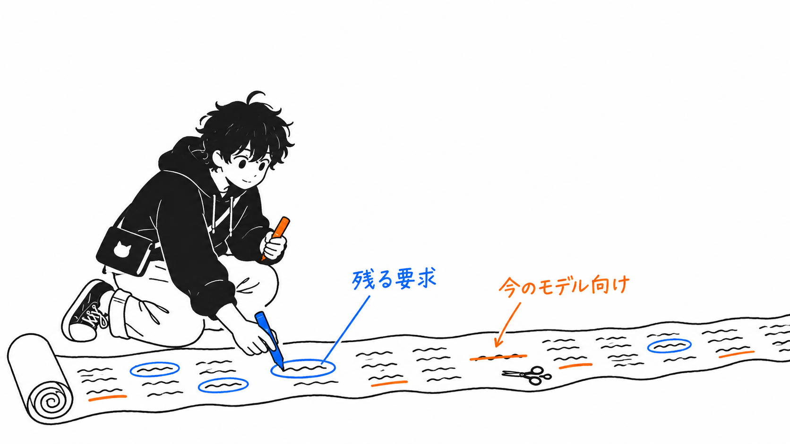

2026年11月23日（UTC）、Uber Engineering が X に「How Uber Evals 1 Million Agent Skill Invocations a Month」という記事を出しました。同じ内容は Uber のブログにも載っています。冒頭の数字はこうです。

> Uber's shared skills marketplace grew from 1 skill in October 2025 to more than 5,000 in just one year. Thousands of people have written a skill, and agents invoked skills more than 1 million times in just one month.
>
> （Uber の共有スキルのマーケットプレイスは、2025年10月の1スキルから、1年で5,000以上に増えた。数千人がスキルを書き、エージェントがスキルを呼んだ回数は、1か月で100万回を超えた。）

配布の CLI、3段の階層、利用の計測、リンター、eval、コスト削減、エージェントが自分で不具合を報告する仕組みと、話は広いです。

先に結論だけ書くと、こうです。

> Uber には、spec から SKILL.md を生成し、モデルが変わると作り直す仕組みがあります。私はこれを、モデルが変わっても残す文章（spec）と、今のモデル向けに作り直す文章（SKILL.md）を、別のファイルに分けたのだと読みました。私の手元のスキルは、この2種類が1つの SKILL.md に混ざっています。モデルが変わったとき、どれを削っていいか分からない状態なので、分けることにしました。

---

## ざっくり言うと

AI に仕事をさせるとき、「この作業はこうやる」という手順書を渡します。これを「スキル」と呼びます。Uber では社員が5,000本以上の手順書を書き、AI は1か月に100万回以上それを使いました。

手順書には、2種類の文が混ざっています。1つは「何ができたら合格か」という、AI が新しくなっても変わらない約束。もう1つは「今の AI にはこう言うと伝わる」という、今の AI の癖に合わせた言い回しです。後者は、AI が新しくなると合わなくなります。

Uber は前者を「設計書（spec）」という別の紙に書いて残し、後者はその設計書から作り直す仕組みを持っています。私の手順書は2種類が1枚に混ざっていて、AI が変わったときにどこを消してよいか分からないので、分けることにした、という話です。

## この記事について

読んだのは X の記事の本文のテキストです。本文に埋め込まれた画像（図や画面）は見ていません。記事が参照している Cloudflare の Code Mode の記事、Uber の別の記事（efficient software factory）、Agent Skills の仕様も読んでいません。

私の位置も書いておきます。このブログの記事は、Claude Code のスキルを使って書いています。Uber の社内ツールである aifx や Skill Workshop は使ったことがありません。

## SKILL.md は spec から作られる

記事は、スキルを「Markdown ファイル」と定義するところから始まります。ところが、品質の節まで読むと、その Markdown を spec から生成する経路が用意されています。TL;DR の項目の1つも「Write the spec first」（spec を先に書け）です。

> The spec keeps the intent of the skill: its goal, its outputs, the tool actions that are required or forbidden, and the agents and models it targets.
>
> （spec はスキルの意図を保持する。目的、出力、必須または禁止のツール操作、そして対象のエージェントとモデルだ。）

Skill Workshop という社内のツールが、この spec から SKILL.md とテスト用のプロンプトを生成し、モデルやエージェントが変わると作り直す。今後の計画には、モデルの系統ごとに SKILL.md を書き分けることも挙がっています。言い回しや長さの最適な形がモデルによって違うからだ、と。

5,000本すべてがこの経路で作られているかは書かれていません。SKILL.md は今も作者が実運用を見て直し、Core 階層ではチームが保守して変更をレビューする、とあります。そのうえで、言葉を削る試験もしています。

> As models get better, more words can reduce performance, so we also test removing words from skills.
>
> （モデルが良くなるほど、言葉が多いと性能が下がりうる。だから、スキルから言葉を削る試験もしている。）

この試験の結果は、記事に書かれていません。ただ、方針ははっきりしています。スキルには寿命があり、より良いモデルが要らなくすれば廃止する、とも書いてあります。

ここからは私の整理です。目的、出力、守るべき操作のような、モデルが変わっても変わりにくいものは spec に置き、今のモデル向けの言い回しは SKILL.md に置く。後者は作り直しても削ってもいい（ただし spec には対象のモデルも書くので、対象を変えれば spec も変わります）。Uber が残す側に置いているように見えるのは、spec と eval、それに会社中のスキルが名前で参照する Code Mode のスクリプトのパッケージです。リンターの規則（手順に番号を振り、1手順1目的にする。エラー回復の表を置き、「Try again」は回復策と認めない）は、SKILL.md の形を機械で検査するものです。

eval の設計も記事に書いてあります。固定の入力と期待する出力を持つ golden ケースが約5%、実際のプロンプトを軌跡（正しいスキルとツールを正しい順に使ったか）で採点するものが約80%、作者が判定するものが約15%。全部通る eval より、70〜90%通る eval のほうが役に立つことがある、とも書いています。全部通るなら、答えの意味のある変化を見逃している可能性があるからだ、と。それでも記事の結びは、まれにしか動かず、重要で、判定の難しいワークフローの評価は未解決だ、と認めています。

## 効いた数字は、スキル全体の有無の比較

記事でいちばん目を引く数字は、ablation（スキルを外して比べる試験）の結果です。

> In our ablation test of a skill that runs warehouse queries, sessions without the skill made 13% more tool calls, had six times as many tool errors, and took 31% longer, and the answer with the skill won 87% of the comparisons.
>
> （データウェアハウスにクエリを投げるスキルの ablation 試験では、スキルなしのセッションはツール呼び出しが13%多く、ツールのエラーが6倍、時間が31%長くかかった。スキルありの答えが、比較の87%で勝った。）

これは1つのスキルについて、スキルがあるかないかを比べた数字です。スキルのどの部分が効いたのかは分けていません。比較の件数も書かれていません。どんなスキルが効いたかについては、記事はこう書いています。

> The biggest wins came from skills that give the agent something it couldn't easily find or understand, such as access to internal documents or a way to run warehouse queries.
>
> （いちばん大きな勝ちは、エージェントが自力では見つけにくい、理解しにくいものを渡すスキルから出た。社内文書へのアクセスや、ウェアハウスのクエリを実行する手段などだ。）

スキル全体については「In a majority of the cases」（大半のケースで）よくなった、とだけあり、割合はありません。

コスト削減の施策は4つ挙がっていて、削減率の数字があるのは2つです。重いツール結果を安いモデルのワーカーに任せる施策で、トレーシングのスキルの1回あたりのコストが46%下がった（同じ施策で、デプロイのスキルは最初の週に下がらなかった）。読み込み時にスクリプトを実行して結果をプロンプトに入れる施策で、検索のスキルの平均コストが32%下がった。残りの2つ、Code Mode とポーリングの切り出しには、削減率が書かれていません。

数字の読み方にも注意が要ります。スキル1回あたりのコストは、定期的に報告される累計コストのうち、呼び出し前の最後の値と呼び出し後の最初の値の差で、その間の他のツール呼び出しも含みます。46%と32%は変更の前と後を比べた数字で、対照群があったかは書かれていません。

## 不具合を見つけたのはエージェントだった

エージェントが自分で不具合を報告する「papercut」の仕組みで、3か月に数千件が報告され、数百件が直りました。例として4つ挙がっています。

> A deployment skill told the agent to pass epoch seconds where the API expects milliseconds.
>
> （あるデプロイのスキルは、API がミリ秒を求めるところで、エポック秒を渡すようエージェントに指示していた。）

ほかの3つは、プルリクエストのスキルがコミットメッセージを共有の一時ファイルに書き、同時に動いた2つのセッションが互いのプルリクエストを書き換えた件。CI の無いリポジトリで CI を待ち続け、同じ404を繰り返した件。設定を引くスキルが、キーが無いときにエラーを出さず別のプロパティを返した件です。

誤りがスキルの手順の文章にあったのか、付属のスクリプトにあったのかは、原文に書かれていません。私には、3つは手順が何を指示したかの問題に、1つは返り値の問題に読めます。どれも、言い回しが分かりにくかったという種類の問題ではありません。そして4つとも、エージェントの報告で見つかったものです。

## 私の見解

私が引っかかったのは、記事が「文章を減らせ」と言っていることではなく、「どの文章を残すか」を決めていることです。

spec も文章です。目的、出力、禁止する操作を書いた文章。違いは、モデルが変わっても書き換えなくていい部分が多いことです。一方、SKILL.md の言い回しは、今のモデルに合わせた調整で、モデルが変われば作り直す。Uber は、この2種類を別のファイルに分けました。

私の手元のスキルは、この2種類が1つの SKILL.md に混ざっています。記事を書くスキルには、「挿絵と3言語がそろうまで完成と言わない」のような、モデルが変わっても変わらない要求と、「この言い回しは避ける」のような、今のモデルの癖に合わせた調整が、同じ調子で並んでいます。どちらも私が手で磨いてきました。

混ざっていると何が困るか。モデルが変わったときに、どれを削っていいのか分からない。Uber のように言葉を削る試験をしようとしても、削ってはいけない要求まで一緒に削る試験になってしまいます。

ただし、文章が悪いという話ではありません。私の記事の誤りを止めているのは、引用が原文に一字一句あるかを照合するスクリプトと、別のコンテキストで記事を読むレビュアーです。直前に公開した[記事](https://meikocho1.github.io/blog/efs-zero-data-retention-two-copies/)では、レビュアーが事実の誤りを6件指摘し、すべて直しました（1本だけの例です）。そのレビュアーを動かしているのは、私が書いた依頼文という文章です。依頼文の中身は「事実を原文と照合する」「根拠の無い体験談を指摘する」といった、モデルが変わっても変わらない要求がほとんどです。spec に近い文章なので、モデルを替えても長持ちするはずだと予想しています（モデルを替えた前後でレビュアーの働きを比べたことはないので、確かめてはいません）。

もう1つ。「挿絵と3言語が必須」は spec に置くべき要求で、しかも機械で検査できます。今は SKILL.md に文章で足してあるだけで、検査のスクリプトはまだありません。Uber の記事を読んで、検査を書くことにしました（まだ書いていません）。

## 1つだけ持ち帰るなら

自分のスキルの文を1つずつ見て、「モデルが変わっても残る要求」と「今のモデル向けの言い回し」に印をつける。前者は spec として別に置き、できるものは検査にする。後者は、削る試験にかけていい部分です。

出典: Uber Engineering「[How Uber Evals 1 Million Agent Skill Invocations a Month](https://x.com/i/article/2120222611070500864)」と紹介の[投稿](https://x.com/ubereng/status/2125008806249930999)（X、2026年11月23日 UTC）。同じ内容の Uber のブログ記事は「[optimizing-ubers-agent-skills](https://www.uber.com/us/en/blog/optimizing-ubers-agent-skills/)」。本文中の画像、参照先の Cloudflare の記事、Uber の別記事、Agent Skills の仕様は読んでいません。
