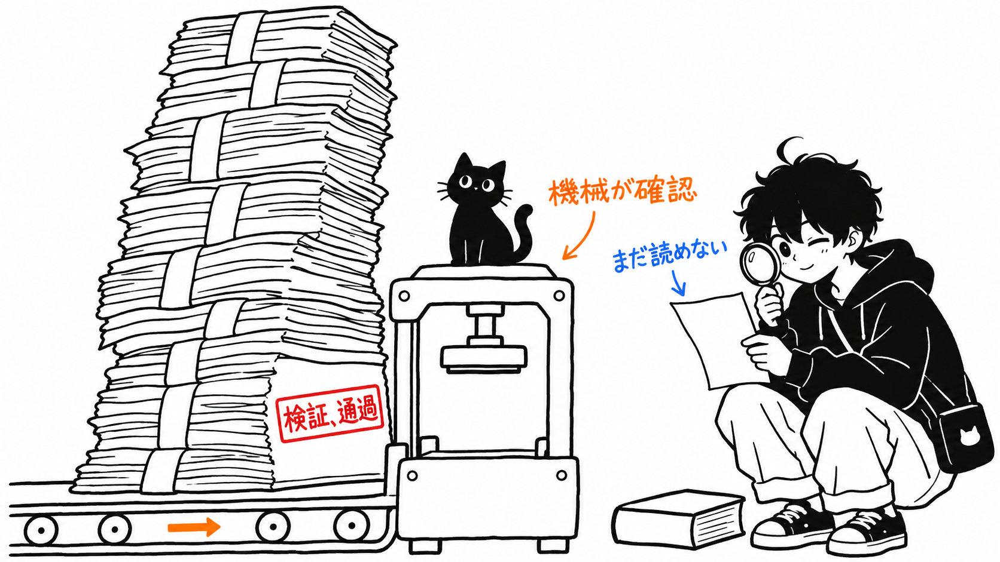
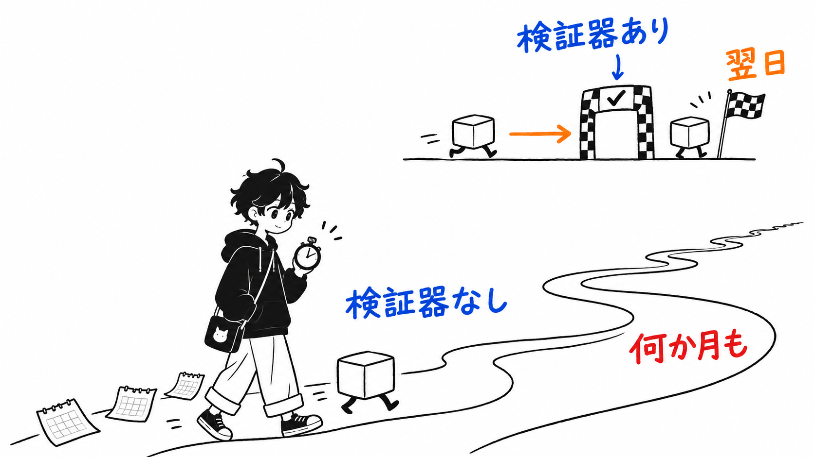

2026年11月20日、Anthropic で働く数学者の Levent Alpöge さんが、Claude と一緒にリーマン予想を証明したと発表しました。証明は通常の論文ではなく、定理証明支援系 Lean のコード約1,700万行として公開され、翌21日には Lean と Mathlib のコミュニティが、コードが検証を通り、元の命題と一致していることを確かめた共同声明を出しています。

11月22日（UTC）、Meta の Chief AI Officer である Alexandr Wang さんが、X に「Superintelligence is Arriving」という記事を出しました。冒頭はこうです。

> Superintelligence is arriving. How humanity acts over the next year will have great consequence on what future world we live in.
>
> （超知能が到来しつつある。この1年で人類がどう動くかが、どんな未来の世界に住むことになるかを大きく左右する。）

先に結論だけ書くと、こうです。

> Wang さんはリーマン予想の証明を、知能がもう足りている証拠として読んでいます。私は、この証明が発表の翌日に検証を通ったのは、人がまだ中身を理解していないのに、Lean という機械の検証器があったからだと読みました。Wang さんが残りの課題として括弧に入れた「実験、データ、フィードバックの回路」こそが他の分野の Lean に当たり、それが無い分野では同じ速さは出ないと考えています。

---

## この記事について

読んだのは Wang さんの X の記事の本文です。証明の経緯は、Al Jazeera と techno-science.net の記事で確かめました。Alpöge さん本人がサイトに載せた4ページの説明と、Lean と Mathlib の共同声明そのものは読んでいません。証明の Lean コードも見ていません。

私の位置も書いておきます。私は数学者ではなく、リーマン予想の証明の中身を評価する力はありません。この記事で扱うのは、Wang さんの議論の組み立てと、証明が検証を通った経路のほうです。

## Wang さんの議論

組み立ては、知的な難しさの順位づけです。

まず、2024年12月に o3 が数学コンテストの AIME で高得点を取ったとき、競技数学の経験者には「すべてが変わる」瞬間があった、と書きます。AIME の難問は、エンジニアやビジネスの人が日々解く問題よりずっと難しい。ほかの分野にモデルを広げるには分野ごとの知識や文脈が要ったが、足りなかったのは生の知能ではなかった。その2年で、コーディングはほぼ解決され、強力なサイバー能力とエージェント能力が出てきた、と。

次に、AIME は10代の課外活動で、リーマン予想は人類が考えた中で最も知的に厳しい問題かもしれない、と続けます。

> The remaining gaps for models to greatly surpass humanity in every field are no longer intelligence; they are domain-specific know-how, plumbing, and experimentation.
>
> （モデルがあらゆる分野で人類を大きく上回るのに残っている隙間は、もはや知能ではない。分野ごとのノウハウ、配管、そして実験だ。）

AI の研究もリーマン予想よりずっと易しいので、モデルは AI 研究を自動化し、自分を改善することで明らかに人間を超える。生物学、兵器、経済学の研究も大きく加速する。そして、数学界がリーマン予想の証明をまだ消化しきれていないのと同じように、ほとんどの分野が、人間が理解も監視もできない速さで加速しうる、と書きます。

後半は警告です。完全に制約のない再帰的な自己改善を人類が制御し続ける世界は想像しにくい。業界には「ASI は避けられず、問題はどう安全に作るかだけだ」という怠惰な考えがある。社会を AI に「引き渡す」ことをよしとしてはいけない、と。

## 証明は、理解される前に検証を通った

ここで、証明が検証を通った経路を見ます。

Alpöge さんは通常の論文を出さず、サイトに4ページの説明を載せ、証明そのものは Lean のコードとして公開しました。約1,700万行、175,187ファイル。Al Jazeera によれば、Alpöge さんは「Claude far outpaced me near the finish line」（終盤は Claude が私をはるかに上回った）と書いています。翌日、Lean と Mathlib のコミュニティが、全ファイルがコンパイルでき、証明された命題が元の予想と一致し、証明が追加の未証明の仮定に頼っていないことを確かめました。

一方で、中身はまだ理解されていません。Imperial College London の Kevin Buzzard さんは Al Jazeera にこう話しています。

> At the minute, we don't even know why the theorem is true
>
> （今のところ、その定理がなぜ正しいのかさえ分かっていない。）

Buzzard さんは続けて、1,700万行は数学にすると何万ページにもなりうるし、どこが新しい発想で、どこが機械が埋めただけの定型なのかもまだ分からない、と話しています。世界中で、Lean のコードを英語に訳し戻す作業が進んでいる最中です。ただし Buzzard さんは、人に Lean のコードを渡せば1〜2週間でずっと理解が進むものだ、とも言っています。理解はこれから追いつく見込みです。

それでも、11月21日の時点で、この証明が正しいことを支えていたのは、人の理解ではなく Lean の検証でした。Wang さんの記事の「the math community has not fully digested the proof」（数学界はまだ証明を消化しきれていない）は、この状態のことです。

## 私の見解

Wang さんは、この出来事を知能が足りている証拠として使っています。私は、同じ出来事が示しているのは、もう1つの条件のほうだと考えます。結果を機械で検証できる分野では、人が理解する前に、AI の結果を信用できるということです。

数学には Lean がありました。1,700万行は誰も手で確かめられませんが、Lean は確かめられる。だから発表の翌日に、少なくとも「この命題を証明しているか」には答えが出た。Wang さんが次に挙げる分野はどうでしょう。生物学の仮説は、実験で確かめるのに長いと数か月かかります。経済学の政策は、効いたかどうかが何年も分からないことがあります。Wang さん自身、MIT の先生たちは多くの分野の最難問がリーマン予想より「易しい」と言うだろうと書いたうえで、こう括弧をつけていました。

> albeit with other challenges such as experimentation, data, and feedback loops.
>
> （ただし、実験、データ、フィードバックの回路といった別の課題はあるが。）

Wang さんもこれを課題として挙げているので、私との違いは重みづけです。私はこの括弧の中が、括弧の外より重いと思います。実験とフィードバックの回路は、その分野にとっての検証器です。それが無い分野では、AI がどれだけ賢い答えを出しても、正しいと分かるまでの時間は縮みません。

知能だけでは説明しきれないことは、Al Jazeera の記事の中にもあります。Buzzard さんは、まず Alpöge さん本人を評価すべきだと言い、同じように最先端のモデルと計算資源を使えたほかの人たちは証明にたどり着けなかった、と話しています。どの向きに探すかを決めた人がいた。

Wang さんは、ほとんどの分野が「人間が理解も監視もできない速さ」で加速しうることを恐れていました。Wang さんの「監視」は AI の自己改善を制御する話で、Lean の検証とは別のものです。ただ、リーマン予想の証明は、理解が追いつく前でも、検証器があれば「正しいか」だけは押さえられることを示しています。逆に、検証器の無い分野で同じ速さを出そうとすれば、理解も検証も無いまま結果が積み上がる。私が怖いのはこちらです。

最後に、記事の中の比較の多くは Wang さんの見立てです。原子爆弾の発見はリーマン予想に比べれば宿題レベルだと多くの物理学者が同意するだろう、という一文の根拠は、ロスアラモスで育ったという本人の見聞です。AI 研究はリーマン予想よりずっと易しい、コーディングはほぼ解決された、にも出どころは示されていません。

## 1つだけ持ち帰るなら

「AI がこの分野を加速する」という話を聞いたら、その分野の Lean は何かを探す。結果が正しいかを、人が理解する前に機械で確かめる仕組みです。それがある分野から順に、本当に速くなると考えています。

出典: Alexandr Wang「[Superintelligence is Arriving](https://x.com/i/article/2124634870681063424)」と紹介の[投稿](https://x.com/alexandr_wang/status/2124636606959345776)（X、2026年11月22日 UTC）。証明の経緯と Buzzard さんの発言は Al Jazeera「[Riemann hypothesis: Has the world's most famous maths problem been cracked?](https://www.aljazeera.com/news/2026/11/21/riemann-hypothesis-has-the-worlds-most-famous-maths-problem-been-cracked)」（2026年11月21日）、行数・ファイル数と共同声明の内容は techno-science.net「[An AI solves the Riemann hypothesis: 17 million lines for a historic proof](https://www.techno-science.net/en/news/ai-riemann-hypothesis-lean-proof-29823)」から。Alpöge さんの説明、Lean と Mathlib の共同声明、Lean のコードそのものは読んでいません。
