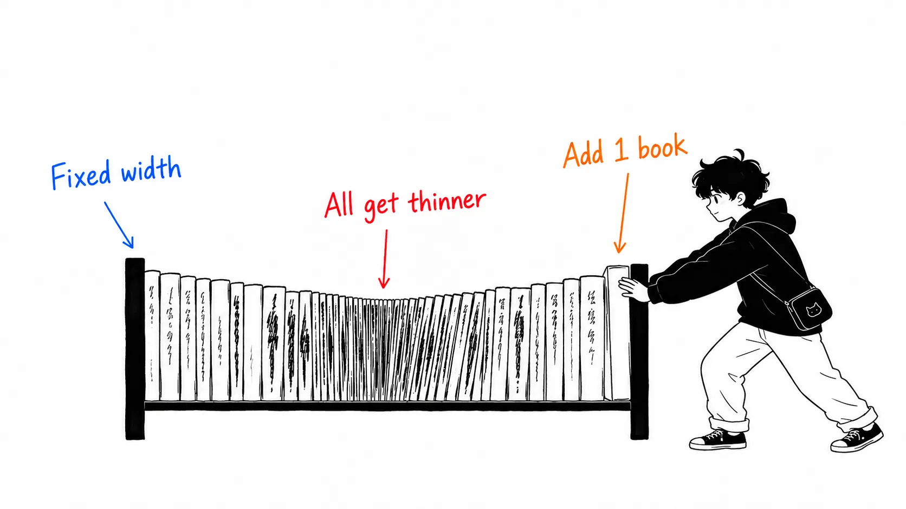
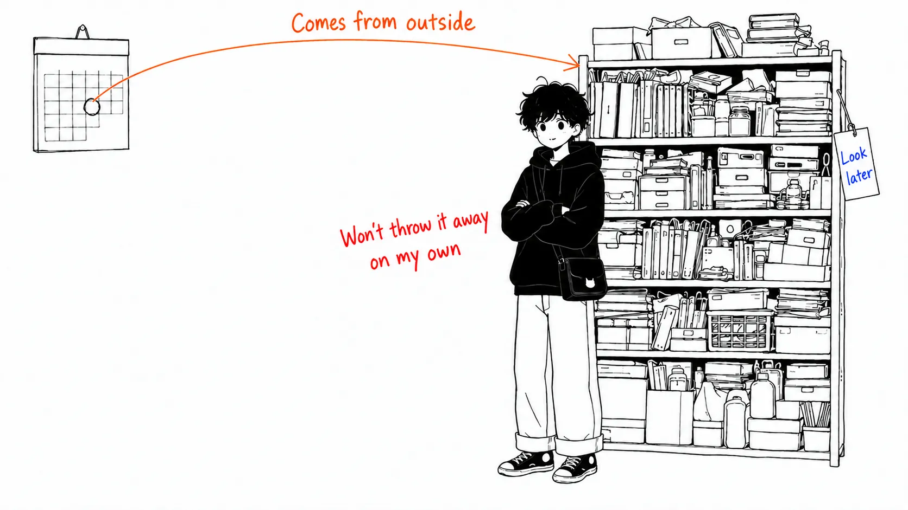
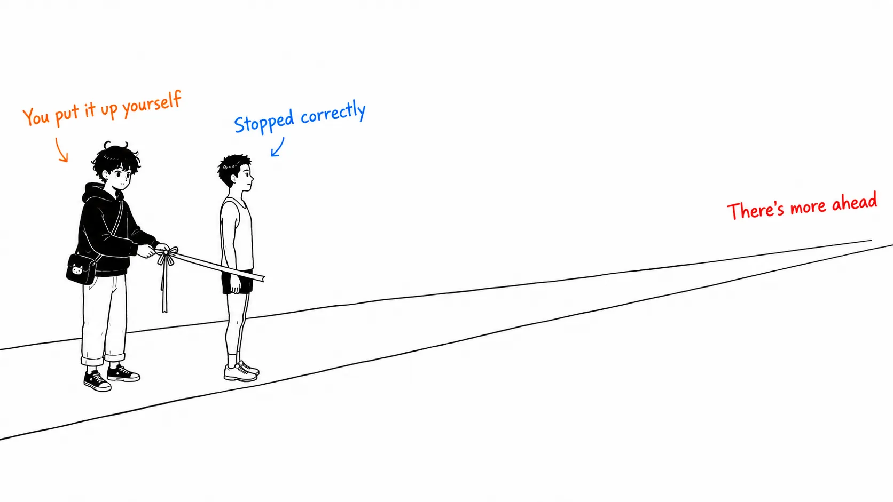
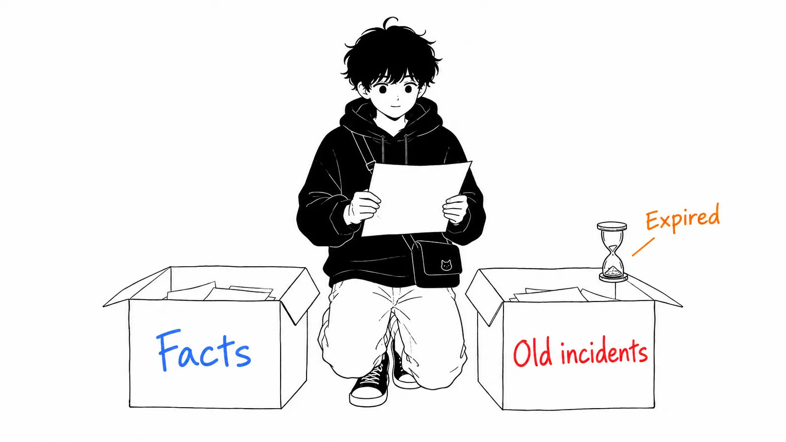

Here's the conclusion first.

> Adding a skill is **not addition. It's a tax on every skill that already exists.** There's a ceiling on the context budget for descriptions, and when you exceed it, **everyone's description gets shortened.** That very warning was showing up in my own environment, and I didn't understand what it meant until I read this article. And it's part of a bigger problem: "skills pile up and nobody deletes them." A model update may be **the one pretext from outside** to take that inventory.

## About this article

- Original: [Rethinking skills and prompts for GPT-6 Astra](https://x.com/i/article/2095989703967125509), by eric provencher ([@pvncher](https://x.com/pvncher/status/2095991462416490862)), September 4, 2026

GPT-6 Astra is out, so the article says it's time to review the instructions you've piled up over the past year (Skills, `AGENTS.md`, task prompts). Its claim is simple: **instructions you wrote last year to cover for a model's weaknesses have now flipped to the side that constrains the model.**

An honest disclosure. The original seems to have images laying out good and bad examples of descriptions, but I could only read the text. Also, there's a part where the author writes that "we recently updated" the `$skill-creator` guidance, but I haven't confirmed the author's position, so I'm leaving it as a quotation.

This time, though, I have **one piece of primary evidence** on my side. I'll start there.

## The warning that was in my logs

Last week I was running `codex exec` to generate illustrations for an article. In the JSON that came back, there was an error entry like this.

> Skill descriptions were shortened to fit the 2% skills context budget. Codex can still see every skill, but some descriptions are shorter. Disable unused skills or plugins to leave more room for the rest.

I skipped past it. The images were generated, so there seemed to be no real harm.

After reading pvncher's article, I understood what it had been saying.

> Many people default to downloading lots of skills into their projects, and that's a mistake. Each skill comes with a name and a description, which get loaded into the model's context so it can judge when to use it. **Many descriptions are too long, and if you have too many skills, Codex starts shortening descriptions to make them fit.** Each description the model sees shrinks, making it harder to judge which skill to pick.

So that warning wasn't saying "we saved a little." It was a notice that **the material for making a choice had been trimmed.** And what gets trimmed isn't only the skills you added. **It's everyone's.**

So I counted what's in my own environment.

| | `~/.claude/skills` | `~/.codex/skills` |
| --- | --- | --- |
| Number of `SKILL.md` | 118 | 8 |
| Total description length | 12,127 characters | 3,295 characters |
| Median description length | **64 characters** | **461 characters** |
| Longest description | 990 characters | 990 characters |
| Descriptions over 300 characters | 4 | **4** (out of 8) |

The numbers had an interesting shape. **The side that raised the warning wasn't the one with 118 skills. It was the one with only 8.**

The Claude side has as many as 118, yet a median description of 64 characters. The Codex side has only 8, but a median of 461 characters, and 4 of the 8 run past 300. **What was eating the budget wasn't the count. It was the length of each one.**

This matches pvncher's first piece of advice exactly.

> First, a skill's description should be **as short as possible** while making clear when the model should use it.

I'd thought it meant "don't put in too many skills," but to be precise it was "**don't put in too many long descriptions.**" Skills with short descriptions cost little even if you have 118. Skills with long descriptions fill the budget with just 8.

### The real cost of adding

From here on is my reading.

When I added a skill, what I was thinking was "is this skill useful?" If it's useful, put it in. If it's not, just don't use it. I never thought **putting it in has a cost in itself.**

But if the budget is fixed, this isn't addition. **Every time you add one, you take a little from everything already there.** And what's taken is the material the model uses to judge "which one should I use?"

That leads to a strange conclusion. **Even if every individual skill is useful, in total they weaken one another.** Each skill is written on the assumption that its own description will be read, but in reality everyone is being sorted in a trimmed-down state.

The original goes one step further, and it's a nasty one.

> Worse, descriptions can contradict each other, or carry too much "pick me" energy, and the model may end up loading instructions that don't actually help with the task.

Trimmed, and then the fragments that remain take effect in order of how assertively they push themselves. It's a structure where whoever wrote the longer description wins. The "990 characters" in my own environment was probably a product of that kind of competition too.

## Instructions weren't assets. They were depreciating liabilities

The remaining three sections of the article (`AGENTS.md`, decision boundaries, persistence) all have the same shape. **Instructions that were right last year work in reverse this year.**

- "Read the docs before editing" → overkill for fixing a typo. **A great way to burn context and slow down the work**
- "Run the tests, verify your own work" → earlier models needed encouragement. GPT-6 Astra does it on its own, so the same instruction produces **unnecessary tests**
- "Don't proceed on your own, ask first" → earlier models went ahead without permission, so stronger wording was added. Today's models **take the boundary too seriously and stop where you'd want them to continue**

All three are **patches written against past incidents.** The patch stays even after the incidents stop happening. And the remaining patch doesn't carry the reason it was written for at the time. So you can't decide to delete it.

My `CLAUDE.md` is the same. "Write the tests first," "don't commit on your own," "token budget is 4000." Each was surely needed somewhere in the past, but **there's no mechanism for checking whether it's still needed.**

Thinking that way, I realize all the articles I read over the past two weeks dealt with the same problem.

| Source | How it deals with "piling up" |
| --- | --- |
| Cainex (medical coding) | From the failure of encoding individual cases and accumulating patches: **"fix the principle, not the instance"** plus a cap on the number of concrete examples allowed in a single change |
| OpenAI (Codex) | Used every Friday (20% of the week) for manual cleanup → **golden principles plus background cleanup agents** (the original calls it garbage collection) |
| Warp | An improvement skill **drafts the diff** and turns it into a PR (though the review queue grows) |
| Uber | **Pushes MCP tool definitions out of context** (the same problem, for tools) |
| momo5502 | Soft instructions didn't work, so **replaced them with mechanical blockers** |
| **pvncher (this one)** | **The model changed, so take inventory** |

The first five are about building mechanisms so that things don't pile up. **Only pvncher talks about clearing the shelf for a reason that comes from outside.**

This is the biggest thing I took away this time. The decision to delete an instruction almost never comes from the inside. Whether you can delete it depends on "will the current model be fine without it," but you can't know that without testing, testing is a pain, and leaving it in has no visible cost (or so you think).

**A model update may be the one event that breaks that deadlock from outside.** The original's final sentence says exactly that.

> A new model is a great time to clean house.

## A stopping condition becomes the goal itself

One more point, a small one that landed.

> If you're used to GPT-5.6 Sol taking a request and running for a long time, GPT-6 Astra may feel more careful about when to stop. When it reaches a first implementation, it may come back asking for review even though work remains.
>
> This is where **defining "done" before you start** pays off. (omitted) **A request to stop for review after the first implementation pulls the model toward an earlier stopping point.** Make sure that's really a decision you need to make.

You write "stop for review" meaning it as a safety-side instruction. But from the model's point of view, it's **a goal to be achieved.** A condition you placed for safety becomes the target to reach, as is.

I thought this has the same shape as the TokenOps story I read earlier (HALT is a last resort, because stopping itself causes the very failure you were trying to avoid). **When you put in a mechanism to stop things, you have to put it in including the fact that it will be read as a goal.**

I'm someone who writes "don't proceed on your own" in my `CLAUDE.md`, so this one stung. What I meant was "ask before dangerous operations," but how it's read may be "stop early." **Even if intent and reading diverge, I have no way to notice.** I can count the number of times it stopped, but I can't count "the number of times it stopped when it shouldn't have."

## A repo's skills aren't yours alone

There was one more easily overlooked point.

> A repo's skills also guide other contributors' agents. They **may be using a different model.** Guidance that helps Sol or Luna can over-constrain GPT-6 Astra, so think about which model will use the instructions you leave behind.

The `AGENTS.md` and `CLAUDE.md` you put in a repository are not tuning for your own environment. They are **shared infrastructure.** And you can't choose which model the reader is.

Honestly, I don't see the answer here. Writing instruction files that branch per model can't be maintained, and taking the lowest common denominator makes it optimal for no one. If I had to say something, maybe it's to write "instructions that cover a model's weaknesses" separately from "facts about the project (structure, conventions, boundaries)," and keep only the former on your local side. **Facts don't rot easily. Patches do.**

## What I'll do

The article's last piece of advice is "have GPT-6 Astra audit using the content of this article." My environment uses different models, so I won't copy that as is, but I'll do it in this order.

**1. Count first.** The script that produced the table above is about 30 lines. It just picks up every `SKILL.md` and lines up the length of the `description` in the frontmatter. **Look not at the count but at the distribution of description lengths.** If the median is a few hundred characters, that's what's eating the budget.

**2. Cut the long descriptions first.** In my case, the 990-character descriptions took up a considerable part of the budget. Cutting just one raises everyone's share.

**3. Separate patches from facts.** Try labeling each line of `CLAUDE.md` with "is this a response to a past incident, or a fact about the project?" For the ones that respond to incidents, **try reproducing the problem once before keeping them.**

The third is the work I least want to do. The lines are still there precisely because testing them is a pain. Still, I think the value of pvncher's article is that it justifies that pain from outside.

## If you take away just one thing

**Know that adding has a cost.**

I thought a skill, or a line in `CLAUDE.md`, was "zero if unused." In reality the budget is fixed, and every addition takes from what's already there. And what's being taken is **the material the model uses to pick the right one.**

That warning was in my own logs, and I skipped past it without understanding it. Counting takes only a 30-line script. In my case, the culprit wasn't the count but the length of a single one.

## Sources

- eric provencher (@pvncher), [Rethinking skills and prompts for GPT-6 Astra](https://x.com/i/article/2095989703967125509), X Article, September 4, 2026
- Articles referenced in the comparison table: [The Claude Code guide for startups](https://claude.com/blog/claude-code-guide-for-startups) (the Cainex case, August 20, 2026) / OpenAI [Harness engineering: leveraging Codex in an agent-first world](https://openai.com/index/harness-engineering/) (February 11, 2026) / [How Warp builds self-improving agents on Claude](https://claude.com/blog/how-warp-builds-self-improving-agents-on-claude) (August 26, 2026) / Uber Engineering [Running a Software Factory Efficiently at Uber Scale](https://www.uber.com/us/en/blog/efficient-software-factory/) (August 27, 2026) / Maurice Heumann [235 Billion Tokens Later](https://momo5502.com/posts/2026-08-22-mw2-decompilation-audit/) (August 22, 2026) / Chawla & Koul [Who spent all the tokens?](https://commandline.microsoft.com/tokenops-real-time-run-scoped-cost-control-ai-agents/) (August 13, 2026)

Quotations from the original are taken from the text portion of the body (I haven't checked the images showing good and bad examples of descriptions). The warning text and statistics in the section "The warning that was in my logs" are measurements from counting my own environment, but they are values from my one machine and not general figures. I haven't been able to confirm what the denominator of the "2%" budget is. The framing from the section "Instructions weren't assets" onward, and the reading that positions a model update as an occasion for taking inventory, are mine and not claims of the original.
