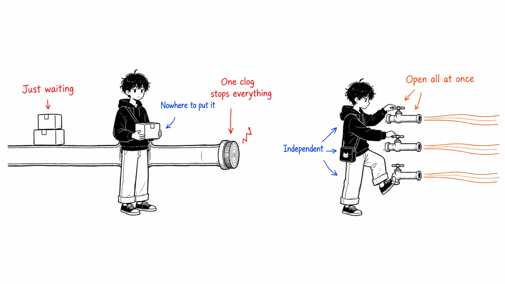
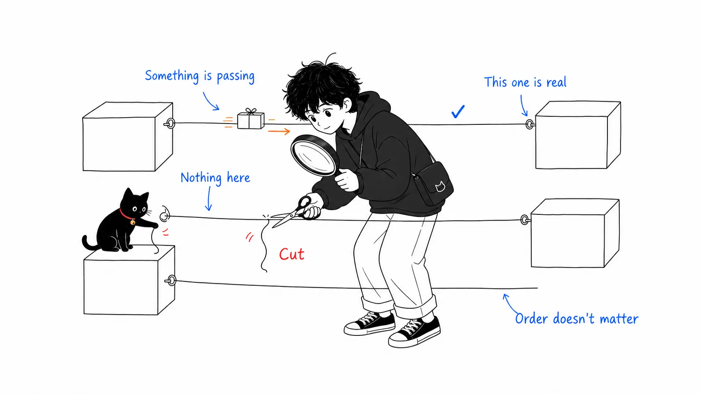
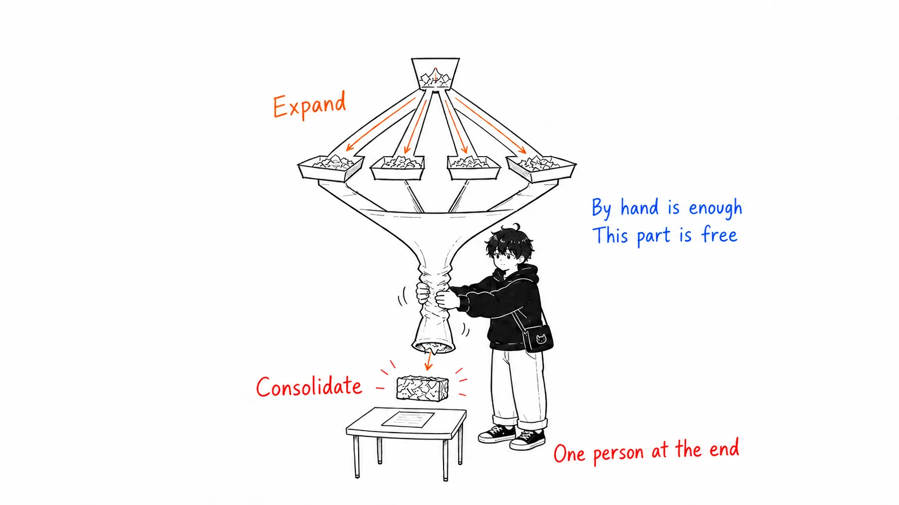
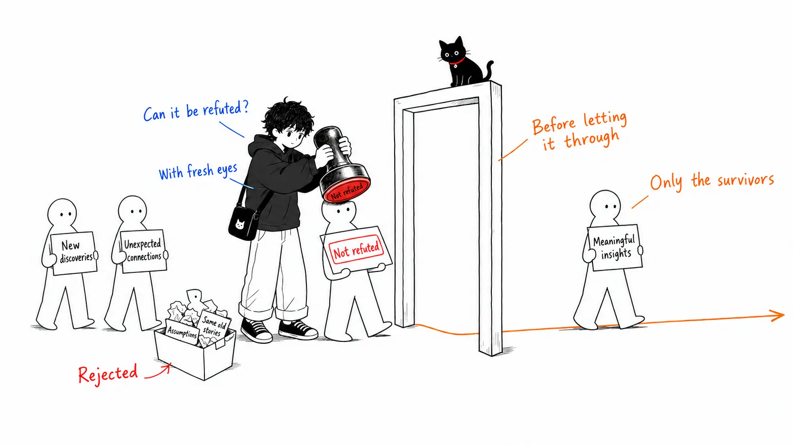
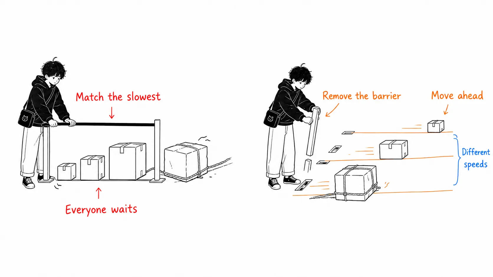
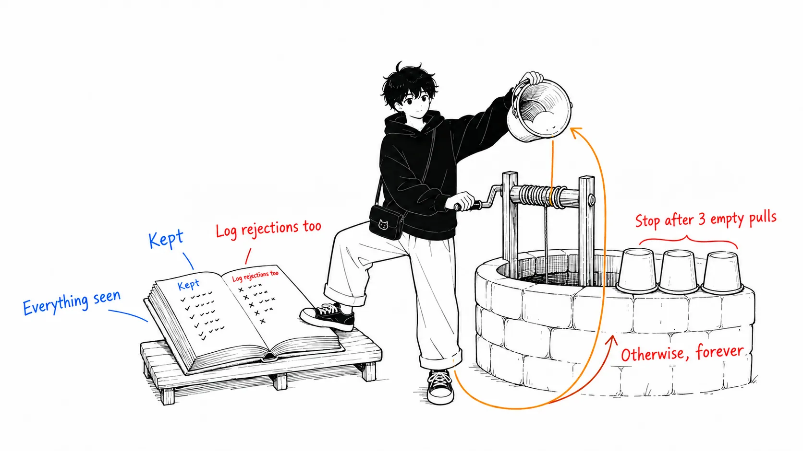

## About this article

This is a close reading of the long-form post **"Graph Engineering: How to Stop Building AI Agents That Wait in Line"**, published on July 27, 2026 by MIKE ([@mikenevermiss](https://x.com/mikenevermiss)).

The original argues that you should design agent systems as graphs, not chains (straight lines), and it uses Claude Code's **dynamic workflows** as the working example. It had about 220,000 views.

Its key facts rest on Anthropic's own documentation, so I **checked them against primary sources first** and then wrote this up.

- [A harness for every task: dynamic workflows in Claude Code](https://claude.com/blog/a-harness-for-every-task-dynamic-workflows-in-claude-code) (Anthropic, June 2, 2026)
- [Official docs: Orchestrate subagents at scale with dynamic workflows](https://code.claude.com/docs/en/workflows)

Here is the whole thing in one line.

> Stop **adding steps** to your agent. **Change its shape.** What drives speed, cost, and reliability most is not the model. It's the topology, the shape of the graph.

---

## Part 1: Why a single line breaks

### Everyone writes a chain first

Ask an agent to do something even slightly complicated and it usually ends up looking like this.

```
ファイルを読む → 要約する → ルールと照合する → レポートを書く
```

One prompt per step. Each step waits for the one before it. **It's the natural shape.** It's exactly the order in which we type things.

For short jobs, that's enough. It starts to break when the job gets long, when it gets wide, and when **you ask the agent to grade its own work**.

### Three failure modes Anthropic gave names to

The official post sorts what happens when an agent works for a long time inside a single context window into three categories.

| Failure mode | What happens | Example |
| --- | --- | --- |
| **Agentic laziness** | Quits a complex multi-step task partway and declares it done | Checks 35 of 50 items in a security review, then reports completion |
| **Self-preferential bias** | Asked to verify or grade its own output, it favors its own results | Goes easy when reviewing code it wrote itself |
| **Goal drift** | Fidelity to the original request erodes over successive turns, **especially after summarization (compaction)** | A constraint like "don't do X" is the first thing lost |

What matters is that **adding steps fixes none of these three.**

If you keep everything in one line and add more steps, the same context just gets heavier. The fix is to change the shape: **give each unit of work a fresh, clean context, and put findings through verification before you trust them.**

The official post says it in nearly these words. Workflows counter these failures by orchestrating "separate subagents, each with its own context window and a focused, isolated goal."



### The "and then" test

Here is a simple diagnostic that shows how much of your chain is actually needed.

> For every "and then" between steps, **does the next step actually read the previous step's output?**

The original's example makes this clear. "Summarize the file, **and then** look up tomorrow's weather." The two have nothing to do with each other. The weather doesn't consume the summary. **Two independent jobs have been chained together by a straight-line script on its own initiative.** The waiting between them buys nothing.

### A chain is also a graph (just the smallest and most fragile one)

This is the shift in perception.

A straight chain is not something other than a graph. It is **the smallest and most fragile graph you can draw.** One path with no branches, every node with exactly one way in and one way out. Zero redundancy.

- If one spot clogs, everything downstream stops
- And upstream is left stranded, with nowhere to put its output

The thing to fix isn't the length. It's the **width**.

---

## Part 2: Vocabulary, nodes and edges

A graph has only two building blocks. Most of the confusion in agent design comes from mixing them up.

### Node = one bounded job

**One agent, one clearly bounded job, one input, one output.**

"Handle customer interactions" is not a node. It's too broad. "Classify this one ticket" or "check this one file for one particular kind of bug" is the right grain.

### Edge = a dependency. That's all

An edge means "this node's output becomes that node's input." **Nothing more.**

So it follows that:

| These are not edges |
| --- |
| **Order.** "I wrote it first" is not a reason |
| **Proximity in the prompt.** They just happen to sit next to each other |

The only thing that makes an edge real is **data actually passing through it**.



You can run this check on an agent you've already built.

> For every arrow you drew between two steps, **can you point at the concrete data that passes along it?**

If you can't, those two steps are independent. The wait between them is pure overhead.

### A node needs a contract

A node is safe to wire into a larger graph only when it has a **contract**.

- A bounded input
- A defined, ideally validated, output shape

In other words, it returns **structured data you can use as is**, not free text that the next step has to parse while hoping nothing is broken.

With that in place, you can swap out the agents at either end of an edge. You can run several nodes in parallel without the whole system quietly collapsing the moment an output comes back a little different from what you expected.

---

## Part 3: Six shapes

Once nodes and edges are clear, a small number of shapes covers most real agent systems. I've listed them in the order you'd reach for them.

### 1. Fan-out (spread out like a fan)

If you have N independent jobs, run them at the same time instead of making them wait in line.

The design discipline that matters here is **fault tolerance**. One node failing must not sink the whole batch. Build it so a failed unit **comes back empty** instead of crashing, and strip out the empties before the next stage.

### 2. Fan-in (gather at a barrier)

Spreading out means nothing unless something gathers the results. A **barrier** is the point where nothing moves on until all the upstream results are in.

And the important part: **this is the exception, not the default.** Use it only when you truly need everything to be there.

- Deduplication across all sources
- Ranking the whole list
- A decision like "nothing came back, so exit early"

### 3. Diamond

Fan-out and fan-in combined. It's the shape behind nearly every decent agent system. **Spread out, do the work, pull it together.**

It's worth separating the three parts and naming them.

```
① fan out    広さを稼ぐ（エージェント複数）
② reduce     普通のコード数行で圧縮する（平坦化、重複除去）
③ synthesize 完全な圧縮済みセットを必要とする最後の1エージェント
```

**Step 2 is the crux.** Flattening a list and removing duplicates are jobs for deterministic code. You don't need an agent. **The middle edge is free**, and only the barrier below it is worth waiting for.



### 4. Routing

Not every path is fixed. A **router node** looks at the result and decides which edge fires next. Classify a support ticket and send it to the right owner; look at the size of a change and choose between a light review and a full audit.

There is an important design decision here.

> **Classification can be the agent's judgment. But the routing itself should be written in plain code.**

That way the same input takes the same path every time. The decision doesn't get buried inside the model's head, and unpredictable branches don't appear.

### 5. Verification

The real leverage of a graph isn't adding more agents to do more work. It's **the structure you wrap around the work to build confidence in what it found.**

A verifier sits on an edge and stands in the way before a result is allowed downstream. Its only job is to **try to refute that finding.** If the finding survives, it passes. If not, it doesn't make the report.



Recall the three failure modes from Part 1. Self-preferential bias happens when you let an agent grade its own work. **Having a different agent in a different context try to refute it** is the structural countermeasure.

### 6. A cycle that converges

Sometimes you can't know in advance how much work there is. Bug hunting is like that: find one and three more come into view. This calls for a controlled loop back to an earlier node.

The danger is obvious. **A cycle with no exit condition is an infinite loop that burns through your budget rediscovering the same spots.**

What actually works is **loop-until-dry**.

```
数ラウンド連続で新しいものが出なくなるまで続ける。そして止める。
```

And here is a critically important detail.

> Check new findings against **"everything seen so far,"** not "everything confirmed."

If you don't record the results you rejected, they resurface every round. The loop keeps paying, forever, to rediscover the same dead ends.

### How this maps to the six official patterns

The original points out that these six shapes line up neatly with the six patterns Anthropic named and documented for dynamic workflows. I confirmed this in the official post.

| What this article calls it | Official pattern name |
| --- | --- |
| Routing | **classify-and-act** |
| Diamond | **fan-out-and-synthesize** |
| Verification | **adversarial verification** |
| A cycle that converges | **loop until done** |
| (not covered here) | **generate-and-filter**: generate candidates in bulk and keep only the ones that survive a rubric |
| (not covered here) | **tournament**: have entrants compete on the same job, and a judge compares them one-on-one to pick a winner |

**Tournament** is worth remembering. The official post uses sorting more than 1,000 rows as its example, and the reason is clear: **comparative judgments are more reliable than absolute ones.** It suits judgments that are "comparative rather than absolute," such as naming, ranking, and ordering.

---

## Part 4: Four things that really matter in implementation

### (1) Isolate failures. Isolate writes too

Parallel runs break in two ways, and each needs its own fix.

| How it breaks | Fix |
| --- | --- |
| A node simply fails | Design the fan-out so an exception resolves to **returning nothing** instead of taking everything down |
| Nodes writing to the same file collide | Give each agent an **isolated workspace** and merge later |

The second is offered in Claude Code as worktree isolation. The official post also states that a workflow can decide "which model an agent uses, and whether to run a subagent in its own worktree."

One caveat, though. This is **a seatbelt for the one topology that needs it**, not a tax to levy on every graph. Isolation costs setup time and disk.

### (2) Tier your models across the graph

Not every node weighs the same.

```
1フィールドを抽出する、1チケットを分類する → 境界が明確で反復的 → 安いモデル
最終レポートを合成する、争点を裁定する      → 判断が宿る場所     → 最良のモデル
```

And **this doesn't happen unless you do it on purpose.**

> By default, every node you spawn **inherits the model of the session that started it.** Tiering only happens when you specify it explicitly, node by node.

### (3) Topology is the cost lever

This is where people trip the most, and where the biggest number hangs.

**A barrier makes every downstream step wait for the one slowest item, even if the other nine finished instantly.**

By contrast, if you let each item run through every stage independently, with no sync points, the fast items get to run three stages ahead of the slow ones. There's no reason for them to idle in the back.



**The default is "flow independently."** Reach for a barrier only when that stage truly can't proceed without the complete set. Deduplication across everything, early exit based on a total count, comparison against every other finding.

And the original's point stings.

> **"It makes the code cleaner" is not on the list of reasons.**

Extra waiting is time you can measure. A barrier needs a reason to earn its place.

### (4) How to launch it

Here's how to actually launch it in Claude Code.

| What you want | How |
| --- | --- |
| Run it as a workflow | Describe the goal and say "as a workflow." Or use the **trigger word `ultracode`** to make sure a workflow gets built instead of the usual one-question-one-answer exchange |
| Run it repeatedly | Combine a recurring schedule (`/loop`) with a clear completion condition (`/goal`) |
| Prevent runaways | **Specify a token limit.** Tell it something like "with 10k tokens" and a cap is set |
| Reuse a good result | Save the generated script. It becomes a versioned, reusable asset, and you don't have to explain it from scratch next time |

Let me also confirm the prerequisites. According to the official docs, dynamic workflows require **Claude Code v2.1.154 or later** and are available on all paid plans, the Anthropic API, Amazon Bedrock, Google Cloud's Agent Platform, and Microsoft Foundry. **On the Pro plan, you have to turn it on yourself from the Dynamic workflows row in `/config`.**

### So what is different about workflows?

The official docs lay it out well, so I'll take it as is. The difference between subagents, skills, agent teams, and workflows is **who holds the plan.**

| | Subagents, skills, agent teams | Workflows |
| --- | --- | --- |
| Who decides what runs next | Claude (turn by turn) | **The script** |
| Where intermediate results live | Claude's context window | **The script's variables** |
| What can be reused | Worker definitions and instructions | **The orchestration itself** |
| When interrupted | Redo the turn | **Resumable within the same session** |

In other words, a workflow **moves the plan into code.** Loops, branches, and intermediate results are all held by the script, so only the final answer is left in Claude's context.

---

## Part 5: Where graphs break quietly

These are the pitfalls the original lists. Every one of them is the "it runs, but you keep paying for it" kind of failure.

| # | Pitfall | What is going on |
| --- | --- | --- |
| 1 | **False edges** | You connected them because you typed them in that order. The second doesn't read the first's output. The wait buys nothing |
| 2 | **Barrier by default** | You added a sync wait because it looked tidier. The next stage doesn't need the complete set. The latency is real, and wasted |
| 3 | **Paying rent on your own plumbing** | Standing up an agent to flatten a list or dedupe an array. That's a few lines of deterministic code, at zero cost. **Save agents for judgment** |
| 4 | **A loop that never dries up** | You check new findings against "confirmed" only. Rejected results reappear every round, and you rediscover the same dead ends forever |
| 5 | **Skipping verification under time pressure** | Findings pass through before anything has tried to refute them. You've reintroduced the very laziness and self-preference that verification was supposed to prevent |
| 6 | **Reaching for it when you don't need it** | — |

On the sixth, Anthropic's own guidance is blunt.

> Most tasks don't need a panel of five reviewers.

A graph, like any other architectural decision, **has to earn its orchestration cost.** A quick one-shot prompt is still the right tool for a quick one-shot job. The official post also says outright that workflows "can use significantly more tokens" and are "best suited to complex, high-value tasks."



---

## Part 6: From drawing graphs to growing them

A hand-drawn graph is a big step up from a straight chain, but it isn't the ceiling.

The next frontier the original points to is **not drawing the graph by hand.** You describe the goal, let the system break the task down itself, let it choose how wide to fan out, and let it **write an orchestration script fitted to that run**, instead of a fixed shape you hope will suit every case.

It also means **turning the graph from a personal habit into a shared asset.** The script from a good run gets saved and committed to the repo, and teammates can launch it by name. It no longer belongs only to whoever built it first.

---

## Six shapes worth actually trying

These are concrete examples from the original. The official patterns they correspond to are in parentheses.

| What you build | Shape |
| --- | --- |
| **A security sweep across every route.** One subagent per file, each chasing a specific kind of issue, with a verifier checking every finding before it reaches the report | fan-out-and-synthesize + adversarial verification |
| **A research report with citations.** Parallel searches, fetch the sources, adversarially check every claim against "what the source actually says," then synthesize | fan-out-and-synthesize + adversarial verification |
| **Porting a module, file by file.** One agent per fix in its own workspace, and a second reviews every change before merge | fan-out-and-synthesize + isolation + adversarial verification |
| **Adversarial review of a diff.** Route by size: a light single pass for small changes, a full multi-perspective audit for large ones | classify-and-act + adversarial verification |
| **A recurring scan of a fast-moving area.** Check many sources in parallel, rank at a barrier, save it so next week it runs without being rebuilt from scratch | fan-out-and-synthesize (scheduled) |
| **Open-ended discovery.** Run explorers in parallel, check new results against everything seen, loop until several rounds in a row turn up nothing | loop until done + adversarial verification |

---

## What I couldn't verify

In the interest of honesty.

The original gives a real-world example, saying that "the rewrite of Bun's runtime from Zig to Rust was exactly this shape," but **I couldn't confirm this in primary sources.** It doesn't affect the backbone of the article's argument, but please avoid citing it as fact.

The three failure modes, the six pattern names, worktree isolation, the model-inheritance behavior, the token limit, and enabling via `/config` have all been confirmed in Anthropic's official post and docs.

---

## Summary

| Aspect | Chain | Graph |
| --- | --- | --- |
| Shape | One path. One way in, one way out | Has width. Independent jobs run at the same time |
| When one spot clogs | Everything downstream stops, upstream has nowhere to go | Independent nodes are unaffected |
| What an edge means | The order you wrote things in | **Only dependencies where data actually passes** |
| Verification | Grades itself (self-preferential bias) | A refuter in a separate context stands at the gate |
| Work of unknown size | A fixed number of passes | A loop until several rounds come up empty |
| Main cost lever | Choice of model | **Topology** |

The original's closing line captures this shift well.

> "A prompter asks a question. An architect draws a graph."
> — MIKE (@mikenevermiss)

It isn't about adding more steps. It's about **asking, for every piece of work that comes in, "where does this need to split, and where does it need to merge?"**

---

### References

- MIKE [@mikenevermiss](https://x.com/mikenevermiss), "Graph Engineering: How to Stop Building AI Agents That Wait in Line" (July 27, 2026)
- Anthropic, [A harness for every task: dynamic workflows in Claude Code](https://claude.com/blog/a-harness-for-every-task-dynamic-workflows-in-claude-code) (June 2, 2026, Thariq Shihipar and Sid Bidasaria)
- [Official docs: Orchestrate subagents at scale with dynamic workflows](https://code.claude.com/docs/en/workflows)
- Anthropic, [Building multi-agent systems: when and how to use them](https://claude.com/blog/building-multi-agent-systems-when-and-how-to-use-them) (the companion question: when is a graph overkill?)
- Anthropic, [Building verification loops in Claude Code with skills](https://claude.com/blog/building-verification-loops-in-claude-code-with-skills)
