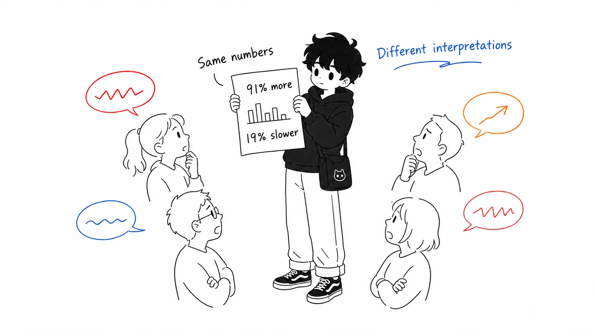

## About this article

Csaba Okrona, a manager in an engineering organization, has published an essay on his blog Leadership Garden called "[The Work Moved: What the AI Coding Debate Actually Agrees On](https://leadership.garden/ai-the-work-moved/)". It's a roundup from reading six essays side by side, from writers deeply skeptical of AI coding, like Cory Doctorow, Armin Ronacher, and Addy Osmani, to practitioners who have committed fully.

In the interest of disclosure: I have not read all six of the original essays myself, and this article relies on Okrona's roundup. I also couldn't find a publication date on the essay itself. The posts before and after it on the same blog are from May and June 2026, so it was published after that (I read it on August 16, 2026).

Here is the conclusion up front.

> The AI coding debate isn't about the facts. Skeptics and promoters cite **the same datasets**, and they even agree on the phenomenon: "the work didn't disappear; it moved from code generation to review, specification, and verification." Only the interpretations split. And I think even that difference in interpretation is not a difference in philosophy but a difference in "how much has been invested in guardrails." In other words, this is an accounting problem wearing the face of a philosophical debate.

In the first half I'll lay out what the essays say, and I'll spend my words on "My view" in the second half. Lists of numbers can be read elsewhere, so I'll keep them short.

---

## Part 1: Everyone cites the same numbers

What Okrona points out first is that writers with diametrically opposed positions are reaching for nearly the same data.

According to the Faros AI and Google DORA reports, teams with high AI adoption saw 98% more merged PRs, while review time swelled 91% and PR size grew 154% on average. The bottleneck didn't disappear; it just moved from generation to review. In Atlassian's 2025 survey, 99% of developers who use AI said they "saved 10 or more hours a week," yet most did not report a reduction in their overall workload. The freed-up time was eaten by coordination costs and context switching. In METR's controlled experiment, experienced developers were 19% **slower** when using AI, yet they believed they had gotten faster. In Stack Overflow's 2025 survey, only 16% of developers reported a "major productivity gain."

Skeptics read these numbers as "See, it's an illusion," and promoters read them as "See, the work just moved upstream." The data is a shared asset, and only the interpretation is private property. That is Okrona's starting point.

> 私が衝撃を受けたのは、彼らの意見が割れている点ではない。**事実についてはこれほど一致しているのに、その解釈がこれほど違う**という点だ。
>
> （What struck me was not that they disagree. It's that **they agree this much on the facts, yet interpret them this differently**.）
>
> （エッセイより、拙訳）
>
> (From the essay, my translation)

---

## Part 2: Where did the work move?

The core of the essay is the part that lines up each writer's description of the "destination."

Dmytro Gaivoronsky, who runs 20 to 30 agents at once in Steve Yegge's Gas Town environment, puts it most frankly.

> AI支援コーディングは、私の生産性と、私とコードの間の距離の両方を増やした。この2つは別々の効果ではない。**生産性の向上とは、距離そのものなのだ。**
>
> （AI-assisted coding increased both my productivity and the distance between me and the code. These are not two separate effects. **The productivity gain is the distance itself.**）
>
> （Gaivoronsky 氏、Okrona 氏の引用より拙訳）
>
> (Gaivoronsky, my translation from Okrona's quotation)

He divides his work into 70% "autopilot" (CI, linters, and type checks serve as the quality gates) and 30% "deliberate mode" (thinking through design and reviewing code carefully). He can stay calm as the distance grows because he has already invested in the infrastructure that catches him when something falls.

Addy Osmani accepts the same movement and then looks at its cost. The "**comprehension debt**" he spread (by way of Jeremy Twei) is, Okrona says, the most useful concept in this debate, and I agree. Generating ability and comprehension ability are different cognitive abilities, and after the ability to write has faded, the ability to review remains for a while. But there's a threshold at which "review" turns into a rubber stamp. Osmani's own confession is vivid.

> Claude が、私が何日も後回しにしていた機能を実装した。テストは通った。ざっと眺めて、頷いて、マージした。3日後、それがどう動いているのか自分で説明できなかった。
>
> （Claude implemented a feature I had been putting off for days. The tests passed. I skimmed it, nodded, and merged it. Three days later, I couldn't explain how it worked.）
>
> （Osmani 氏、Okrona 氏の引用より拙訳）
>
> (Osmani, my translation from Okrona's quotation)

Bicameral AI pushes back on the whole frame. In IDC's 2024 data, developers spend only 16% of their work time writing code. The bottleneck was never code generation; it was the ambiguity between business intent and technical implementation. Where a human developer would spot the gap in the requirements and escalate it to the product side, their concern is that an AI agent **buries the gap inside hundreds of lines of code** and hands it back.

Jake Quist's breakdown is the simplest. He had an LLM write a RingBuffer, and since it's a self-contained data structure with clear boundaries, it wrote it better than he could. Then he had it build a simple personal CRM, and it fell apart. The watershed is not front-end versus back-end, nor easy versus hard, but **whether you have to hold multiple concerns in your head at once**. Humans are uncannily good at this kind of cross-context work, he says, and current AI is bad at it.

Armin Ronacher, as an OSS maintainer, sees the downstream side of the "slop loop" caused by people without guardrails. Typing the prompt takes a minute, and seriously reviewing the code that comes out takes many times that. The contributor is satisfied, having been praised by the AI, but what's in front of the maintainer is "code that looks plausible on the surface and takes real effort to evaluate." Some projects have reportedly started asking people to send the prompt instead of the code, on the grounds that the prompt shows the intent more clearly.

And then Cory Doctorow's "**reverse centaur**." If a centaur is a human assisted by a machine, a reverse centaur is a machine's head on a human body: the human as an appendage that works for the machine. The point that a developer who merges code they don't understand just because the tests pass is not supervising the AI but merely providing **a face to take responsibility** for the AI's output is this concept at its best.

---

## Part 3: My view: This is not a philosophical debate but an accounting problem

From here is the main part. I'll write what isn't in the original essay or, as far as I've seen, in other commentary.

### The difference in positions is not a difference in philosophy but in how much has been invested in guardrails

Rearrange the six writers' "differences in interpretation," and you notice a strange correlation. Line them up from most optimistic, and that's exactly the order of how much they've already invested in guardrails.

Gaivoronsky is calm because he built the safety nets first: unit tests, linters, type checks, CI gates, pre-commit hooks. Osmani is cautious because he stands in the position of preaching spec-driven development, three-layer boundaries, and LLM-as-a-judge as safety nets "everyone should build from now on." And Ronacher is angry because he sits where other people's lack of guardrails gets billed to him: the OSS maintainer's seat.

In other words, they don't hold different opinions about the same phenomenon; **they're reporting different accounting periods of the same phenomenon**. The person who finished investing first sees profit, the person who preaches investing sees an estimate, and the person who receives the bills of others who don't invest sees a loss. Read it as "optimism and pessimism about AI," and the discussion never meshes. Read it as an accounting question, "who is paying the review cost in your environment?", and the six positions line up on a single line.

So I think this debate will have no "winner." It doesn't need one. Whether you have the Gaivoronsky-side experience or the Ronacher-side experience is decided not by the AI's performance but by your team's safety nets first.

### Comprehension debt is not something to repay but something where you choose "where to borrow"

The term comprehension debt carries the ring of debt = bad, zero = ideal. I disagree with that reading.

As with financial debt, the problem is not the existence of debt but unwitting borrowing. What's scary about Osmani's "three days later I couldn't explain it" confession is not that there was debt but that he hadn't noticed he'd borrowed. Only debt that isn't on the books causes bankruptcy.

Gaivoronsky's 70/30 is in fact what doing this bookkeeping explicitly looks like. "In this 70% area, I give up understanding. CI and the type system are put up as collateral instead." "This 30% has no effective collateral, so I keep it in my own head." Rather than trying to bring comprehension debt to zero, you draw first the boundary between areas where you may borrow and areas where you may not. My sense is that what always falls on the side where you must not borrow is domain boundary design, the data model, and anything around authentication and authorization, while the typical case on the side where you may borrow is a self-contained module where "tests can fully describe the spec," that is, Quist's RingBuffer side. His RingBuffer/CRM watershed can be used as is as "a map of where you can borrow comprehension debt."

You might wonder, "If both sides are right in the end, what should the reader do?" There's one thing to do, and only the order matters. **Build the safety net before you increase the number of agents.** The bills of the people who did it in reverse order are piling up in Ronacher's inbox right now.

### OSS is the canary in the coal mine

One more thing. The essay doesn't dig into why OSS maintainers were the first to cry out, but I think there's a structure here.

Inside a company, the review cost that AI creates gets absorbed within the same organization. Even if someone mass-produces sloppy code, the colleagues who review it are on the same pay structure too, and the cost stays in-house. In OSS, though, the cost of generation is paid by the contributor (nearly zero) and the cost of review is paid by the unpaid maintainer. The asymmetry in the cost structure is exposed without the cushion of an employment contract. That's why, while corporate managers are still saying "it feels like productivity went up," maintainers are already reporting their limit.

This should be read not as a tragedy peculiar to OSS but as an advance notice with a time lag. Inside a company, the same asymmetry exists in the same shape between those who use AI and those who take the hit (reviewers, SREs, QA, and the future you who touches that code six months later). The cushion just makes the exposure slower. I interpret Faros AI's "91% more review time" as the sound of the canary's voice starting to reach the mine shafts inside the company too.

---

## Summary: If you take home just one thing

Drop the question "are you for or against AI coding?" The facts are already agreed on by both camps, and what decides your experience is not a statement of position but only whether the investment in safety nets comes first or later. Put comprehension debt on the books and borrow it deliberately. Only unwitting debt causes bankruptcy; Osmani's three-days-later confession has already proven that.

## Sources

- Csaba Okrona, "[The Work Moved: What the AI Coding Debate Actually Agrees On](https://leadership.garden/ai-the-work-moved/)," Leadership Garden (no publication date given; viewed August 16, 2026)
- Main primary sources mentioned in the essay: Faros AI / Google DORA report, Atlassian 2025 survey, METR controlled experiment, Stack Overflow 2025 survey, IDC 2024 survey
- Writers mentioned: Cory Doctorow (reverse centaur), Armin Ronacher (agent psychosis / slop loop), Addy Osmani (the 80% problem, comprehension debt), Bicameral AI, Dmytro Gaivoronsky (Gas Town), Jake Quist (RingBuffer/CRM)
