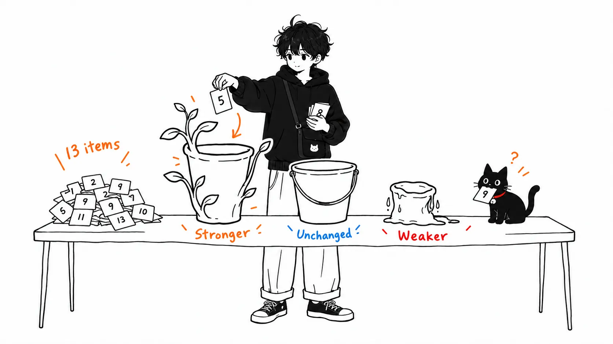
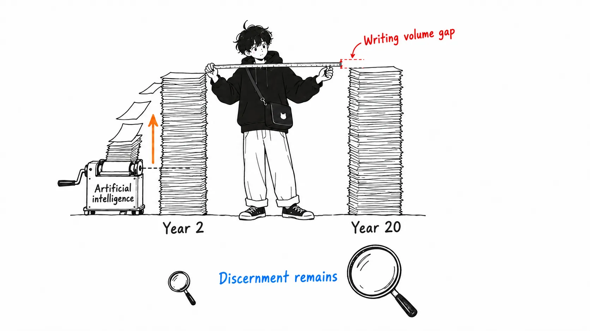
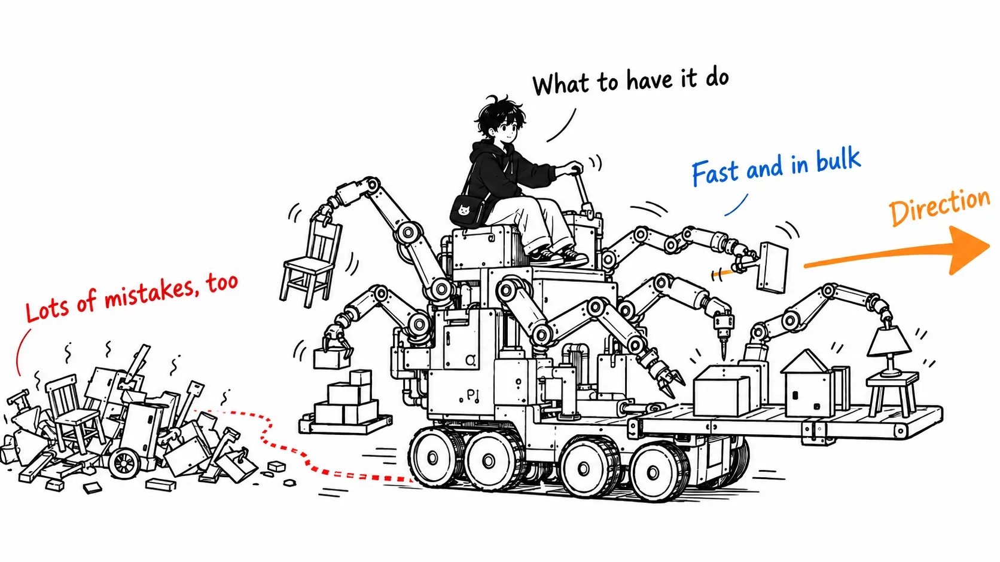
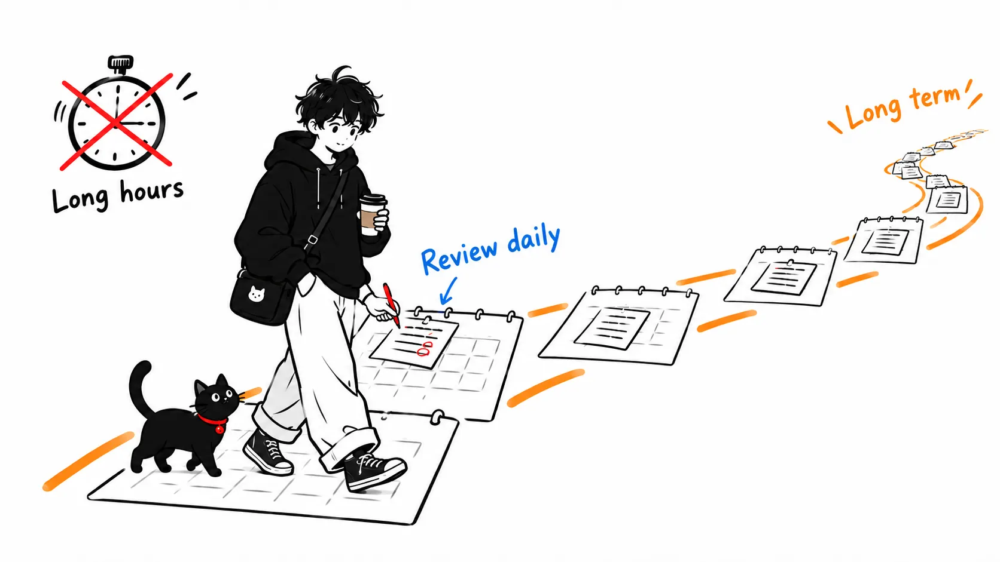

I reread Sam Altman's "How to Be Successful," which he posted on his own blog in January 2019. Drawing on the thousands of founders he saw while running Y Combinator, he boiled down what it takes to achieve outsized success into 13 points.

It's a seven-year-old essay, written before ChatGPT. The "leverage" Altman had in mind at the time didn't yet include AI.

So I read the 13 points through 2026 eyes and sorted them into "stronger now," "unchanged," and "weaker."

Here's the conclusion up front.

> The thing that has shaken most among the 13 isn't "7. Work hard." It's one sentence inside "1. Compound yourself": avoid a career where someone with two years of experience can be as effective as someone with twenty. I think AI is working precisely to close that gap. On the other side, the points whose value went up with AI are "6. Focus" and the writing part of "4. Get good at 'sales'." Both turned out to be abilities on the side that decides what to have the AI do.

---

## What the 13 Points Say

I'll just list the names. They're the headings from the original, as is.

1. Compound yourself
2. Have almost too much self-belief
3. Learn to think independently
4. Get good at "sales"
5. Make it easy to take risks
6. Focus
7. Work hard
8. Be bold
9. Be willful
10. Be hard to compete with
11. Build a network
12. You get rich by owning things
13. Be internally driven

Altman opens by saying this is for people who have already reached some degree of success (through privilege or effort) and want to turn it into outsized success. In a footnote he also writes that luck of birth is a big part of why he is where he is. It's an honest essay in how it sets up its premises.

You can read plenty of summaries of the content elsewhere, so from here I'll only talk about the sorting.

## The Sentence That Shook: Two Years vs. Twenty

What caught me most was this paragraph in the first point.

> You don't want to be in a career where people who have been doing it for two years can be as effective as people who have been doing it for twenty—your rate of learning should always be high.

In 2019, software engineer was the textbook example of a job that met this condition. Someone with twenty years was clearly stronger than someone with two. The instinct for design, the ability to read a failure, the memory of where the landmines are. It was work where experience compounded directly.

In 2026, I think that premise has largely collapsed. When someone in their second year uses Claude Code or Codex, out comes the volume and quality of code that someone with twenty years used to write. Not all of it. But as far as "writing" goes, the gap between two years and twenty is much smaller than in 2019.

Apply Altman's yardstick as is, and software engineer is drifting toward the "career to avoid" side.

Write that, and someone will say, "But the twenty-year person can tell whether the AI's output is any good." That's true, and I think a gap remains there. But that's compounding on "experience verifying output," not "experience writing code." Even with the same twenty years, the value after AI splits depending on what the compounding was riding on. Altman's essay doesn't split it that finely, but read today, it needs to be split.

## Stronger: Focus and Writing

On the flip side, I think two things have gained value because of AI.

The first is "6. Focus."

> It is much more important to work on the right thing than it is to work many hours.

Once you have an agent do the work, the time spent moving your hands becomes nearly free. What's left is the time spent deciding what to have it do. I have Claude Code write the drafts for this blog too, but choosing the topic is still something a human decides. Pick the wrong one and the agent just produces the wrong thing, fast and in bulk. Altman's Focus applies, in a literal sense, even more now than before AI.

The second is the paragraph on writing inside "4. Get good at 'sales'."

> Getting good at communication—particularly written communication—is an investment worth making. My best advice for communicating clearly is to first make sure your thinking is clear and then use plain, concise language.

Altman wrote this as an ability for persuading customers, investors, and hiring candidates. Now instructions to agents have been added to that list. Instructions written with unclear thinking return unclear deliverables. The readers have grown from humans to include AI, but the ability required is the same.

## Weaker: The "Hours" Part of Work Hard

Point 7, "Work hard," is only half outdated when you read it now.

> You can get to about the 90th percentile in your field by working either smart or hard, which is still a great accomplishment. But getting to the 99th percentile requires both

If "hard" means working hours, then now that agents can run several tasks in parallel, the value of human time has fallen in relative terms. On the other hand, the "work stamina" Altman writes about in the same point, meaning the ability to keep going for a long time, hasn't gone out of date. Looking at an agent's output every day, fixing it, and running it again is an endurance race, not a sprint.

So my reading is that Work hard has shifted in meaning from "long hours" to "a long period."

## Unchanged: Points 10 and 12

Most of the rest read the same with or without AI. Among them, point 10 fits so well you'd think it was written for the age of AI.

> If what you do can be done by someone else, it eventually will be, and for less money.

In 2019, the "someone else" was another human, or an offshore company. Now models are in that set. And models are far cheaper than humans. After AI, this sentence becomes reality much faster.

Point 12, "You get rich by owning things," points the same way. Altman writes "Time only scales linearly." Selling your time has always been linear, but since AI pushes down the unit price of that time itself, the reason to be on the owning side has gotten stronger.

## If You Take Away Just One Thing

What sorting the 13 points showed me is that what went out of date in Altman's essay isn't the talk of diligence. It's the premise that years of experience translate directly into value.

Try writing out, for your own job, where the gap between year two and year twenty remains. If the gap lies only in "the amount you wrote," your job is moving closer to what Altman's yardstick calls a career to avoid. If the gap lies in "what you choose" and "what you judge to be correct," that experience is still compounding.
