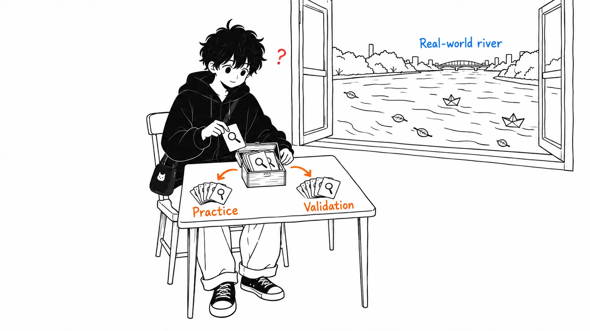
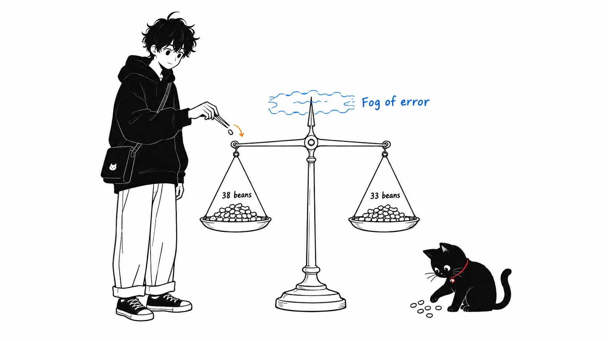
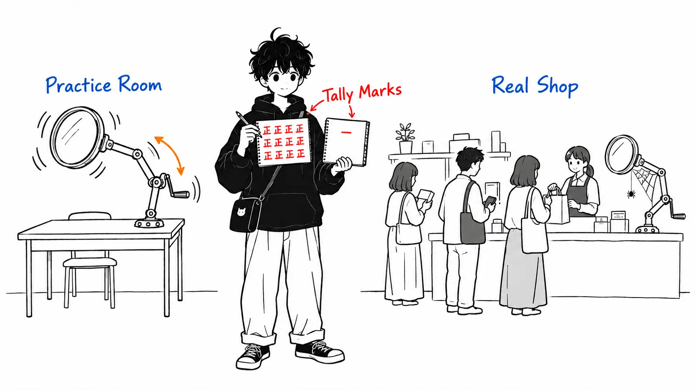

The customer-support example in Anthropic's claude.dev blog post ends on this number: "90.5% on the 14 held-out tickets, against 78.6% for the original setup." Work backward from the percentages and both fit 42 trials (14 tickets × 3 runs each). That's 38 and 33. The gap is 5 runs.

The `/claude-api hillclimb` guide, which the same post introduces, gives a rule of thumb for test-set noise: `1/sqrt(n·reps)`. Plug in 42 and you get ±15 points. The post's 11.9-point gap falls inside the noise, measured with the skill's own yardstick.

Here is my reading, up front.

> I think the most important figure in the post is the OCR example (Figure 5). But the first remedy listed right after it, the train/test split, can't detect OCR-style overfitting at all. If every case in the eval needs OCR, train and test go up together. A split guards against "overfitting to specific cases." It does not guard against "overfitting to the gap between the eval and production." The latter can't be stopped inside the hillclimb. It can only be stopped at the build-eval stage, by drawing inputs from production traffic.

The source is the claude.dev blog post [Automating eval design and hillclimbing with Claude](https://claude.dev/blog/automating-eval-design-and-hillclimbing/), by Lance Martin, published September 28, 2026.

A caveat first. I did not run `/claude-api build-eval` or `hillclimb`. What I read was the post body, its nine figures, and four eval-related files from the skill itself in [anthropics/skills](https://github.com/anthropics/skills/tree/main/skills/claude-api) on GitHub (as of commit #1930 on September 29, 2026). Every experimental number in the post is Anthropic's own report, and I have no way to verify any of them.

---

## What the post says

The first half covers eval design principles. It lists four conditions for a good eval.

> 1. Eval tasks mirror production.
> 2. Performance improves with stronger models and more thinking.
> 3. There is "passable" headroom at the frontier.
> 4. Low run-to-run variance.

Points 2 and 3 together are the practical part. If a stronger model doesn't score higher, the task is ambiguous or the grader is off. A task that fails on every run isn't hard; it's broken. The post says to use "would two experts reach the same verdict?" as the test.

The "adversarial sampling" section also lands. If you collect only the cases today's model fails, the eval ends up measuring a fingerprint of that model's weaknesses. Include a hard case only if a human can say why it's hard.

`/claude-api build-eval` turns this into an interactive procedure. It gathers inputs in this order: production transcripts, then bug reports and support inquiries, then 5 to 10 handwritten cases, then synthesis from the codebase. Grading goes cheapest first. If the output has a fixed shape, grade it with code; if it's free text, have an LLM grade it (write the rubric as claims that can be checked, not as a five-point scale). After running the baseline, it grades the same outputs twice to see whether verdicts change, checks for timeouts and truncated answers, and if the baseline is above 95% it warns you to aim at cost or latency instead of quality.

The second half is the hillclimb.

1. Ask what to improve (performance, or cost while holding performance)
2. Randomly split the eval cases into train and test
3. Each round, read only the train transcripts and propose exactly one change as a patch
4. If both train and test go up, adopt it; if train goes up and test stays flat, suspect overfitting and revert
5. When the score stalls for 2 to 3 rounds, sort the remaining failures by cause (grader bug, harness defect, variance)

Two examples are given. The first is 44 customer-support tickets (30 for exploration, 14 held out). It starts at 74.4% and 4.6 cents per ticket on Opus 4.8 with effort high. A prompt audit plus a move to Opus 5.5 with effort low gets 87.8% at 1.9 cents. Sonnet 5 with effort low gets 88.9% at about 1 cent. Adding routing rules to the prompt reaches 98.9%. On the 14 held-out tickets it's 90.5% versus 78.6%, at about one-fifth the cost. The second example improves the claude-api skill's own performance, going from 66% to about 88%.

---

## What the skill itself says

The post is a summary, so I opened the skill's eval guides. The four files total about 180,000 characters of English.

| File | Lines | Contents |
| --- | --- | --- |
| `build-eval.md` | 234 | Building an eval |
| `eval-hillclimb.md` | 339 | Performance hillclimb |
| `cost-hillclimb.md` | 442 | Cost hillclimb |
| `eval-audit.md` | 205 | Eval audit |

Three passages go further than the post.

The first is the noise rule of thumb. `eval-hillclimb.md` says:

> For a binary pass-rate the 95% CI half-width is roughly `1/sqrt(n·reps)` - 25 test cases at 2 reps is about ±14 points, 50 at 2 reps about ±10

The second is how the word "test" is used. In the default split in the same file, test is scored every round, and "its score picks the winning round and is the headline." Building a third validation slice and holding test back until the end is recommended only for large sets of "~150+ cases," and the guide says "For most evals the extra bookkeeping isn't worth it."

But `cost-hillclimb.md` says this:

> **Selection set != holdout.** The split whose score picks winners each round is a selection set, even if the guide calls it "test". Pre-register confirm runs for the headline and expect train->holdout shrinkage.

Depending on how you read it, "the guide" in "even if the guide calls it 'test'" points at the neighboring `eval-hillclimb.md`. Two files in the same skill use the same word to mean different things, and one of them puts a warning label on the other.

The third is a measured case in `cost-hillclimb.md`. A configuration scored 11 out of 20 in the selection run, then 11, 6 and 11 in three confirm runs. The conclusion reads "cost cut firm, mean quality comparable within noise, NOISIER than baseline." Behind the showy example in the post, the guide builds its rules out of unglamorous failures like this one. I trusted the guide more than the post.

---

## Measuring the example's numbers with the skill's own yardstick

Every percentage in the post divides evenly into a whole number of runs. I checked.

| Stage | Split | Rate | If 3 runs each |
| --- | --- | --- | --- |
| Opus 4.8 high (baseline) | 30 exploration | 74.4% | 67/90 |
| Opus 5.5 low + prompt audit | 30 exploration | 87.8% | 79/90 |
| Sonnet 5 low | 30 exploration | 88.9% | 80/90 |
| Sonnet 5 low + prompt improvements | 30 exploration | 98.9% | 89/90 |
| Original setup | 14 held-out | 78.6% | 33/42 |
| Final setup | 14 held-out | 90.5% | 38/42 |

With 1, 2, 4 or 5 runs each, the six percentages can't all be whole numbers at once. With 3 (or 6) runs each, they all fit. The post doesn't state the run count, so this amounts to no more than "it adds up if you assume 3 runs each."

If it is 3 runs each, the held-out set is 42 runs. The skill's rule of thumb, `1/sqrt(42)`, is about ±15 points. The gap between 90.5% and 78.6% is 11.9 points, which is smaller. Section 5 of `eval-audit.md` uses this formula as the "noise floor," that is, as a rough 95% CI half-width for a paired difference between two configurations. It is the skill's own yardstick for deciding "can I trust this difference?"

This run aimed to cut cost while holding performance, so the conclusion worth drawing is "at about one-fifth the cost, held-out accuracy did not drop." That is a solid claim and worth plenty. But reading the post's last line as "accuracy rose by 12 points" is exactly the reading the skill's own guide would stop.

Figure 7 (the inbox-routing results page, captioned "schematic") looks even thinner under the same lens. Of 24 cases, 8 are test, run 3 times each for 24 runs. The adopted v1 scores 0.875 on test (21/24). v2, reverted as "train went up but test was flat," scores 0.833 (20/24). The decision to revert came down to a single run. It's a schematic, so blaming it as a real measurement misses the point, but it's worth remembering that this is the granularity of the screen readers will imitate.

Figure 8 snagged me on one more thing. The label on the second point is "move to Opus 5.5 & audit prompt," so a model migration and a prompt audit sit in one point. `cost-hillclimb.md` puts the audit first as a "cheap, one-time, noise-reducing" step, so this doesn't violate the one-change-per-round rule. But the figure has no point where only the audit was applied, so I can't tell how much of the jump from 74.4% to 87.8% came from the model and how much from the prompt. The post explains part of the cost drop by Opus 5.5's pricing (20% cheaper on input and output, 60% cheaper on cache reads), but the accuracy gain isn't broken down.

As for the 14 held-out tickets themselves, the post says "the search never saw" them. If that was a confirmation run executed exactly once at the end, it is a stronger design than the default in `eval-hillclimb.md`. In that case, the only weak point is the count.

---

## My take

### 1. A held-out set doesn't stop OCR

The post's overfitting section opens with the OCR example.

> consider an evaluation task that benefits from OCR, but OCR is rarely beneficial in your production tasks. The evaluation harness might add an OCR tool to your application, which improves on the benchmark without any impact on production.

Figure 5 lines up this pattern: "the task setup demands OCR → an OCR tool is added," "the task lives in /app → 'always cd /app and run pytest' is added," "the phrasing has a quirk → a prompt tailored to it." Right after it comes "Three things can help address this," and the first item is "Split the cases."

This is what snagged me most. Everything lined up in Figure 5 is a property of **the eval as a whole**. If most eval cases need OCR, the randomly split train and test both contain cases that need OCR in the same proportion. Add an OCR tool and both go up together. The hillclimb's verdict is "both went up, so adopt it." The overfitting signal, where train goes up and test stays flat, never appears.

What a split can catch is a change tailored to specific train cases, for example pasting the phrasing of a failed ticket into the prompt. That's the kind of thing the guide covers separately with "Never paste failures into the prompt." It's a real problem and the split does work for it. But the OCR and /app examples at the top of Figure 5 sit outside the split's net.

So what does stop it? Only the post's first principle, "eval tasks mirror production." That is probably why build-eval tries to take its inputs from production transcripts. In other words, OCR-style overfitting can be stopped only at the build-eval stage, not inside the hillclimb. In the post's structure these two sit in separate sections, and I think that makes the connection hard to see.

I came up with one thing you can do in practice. `eval-hillclimb.md` has a rule, "Separate 'did the mechanism engage' from 'did it help.'" It has the agent record things like how many times a tool was called in a column separate from the score. Line that column up against production logs. If a tool or branch the hillclimb added fires in 60% of eval cases but only 2% in production, that's OCR. The skill counts only the in-eval numbers, so the production-side counts have to come from you.

One more thing. The options for what the hillclimb is allowed to touch include "Your harness code," and the post itself says that open-ended requests to fix the harness tend to stall. This is exactly the surface where OCR-style additions happen. Until you have a way to check against production call counts, I think it's safest to put the harness code on the do-not-touch list.

### 2. "Test" is, in the default design, a selection set

The second point is about wording. When the post explains the split, it describes test as "a test set that is never seen." The hillclimb's analyst really doesn't read the test transcripts. But the test score is looked at every round. It's used to decide whether to adopt or revert, and to pick the winning round at the end.

The more rounds you run, the easier it is for a change that happened to score well on test to get adopted. In the claude-api skill example, which ran 24 rounds, that's 24 decisions. The test score finally reported is, by definition, the maximum of the test scores across all rounds. It comes out a little generous by construction. The "Selection set != holdout" line in `cost-hillclimb.md` says exactly this, so the answer already exists elsewhere in the same skill.

My position is clear: I think the default in `eval-hillclimb.md` should be fixed. Making the third slice optional at "150+ cases" is a convenience argument, but the fewer cases you have, the bigger the selection leniency, so it should really be the other way around. If you don't have enough cases to cut three ways, at least rerun only the winner and the baseline at the end with a different random seed and use that number as the headline. `cost-hillclimb.md` says to do that.

While I'm at it, in the post's second example (the claude-api skill itself), neither the post nor Figure 9 shows the distinction between train and test. You can't tell which split the 66.1% to 87.9% curve is drawn from.

### 3. The most valuable part was sorting the failures when the score stalled

The third point is the part I found most interesting to read. In the claude-api skill example, after the score stalled for two rounds, the remaining failures were sorted by cause, and this came out:

> the hillclimber found that the skill content was present but Claude was simply writing older API shapes (e.g., from its trained priors).

The fix was to put a "the shape I remember → the current shape" mapping table near the top of the skill, and to move the C# and Java notes above the examples. That took it from 77% to 80%.

Adding more content doesn't fix this because what's missing isn't information. It's the strength to push back against the habit the model has memorized. When I previously read a paper that verified the "skills work" numbers, it made the point that fetching a skill and following it are separate steps. This example is the field version of that. It isn't enough for a skill to be written down; it has to be placed before the spot where the habit shows up, or it doesn't work.

The other thing the sorting turned up was a way the eval side was broken. A task asked for code that catches one kind of error, but the grader demanded "a chain of at least three levels." The grader's instruction contradicted the documentation, and when they actually hit the API, the documentation was right. The label on the third segment of Figure 9 (80.1% → 87.9%) is "fixing graders, plus more skill edits." The post doesn't say how much of that segment's gain came from a better skill and how much from a more correct grader. (The guide says to re-grade every version after fixing a grader, so if they followed it, the curve should be connected on a single yardstick.)

I don't see this as a weakness. I think it's the real use of a hillclimb. Even if you run it as a tool for raising the score, the most useful output may turn out to be a report saying "this part of the eval is broken." A stalled score is the signal that tells you so.

I'll leave one question I couldn't answer. The eval in this example was built from the documentation, and the hillclimb is given that documentation and the SDK to read. The side proposing changes can read where the correct answers come from. The guide's rule "don't put the answer within the model's reach" is about the model under test, so it doesn't speak directly to the proposing side. Since the skill's job is to carry the documentation's contents, you could also say this isn't cheating but the work itself. But in that case the test tasks, even when split randomly, are built from the same pages of the documentation, so "the test wasn't seen" means considerably less.

---

## If you take away just one thing

When `/claude-api hillclimb` adds a tool or a branch, line up how many times it fired inside the eval against how many times it fires in production logs. The skill counts the former for you. The latter you have to bring yourself. If the two counts differ a lot, that's the OCR of Figure 5. The train/test split won't tell you about that difference.

---

## Sources, and how I checked

- Lance Martin, ["Automating eval design and hillclimbing with Claude"](https://claude.dev/blog/automating-eval-design-and-hillclimbing/), claude.dev Blog, September 28, 2026
- The [claude-api skill](https://github.com/anthropics/skills/tree/main/skills/claude-api) in anthropics/skills: `build-eval.md`, `eval-hillclimb.md`, `cost-hillclimb.md` and `eval-audit.md` under `shared/evals/`. Fetched through the GitHub API as of the September 29, 2026 commit "Update claude-api skill: Claude Opus 5.5 default, Claude Sonnet 5.5, build-eval and hillclimb guides (#1930)"
- Something I wrote earlier on a related topic: [Claude's official cost-cutting tips](/articles/claude-official-cost-down) (my read of the cost-reduction post that the blog links to)

For the back-calculation of the percentages, I brute-forced 1 to 6 runs each for the 30-case and 14-case sets and checked whether the post's percentages (to one decimal place) could come from whole-number counts. Only 3 and 6 runs each make everything fit. For the noise rule of thumb I used `1/sqrt(n·reps)` from `eval-hillclimb.md` and `eval-audit.md` as is. Section 5 of `eval-audit.md` also uses it as a rough confidence interval for a difference. Per-ticket results aren't published, so I did not run an exact paired test.

I read the figures by eye from the images in the post. The underlying data is not public.

### What I couldn't verify

- The number of runs per ticket. I got only as far as "it adds up if you assume 3 runs each"
- Whether the 14 held-out tickets were a confirmation run executed exactly once at the end, or were also used midway in the adoption check in `cost-hillclimb.md` (whether the held-out score stays within a given range)
- In the second point of Figure 8, the split between the effect of the prompt audit alone and the effect of moving to Opus 5.5
- Whether the claude-api skill example (66.1% → 87.9%) is the train, test or overall number. Whether the baseline was re-graded after the graders were fixed
- Since Figure 7 is a schematic, whether real hillclimb output has this granularity (8 test cases)
- Sonnet 5.5 came out the same day (September 28), and the post's examples use Sonnet 5. I don't know whether 5.5 gives the same results
