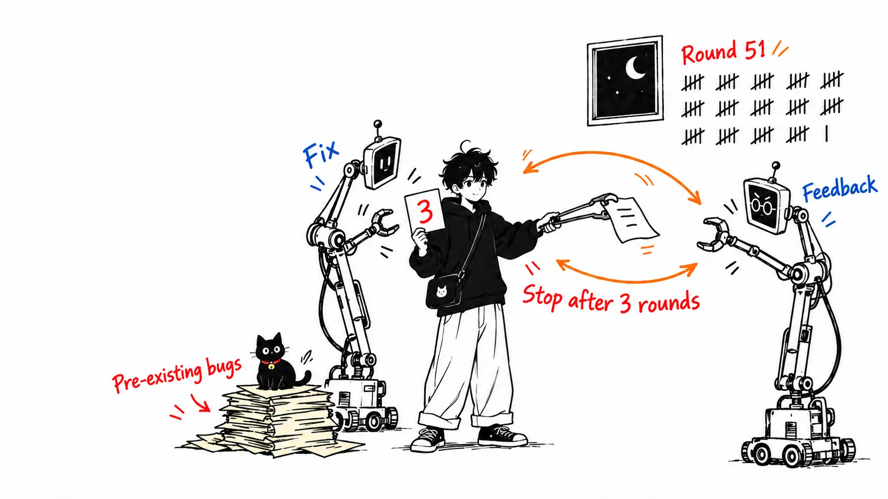
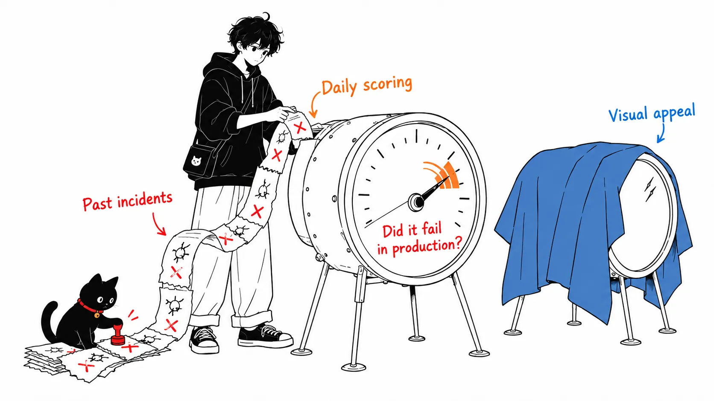
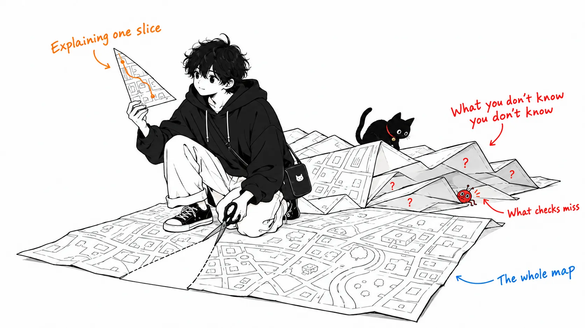
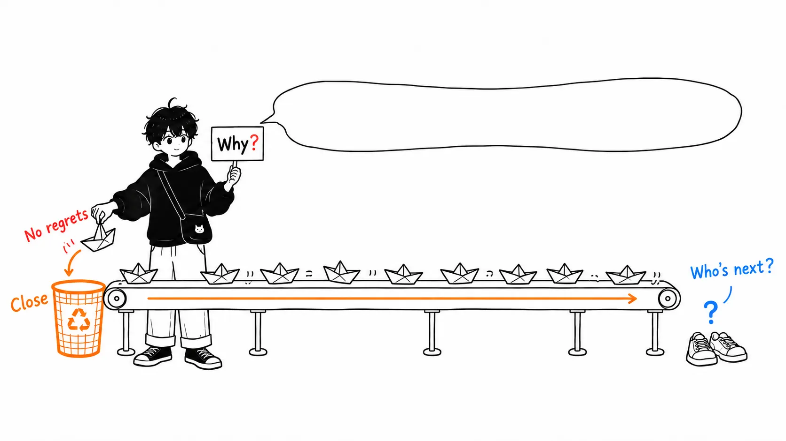

One PR got reviewed more than 50 times in a single night.

Not by human reviewers. An agent wrote the PR, an agent reviewer flagged problems, the author's agent fixed them, and the reviewer flagged more. It went on all night, until the author stopped it.

That story comes from "How the Claude Code team does code review," which the Claude Code team published on claude.dev on October 15, 2026. The authors are Addy Osmani, Morgan Westlee Lunt, and Qing Wang. The post starts from the premise that Claude writes about 90% of Claude Code's code, then explains how they review that volume in six layers. The headline numbers: from June to September, merged PRs more than doubled, and the share of those PRs that got reverted fell by more than 40%.

Here is my conclusion up front.

> In August I wrote that "having AI pre-screen reviews just puts a second copy of a broken instrument next to the first one." This article refutes half of that. If you score an AI reviewer against past incidents instead of against human taste, it stops being the same instrument. But take the other half, the second job of review: "the team understanding its own code." On that, the article says "nobody needs to hold the whole picture." And the five judgments the same article leaves to humans all require the whole picture.

I read the original article in full. I did not read the linked posts on redesigning source control for the monorepo or on scaling CI. One more disclosure: this is a team at a company that sells its own product called Code Review, writing about its own practice. Every number was measured by them.

---

## They dropped "did a human read it?" Here is what they measure instead

First, the premise numbers. In Anthropic's monorepo, daily changes grew from about 2,500 in May to more than 30,000 in September. Claude Code itself lives in a separate repository, but it faces the same pressure.

Anyone can say that humans can't read that volume line by line. What this article does differently is restate the purpose of review.

> We think "did a human read the code?" is an imprecise proxy for "what could go wrong with this change, and which check—automated or human—is the right one to catch it?"

They also state plainly what they optimize: human approvals per PR (median and 95th percentile), human comments, and the time a PR spends waiting on people. They want those down. But they use revert and incident rates as guardrails, and if those rise, they count it as "not saving human time, just moving it later."

> Cutting the first doesn't help if the time just shows up in the second.

That one sentence sets the scoring standard for the whole article. The six layers that follow explain how they built things to meet it.

## Of the six layers, the first one absorbs the volume

The six layers are: verification before the PR is opened, AI review on every PR, a blocking security review, required CI, human approval tiered by risk, and merge queues with flags and staged rollouts. Underneath all of them sits "we can roll back quickly."

The plainest of these, and the one I think works best, is the first.

> Most review now happens before a PR exists. We give Claude something it can run—like tests, a build or a screenshot to compare against the design—and ask it to show the output instead of saying it's done.

After that, a subagent in a separate context looks at the diff. Boris Cherny, who built Claude Code, estimates that giving Claude a way to verify its own work makes the end result 2 to 3 times better.

Another habit sits in the same layer. If the AI reviewer keeps flagging the same thing, don't just take the comment. Fix the source: fix the skill, turn it into a lint rule, or write it into `CLAUDE.md` or `REVIEW.md`. The description of a good `REVIEW.md` is concrete. It states what "failure" means in that repo. For docs, it's "lying." For config, it's "routing things to the wrong place." Findings must cite file and line as evidence, and guessing from names is not allowed. If there is nothing to fix, the reviewer is made to say so.

This layer has almost nothing to do with selling the product, and anyone can copy it starting tomorrow.

## They score the AI reviewer against their own incidents

The second layer is the Code Review product itself. Multiple agents hunt for bugs in parallel, a separate group of agents votes on each finding, and only findings with enough agreement get posted. Comments that are only about style or cleanup are dropped. At the research-preview stage, the share of internal PRs receiving substantive review comments rose from 16% to 54%.

More than the numbers, what stopped me was the section on how they improve this reviewer.

> The team collected past PRs that caused incidents, with their fix-forwards and reverts, and had engineers who know that code confirm each bug and where it lived. The reviewer runs against that set daily.

Every incident adds one case to the eval set. Whenever they change the reviewer, whether the prompt, the tools, or the model, they re-score against every case, and if the score doesn't go up, they throw the change away.

They measure noise with the same idea. They classify the reviewer's comments by how the human on the PR reacted: fixed it, said it was wrong, said it was intended behavior, or judged it irrelevant. They also run the reviewer on PRs known to be fine and count how many findings it produces that could lead to a wrong fix.

Neither mechanism measures the reviewer by whether a human finds it plausible. They measure it by whether something actually broke in production and by what humans actually did. That matters for my argument later.

## The night of 50 rounds

The most honest section of the article is about review that wouldn't end.

> An agent author and an agent reviewer can keep each other busy indefinitely. One CLI PR went through more than fifty rounds of review and fixes overnight before its author stopped it.

The line placed just before it captures the heart of the problem. A human can wave off a nitpick in a few seconds. An agent fixes it. Fixing adds commits, and the review goes around again. When the author is an agent, the cost of noise shoots up.

To find the cause, they used git blame. About 59% of the spots the reviewer kept flagging were code that already existed when the reviewer first looked. It wasn't finding new bugs. It was finding old, pre-existing bugs, a few more with each round.

And they write that they made it worse themselves. Since each round turned up something new, running multiple rounds had become a habit.

They made four fixes. After three rounds, the reviewer tells the author to rethink the whole approach. After the first few rounds, only the diff is re-reviewed. The reviewer names the kind of bug rather than a single line, and the author fixes every instance. A finding already raised is not raised again. As a result, PRs that pass in one round of review and fixes went from 65% to 78%, PRs needing five or more rounds went from 8.9% to 1.5%, and the average number of reviews to pass went from 2.08 to 1.32.

I read this section less as a story about review quality and more as a story about metrics. They began tracking rounds-to-pass alongside recall (how many bugs were caught). If you only push toward catching more bugs, the reviewer keeps digging through old code and PRs never finish. Measure only one of the two and the other runs wild. That is an obvious point, and the value of this article is that it shows it with a real case: 50 rounds.

## Approval tiers are set by the change, not by the author

The fifth layer varies human approval by risk.

| Risk | Examples | Human approval required |
| --- | --- | --- |
| Low | Docs, wording, internal-only features, additive changes behind a flag | None, if automated review and security are green |
| Medium | Normal product changes, sensitive areas such as caching, the auto-updater, and the system prompt | 1 person |
| High | The riskiest code, and some paths that always require 2 people | 2 people |

A classifier sets the tier. A second classifier decides, "even if the tier doesn't require it, does this change need a different human?" CI workflow files and paths that an owner has registered as sensitive always need a human.

The finer rules were the more interesting part to me. Only authors on that repo's trusted list can use the lighter tiers. An agent's approval never fills a human approval slot. On a PR written by an agent, the human who directed the agent counts as one of the required reviewers, just as if they had written it themselves. Approval is for a specific commit, and if a new commit the system can't vouch for lands (an agent's push, or a manually resolved merge), the approval has to be redone.

That last rule should matter a lot in the agent era. It closes off in advance a failure mode where the author's agent quietly pushes an "improvement" after approval.

On top of this sits the norm "once you land it, it's yours." When a small or medium change breaks something, the person who landed it usually fixes it. The reasoning is not blame but that this person has the most context. The norm works because of a premise: changes are small, and flags, reverts, and staged rollouts can undo them within minutes.

---

## My view

### Half of my August article was wrong

In August I wrote an article arguing that "review isn't clogged, the instrument is broken." The claim was this. Code written by AI has a clean surface, so the instrument human reviewers used, "sloppiness" as a cue, stopped working. And the industry's prescription, AI pre-screening, has the same bias of judging fluent code as "reasonable," so it just puts a second copy of a broken instrument next to the first.

Having read the Claude Code team's article, I admit that the second half does not apply, at least to their operation.

The reason is what their reviewer is calibrated against. I wrote "same instrument" because I assumed AI reviewers would be fooled by the same surface that fooled human reviewers. Whatever is scored on surface gets fooled by surface. But their reviewer is scored daily against a set of PRs that actually broke in production. Its noise is measured by what humans actually did in response to its comments. An instrument calibrated against "did it actually break" rather than "does it look plausible" is not the instrument I had in mind.

In the August article I listed three signals that can't be faked: a test that fails before the change, actually running the path, and the revert rate. Their first layer is "make it show the output," and their guardrails are the revert and incident rates. Their prescription was closer to mine than I expected. The difference was that I had put the AI reviewer outside the prescription, while they put it inside, on the side that learns from incidents.

You might object that the eval set contains only incidents that have happened. True, and kinds of incidents that haven't happened yet can't be scored. But the same goes for human reviewers. Human intuition only grows from the incidents it has seen.

### The denominator behind "40% down"

One note on the headline number. Merged PRs more than doubled, and the share reverted fell by more than 40%.

The drop in the rate is a real improvement. But if PRs exactly doubled and the rate fell exactly 40%, the absolute number of reverted PRs is 2 × 0.6, about 1.2 times as many. It went up. The article says only "more than," so I can't tell whether the actual absolute number rose or fell.

I don't mean this as nitpicking. Their goal is to reduce "human time per PR," so it makes sense for the guardrail to be a per-PR rate. But it is humans who fix reverts, and the total amount of that work depends on counts, not rates. On a team whose PR volume has doubled, even with a falling rate, the people fixing broken things may be no less busy. I'd like to see the article's own scoring standard, "cutting review time doesn't help if it shows up as fixing time," checked against counts as well.

### The five judgments left to humans demand the whole picture

This is the part of the article that snagged me most, and it is the claim I want to make in this post.

The article says at the start that code review has two jobs: finding and fixing problems before shipping, and sharing an understanding of the codebase across the team. It then spends most of the text on the first, and handles the second in three paragraphs near the end.

> Nobody on the team keeps a complete mental model of Claude Code in their head, and we don't think anyone needs to. When someone wants to understand a part of the codebase, they ask Claude to write an explainer for exactly that slice.

Meanwhile, the same article's section on "where humans stay in the loop" lists five judgments left to humans. Whether to build it at all. High-risk code. Architecture that sets patterns others will copy. Reading the evidence. Owning the outcome. On reading the evidence, it says this:

> If you can't say what the checks would miss, ask for a real review rather than a quick approval.

To say what the checks would miss, you need to know how the system is connected, including the places the change doesn't touch. To judge a "pattern others will copy," you need to know which patterns exist now. To decide "whether to build it at all," you need some sense of what it would collide with in what exists.

All five are judgments that a one-slice explainer can't cover.

A slice explainer works for someone who knows what they don't know. But the five judgments left to humans ask about places where you don't know what you don't know. That is where most of what the checks miss lives.

My reading is that by replacing the second job with "pull up an explainer when you need one," the article has removed a precondition for the part of the first job that it left to humans. And that doesn't show up in their guardrails. Revert rate and incident rate count incidents that happened. "Nobody on the team can explain this module's boundaries" is not an incident, so it shows up in the numbers only after a cluster of incidents caused by it.

The "broken instrument" I described in August no longer applies to this team for the first job. What worries me now is that there is still no instrument at all for the second job.

### If I'm wrong

The most likely objection is that no single person needs to hold the whole picture, as long as the team does. The article also says much of the team works in public channels anyone can see, and that feedback comes from people who aren't the owner. It is quite possible that the whole picture is distributed through channel conversation rather than held in any one head. In that case, my worry is only looking inside individual heads.

There is also something they write in the section on "changing direction." Work that shouldn't be built gets closed when someone asks "why?" early in the channel. That move requires someone who holds the whole picture, so I think the current team has people who can do it. My claim is a question about how those people came to be able to, and whether the next person to join can walk the same path. I don't doubt that things work for the current team, and the article's numbers support that.

What I've written here is inference from the article's internal consistency. I haven't seen what happens inside the Claude Code team.

---

## Summary

If you take away only one thing, take what you score the AI reviewer against. Score it by whether humans find it plausible, and it gets fooled by the same things humans do. Score it daily against your own past incidents, and measure noise by what humans actually did in response to its comments, and it becomes a different instrument. You can do this without using Code Review. All it takes is collecting past reverts and having someone who knows that code confirm where the bug was.

If I can add one more: decide in advance how many rounds review is allowed to take. If both author and reviewer are agents, it never ends on its own.

And a way to measure review's second job exists neither in this article nor in my hands yet.

---

## Sources

- Addy Osmani, Morgan Westlee Lunt, Qing Wang, "How the Claude Code team does code review," claude.dev Blog, October 15, 2026. https://claude.dev/blog/solving-code-review-at-anthropic/
- My earlier post, "Review isn't clogged, the instrument is broken: AI code burned out the 'sloppiness' warning light," August 25, 2026
