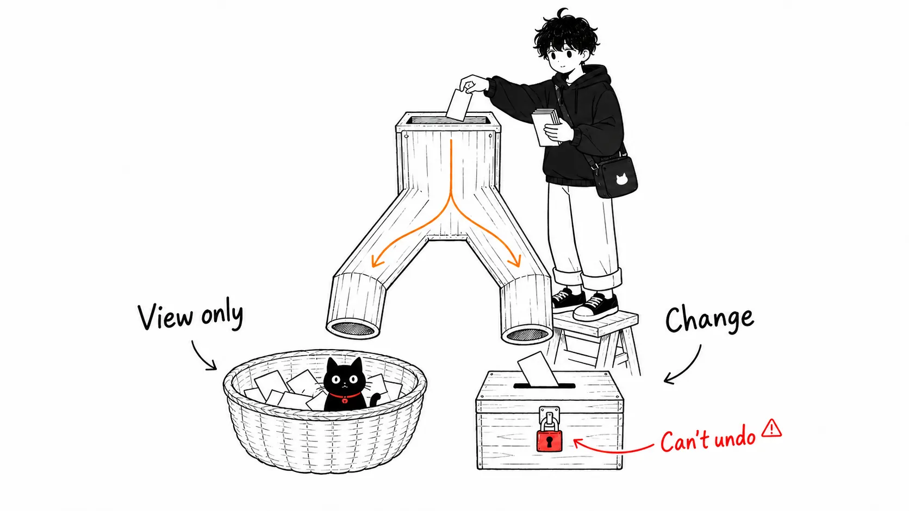
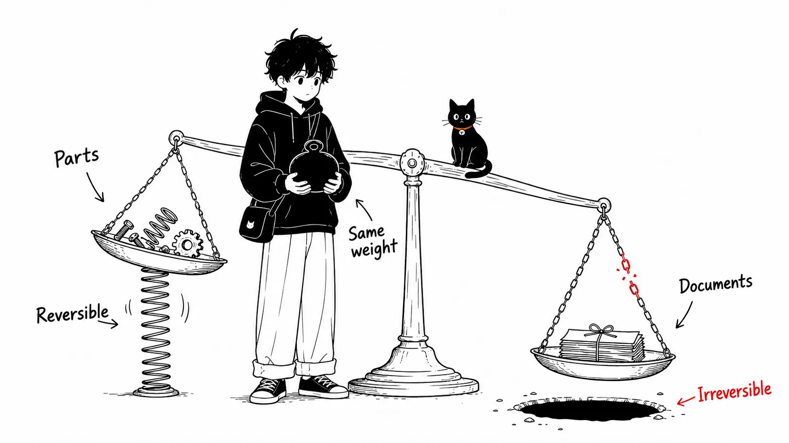
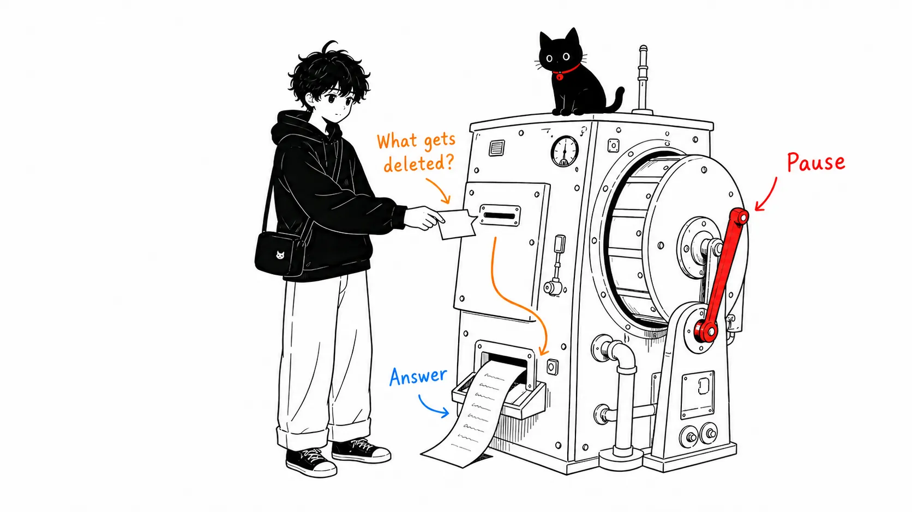

## Sound familiar?

When you start using Claude Cowork or Claude Code, a screen like this shows up.

```
● Bash(rm -rf node_modules)

Do you want to proceed?
❯ 1. Yes
  2. No
```

An engineer can judge it in a second. But for someone seeing it for the first time, **there's no telling whether it's dangerous or safe.**

And if you can't tell, this is what happens.

| What happens | Result |
| --- | --- |
| You're scared, so you stop it every time | You can't use the AI and go back to doing it by hand |
| You press Yes without understanding | Someday an important file disappears |

You want to avoid both. This article is **the minimum set that lets you make that call.**

You don't need any programming knowledge. Just remember ten things.

---

## 1: Look only / Change

**The first thing to learn isn't a term. It's this distinction.**



This alone settles 80% of the judgment. The terms that follow are tools for telling the two apart.

---

## 2: Directory = Folder

They mean **exactly the same thing.** Engineers just say it differently. Read it as "folder" in your head and you're done.

---

## 3: Path = a file's address

```
documents/2026/07/請求書.xlsx
```

`/` is **the separator between folders.** Read it as "the documents folder → 2026 → 07 → 請求書.xlsx (the invoice file)."

`.` is "the folder you're in now," `..` is "one level up," and `~` is "your own home folder." Remember just these three and you can read a path.

---

## 4: `ls` = view a list

It just lists what's in a folder. **Nothing changes.** 🟢

Others in the same family (all "look only," so they're safe):

| Command | Meaning |
| --- | --- |
| `ls` | List |
| `pwd` | Where you are now |
| `cat` | View a file's contents |
| `head` / `tail` | View only the start / only the end |
| `wc` | Count |

---

## 5: `grep` = Ctrl+F (search)

```
grep -rn "請求書" ./documents
```

It means "look inside the documents folder for lines containing '請求書' (invoice)." **It's the same as Excel's search**, and nothing changes. 🟢

You may also see `rg`, but it's **the same kind of "search"** (a faster version). `find` searches by file name rather than by contents. All of them are safe.

---

## 6: `rm` = delete for good (it doesn't go to the trash)

Now we get to the main point.

```
rm -rf node_modules
```

`-rf` means "**delete the whole folder, without asking, by force.**"

:::message alert
Always stop when you see `rm -rf`. But **`-rf` itself isn't the bad part. Everything depends on what the target is.**

- `rm -rf node_modules` → parts that were fetched in. Even if deleted, you can put them back 🟢
- `rm -rf documents` → **your documents folder. Absolutely stop it** 🔴
:::



---

## 7: `git commit` = a save point

It's the same as saving in a game. **If you've committed, you can return to that point exactly as it was.**

The flip side: **changes you haven't committed can't be restored.**

:::message
**Commit before you ask for work.** This is the most effective insurance. One sentence is all it takes.

```
作業を始める前に、今の状態をコミットして
```
:::

---

## 8: `diff` = the difference before and after a change

It's the same as Word's "Show Markup" for tracked changes.

```diff
- 請求書の締め日は月末です
+ 請求書の締め日は毎月25日です
```

`-` (red) is a deletion and `+` (green) is an addition. It's **the fastest way to check what the AI changed.**

---

## 9: `git push` = send it outside

This is an operation that **sends something onto the internet (to GitHub or the like).** Once it's sent, it's hard to treat it as "never happened."

If internal documents or customer information are mixed in when you send, **the information gets out.** 🔴

Others in the same "goes outside" family: deploy, pushing to production, `--prod`. All of them are things to stop and confirm.

---

## 10: `.env` = a file with passwords in it

`.env` and key files (inside `~/.ssh`) contain **passwords and API keys in plain text.**

If you let the AI open them, **they stay in the conversation record.** 🔴

:::message
Set this up once at the start, and from then on you're protected automatically.

In Cowork, put it in Global instructions under "Settings > Cowork"; in Claude Code, in the project's `CLAUDE.md`:

```
- .env や鍵ファイルは開かない・中身を出力しない
- ファイルを削除・上書きする前に必ず確認する
- 元のファイルは書き換えず、新しいファイルとして作る
```
:::

---

## Summary: this table alone is enough to decide

| When you see | Decision |
| --- | --- |
| `ls` `pwd` `cat` `grep` `rg` `find` `git status` `git diff` | 🟢 **Yes** |
| `mkdir` `cp` `git add` `git commit` `npm install` | 🟢 Yes (things only get added) |
| `mv` `>` `chmod` | 🟡 Check the target |
| `rm -rf` `git reset --hard` `git push` `sudo` `deploy` `DROP` | 🔴 **Stop** |

And **when you don't know, the right answer is always the same.**

:::message
```
それは実行しないで。まず何をするコマンドか、
何が消えるかを日本語で説明して
```
:::



**Asking back isn't a delay in the work. It's the correct way to use it.** Claude is built on the assumption that it will be asked back.

---

## Going deeper: there are two follow-up books, depending on the reader

This article is the minimum set. The follow-up depends on **which one you use.**

### If you don't use the terminal (the black screen)

📘 **『AIが何をしているか分かる本 — 事務職のための Claude Cowork 入門』 (A Book for Understanding What the AI Is Doing: An Introduction to Claude Cowork for Office Workers; in Japanese)**

- Five steps from installing Claude Desktop to getting Cowork running
- How to organize folders (the story of how **folder design doubles as security**)
- The Projects feature, and how to write different kinds of instructions (Global / project / folder)
- **The words on the approval screen** (Read/Write, deletion protection, prompt injection)
- Signs that mean you should stop, and recovery when something goes wrong

:::message
In fact, Anthropic's official guidance says "**Monitor tasks, not just commands**" and that you "shouldn't try to verify every single command."

In other words, if you're only doing office work in Cowork, **you don't even need to learn the commands in this article.** I covered the details in that book.
:::

### If you use Claude Code in the terminal

📘 **『黒い画面が読めるようになる本 — Claude Code コマンド・用語辞典』 (A Book That Teaches You to Read the Black Screen: A Claude Code Command and Terminology Dictionary; in Japanese)**

- Terminal and Git vocabulary
- Look-only commands / change commands (a list with options)
- How to read what's on screen (`● Read(...)` `● Bash(...)`)
- A reverse lookup of symbols (`-rf` `~` `*` `|` `>`) and error messages (`command not found` and the like)
