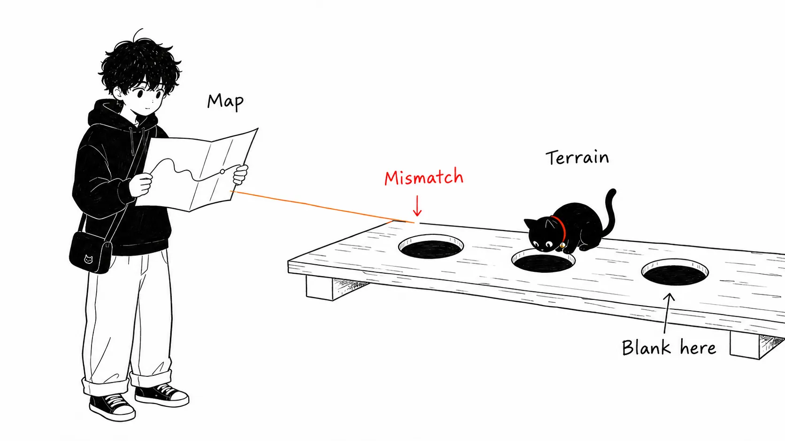
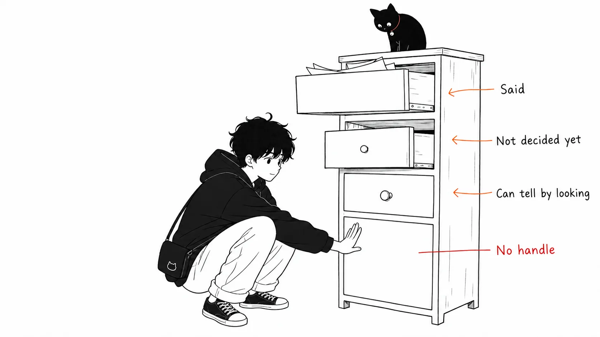
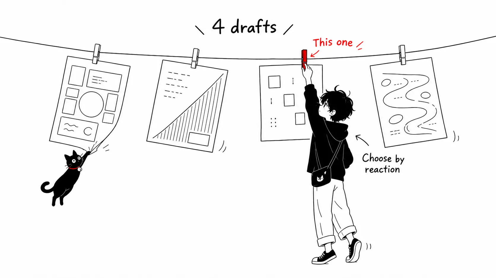
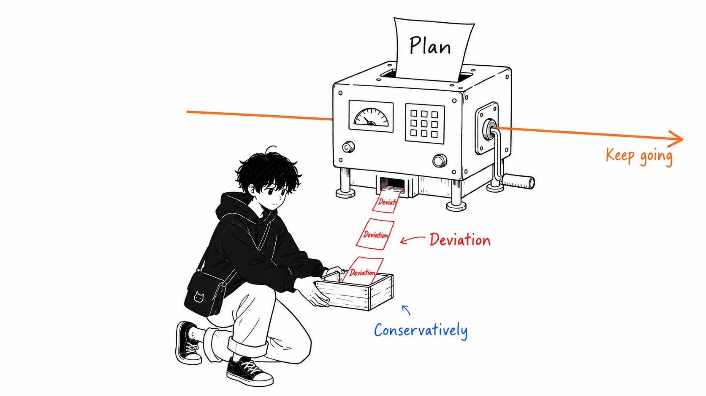
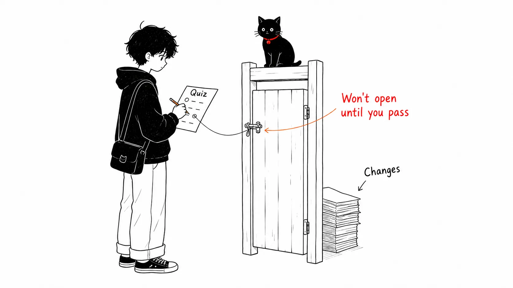

## About this article

I'm working through [A field guide to Claude Fable 5: Finding your unknowns](https://claude.com/blog/a-field-guide-to-claude-fable-finding-your-unknowns) (July 6, 2026) by Thariq Shihipar of Anthropic. The idea is that **"when you hand work to an AI agent, quality is determined not by the model's capability but by how many unknowns you have (things you haven't figured out yet)."** I'll lay out that idea and its concrete practices.

The original is a short essay, about a five-minute read, but what it contains works well as a set of prompts you can use starting tomorrow. Here I unpack its claims and organize them in a form you can drop into a real workflow.

---

## 1. Map and Territory

The original opens with this metaphor.

> **Map** = what you give Claude. Prompts, Skills, context.
> **Territory** = where the work actually happens. The codebase, the real world, the real constraints.



It then defines **the gap between the map and the territory as "unknowns."**

This is the core of the article. When Claude runs into an unknown, it has no choice but to **make a decision by guessing**: "they probably want this." And:

> The more work you hand over, the more unknowns Claude runs into.

In other words, "handing a big job to the AI" means "increasing the number of times the AI has to guess."

### Why this matters now

The author writes:

> I feel that Claude Fable is **the first model where the quality of your work is bottlenecked by your ability to make your unknowns clear**.

Put differently, the claim is that this kind of shift is underway:

| Before | Now (Fable onward) |
| --- | --- |
| The model's ability to implement falls short | The model can implement well enough |
| "The AI couldn't write it" is the bottleneck | **"I couldn't explain it" is the bottleneck** |
| Prompt engineering = steering the AI | Prompt engineering = **excavating your own requirements** |

And an important caveat:

> **Simply planning up front is not enough.** Unknowns can turn up deep inside the implementation, and sometimes they make you realize "this should have been solved a different way in the first place."

So the author treats discovering unknowns as **an iterative process repeated before, during, and after implementation**.

---

## 2. The four categories of unknowns

When the author brings a problem in, they always break it into four parts. It's an application of the well-known Rumsfeld matrix.

| Category | Definition | Example |
| --- | --- | --- |
| **Known Knowns** | What's written in the prompt. The requirements you are actually telling the AI | "Add authentication to this API" |
| **Known Unknowns** | What you haven't decided yet, and you're aware you haven't | "I haven't decided how many minutes the token should last" |
| **Unknown Knowns** | Things so obvious you never write them down, but **you know "that's it" when you see it** | "The tone of the error screen," "the padding on buttons," "this company's conventions" |
| **Unknown Unknowns** | Things you've never even thought about. **You don't know how good this could get** | "An existing library could have solved this," "there's a better UX pattern" |



The top three drawers open if you struggle with them, but the bottom one has **no place to pull at all**, so it doesn't open. That is Unknown Unknowns.

### The trickiest one is Unknown Knowns

Personally, the one that hits hardest among these four is **Unknown Knowns**.

They are things that are "obvious once someone says them, but you'd never put them into words yourself." If this part isn't filled in, the AI's output ends up **technically correct but somehow unconvincing**. This is what's behind it when all you can say in a design review is "something's off."

### Skilled people have fewer unknowns, but they assume unknowns exist

The author says that when they look at the prompts of Boris Cherny, who built Claude Code, and Jarred Sumner of Bun,

> **It's obvious they have a detailed grasp of what they want.** They are deeply in sync with both the codebase and the model's behavior.

and then goes on:

> **But even they assume unknowns exist.** In many ways, reducing unknowns and preparing for unknowns is the "skill" of agentic coding. Luckily, it's a **skill you can get better at by working with Claude**.

The key point is that "being bad at giving instructions" is treated not as a matter of talent but as a skill that practice can improve. The sections that follow are the concrete techniques for that.

---

## 3. Pre-implementation

The practical part starts here. The original gives four techniques.

### 3-1. Brainstorm and prototype

**Unknowns targeted: Unknown Knowns (things you'd recognize on sight but can't put into words)**

For areas where "you can only define the criteria once you see it," the author has Claude brainstorm and prototype together with them.

Why move this earlier? The reason is stated clearly.

> **Identifying and articulating unknown knowns at the prototyping stage is extremely valuable. Finding them during implementation is (comparatively) expensive.** A small change to a feature or spec can cause a dramatically different implementation in code, and it's harder for an agent to unwind earlier changes.

For example, if you "just want to see how it looks when a button is added to the frame," there's no need to wire up backend routes or add front-end state management.

The author also writes that **they start almost every coding session in an exploration and brainstorming phase**. The effects:

- You can define the project's scope with intent
- Claude often finds high-value approaches you had overlooked
- Conversely, it can also fall into "missing the forest for the trees"
- As a result, **you avoid setting the scope too narrow or too wide**

**Prompt examples (from the original)**

```text
I want a dashboard for this data, but I have no visual sense and I don't even
know what's possible. Make an HTML page with four design proposals that go in
completely different directions. I'll decide by reacting to them.
```

```text
Before wiring anything up, make a single HTML file that mocks the new edit screen.
```



:::message
The point is the "**make them choose**" format. Instead of making you put it into words from zero, having you react to multiple options reels in the Unknown Knowns. The "four completely different options" part is what makes it work.
:::

### 3-2. References

**Unknowns targeted: Known Unknowns that cost too much to explain**

This is for when you can't explain something in detail, or it would take too long.

> Diagrams, documents, and images can be included, but **the best reference is source code**.

The author writes:

> If there's a library that implements some behavior in a particular way, or a design component you like, **just point Fable at that folder and tell it what to look at. It doesn't matter if it's written in a different language.** Compared with screenshots and the like, you can give Claude far richer detail about markup and structure.

**Prompt example (from the original)**

```text
The Rust crate in vendor/rate-limiter implements exactly the backoff behavior
I want. Read it and reimplement the same semantics in our TypeScript
API client.
```

:::message
"Different languages are fine" is a very practical point. It's an everyday occurrence that the behavior you want to borrow lives in a library in another language.
:::

### 3-3. Interviews

**Unknowns targeted: Surfacing Known Unknowns**

Even after plenty of brainstorming, unknowns remain. So the author **has Claude interview them**.

> When you ask Claude to interview you, give it the context of the problem to guide its questions.

**Prompt example (from the original)**

```text
Interview me one question at a time about anything that's ambiguous.
Prioritize questions where my answer would change the architecture.
```

:::message alert
This short prompt contains two important touches.
1. **"One question at a time"**: if you ask ten at once, people answer sloppily.
2. **"Prioritize questions that would change the architecture"**: by making it rank its questions, you keep it from spending your time on trivial confirmations.
:::

### 3-4. Implementation plans

Once you think you can implement, have Claude write an implementation plan for review. There's a trick here, too.

> Have the plan focus on **the parts most likely to change**: the data model, type interfaces, UX flows, and so on. This lets Claude surface "the things I might actually need to change."

**Prompt example (from the original)**

```text
Write the implementation plan in HTML, but put the decisions I'm most likely
to tinker with at the top: data model changes, new type interfaces, and
everything the user sees.
You can bury the mechanical refactoring at the bottom; I trust you on that part.
```

:::message
The instruction "you can bury the mechanical refactoring at the bottom, I trust you" is excellent. **A human reviewer's attention is a finite resource**, so the design concentrates it on the decisive parts. It should resonate with anyone who has worn themselves out reading a huge implementation plan in full.
:::

---

## 4. During implementation

### 4-1. Switch sessions and hand over the artifacts

Once satisfied with the plan, the author **starts a new session and passes the artifacts in the prompt**.

> This gives Claude a **fresh context window** while keeping everything gathered during planning at hand.

For example, you hand over the spec file and the prototype and have it implement. The idea is to carry over only the conclusions, without bringing in the noise of trial and error from the planning stage.

### 4-2. Have it write implementation-notes.md

> **No matter how much you plan, unknown unknowns are always lurking.** While working, the agent may realize it has to take a different approach because of an edge case it found in the code.

So the author gives Claude Code a temporary `implementation-notes.md` (or `.html`) and **has it record the decisions it makes**. The purpose is "so the next attempt can learn from them."

**Prompt example (from the original)**

```text
Maintain implementation-notes.md.
If you hit an edge case that forces you to deviate from the plan, pick the
conservative option, record it in a 'Deviations' section, and keep going.
```



:::message
This prompt combines three instructions.
- **Give the decision criterion up front** ("pick the conservative option") → behavior when it's unsure becomes predictable
- **Have it record** (write it in Deviations) → a human can verify later
- **Don't let it stop** (keep going) → trivial confirmations don't halt the work

It's a design that sits between "it checks with me every time" and "it quietly proceeds and I find out later." And the recorded Deviations become, as they are, **a list of unknowns you can eliminate in the next planning round**.
:::

---

## 5. Post implementation

### 5-1. Quizzes (you get tested)

After a long session, Claude may have accomplished far more than you thought.

> Reading the code diff gives you only a light understanding, **because much of the behavior depends on existing code paths**.

So the author gives Claude enough context and **has it quiz them on the change**.

> **I only merge after I pass the quiz perfectly.**

**Prompt example (from the original)**

```text
I want to make sure I understand everything that happened in this change.
Make an HTML report about the change, including context, intuition, and
what was done, in a form I can read and understand.
And at the bottom, add a quiz that I have to pass.
```



:::message
It flips "review the code the AI wrote" into "**the AI tests your understanding**." I think it's a quite effective countermeasure to the problem of skimming a diff, thinking "looks fine, I guess," and merging.
:::

### 5-2. Pitches and explainer materials

> One of the most important parts of shipping anything is **getting buy-in and approval**.

Including a pitch or explainer artifact in the final document, it says, helps in two ways.

- **It speeds up understanding when the reviewer starts from the same unknowns you did**
- **It speeds up approval when an expert wants to confirm that you've already considered the unknowns and typical failure points they themselves would have expected**

**Prompt example (from the original)**

```text
Combine the prototype, spec, and implementation notes into a single document.
Format it so I can post it in Slack and get buy-in. Put the demo GIF first.
```

:::message
This, too, is consistent as an extension of the unknowns frame. **The reviewer has the same unknowns you do.** So the very process by which you eliminated your unknowns becomes the review material as is.
:::

---

## 6. Matching the map to the territory (conclusion)

The original closes like this.

> The better the models get, **the more you can achieve when you take the right approach**. When a long-running task comes back with the wrong result, you probably should have spent more time defining the unknowns, or built an implementation plan that lets you and Claude proceed while adapting to the unknowns.

And this is my favorite line in the article.

> **Every explainer, brainstorm, interview, prototype, and reference is a cheap way to "learn what you didn't know before fixing it gets expensive."**
>
> So start your next project by asking Claude to help you find your unknowns.

---

## Practical checklist

I've organized the original's techniques into a checklist you can use as is.

### Before implementation

- [ ] **Brainstorm**: don't have it implement right away; start with "give me N completely different approaches"
- [ ] **Prototype**: mock up the look and UX in a single HTML file before wiring anything, and decide by reacting
- [ ] **References**: if there's an implementation you want to borrow from, give it **the source code path**, not a screenshot (a different language is fine)
- [ ] **Interview**: ask it to "go one question at a time, and prioritize questions that would change the architecture"
- [ ] **Implementation plan**: put the decisions likely to change (data model, types, UI) at the top and mechanical work at the end

### During implementation

- [ ] Once the plan is firm, create a **new session** and start by handing over the spec and prototype
- [ ] Have it **record Deviations** in `implementation-notes.md`
- [ ] **Give the decision criterion up front** for when it's unsure (e.g., pick the conservative one)

### After implementation

- [ ] **Merge only after passing the quiz**
- [ ] Combine prototype + spec + notes into **a single pitch document**

### Retrospective

- [ ] Read the Deviations in `implementation-notes.md` and **turn the unknowns you can eliminate next time** into CLAUDE.md or a Skill

---

## Closing: my take

What hit me most in this field guide is that it **reframes "I'm bad at instructing the AI" as "my requirements are vague."**

There's a flood of "prompt tips" out there, but this article points the opposite way. **Now that models are smart enough, what needs improving is not the craft of communicating to the model, but the fact that what you want to communicate hasn't firmed up inside you.**

And of the four categories, Unknown Knowns and Unknown Unknowns **by definition can't be found by yourself alone**. That's why you ask Claude to "help you find them." It's also why the article's techniques (brainstorming, multiple options, interviews, quizzes) all take the form of "have the AI pose the questions / lay out the options."

Even just adding one line before you ask for an implementation, **"ask me about whatever I haven't decided about what we're about to build,"** I think will change the experience.

---

## References

- Original: [A field guide to Claude Fable 5: Finding your unknowns](https://claude.com/blog/a-field-guide-to-claude-fable-finding-your-unknowns) — Thariq Shihipar (Anthropic), July 6, 2026
- Related: [Building verification loops in Claude Code with skills](https://claude.com/blog/building-verification-loops-in-claude-code-with-skills) — July 21, 2026
- [Claude Code docs](https://code.claude.com/docs/en/overview)

Note: the prompt examples in this article are my renderings of the English prompts in the original post. If you want to check the nuance, please see the original.
