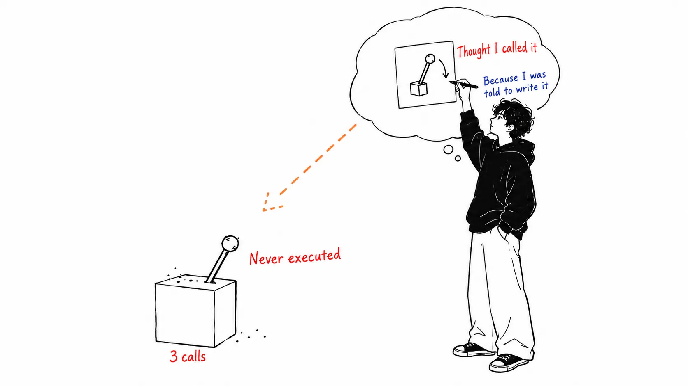
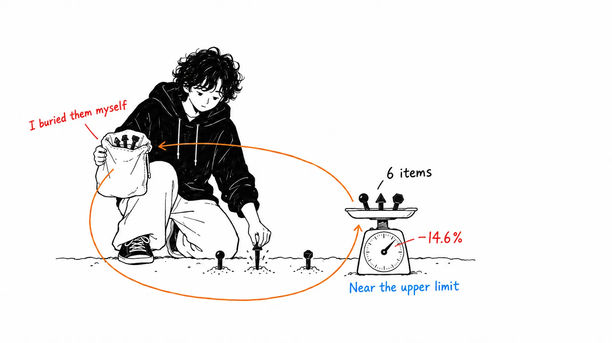
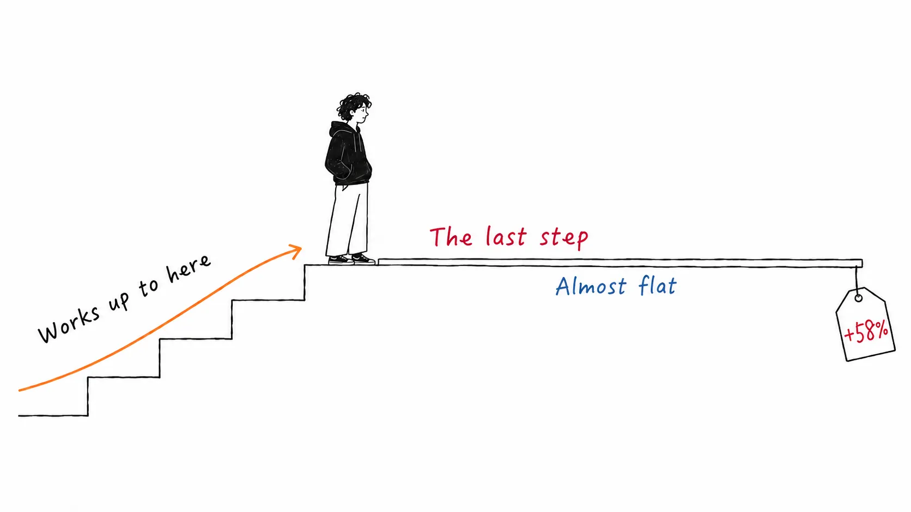
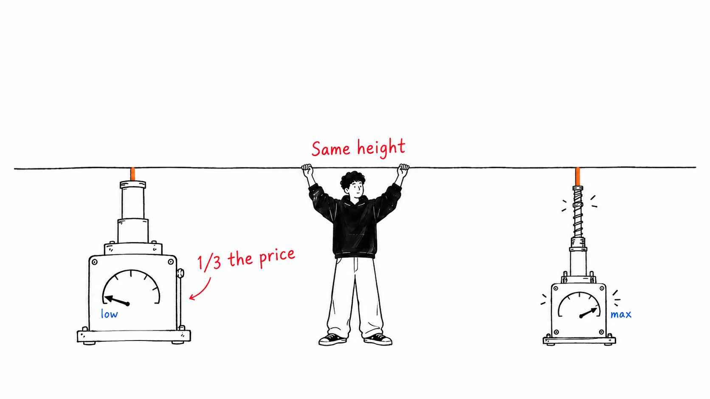

Conclusion first.

> The most interesting thing in this article is not the 14.6% savings. It's that **accuracy went up 5.3% on the same operations.** And all three reasons it went up come down to "the instructions were breaking the processing." What I cut in the name of cost optimization was already a bug before I cut it.

## About this article

This is my record of reading "Reducing cost and improving performance with Claude Platform," an [X Article published by @claudedevs on September 8, 2026](https://x.com/claudedevs/status/2097369738968195513). The authors are Lance Martin, Brad Abrams, Isabella He, and Ben Lehrburger. It introduces three levers (prompt caching, instructions, and effort) and three slash commands: `/claude-api prompt-audit`, `cost-optimize`, and `hillclimb`.

An honest disclosure first. I read all of the body text, but **the Figures in the article are image blocks, and I couldn't read their contents when I first wrote this**.

After publication, readers showed me four of them (the cache hierarchy, the Fable 5 effort curve, the two CursorBench curves, and the `cost-optimize` results), so **I revised the article on September 10, 2026**. One of the things I learned from the figures **contradicted** my original interpretation. I didn't delete it; I left it in the relevant section as a correction. The remaining Figures are unchecked.

Also, partway through this article I place some fairly strong demands on the original. I'll say up front that I think the original's claims themselves are correct.

## It's the story of getting more correct, not the story of getting cheaper

`prompt-audit` is a command that reads an existing prompt, finds anti-patterns, and rewrites it. The authors took a customer-support ticket classification prompt and built six legacy versions, each with one anti-pattern planted in it, then ran the audit while migrating from Opus 4.8 to Opus 5.

The result: **cost −14.6%, accuracy +5.3%**.

Cost going down is a given. You deleted useless instructions, so both input tokens and thinking tokens drop. What I couldn't explain was the accuracy, and the original gives a three-part breakdown.

> - A retired thinking setting was left in, and **the API was rejecting every routing request**
> - The refund rules contradicted each other, and **four refunds that should have been issued were not**
> - A hand-written scratchpad instruction collided with the built-in thinking, and **in three tickets the tool call was written inside the reasoning and never executed**

None of the three is a performance problem. They were broken.

I think the third is the scariest. An instruction like "write your thoughts to a scratchpad first, then act," which would have been the model answer five years ago, worked in the direction of **making the model write the tool call as reasoning text** on a model with built-in thinking. The model feels like it "made the call," the thinking looks diligent in the logs, and in reality nothing happened. It doesn't necessarily fail in tests either, because a classification result still comes back.

The original's list of anti-patterns: verification rituals, thoroughness and emphasis boosters, mandatory procedures and scratchpad scaffolding, stale examples, contradictory rules, and out-of-date settings. Lined up, **every one of them is something that "used to work."** They didn't stop working. They started working in the opposite direction.

## But those six were planted by the authors themselves

Here I need to quote the original's words directly.

> We started from a clean prompt and **planted** one anti-pattern at a time (a retired thinking setting, a pair of contradictory refund rules, a manual scratchpad, "verify twice", "be maximally thorough", and a mandatory six-step procedure), giving six legacy prompts.

They started from a clean prompt and **planted** anti-patterns one at a time. So −14.6% / +5.3% is **the effect of removing landmines they buried themselves.** It is not the number you'd get from auditing a prompt found in the wild. I think it should be read as a measurement near the upper bound of the effect size.

Checking the six planted items against the classification list above, you notice one is missing. **"Stale examples" were not measured.** It's in the classification, but none of the six legacy prompts contains few-shot examples. This isn't spite; it's probably because it's the hardest to measure. If you rewrite one example, is it the same prompt or a different one? That's also where I hesitate most when cleaning up my own CLAUDE.md, and that's the one place with no number.

I read `hillclimb` the same way. Starting from Opus 4.8 high: Opus 5 low + audit reaches 98.9% on the training set at 2.6 cents per ticket; dropping to Sonnet 5 low gets 1 cent but 88.9%; adding a routing rule and a cross-reference to the refund cap keeps it at 1 cent while restoring 98.9%. That's the training set so far. On the holdout it's **90.5% versus 78.6%, at about 1/5 of the cost**.

Good numbers. But the holdout is **14 cases**. That's where I stopped. 78.6% is exactly 11 of 14. But 90.5% is not divisible by 14 (12 cases would be 85.7%, 13 cases 92.9%). It looks like **the same 14 cases are being scored by count on one side and at a different granularity on the other**. I may be misreading it, but since I can't read Figure 7, I couldn't pin that down.

Either way, a 12-point difference is being discussed on a denominator of 14. If one or two cases move, the picture changes.

I'm not making the obvious point that a vendor is measuring its own product on its own benchmark. My reading is that **the method is sound and only the effect size leans optimistic**. The distinction matters, which is why I think the procedure in this article is worth imitating. Only the numbers can't be imitated.

## On every curve, the last step is the worst deal

:::message
**Correction, 2026-09-10.** This section originally said "the shape of the curve differs by task. For one it's an investment, for the other it's waste." When I looked at the figures, **that contrast didn't hold up.** What follows is the rewrite. How I got it wrong is at the end of the section.
:::

The original shows cost and score by effort as four curves. Numeric labels are attached only at the two ends, so the intermediate points are my readings off the axes.

| Curve | low | max | Last step (xhigh→max) |
| --- | --- | --- | --- |
| Fable 5 / FrontierCode Diamond | 11.5%, $5.35 | 30.9%, $19.00 | +1.6pt, +58% |
| Fable 5 / CursorBench 3.2 | about 62.1%, about $4.3 | about 70.5%, about $18.5 | +2.1pt, +64% |
| Fable 5.1 / HLE (no tools) | about 53%, about $0.30 | about 61%, about $2.23 | +0.5pt, +46% |
| Fable 5.1 / CursorBench 3.2 | about 66.1%, about $2.9 | about 73.5%, about $9.7 | +0.8pt, +33% |

**On all four, the last step costs the most.** From low to xhigh, every curve rises cleanly. The flattening always comes at the last step. The original itself wrote about HLE, "+0.5 points for +46% cost. Within run-to-run variance." That wasn't a property of HLE. It was **a property of max**.

So the effort decision isn't "which curve is this task on?" **Whether to go up to xhigh and whether to buy the step beyond it are separate questions.** The former is usually worth buying. The latter is a poor deal on all four curves.

The reason I got it wrong at first is clear. **I decided the shape of the curve from just the two endpoints.** Put 11.5%→30.9% next to 53%→61% and the former looks like "it's working" and the latter looks like "it's flat." Add the intermediate points and both have the same shape. From a list of extracted numbers you can tell the slope, but not how it bends.

One more thing I noticed in the figure is that **the horizontal axis is log scale**. A 3.5x increase in cost moves only a little horizontally, so going all the way to max looks cheap on the figure. My impression when I was reading only the numbers and my impression from the figure pointed in opposite directions.

## On CursorBench, the two curves never cross

The CursorBench 3.2 figure overlays Fable 5 and Fable 5.1, and **there is no intersection**. Fable 5.1's max (about $9.7) is **cheaper and 5 points higher** than Fable 5's xhigh (about $11.3). On the Fable 5 side, there is no effort level that beats 5.1 on price.

The original's "Fable 5.1's low matches Fable 5's high at 1/3 the cost" is about the lower left of this figure. Cache reads being cheap, $0.25/M versus $1.00/M, contributes, but according to the original it would still be about 40% cheaper even at the same price as Fable 5.

Running a strong model gently is cheaper than running a weak model hard, for the same result. On the figure it's one step stronger than that: **there is no place a weak model run hard can reach in the first place.**

## Two things were new in the caching section

The caching mechanics (prefill / KV, tied to the model, byte-wise prefix match, TTL) are already known.

**First. The 5-minute TTL is counted from the "start" of the request.** So if you run a subagent that takes 10 minutes, the parent's cache has expired before the child returns. The original recommends a 1-hour TTL. And if you're switching models or effort, do it at compaction time, since that's when the cache breaks anyway.

**Second (correction and addition).** I originally wrote that "only one thing was new," and listed three as "known tricks": `defer_loading`, moving system prompt updates to the message side, and pre-warming with `max_tokens: 0`. Looking at the figure, these three are not separate tricks but **one rule restated**. The prefix is stacked in order of how widely it is shared.

| Layer | Cached scope |
| --- | --- |
| System instructions | Global |
| Tools | Global |
| CLAUDE.md, memory | Per project |
| Session state | Per session |
| Messages | Grows every turn |

Since a hit happens only on a prefix match, **the moment you put something that changes per project above the "global" layers, everyone's prefix breaks.** `defer_loading` is an operation that pushes loading downward so as not to contaminate the upper layers, and moving system prompt updates to the message side is the same thing. What I thought were three small tricks were one action for keeping to this stacking order.

## In `cost-optimize`, all four confidence intervals straddled zero

When I wrote the body, I could only treat the `cost-optimize` results as a string of numbers. The figure **has 95% confidence intervals attached**.

| Benchmark | Cost | Amount | Score change | 95% CI |
| --- | --- | --- | --- | --- |
| tau2-bench (retail) | −72.7% | $25.88 → $7.05 | +1.3pp | −4.6 to +7.2 |
| LegalBench | −57.6% | $13.67 → $5.79 | −0.3pp | −0.8 to +0.3 |
| OfficeQA Pro | −52.4% | $136.20 → $64.87 | +4.5pp | −2.1 to +11.1 |
| SWE-bench Verified | −55.1% | $39.74 → $17.86 | −3.3pp | −9.6 to +3.1 |

**All four straddle zero.** I take this as evidence of honesty on Anthropic's side. They were right not to write the +4.5pp on OfficeQA Pro as "performance went up." The CI reaches −2.1, so you can't say it went up. Plenty of companies would publish just the +4.5pp without the CI.

At the same time, let me write this down too. **The CI for SWE-bench Verified reaches −9.6.** In agentic coding, the use case readers of this article care about most, a degradation of nearly 10 points can't be ruled out. "Performance was maintained" means "no degradation was detected," not "there was no degradation." When you propose halving costs for production, that difference matters.

Also, this article originally said that "the tau2-bench retail reduction was written two ways in the original, about 73% and 72%, and I couldn't tell which was the final value." The figure's value is **−72.7%**, and the difference was the headline's rounding versus the body's truncation. I'm lifting the hold.

## What someone observed four days ago became a measurement here

This article fits neatly with three things I've read over the past few weeks.

**First.** On September 4, pvncher wrote that "instructions are a depreciating liability; when you upgrade the model, clean out the old instructions" ([my article](https://meikocho1.github.io/blog/adding-a-skill-taxes-the-others)). That was one individual's observation. Four days later, the official side attached the numbers −14.6% / +5.3% and a mechanism, three kinds of breakage, to the same claim. The community's gut feeling came first and the vendor's measurement after.

**Second.** Uber had raised its cache TTL from 5 minutes to 1 hour as an internal default ([my article](https://meikocho1.github.io/blog/mcp-out-of-the-context-window)). Now that has come out as an official recommendation. And with a reason Uber hadn't written: "TTL is counted from the start of the request."

That said, Uber **left only subagents at 5 minutes**. Their reasoning was that because subagents are short-lived, there's no reason to pay the 2x write premium. The official piece this time looks at the same spot from the opposite side and says a long subagent kills the **parent's** cache. Do you look at the child's cost or the parent's? The same knob gives opposite answers depending on where you stand.

**The third is the most interesting.** momo5502's audit was about the problem of "the model not obeying soft instructions." This time it's the reverse: the problem of **the model obeying too well**. Write "verify twice" and it really verifies twice and burns tokens. Write "write to a scratchpad" and it really writes, and doesn't call the tool.

Put the two side by side and you get this: **it's a problem when the model doesn't follow instructions, and it's also a problem when it follows them too well, and at the moment you're writing the instruction you can't tell which side you're on.** The intuition that soft instructions don't work because they get ignored, and the fact that soft instructions break things because they get executed literally, both hold at the same time.

## My view

If you read this article as a "cost reduction article," you'll probably take away only its weakest part. −14.6% says nothing more than that cleaning up your prompts will bring costs down.

What's worth reading is **the +5.3%**, and that is not "it got better as a side effect of getting cheaper." It's that **a check run under the name of cost optimization worked as a bug detector.** Four refunds were stuck. Three tool calls weren't executing. The API was rejecting all routing. These were discovered as cost problems, but they are not cost problems.

The one operating rule I draw from this: **do the prompt inventory on the quality-assurance budget, not the cost-reduction budget.** Propose it as a cost-cutting measure and it gets brushed off with "we have higher priorities this month." Propose it as quality assurance and it becomes a conversation about the risk that refunds might have been stuck. Same work, different way of getting through.

One more thing. The three commands introduced in this article are Anthropic products. Many people will be in environments where they can't use them. But the substance is portable. All `prompt-audit` does is "scan the prompt against six anti-pattern categories and delete the statements that contradict the model generation." The category list is in the original. You can do it by hand. Doing it by hand might even be better, since you remember what you deleted.

## If you take just one thing home

**Grep your prompts today for "write out your thoughts first, then act."** If you're sending it to a model with built-in thinking, that instruction may be trapping tool calls inside the reasoning. It won't fail. Results will come back. They just won't have been executed.

## Sources

- [@claudedevs, "Reducing cost and improving performance with Claude Platform" (September 8, 2026)](https://x.com/claudedevs/status/2097369738968195513) — Authors: Lance Martin, Brad Abrams, Isabella He, Ben Lehrburger

This article was published on September 9, 2026 and revised the next day, September 10. The revision came about because readers showed me four of the original's Figures (the cache hierarchy, the Fable 5 effort curve, the two CursorBench curves, and the `cost-optimize` results). Since numeric labels on the figures are attached only at the endpoints, values for intermediate points are readings off the axes and carry some error. I haven't been able to read the remaining Figures yet.
