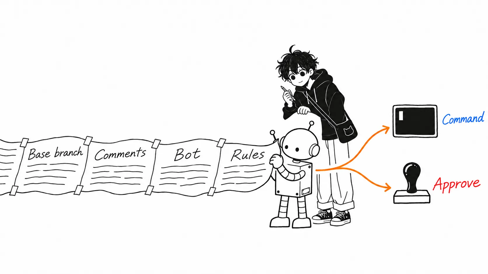
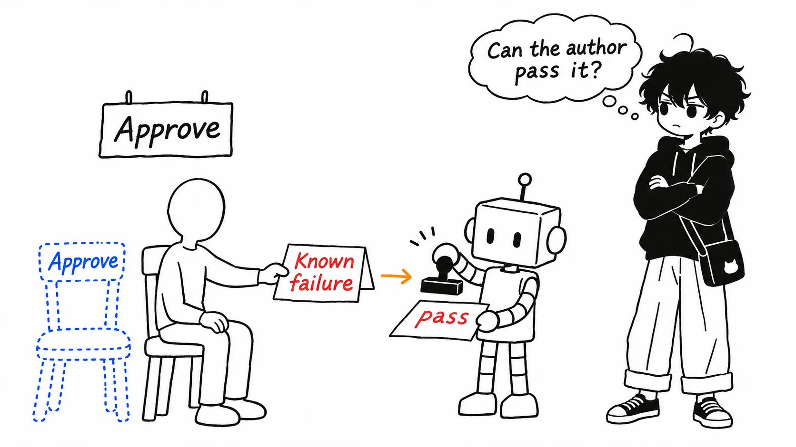
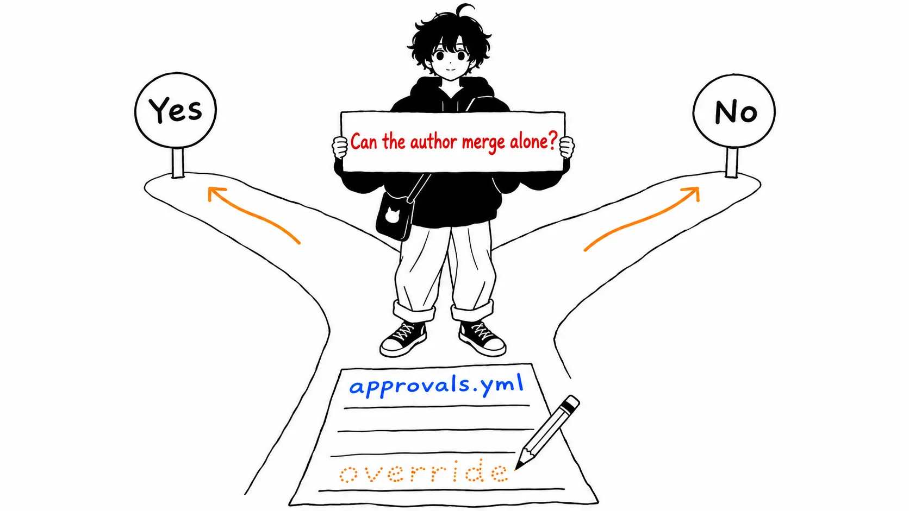

On November 25, 2026 (UTC), Addy Osmani of the Claude Code team published an article on X titled "A practical guide to shipping with Claude Code". It is a guide to using Claude Ship, which had just been released. It opens like this.

> We just launched Claude Ship which can review your pull requests, work on fixes and approve the ones your team's policy allows.

Claude Ship is made of three agents. Code Review reviews pull requests. PR Steward handles CI failures, conflicts and review comments to keep a PR in a state where it can pass. Claude Approvals approves according to a policy file placed in the repository. Only Code Review is generally available; the other two are in beta. Locally, you can try them with the `/code-review`, `/ship` and `/steward` commands.

Here's the conclusion up front.

> Of the caveats in the guide, the ones I found heavy are those about whose text the agent reads and what that text sets in motion. The heaviest is the override setting that reduces the number of required approvals when Code Review passes. The guide itself admits that text inside a PR can sway the review, and the one remaining seat can be filled by the author. Most of the text in a PR is written by its author, so I treat override as a setting that means "if an LLM reads the author's text and passes it, the author can merge on their own," and I think it should be placed only on paths where an author's self-merge is acceptable.

---

## In plain words

When you change a program, you file a request: "may I put this change in?" (a pull request, or PR). Someone else looks it over and approves it before it goes into the main code. Claude Ship has an AI check these requests, fix them, and even approve them when conditions you set are met.

In the guide's example, two people have to approve. Add one "override" line and it becomes "if the AI's check passes, one approval is enough." But the requester can be that one person. And the guide itself says the AI's check can be swayed by text in the request. Most of a request's text is written by the requester.

So once this setting is enforced, the AI can read the requester's own request and pass it, the requester can approve it themselves, and the change can go in without anyone else looking (all the more so if changes are merged automatically). That's why I say the override line belongs only where it's fine for one person to put a change in alone.

## About this article

I read the text of the X article body. I did not see the images (tables and diagrams) embedded in it. Where I touch on what is in a table, I write only what can be inferred from the surrounding prose. I have not read the linked Claude Ship announcement, the documentation for each command, or the Claude Code team's blog post on review and verification.

I should also state my own position. This blog is a personal repository, and I push directly to main without making PRs. I have never used `/ship` or `/steward` on this blog, and I have not tried Claude Approvals.

## Three tiers: my own PR, the repository, the team

The guide moves in three tiers: start with your own PR, then write the repository's rules, and finally extend to the whole team.

The first step is to look at your own branch with `/code-review` before you push. You can choose the effort from low to max: low gives only high-confidence findings, and the higher you go, the wider it picks up. `/ship` commits uncommitted changes the way `git add -A` would, creates a PR, reviews it, and then watches the PR for up to 7 days. It responds to failed checks, conflicts and review comments, and it finishes when the PR is merged or closed. It pushes at most 3 times for the same problem, and if that still doesn't work, it reports to the author what it tried.

The next tier is to write what keeps recurring into files. The same review comment goes to CLAUDE.md or REVIEW.md; the app startup steps you explain every time go to a verify skill; the conventions for tending a PR go to a steward skill. As a team principle, the guide says to make something a rule only if it repeated in at least two PRs, and that a human approves PRs that add rules.

The last tier is Claude Approvals. You write a policy in `.claude/approvals.yml`, first run in observe mode, which leaves only a record of "this is how it would have judged had it approved," compare that with real reviewers' judgments for 1 to 2 weeks, and then move to enforcement.

## The heavy caveats are about "whose text is read"

The guide has many caveats. There is cost (an ultra review can be billed separately, watching eats usage, some reviews are billed even in observe mode) and environment (the watch stops if you close the laptop, the watch doesn't start on Windows, use separate worktrees). Of these, the ones I found heavy are those about whose text the agent reads. Take the watch, for example.

> In other words, anyone who has the ability to land changes on the base branch has the ability to run commands on your machine during the watch.

The watch merges the base branch as needed and runs tests. So test code written by anyone who can write to the base branch runs under my credentials. The guide says Claude is instructed not to merge and that gh and git commands are restricted in unattended turns, and then lists what that still doesn't prevent. Test scripts run with my credentials. If I type a message mid-turn, the restrictions are lifted for that turn only. If auto-merge is enabled, the watch's fix can be the final push toward merging. The watch's commits don't go through the repository's git hooks.

Comments are the same. By default `/ship` reads comments from me, people with write access, and Claude's GitHub App, and it also treats comments from bots specified with `+name` as claims to check against the code. For PR Steward for teams, the guide says this.

> Like any text-parsing agent, it can be fooled by what people say.

The steward's skill file can also be rewritten by anyone who can merge, so the guide says to review it as carefully as a CI change.

Lined up, these say the same thing. The agent reads text written by many different people: base-branch code, PR comments, bot output, rule files. And the text it reads makes commands run, commits pile up, and approvals go out.

## My view

The guide's line of defense is consistent. The files that decide the rules (.github/, CODEOWNERS, CLAUDE.md, .claude/ and so on) are not committed by `/ship` or the watch. A PR that adds a rule is approved by a human. The sample policy also requires two approvals for changes to rule files. When multiple rules apply, the stricter one wins, so those two people aren't overridden by a rule loosened later. The sources that settings are read from are closed off as well. Code Review doesn't read REVIEW.md inside the PR under review, and both approvals.yml and the steward skill are read from the default branch. The rules themselves have been taken out of the agent's hands. What remains as entry points are the PR description and the code.

But at approvals, this line loosens in one place: override. In the guide's sample, you can add to a rule that normally needs two approvals an override saying that if Code Review passes, "one person and Claude's approval" is enough. Right after this, the guide itself writes:

> But text in a pull request can sway Claude's review, and when it does, this override lowers what that pull request needs.

Furthermore, in the sample rule the author can also fill one seat. That is, on a path where an override is placed, if Claude reads a PR the author wrote (the description and the code are both the author's) and passes it, the one remaining seat can be filled by the author alone. The guide also writes elsewhere that if you use auto-merge, a PR can be merged with nobody doing anything. Claude's approval counts as a real approval on GitHub, so how far it actually gets through depends on the branch protection settings.

However, the guide presents this override inside an observe-mode policy, and the purpose is to "see where the required approvals could be lowered if the review passes." While in observe, it only displays results and issues no approvals. The author's self-merge becomes possible only after you take off observe and move to enforcement.

Here, the person writing the text that influences the review is the very person who benefits from approval. That is where this differs from base-branch write access or comment write access. For those, the countermeasure of limiting access to trusted collaborators works. With override, the author, the very person being trusted, writes the review's input. Even without malice, I think just writing "this test failure is known" in the PR description can change the review's judgment.

So I think override should be treated not as "approval with review" but as "author self-merge conditioned on an LLM's reading." It should be placed only on paths where the author's self-merge would be acceptable anyway. Places like documentation typos or generated files. On other paths, put the rule with neither an if nor an override (one that always requires one person other than the author), which the guide says to put in place before enforcement. At the step of moving to enforcement, the guide also says that if you combine auto-merge with a policy that only the author can satisfy, you should decide per path whether that is acceptable and write it down. My only difference is that I would answer this first for every path where you take off observe while leaving override in place, not conditionally on "if you use auto-merge."

One more point about my own environment. The guide says that if the repository's `.claude/settings.json` has a Bash PreToolUse or PermissionRequest hook, the watch won't start. I put a PreToolUse hook that compresses Bash output not in the repository but in user settings (`~/.claude/settings.json`). Whether a hook in user settings also stops the watch isn't written in the guide, and I haven't tried it.

## If you take away just one thing

Before you take off observe while leaving override in place, answer for that path whether the author may merge alone. If you can't say yes, remove the override on that path and put in a rule that always requires someone other than the author.

Source: Addy Osmani, "[A practical guide to shipping with Claude Code](https://x.com/i/article/2125456204969512961)" and the [post](https://x.com/addyosmani/status/2125492213903978917) introducing it (X, November 25, 2026 UTC). I have not read the images in the body or the linked announcement and documentation. I have not tried `/ship` or Claude Approvals.
