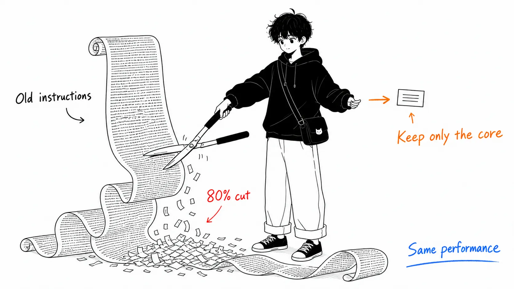
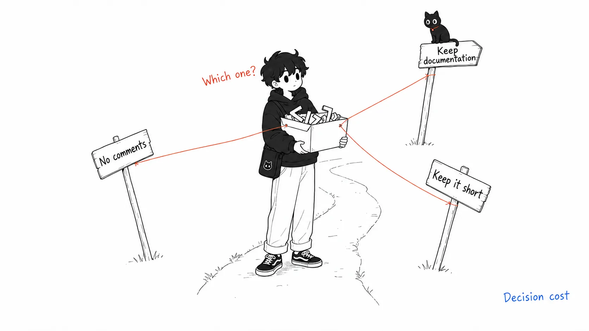
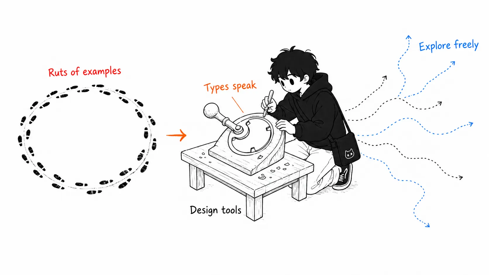
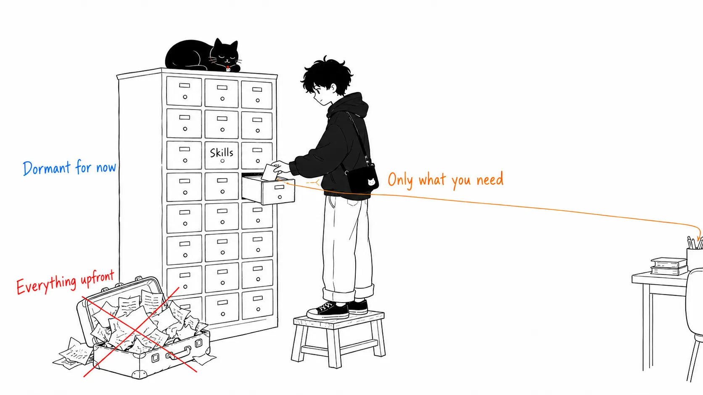
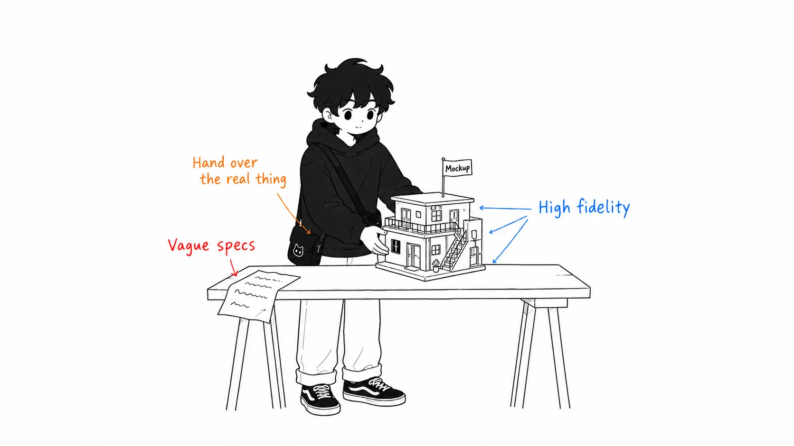
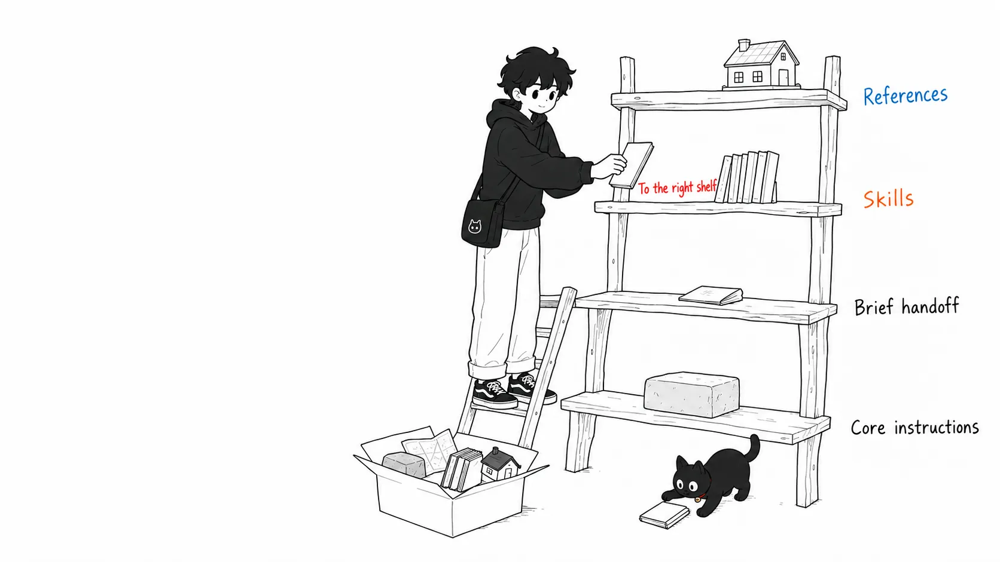

## About This Article

On July 24, 2026, Thariq of the Claude Code team ([@trq212](https://x.com/trq212/status/2080710971228918066)) announced that **they had deleted roughly 80% of Claude Code's system prompt for the latest generation of models**. And coding eval scores showed **no measurable drop**. The same content also appears on the [official Claude blog](https://claude.com/blog) as "The new rules of context engineering for Claude 5 generation models."

Coming from an era when "prompts should be long, detailed, and full of examples" was common sense, this looks like a pretty contrarian move. In this article I'll lay out:

- **Why 80% could be cut** (the thinking behind the deletion)
- **Six "old common sense" vs. "how we do it now" contrasts** (Then / Now)
- **How to apply it to your own CLAUDE.md and skills** (practice)

and then give my own take at the end.

Here's the conclusion up front.

> "Rules" written for older models become **shackles on capability** for newer models. With Claude 5 generation models, **giving them material for judgment** gets better results than giving them rules.

---

## Part 1: What Happened

### They Deleted 80% of the System Prompt, and the Evals Didn't Drop

Claude Code's system prompt is the "foundation instruction sheet" that gets loaded every time, before the user's prompt arrives. It used to hold a huge amount of text: how to use tools, coding conventions, prohibitions, and so on.

Anthropic deleted more than 80% of it for the latest generation of models such as Claude Opus 5 and Claude Fable 5. They report no degradation in their internal coding evals. Given how much they cut, the result is almost eerily quiet.

### Why It Could Be Cut: "Excessive Constraints" Were Actually a Cost

What the team noticed when they reread their internal usage logs was that **instructions were colliding with each other within a single request**.

For example, an instruction saying "leave appropriate documentation" and one saying "don't write comments" arrive at the same time, from the system prompt, the skills, and the user's request. Claude can read the user's intent and mostly behave correctly, but it burns extra thinking sorting out contradictory instructions.

These constraints were once necessary to "avoid the worst case." Deleting files on its own, writing code buried in comments: guardrails against the accidents of older models. Newer models can judge from the surrounding context, so for many of those guardrails it became better to delete them and leave things to judgment.

---

## Part 2: Six Contrasts Between "Old Common Sense" and "How We Do It Now"

The thread lists six Then / Now pairs. I think the first three (rules, examples, progressive disclosure) have the biggest practical impact, so I'll spend my words there. I'll run through 4 to 6 quickly.

| | Then (old common sense) | Now (how we do it now) |
| --- | --- | --- |
| 1 | Give rules | Leave it to judgment |
| 2 | Show lots of examples | Design the interface |
| 3 | Put everything up front | Progressive disclosure |
| 4 | Repeat what's important | Write it once in the tool description |
| 5 | CLAUDE.md is the memory | Leave it to automatic memory |
| 6 | Simple spec documents | Rich reference materials |

### 1. Give Rules → Leave It to Judgment

The old system prompt had a sentence like this.

> コードでは原則コメントを書くな。複数段落の docstring や複数行コメントブロックは絶対に書くな——最大でも短い1行。
>
> (As a rule, don't write comments in code. Never write multi-paragraph docstrings or multi-line comment blocks; a short single line at most.)

This instruction is right in many situations, but **it's wrong when complex code needs a multi-line explanation**. With older models you just had to accept that trade-off. The new system prompt changed it to this.

> 周囲のコードと同じように読めるコードを書け。コメントの密度・命名・イディオムを周囲に合わせろ。
>
> (Write code that reads like the code around it. Match the comment density, naming, and idioms of the surroundings.)

It hands over a **criterion for judgment**, not a prohibition. Not "what not to do" but "what to match."

### 2. Show Lots of Examples → Design the Interface

"Teach tool usage through examples" was an iron rule of tool use. But with the latest models, it turns out that **examples actually narrow the search space**. A model shown an example only tries things in the neighborhood of that example.

What's recommended instead is **designing the tool itself**. For instance, if you make a Todo tool's status an enum of `pending / in_progress / completed`, that alone hints at how to use it. Write the constraint "only one in_progress at a time" and you've defined the behavior you want. **Parameter types and names speak louder than example text.**

### 3. Put Everything Up Front → Progressive Disclosure

The old system prompt always contained detailed procedures for code review and verification. Important when needed, but information that **consumes context every time, even when it isn't needed**.

Today's Claude Code splits these out into **standalone skills** and loads them only when needed. Tools work the same way: some tools are "lazy-loaded," meaning they don't enter the context until the agent searches for their definitions with `ToolSearch`.

This applies directly to your own CLAUDE.md. "I'd better put every practice I know in CLAUDE.md, in case Claude can't find it" is a common misconception, and the recommended approach is to **build a file tree so the right file gets read when it's needed**.

### 4. Repeat What's Important → Write It Once in the Tool Description

Older models sometimes wouldn't follow an instruction unless it was repeated, and they also had a tendency to respond better to instructions placed at the end of the context. So the same tool's explanation was duplicated in both the system prompt body and the tool description.

The new generation deleted this duplication, and now **tool usage is written once, in the tool's description**.

### 5. CLAUDE.md Is the Memory → Leave It to Automatic Memory

It used to be recommended to use the `#` hotkey to have Claude remember things in CLAUDE.md. Now Claude **automatically saves memories related to the work and the user**, so there's less need to use CLAUDE.md as a place to store memories.

### 6. Simple Spec Documents → Rich Reference Materials

Plans and specs from plan mode used to be saved as Markdown files as a matter of course. But newer models can handle **more complex reference materials**.

- An HTML mockup built with Artifacts instead of a Markdown spec
- A detailed test suite or a source function from another codebase to port, instead of a written spec
- Instead of putting preferences into words, handing over a rubric (an evaluation criteria table) and having a verification agent score against it

It states outright that "an HTML mockup produces better results than a design description or a screenshot." The point is that **handing it over in the language Claude knows best, code, makes the highest-fidelity spec document**.

---

## Part 3: How to Apply This to Your Own Context

The latter half of the thread lays out how to write for each layer.

**System prompt**
The product context itself. The place to tell Claude "what product it's in and what it's doing." If you only use Claude Code you'll never touch it, but if you build your own agent, this is where you spend the most time.

**CLAUDE.md**
Keep it lightweight. Write the repository's purpose briefly, and spend most of the tokens on **the "snags" in the codebase** (e.g., "type definitions are consolidated in this one file; don't write them anywhere else"). Don't write "obvious things" you can tell by looking at the file system. Split details out into verification skills and the like, and have CLAUDE.md only reference them.

**Skills**
Think of them as "lightweight guides for finding information when it's needed." Don't over-constrain outside critical areas. Split long skills into multiple files for progressive disclosure. They're well suited to carrying **your own or your team's opinions, knowledge, and best practices**.

**Reference materials**
Hand over files with `@` mentions. Specs, mockups, the codebase itself. The principle is to **hand them over in code form wherever possible**.

And as a finishing touch, Claude Code has gained the **`/doctor` command**, which does this "rightsizing" automatically. It diagnoses whether your skills and CLAUDE.md are excessive or insufficient.

---

## My Take: "Constraints Are Debt Tied to Model Capability"

From here on it's my interpretation.

### Guardrails Have a "Best-Before Date"

I think the essence of this story isn't "short prompts are good" but that **a constraint is debt that assumes the model capability at the time you wrote it**. "Don't write comments" was right as accident prevention for older models. But the moment the model gets smarter, that constraint stops working as accident prevention and starts working as a **ceiling on capability**.

This is a lot like technical debt in code. A workaround that was right when you wrote it stays behind after the environment changes and quietly drags you down. The difference is that prompt debt **arises all at once with every model update**. When you switch models, taking inventory of your CLAUDE.md should come as part of the package.

### Your CLAUDE.md Is Probably More Excessive Than You Think

While writing this article, I grepped my own global CLAUDE.md and rules files. Instructions starting with ALWAYS, NEVER, or MANDATORY alone came to 11 places. Plenty of you will recognize yourselves. If you add one line of rules after every bad experience, CLAUDE.md becomes a **fossil layer of past failures**. And most of those are failures of the model back then, not failures of today's model.

Before "adding a rule," think about "can I rephrase this as a criterion for judgment?" Not `DO NOT add comments` but `match the surrounding comment density`. That rephrasing pattern alone is worth taking home.

### But There Are Settings Where "Leave It to Judgment" Is a Problem

The one reservation I'd add is **team operations that need reproducibility**. Rule-based instructions are cramped, but the variation in output is small. Judgment-based instructions behave smartly, but **the swings from member to member and session to session** increase. In areas like review conventions and commit conventions, where you want "consistency over cleverness," it's still reasonable to keep explicit rules. The thread itself says "it's fine to constrain in critical areas," so it isn't saying to leave everything to judgment.

### Progressive Disclosure Follows the Same Current as MCP

Another interesting point is that this direction of "load only what's needed, when it's needed" is exactly the same philosophy as MCP 2026-07-28's move to statelessness and lazy-loaded tools. Context windows keep growing, but the industry is investing not in "load everything" but in **the art of not loading**. Context isn't better just because it's bigger; **it's better the purer it is for the problem at that moment**. That principle doesn't look like it will change anytime soon.

---

## Summary: If You Take Away Just One Thing

If you take just one thing from this article, it isn't `/doctor` or progressive disclosure. It's the rewrite pattern of **rephrasing prohibitions as criteria for judgment**. `DO NOT add comments` becomes `match the surrounding comment density`. That one move alone repays most of the debt piled up in your CLAUDE.md.

Second is running `/doctor`. Third is the habit of taking inventory of your CLAUDE.md every time you switch models. That covers just about everything in this article.

References: [Thariq's X thread](https://x.com/trq212/status/2080710971228918066) / Claude official blog, "The new rules of context engineering for Claude 5 generation models"
