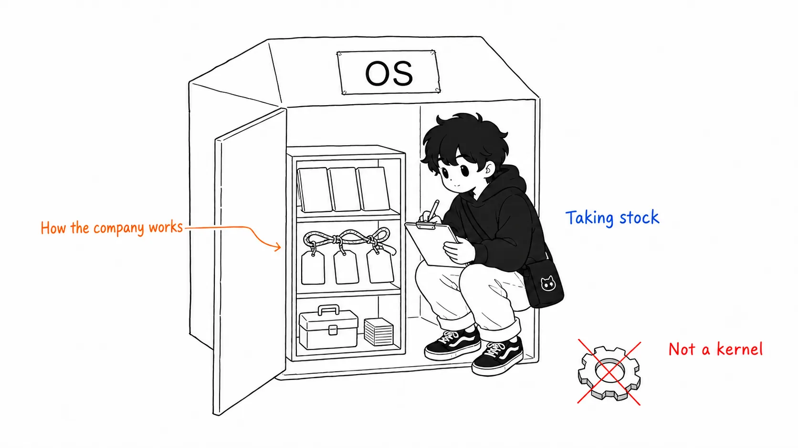
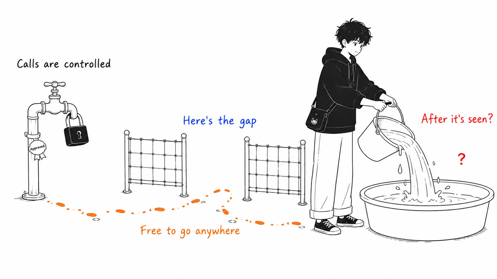
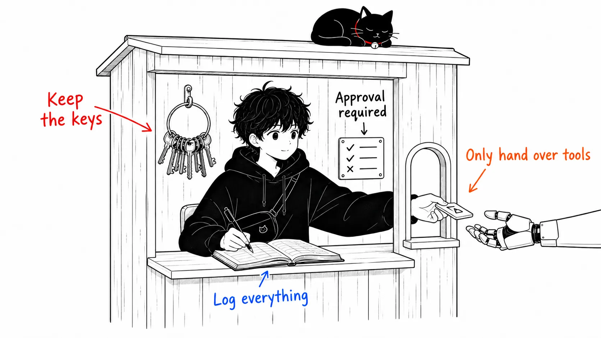
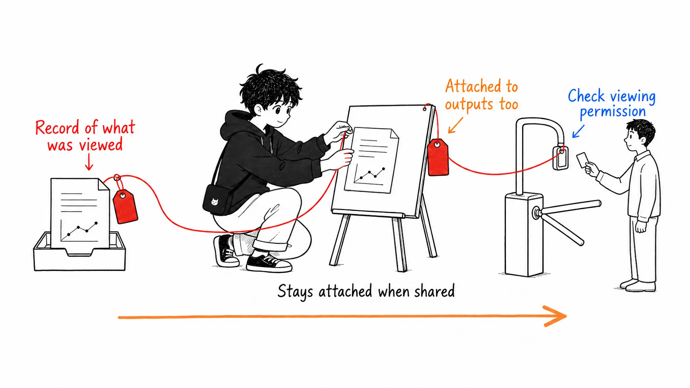
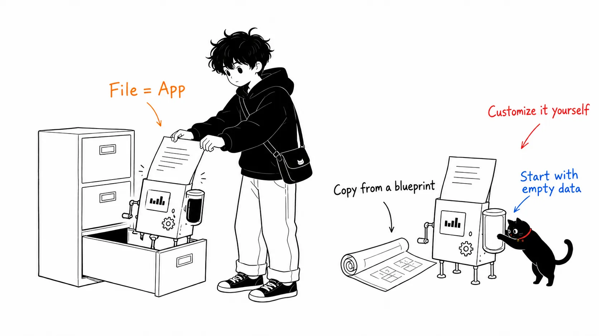

## About this article

On August 5, 2026, Cloudflare released "**Cloudflare OS**" as open source. The primary sources are the [official blog announcement](https://blog.cloudflare.com/cloudflare-os/) and the [GitHub repository](https://github.com/cloudflare/cloudflare-os).

Let me disclose up front that I haven't yet deployed it to my own Cloudflare account and tried it (I'm writing this the day after the announcement). This article is an organized reading of the blog and repository descriptions, plus my interpretation on top of them. It contains no impressions from actually running it.

Here's the conclusion first.

> What's interesting about Cloudflare OS is not the chat UI or the app generation, but the security foundation that **records everything "the agent has seen" and propagates permissions along with that record**. For the first time, a platform is moving to close, as a standard feature, the problem MCP left unresolved: you can control tool calls, but you can't control where the data that was seen goes next.

So this article keeps the introduction of the workspace features short and spends its words on the security model.

---

## Part 1: What was announced (briefly)

### The name is OS, the substance is "an agent foundation where the whole company shares context"

Cloudflare OS is made of three parts.

- **Agent workspace**: built on company-curated context and skills, it can write and run code in an isolated runtime
- **Security and governance foundation**: safe access control to internal data and services (the star of this article)
- **App platform**: apps that an individual builds and shares, and that the people they share with can keep modifying

It's an experience where you start a conversation in the browser and it becomes a document, an app, or an ongoing workflow. At Cloudflare itself, every employee has been using it since May of this year, and people outside engineering use it daily to create materials, automate routine tasks, and build data visualization apps.

On the name "OS," the repository itself disclaims it like this.

> This is not a traditional computer operating system. We use the term in two senses: "an OS for a company to be productive with AI" and "an OS that manages AI workloads."

The license is Apache 2.0. It consists of two repositories, the core (cloudflare-os) and an example deployment modeled on Cloudflare's own internal operation (cloudflare-os-starter), and it's designed so you can layer your own customizations on without patching the core.



That's it for the feature introduction. The "AI workspace" itself is already a commodity in 2026, and every company is releasing something similar. The difference is made in the next part.

---

## Part 2: The core: tracking authorization all the way to "where the data goes"

### MCP can only protect up to "what you can call"

The first thing people who've started using AI internally say is "give me an API key." But handing out keys scatters overly broad permissions over a long period, with no restriction or auditing. That much is a known problem, and it's as far as MCP solved it. The MCP server holds the credentials and shows only the defined tools.

What Cloudflare ran into in its internal operation was what lay beyond that.

> MCP access tells you **which tools the agent can call**, but not **which resources it has observed**. An agent can combine information from multiple systems, send it to a more loosely restricted place, and expose it, through apps or artifacts, to people who have no permission to view the original resource. Authorization has to take into account even **where the data can go next**.

For a concrete example: when an agent reads a confidential table in a data warehouse and builds a dashboard, sharing that dashboard must not become a loophole for showing the table to people who have no permission to see it. Controlling tool calls alone can't prevent this.



### Agents start from a state where they "can see nothing"

In Cloudflare OS, every agent and app starts from **zero access**. When an agent requests access to a specific resource and a human grants it, it's handed to the generated code as a typed binding.

```ts
const issues = await env.PROJECT.listIssues({
  teamId: "ENG",
  state: "open",
});
```

`env.PROJECT` is a capability representing "permission to use a specific resource under a specific policy," and the credentials themselves are completely isolated from both the agent and the generated code. Server code runs in a Dynamic Worker with all outbound network blocked, and client code runs in a browser sandbox frame, and neither can reach the internet except through capabilities explicitly granted.

### Gatekeeper: a checkpoint for each service

Between the agent and an external service sits a Worker called **Gatekeeper**. It understands the target service's APIs, resources, and operations, and for GitHub, for example:

- Restrict access to just one repository
- Make Issues readable but source code not readable
- Mask specific fields
- Require human approval to merge a PR

and so on, at that granularity. Holding OAuth and credentials, enforcing policy, **recording what was read**, and mediating operations with external side effects: all of that is Gatekeeper's job. From the agent's side it just looks like a small TypeScript API.



### Here's what's new: policy follows what was "seen"

And now the main point. Cloudflare OS records every resource the agent observed, and that observation record **stays attached** to the agent and its artifacts.

> When another person tries to open that workspace, interact with the agent, or view an artifact, Gatekeeper verifies whether that person has permission over the "observed resources."

On top of that, the same observation log also constrains outbound actions. Once an agent has read confidential data, policy can stop it from writing to specific places, inviting new collaborators, handing work off to other agents, and making external requests.

In other words, permissions **travel with the data**, not just at the "entrance." Neither the people who build apps nor the people who use agents have to implement this mechanism themselves; the platform holds it underneath. The post says the direct motivation for the rebuild was that in the first version of the internal operation, "the moment we started sharing, we needed this."



---

## Part 3: Every "file" becomes an app (at a medium length)

There are only two points to grasp about the app feature.

**First: every app is a Worker.** When an agent builds an app, it writes two pieces: browser-side UI code, and server code that holds state and behavior. The server side is loaded on demand as a **Dynamic Worker** newly created for this project (a V8 isolate, so no dedicated container is needed), and each app has its own independent SQLite as a **Durable Object Facet**. Communication with the client is over Cap'n Web (object-capability RPC), and the server's methods can be called the same way from a human UI and from an agent.

**Second: there are two kinds of sharing.** Share the app itself and you can co-use the same state in real time; share a "blueprint" and the other person makes their own copy. A blueprint contains only code, not the SQLite data, conversation history, credentials, or connected resources. The recipient, instead of filing a feature request, can have their own AI modify it.



"Not a fixed set of apps like documents, spreadsheets, and slides, but each individual file being its own dedicated app" is, I think, frankly new as a product shape.

---

## My view: what I rate, and what I doubt

### I think this is the first time information flow control has come down to a "standard product feature"

The idea of "a label follows the data you read and constrains where it goes" is not a new invention. As information flow control (IFC), it has existed academically for decades and has been implemented in military systems and some research OSes. But as far as I know, this is the first time it has been put in as a **standard feature, invisible to users, of a SaaS platform that ordinary companies use in an ordinary way**.

And this is also a challenge to the whole MCP ecosystem. Many organizations must have been satisfied with standing up MCP servers, but nobody was protecting "where what the agent saw goes." Cloudflare has given that a name and an implementation. I expect one of two things to happen: other platforms follow, or a similar concept enters the MCP spec itself.

### The "organization's skill library" is the organizational version of what Claude Code taught us

Storing a company's terminology, procedures, and ways of doing routine work in a shared library as skills, so that "when someone finds a good way, everyone can use it": this is the organization-scale version, as is, of what engineers have been doing with CLAUDE.md and skills in Claude Code. The curation of context, which was a personal tool, becomes company asset management. This trend isn't specific to Cloudflare, and I think it will happen at every company over the coming year.

### Doubt: it's "open source," but not "runs anywhere"

This is what snags me most. The code is readable under Apache 2.0, but the execution foundation rests on Dynamic Workers, Durable Object Facets, and Cloudflare Access, that is, **Cloudflare-only features, including ones built for this project**. There is, for now, effectively no path to self-hosting on your own servers or another cloud.

Putting an organization's core assets, "how the company works, its procedures, skills, and apps," all on this runtime means the migration cost after you've put them on is extremely high. Being open source guarantees the transparency of the code, but not portability. If you're considering adopting it, I think the realistic line is "start with work you'd be willing to go down with Cloudflare on."

### Doubt: the name "OS" speaks to ambition more than reality

The repository itself apologizes twice that it's "not a traditional OS," which, flipped around, is because the name is not a description of the substance but a **positioning declaration**. As a declaration that "we're going after the default layer of the AI-era business foundation," it's a good name, but as a reader I think it's better not to be pulled along by the name and to evaluate it as "an agent execution foundation with a permission system."

---

## Summary: if you take away just one thing

If you take away just one thing from this announcement, it's not the feature list but this question.

> **How far can what your organization's agents have "seen" go right now?**

Most organizations must be stopped at controlling tool calls (standing up MCP servers), and the significance of this announcement is that a product-level answer has appeared for what lies beyond: controlling where observed data goes. Second in importance is the product shape of "file = app + blueprint sharing." Third is the weight of lock-in to a Cloudflare-only foundation, which is a watershed for the adoption decision.

References: [Cloudflare OS: an open platform for agents, apps, and work](https://blog.cloudflare.com/cloudflare-os/) / [GitHub: cloudflare/cloudflare-os](https://github.com/cloudflare/cloudflare-os) / [os.cloudflare.app](https://os.cloudflare.app/)
