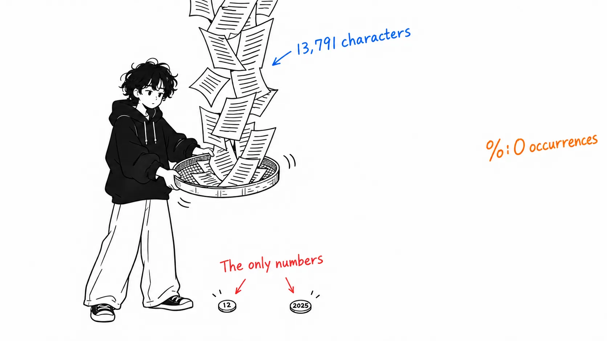
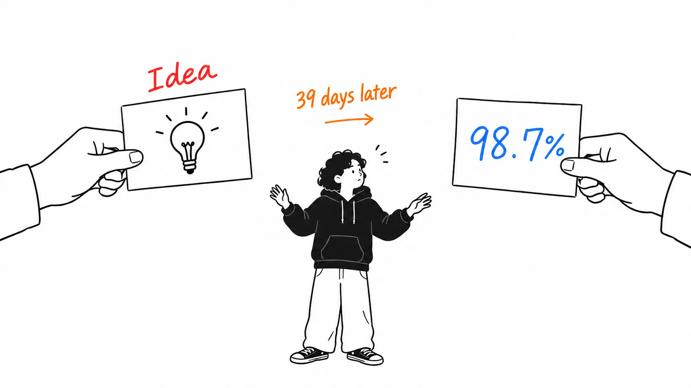
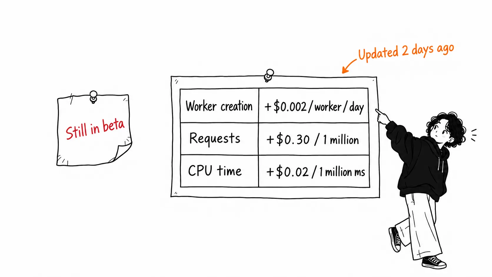
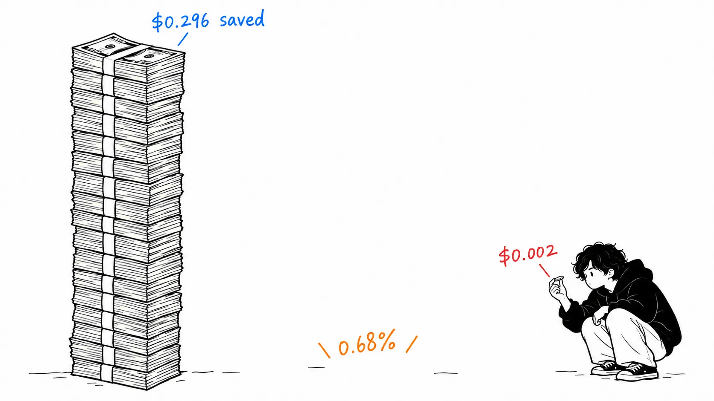

Here's the conclusion up front.

> This article, which opens with "we've all been using MCP wrong," is still being cited 13 months later, and I think **its claim was right**. But the numbers appearing in its prose were **just two: "12" (a 12-minute read) and "2025" (the year)**. Zero percentages, zero token counts. The "striking" in "The results are striking" is supported not by measurement but by an explanation of the mechanism and a metaphor. The numbers were attached **39 days later, in an Anthropic article**, which cites Cloudflare by name. **The source of the idea and the source of the numbers are different companies.**

## About This Article

What I read is [Cloudflare Blog's "Code Mode: the better way to use MCP"](https://blog.cloudflare.com/code-mode/) (Kenton Varda / Sunil Pai, September 26, 2025). It's about not showing MCP tools directly to the LLM, but instead **converting them into a TypeScript API and having the LLM write code that calls it**.

Today is October 14, 2026, so it's been **383 days since publication**. I'm reading an article that's more than a year old, today.

**An honest disclosure.** I haven't run Code Mode myself. What I checked was the count of numbers in the article, the citation relationships, the publication dates, and **the current documentation and pricing table**. I also did one estimate from the pricing, and I'll write out all its assumptions.

## There Are Only Two Numbers in the Prose

First, the claim. It still holds together when I read it today.

> The special tokens used in tool calls are things LLMs have never seen in the wild. They must be specially trained to use tools, based on synthetic training data.

The special tokens for tool calls are something LLMs have never seen in the wild, and they get trained on afterward with synthetic data. Code, on the other hand, they've learned in huge quantities from millions of open-source projects. So **they're better at writing code**.

The metaphor works too.

> Making an LLM perform tasks with tool calling is like putting Shakespeare through a month-long class in Mandarin and then asking him to write a play in it.

Easy to grasp. And the article opens like this.

> The results are **striking**

It says the results are striking. So I picked out every number from the body text (13,791 characters, from the H1 through the related tags, excluding code blocks).

| What I looked for | Count |
| --- | --- |
| Percentage notation | **0** |
| Quantities like "N tokens" | **0** |
| The word "benchmark" | **0** |
| Words containing "measure" | **0** |
| Numbers in the prose | **2** (the 12 in "12 minute read" and the 2025 in "throughout 2025") |

**Not a single bit of what makes it striking is written as a number.** The grounds given are the observation "We found agents are able to handle many more tools" and a hypothesis for the reason ("**Perhaps** this is because LLMs have an enormous amount of real-world TypeScript in their training set"). It says perhaps.

To avoid misunderstanding, this isn't a lie. "Didn't measure" and "is wrong" are different things. It's just that **nobody can tell from this article how much it helps.**

## The Numbers Came 39 Days Later, From a Different Company

On November 4, 2025, Anthropic published ["Code execution with MCP: Building more efficient agents"](https://www.anthropic.com/engineering/code-execution-with-mcp). That's **39 days after the Cloudflare article**.

And this article mentions Cloudflare.

> **Cloudflare published similar findings, referring to code execution with MCP as "Code Mode."** The core insight is the same: LLMs are adept at writing code and developers should take advantage of this strength to build agents that interact with MCP servers more efficiently.

It states outright that these are the same findings. And the numbers are here.

> This reduces the token usage from **150,000 tokens to 2,000 tokens—a time and cost saving of 98.7%**.

Counting the Anthropic side the same way gives one percentage (98.7%) and three token quantities (50,000 / 150,000 / 2,000). The Cloudflare side was 0 and 0.

A caution is needed here. **98.7% isn't a benchmark either.** The context is "in this example," an estimate for a single hypothetical workflow connecting Google Drive and Salesforce. The measurement conditions, number of tasks, and variance aren't given.

So the picture looks like this.

| | Idea | Numbers |
| --- | --- | --- |
| Source | Cloudflare (2025-09-26) | Anthropic (2025-11-04) |
| Form of evidence | Observation and hypothesis (perhaps) | One example's estimate |

When people cite it, what gets named is "Code Mode," and what gets remembered as a number is "98.7%." **Two things from separate articles circulate as a single claim.**

## In 13 Months, the Article Got Left Behind

The end of the article reads like this.

> The Dynamic Worker Loader API is in **closed beta**. To use it in production, sign up today.
> We have **not yet finalized pricing** for the Worker Loader API

Today I went to look at the documentation.

The URL of the Worker Loader API reference jumps to **a standalone product section called Dynamic Workers**. Overview, Getting started, Bindings, Egress control, Observability, Custom resource limits, Examples, and then **Pricing** and **Platform Limits** are lined up. Last updated **October 12, 2026**, two days ago.

The word `beta` appears **nowhere** in the body.

Pricing was out too (the page was last updated June 11, 2026).

| Item | Included | Overage |
| --- | --- | --- |
| Dynamic Workers created per day | 1,000 per month | **+$0.002 / Worker / day** |
| Requests | 10 million per month | +$0.30 / million |
| CPU time | 30 million CPU milliseconds per month | +$0.02 / million CPU milliseconds |

Billing **started May 26, 2026**, and only on the Workers Paid plan.

Meanwhile, the article still says "closed beta" and "pricing not finalized." The article's `dateModified` is **July 15, 2026**, so something was updated after the pricing was published. **I couldn't confirm what changed** (more below).

The code, on the other hand, was alive. For the `import { codemode } from "agents/codemode/ai"` shown in the article, the `agents` package is currently at **0.28.1** (published October 13, 2026, yesterday), and the `./codemode/ai` export still exists. **The import path in the sample code from 13 months ago still works as is.**

## With Pricing Out, You Can Add the Two Articles Together and Calculate

This is the calculation I did for this article. **Neither article contains it.**

The core of Cloudflare's claim was "disposable is fine."

> Isolates are so fast that we can just create a new one for every piece of code the agent runs. There's no need to reuse them.

Back then pricing was undecided, so nobody could calculate what this "recreate every time" costs. **Now you can.**

The definition on the pricing page matters. **A Dynamic Worker is uniquely identified by "Worker ID and code," and if either changes it counts as a new Worker.** Code Mode generates different code every time, so **one execution = one new Dynamic Worker**.

| Agent executions | Monthly | Overage cost |
| --- | --- | --- |
| 100 per day | 3,000 | **$4 / month** |
| 1,000 per day | 30,000 | **$58 / month** |
| 10,000 per day | 300,000 | **$598 / month** |

Next, set this against the savings. In Anthropic's example it's 150,000 → 2,000 tokens, so the saving is **148,000 tokens**. Converted at $2 per million input tokens (Claude Sonnet 5; my reference material is as of June 24, 2026), that's **$0.296**.

One sandbox costs **$0.002**.

| | Per task |
| --- | --- |
| Token cost saved | $0.296 |
| Sandbox cost | $0.002 |
| **Sandbox cost as a share of the savings** | **0.68%** (148x) |

Even if the savings were entirely covered by cache reads (about 0.1x normal input), the saving is $0.0296, and the share is **6.8%** (14.8x).

**Under either assumption, it wins by an order of magnitude.** So Cloudflare's flat claim that "disposable is fine," made before it published pricing, turned out to be sound. But no basis was shown at the time, and **the basis could only be shown from when the price table came out, five months ago.**

## My Take

On this blog I've written several articles that trace a number's source and end up at "a single personal blog" or "it was the peak, not the average." This time is **the opposite case**.

**There wasn't a single number, and the claim was right.**

So I can't write "an article without measurements is no good." What Cloudflare's article had wasn't measurement but **an explanation of the mechanism**. "Special tokens are trained only on synthetic data. Code is trained in huge quantities on real data." That has a falsifiable form, and readers can check it against their own experience. It's the kind of grounds where conviction comes before the numbers.

With that said, here's what I can see after 13 months. **Nobody can say how much it helps, and everybody keeps citing it.**

What's actually circulating is the combination of the name "Code Mode (Cloudflare)" and the number "98.7% (one Anthropic example)." The former wasn't measured, and the latter is an estimate for one hypothetical task. **Add the two together and you still have zero benchmarks.** Even so, "don't call MCP directly" has become the default practice in this one year.

One more thing. **The article doesn't get updated, but the product moves.** The closed beta became a product, a price table came out, billing started, and the documentation was updated two days ago. Even so, the end of the article still says beta. For the reader, it's just the plain point that **you shouldn't judge "how things stand now" from a 13-month-old article**. Still, this article keeps coming up first in search.

Finally, a point that comes back to me. **The 0.68% in this article has the same strength of grounds as Anthropic's estimate.** The savings figure of 148,000 tokens is borrowed from one example, not something I measured. When you divide using a borrowed number, **the precision of the division looks like it exceeds the precision of the original number.** It doesn't.

## If You Take Away Just One Thing

**When you read an article that says "this works," count the numbers in it.** If it's zero, the size of the effect comes from somewhere else. This time it came from a different company's article 39 days later. **Tracing sources also means checking whether the source of the claim and the source of the numbers are the same.**

## Sources

- Kenton Varda, Sunil Pai, ["Code Mode: the better way to use MCP"](https://blog.cloudflare.com/code-mode/), Cloudflare Blog, published September 26, 2025 (JSON-LD `dateModified` is 2026-07-15)
- Anthropic Engineering, ["Code execution with MCP: Building more efficient agents"](https://www.anthropic.com/engineering/code-execution-with-mcp), November 4, 2025
- [Cloudflare Dynamic Workers documentation](https://developers.cloudflare.com/workers/runtime-apis/bindings/worker-loader/) (last updated October 12, 2026) and [pricing page](https://developers.cloudflare.com/dynamic-workers/pricing/) (June 11, 2026; billing began May 26, 2026). Both retrieved October 14, 2026
- The `agents` package version and exports were retrieved from npm on October 14, 2026 (0.28.1, published October 13, 2026)

Here's how I counted. For the Cloudflare article, I treated everything from the H1 to "Related tags" as the body and counted from the 13,791 characters excluding code blocks. 0 `%` notations, 0 "~tokens," 0 `benchmark`, 0 `measure`-family words. The remaining numbers were the 12 in "12 minute read" and the 2025 in "throughout 2025." **There are numbers inside the code blocks** (`gpt-5`, `compatibilityDate: "2025-06-01"`, `SOME_NUMBER: 123`, 93°F in the weather example). They aren't measurements, so I excluded them.

I **couldn't confirm** what was updated on July 15, 2026. The Wayback Machine has snapshots from September 26, 2025, but the HTML I can retrieve doesn't contain the body (it's rendered with JavaScript), so I can't take a diff. My guess that "the beta wording is as it was then" rests only on the fact that **the current body still says beta** and the fact that the documentation side no longer calls it beta.

Here are the assumptions of the pricing estimate. **One Code Mode execution = one new Dynamic Worker** (from the pricing page's definition that a Worker is unique by Worker ID and code, and new if either changes). The free tier is taken as 1,000 per month, and only the overage is counted. **Request charges and CPU time aren't included in the calculation** (since they're added to the existing Workers plan). The token price is Claude Sonnet 5 input at $2 per million tokens from my reference material (as of June 24, 2026), and **I haven't rechecked it against the official pricing page as of today.** The savings of 148,000 tokens uses the figure from Anthropic's article example as is. So the 0.68% is the product of **an example x my unit price x my billing model**. It can't be used for more than checking whether the orders of magnitude line up.

Since I haven't actually run Code Mode, I can't say anything about "whether the success rate really goes up when there are many tools." All this article can say is two things: **the original has no numbers**, and **the numbers came from a different article**.
