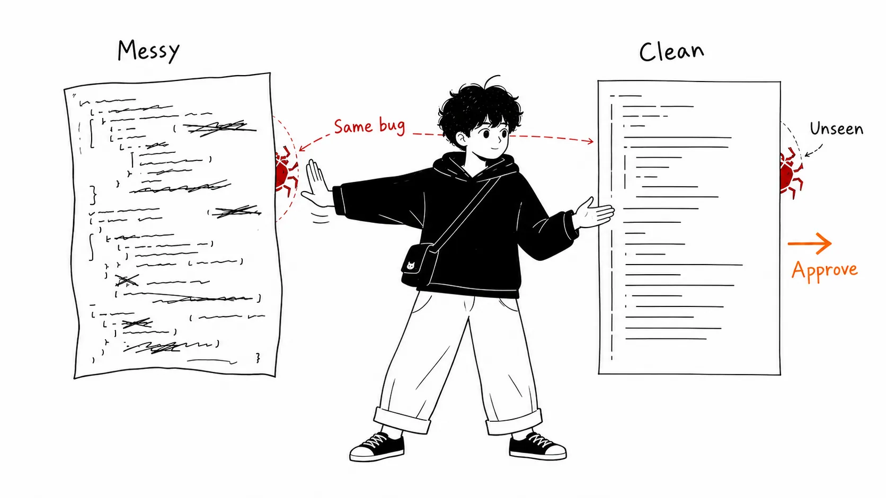
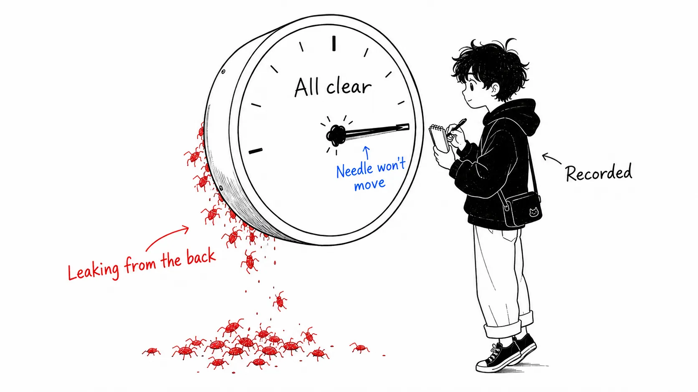
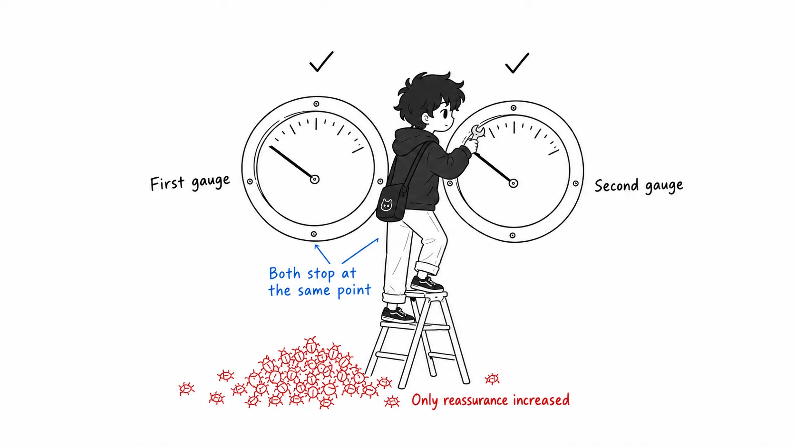
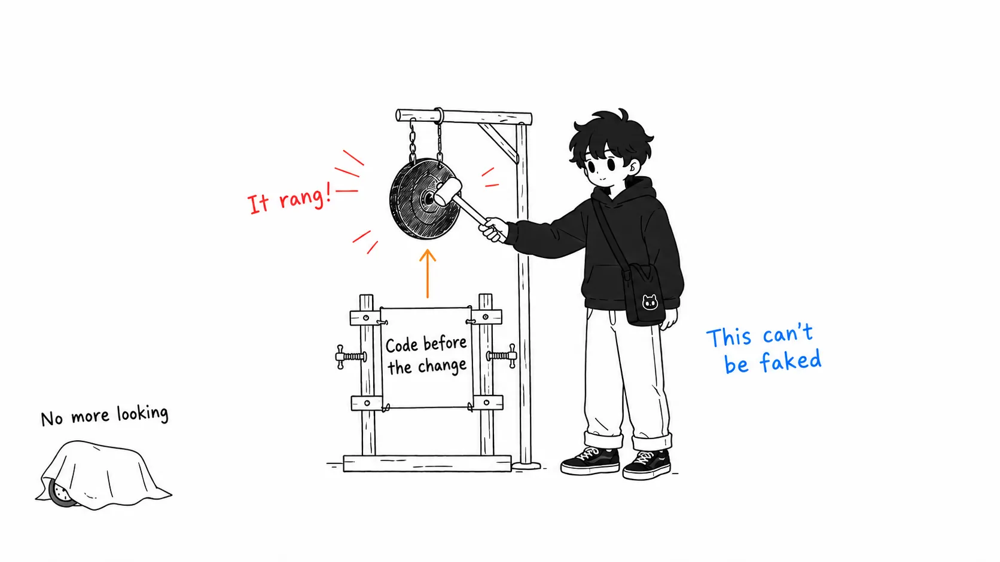

## About This Article

This article deals with code-review data that came out in 2026. Four sources sit at the center: Faros AI's telemetry report "The Acceleration Whiplash" (22,000 developers, about 4,000 teams), CircleCI's 2026 State of Software Delivery (over 28 million CI workflow runs, over 22,000 organizations), LinearB's 2026 Software Engineering Benchmarks (8.1 million PRs), and a May 7, 2026 GitHub Blog post by Andrea Griffiths, "Agent pull requests are everywhere. Here's how to review them."

The article has two parts.

- **Part 1**: What the four datasets say
- **Part 2**: **What I think about where this failure is located**. A reading that none of the sources spell out

The second half is longer. You can get the number-crunching from the original posts.

In an earlier article, "The AI Coding Debate Isn't About the Facts," I wrote about why the same data produces opposite conclusions. That was about how interpretations split. This time it's a different story: where the review process itself is breaking.

A disclosure up front. What I was able to read in full was the GitHub Blog post, David R. Longnecker's blog, and the public summaries of each report. For the two arXiv papers ("More Code, Less Reuse," 2601.21276, and Cotroneo et al., 2508.21634), I only got as far as the abstracts and secondhand mentions. I haven't read the papers themselves. Part 2 is an interpretation that came from lining up existing numbers. It is not something I measured.

---

## Part 1: What the Numbers Show

### The conclusion first

> If you diagnose slower reviews as "there's more volume," the prescription becomes "add review capacity." But what the data shows is reviewers **spending more time and still waving things through more easily**. That isn't a shortage of capacity. It's a failure: the very signals reviewers have relied on for years have stopped working.

### The production gain is real

First, the numbers that favor AI. In Faros AI's telemetry, task throughput per developer is up about 34%. The share of AI-generated code accepted without edits rose from 20% to 60% in one year. On the CircleCI side, overall throughput is up 59% year over year.

80% of the teams in this dataset are already past the point where a majority of people use AI tools weekly. This is no longer a story about early adopters.

### Other columns in the same telemetry

The same Faros report lists these columns side by side.

- Median time spent on code review: up 441.5%
- Median time to first review: up 156.6%
- Bugs per developer: up 54%
- Production incidents ÷ PRs: up 242.7%
- Code churn (share rewritten within two weeks of being written): up 861%
- PRs merged without review: up about 31%

The report adds a note on the last item. No team had changed its review policy. It happened because reviewers could no longer keep up with what was arriving.

CircleCI's breakdown points the same way. Feature-branch throughput rose 15% at the median, while main-branch throughput fell about 7% and the main-branch success rate dropped to 70.8%. More is entering the pipeline, and a smaller share is reaching production safely.

### The failure GitHub gave a name to

The GitHub Blog post opens like this, from its first sentence.

> You've probably approved one without realizing it. The tests passed. The code was clean. You merged it.
> But it was agent-generated, and **how easy it was to approve is the problem**.

The post cites a January 2026 study, "More Code, Less Reuse," which found that agent-generated code carries more redundancy and technical debt per change than human-written code. Even so, human reviewers pass it more readily.

The GitHub team has named this failure: hallucinated correctness. Obvious hallucinations, like calling an API that doesn't exist, get caught by CI. The dangerous code is the kind that compiles, passes every existing test, and is still wrong. An off-by-one in pagination. A missing permission check in a branch the tests never reach. Validation that short-circuits on an edge case the agent never anticipated. A race condition that only shows up at scale.

The post's prescription is "don't scan, trace." Pick the single most important path in the diff and follow every transformation from input to output. Then, for the bug the fix claims to repair, demand a test that fails on the pre-change code. If the agent can't write that test, either the fix is incomplete or the understanding is wrong.

### Here is the contradiction

Everything above is what each source says. From here on it's my arrangement, but put two numbers next to each other and something odd appears.

In LinearB's benchmarks, an agentic-AI PR takes 5.3 times longer to be picked up by a reviewer than a PR with no AI. An AI-assisted PR takes 2.47 times longer. Yet the GitHub piece says PRs written by AI get approved more easily.

If it were pure capacity shortage, both would get slower. Short on people means slow to pick up and slow to pass. If both got faster, reviewers have given up on reviewing, and that also makes sense. But "extremely slow to pick up, easy to pass once picked up" fits neither shape.

---

## Part 2: My View. The Instrument Is What Broke

### Review was never verification. It was sampling inspection

This is my starting point. For a long time we've called code review "confirming that the change is correct." That's not what we were actually doing. We read the diff from top to bottom, looking for signs that the author had cut corners.

Names that don't match. Style that differs from the surroundings. Error handling missing in exactly one place. A function that's unnaturally long. Traces of copy-paste. None of these is a bug in itself. They're proxy indicators for bugs. And as proxy indicators, they worked surprisingly well. The reason is simple: people who are sloppy about style are sloppy about logic too. There was a correlation.

That's why review was cheap. Skim 1,000 lines in 10 minutes, then dig into the few spots that snag. You didn't have to trace every path. You could infer "the danger is around here" from the distribution of sloppiness. The institution of approval sat on top of the assumption that this inference worked.

### LLMs cut that correlation

Fluency is exactly what a model optimizes for. Names are consistent, style blends into its surroundings, and error handling is formally there. The surface becomes uniformly clean, including in places where the logic is wrong.

This is the decisive part. AI code didn't lower the value of the proxy indicator. It **cut the correlation** between the proxy indicator and the actual defects. It's not that the needle stopped moving. The needle keeps pointing at "all clear."

As an instrument, that's worse than one that's broken and frozen. A frozen instrument at least shows that it's frozen. An instrument that returns wrong values with high confidence contaminates every decision made by someone who trusted it.

And this view untangles the contradiction from earlier. Reviewers dread opening an agent's PR, because they sense something is off. That's why picking it up is 5.3 times slower. But once they open it, they can't find any of the material they always use to raise objections. There's no ground to object. So they approve. Surrender after hesitation.

Let me be explicit that this part is my speculation. Codacy's article reads the same 5.3x as "evidence that reviewers are spending more time evaluating," the opposite of my reading. And the same LinearB report has another number: AI-assisted PRs are about 2.5 times larger. Large diffs are slow to get picked up and slow to review no matter who wrote them. That confound is real. I'll come back to it.

### So "spend more time" doesn't fix it

Of everything in the Faros numbers, the combination I weigh most heavily is 441.5% and 861%. Median review time is 4.4 times higher, and code churn is still 8.6 times higher, with the production incident/PR ratio at 3.4 times.

More time spent, and getting worse.

That isn't a symptom of a capacity shortage. With a capacity shortage, the extra time should win some of it back. This is a symptom of a broken instrument. An instrument whose scale doesn't reflect reality won't return the right value no matter how long you stare at it. If anything, the longer you stare, the more confidence builds up that you "checked it properly."

### The industry's prescription is a second, identical instrument

This is the claim in this article most likely to draw objections.

According to LeadDev's 2026 report, 86% of respondents who said AI had affected their review practices use AI to pre-screen before human review. That is the mainstream prescription right now. If generation got faster, automate inspection to catch up.

I think this prescription misses where the failure is.

What an AI reviewer reliably catches is what can be judged deterministically. Linters, types, known vulnerability patterns, coverage thresholds, complexity. The list in Codacy's article is exactly that, and it's the right list. But those were never the problem. CI has been catching that territory for ten years.

What about hallucinated correctness? A model that reads a diff and judges its plausibility is biased toward calling fluent, consistent code "plausible." The same surface that fooled human reviewers works on it in the same way. So pre-screening means lining up **a second instrument calibrated to the same broken proxy**. What the first one misses, the second one misses too. And now the dashboard shows two greens, so only the confidence grows.

You might object that GitHub's post recommends exactly that. The post's three takeaways were "stop immediately if CI is weakened," "let the agent scan first while you trace the critical path," and "use a red-flag checklist for complex PRs."

But look closely and it already concedes my point. It hands scanning (reading the proxy indicators) to the machine and leaves tracing (running things to check) to the human. That's an allocation you only arrive at if you assume the proxy indicators are no longer usable as material for human judgment.

The only place I disagree is how it ends. The post closes with "Judgment is the bottleneck, and that's fine." I don't think it's fine. Judgment made without a working instrument isn't judgment. It's a vibe.

### Only what can't be faked brings the signal back

So what can we use? One criterion: **something the model can't satisfy by tidying up the surface.**

A test that fails on the pre-change code. This one is strong. Writing a passing test is easy, but a test that "fails without this change" is a claim about what the change fixed. GitHub is right to demand it.

Tracing one path end to end. Not reading it, but feeding in boundary values (0, max, empty) and checking what actually happens. That yields information independent of how the surface looks.

And after-the-fact metrics. FlowVerify's article says to watch review lead time and revert rate for PRs the agent touched, not the number of merged PRs, and that's the right direction for metric selection. Revert rate isn't a proxy indicator. It's a verdict handed down by production. Fluency can't move it.

Put the other way around, this isn't about "making review stricter." Every direction that increases how much you read is wrong. It's about moving the budget away from reading and toward running.

### On the ritual of approval

One more step further.

The Approve button was never proof of verification from the start. It's a **social ritual placed where verification should be**. Someone puts their name on it and takes on a share of the responsibility. That was enough because the proxy indicators were working. The share of problems a 10-minute skim could find was high enough that the ritual and the substance mostly lined up.

Now that the correlation is cut, I think there are two roads.

One is to make verification real and cheap. Tests that fail on the pre-change code, path tracing, strong rollback, revert-rate monitoring. Then downgrade approval. In fact, the experiments Codacy's article touches on ("changes protected by tests and rollback get merged first and reviewed afterward" and "limit human review to high-risk areas and architectural changes") go in this direction.

The other is to keep the ritual and admit you're signing off on unverified code and shipping it.

Many teams are doing the second while believing they're doing the first. Faros's "PRs merged without review up about 31%, though no team changed its policy" is, as I read it, the sound of that ritual collapsing without anyone having decided it. Because it was never set as policy, the collapse doesn't show up in any record either.

### If I'm wrong

Here is how this interpretation could fall apart.

The biggest is **PR size**. AI-assisted PRs are about 2.5 times larger. With a diff 2.5 times larger, review time, time until pickup, and the number of issues detected all go up no matter who wrote it. If most of the inflation in review time disappears once you normalize for size, my "the instrument broke" story loses its main support, leaving the boring and correct explanation: "diffs just got bigger." As far as I've seen, none of the reports does this normalization.

The volume of defects itself isn't actually stable either. Longnecker writes about this carefully: CodeRabbit's "AI co-authored PRs average 10.83 issues versus 6.45 for human-only" (about 1.7x) comes from a vendor report, with no normalization for PR size, language mix, or how the cohorts were built. He still believed the direction because a peer-reviewed study by Cotroneo, Improta, Liguori and others (a matched sample of over 500,000) found a similar direction with different data and a different detector. Even within that study, though, AI code is structurally simpler than human implementations, and which cohort has more defects flips depending on the model.

Here is what I took from Longnecker's point. A team that reads "1.7x" as "AI is the problem, restrict it" loses the speed it is actually gaining upstream. The breakdown by category (security, null/error handling, business logic) changes behavior more than the raw count does. My argument is the same. This isn't an argument for using less AI. It's an argument for changing how we inspect.

One more. If the revert rate of agent PRs, after matching for size, is no different from human PRs, then hallucinated correctness isn't reaching production. In that case the instrument isn't broken. I looked for this number and couldn't find a published one. If anyone can pull it from their own team, that is where this article's claim can be tested.

And nearly all the central data this time is telemetry from companies that sell AI review tools (Faros, LinearB, CircleCI, CodeRabbit, Codacy). I'm using correlational data from the side with a commercial interest in the conclusion "your inspection process is broken" as the backbone of my argument. That's a weakness.

---

## Summary

If you take away only one thing, take this: **if you pay 4.4 times the review time and churn still goes up 8.6 times, what you're short on isn't time.** Every countermeasure that increases how much gets read (adding reviewers, having AI pre-screen, lengthening the checklist) is the same act of reading the same instrument more earnestly.

If you pick one thing to do next, I think the cheapest place to start is requiring a "test that fails without this change" on every PR where AI was involved. It needs no tooling and no process change, and it's the only requirement that hits hallucinated correctness head-on.

And start measuring revert rate. That will also tell you whether my claim is right.

---

## Sources

- Andrea Griffiths, "Agent pull requests are everywhere. Here's how to review them.", GitHub Blog, May 7, 2026 — https://github.blog/ai-and-ml/generative-ai/agent-pull-requests-are-everywhere-heres-how-to-review-them/
- Faros AI, "The Acceleration Whiplash" (2026, telemetry from 22,000 developers and about 4,000 teams) — https://www.faros.ai/blog/ai-acceleration-whiplash-takeaways
- CircleCI, "2026 State of Software Delivery" (over 28 million CI runs, over 22,000 organizations) — https://circleci.com/resources/2026-state-of-software-delivery/
- LinearB, "2026 Software Engineering Benchmarks Report" (8.1 million PRs) — https://linearb.io/resources/software-engineering-benchmarks
- David R. Longnecker, "The Review Bottleneck", July 2026 — https://drlongnecker.com/blog/2026/07/review-bottleneck-ai-code-review-trust-capacity/
- Codacy Blog, "AI Is Breaking Code Review: How Engineering Teams Fix the PR Bottleneck" — https://blog.codacy.com/ai-breaking-code-review-how-engineering-teams-survive-pr-bottleneck
- FlowVerify, "The AI Code Review Bottleneck, By the 2026 Numbers" — https://www.flowverify.co/blog/ai-code-review-bottleneck-2026-data
- "More Code, Less Reuse", arXiv:2601.21276 (January 2026 / mentioned via the GitHub Blog. The paper itself is unread) — https://arxiv.org/abs/2601.21276
- Domenico Cotroneo, Roberta Improta, Pietro Liguori, arXiv:2508.21634 (matched sample of over 500,000 / mentioned via Longnecker. The paper itself is unread) — https://arxiv.org/abs/2508.21634
- CodeRabbit, "State of AI vs. Human Code Generation Report" (issue counts 10.83 vs. 6.45 / vendor report. Referenced via Longnecker's article. Original URL not confirmed)
- LeadDev, "The State of AI-Driven Software Releases 2026" (pre-screening adoption 86% / referenced via Longnecker's article. Original URL not confirmed)
