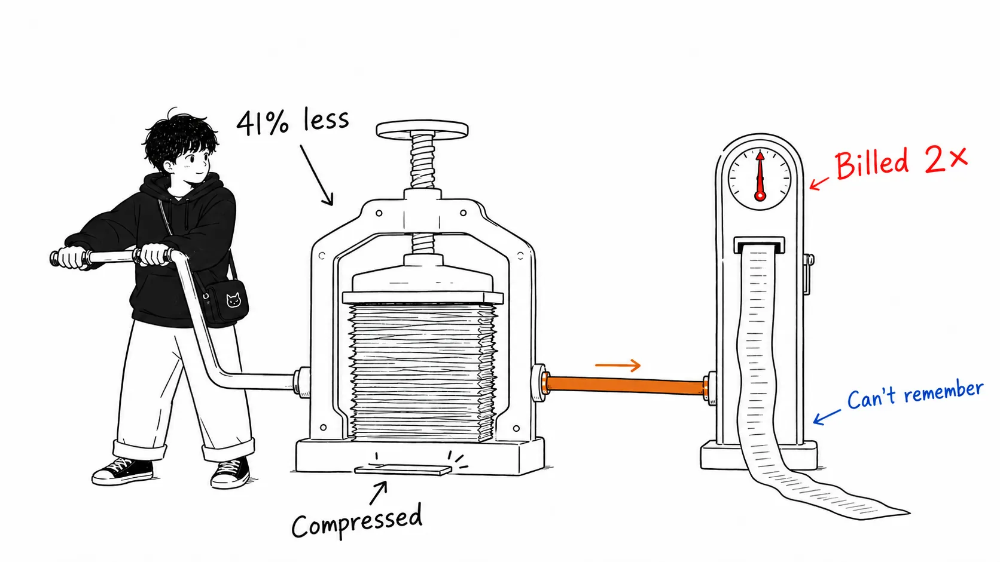
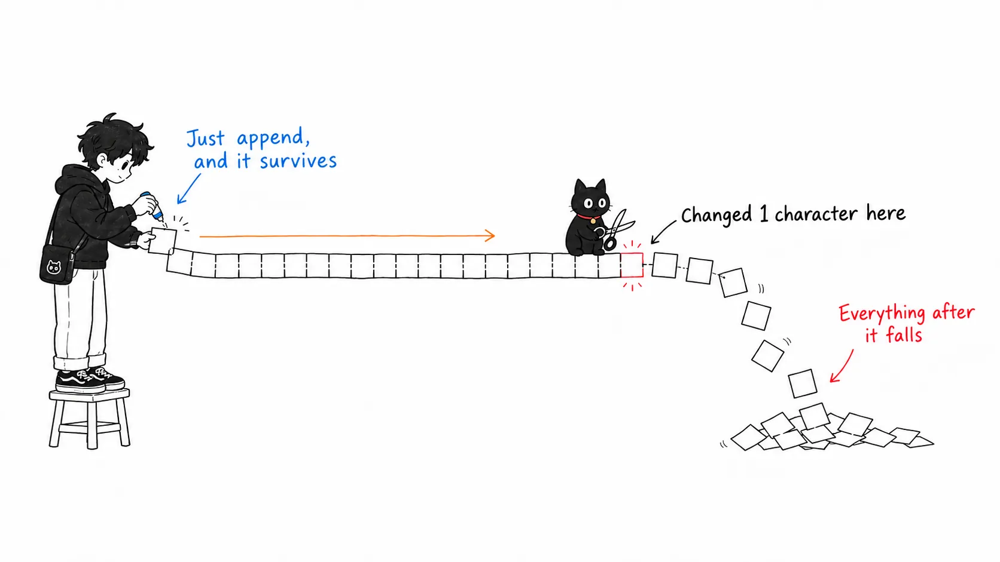
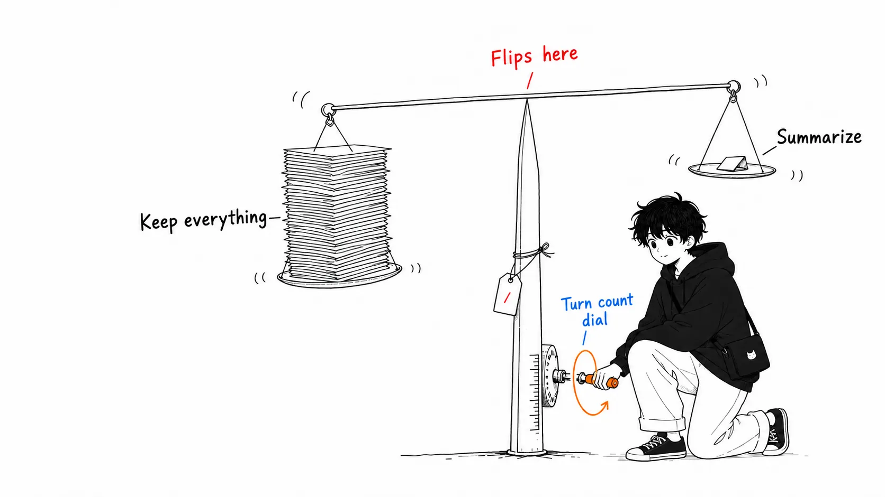
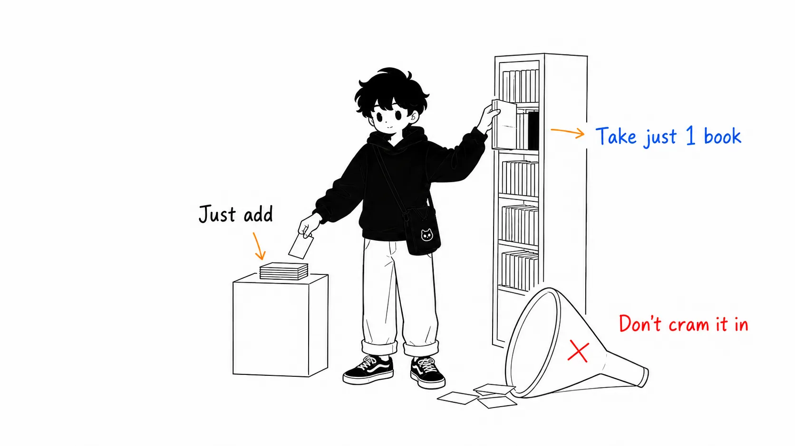
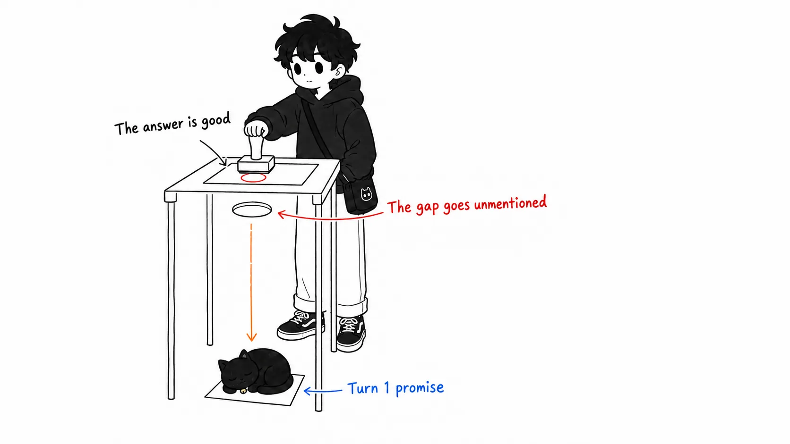

Here is the conclusion up front.

> In an environment where prompt caching works, **the metric to cut was not "token count" but "prefix rewrites."** Compressing by summarization makes the context shorter but throws the cache away, so even if you send fewer tokens, the bill goes up. In measurements, a compaction setup that sent 41% fewer tokens paid about twice as much as the setup that did nothing.

## About this article

I read an article by Louis-François Bouchard, based on a workshop that three people from Towards AI (Bouchard, Omar Solano, and Samridhi Vaid) gave at the AI Engineer World's Fair. Using a live, open-source AI tutor as the subject, they ran a few hundred dollars' worth of evals and found that their own production setup was worse than "doing nothing."

- Article: [Context Engineering in 2026: Why We Stopped Compacting Our Agent's Context](https://www.louisbouchard.ai/context-engineering-2026/), Louis-François Bouchard (Towards AI)
- Workshop video: [Context Engineering in 2026 — Bouchard, Solano & Vaid, Towards AI](https://www.youtube.com/watch?v=WP3hjUXd918)
- Code: [towardsai/ai-tutor-app](https://github.com/towardsai/ai-tutor-app)
- Experiment results demo: [Hugging Face Space](https://huggingface.co/spaces/towardsai-tutors/context-engineering-experiments)

In the interest of honesty: **I have not reproduced this eval myself.** The numbers are quoted from the article, and my position is that of a reader, not a verifier. I still decided it was worth writing about because I am one of the people who used `/compact` in Claude Code as a reflex, "the thing you press when it's getting full," and the basis for that reflex fell apart. One more thing: I couldn't pin down the article's exact publication date (neither the URL nor the body shows one). Since it comes from the workshop, all I can say is that it's a 2026 article.

The second half is longer. Sorting out the numbers is something you can do by reading the original.

## Compressing cost more

First, the raw numbers. On Gemini 3.5 Flash, in sessions of 11 to 13 turns, here is a head-to-head between `full_history` (touch nothing) and the production preset (summarization plus tool-output clearing):

| | full_history | Production preset |
| --- | --- | --- |
| Cost per turn | $0.11 | $0.24 |
| Time to first token | 17 sec | 21 sec |
| Memory recall | 92% | 38% |

"Do nothing" wins all three. Cheaper, faster, and it remembers.

The trick is cache accounting. The compaction preset sent about 41% fewer tokens but paid about twice as much. `full_history` was billed at the cache discount for about 87% of its input, while the summarization side paid full price again every time it rewrote the prefix.

Here is the one number that hit me hardest when I read it.

> 全アームの中で一番多くのトークンを請求されたのが `full_history` で、1ターンあたり約296kトークン、その97%がキャッシュヒット。それでも $0.0063/ターンで最安だった。36ターンの会話で送ったトークンは合計178万。
> (Of all the arms, `full_history` was billed for the most tokens, about 296k tokens per turn, 97% of them cache hits. It was still the cheapest at $0.0063 per turn. Across a 36-turn conversation, it sent 1.78 million tokens in total.)

The setup that sends the most is the cheapest. DeepSeek's cache discount is 50x, so tokens riding on the cache behave like "nearly free padding."

Summarization also came with a side effect. After the tool outputs were cleared, the agent went off to re-fetch information it had just retrieved. An operation meant to cut cost multiplied the sources of cost.

## The cache only works on a byte-for-byte match

The mechanism fits in one line.

> キャップは接頭辞を短くするが、ターン間でバイト単位では同一に保つので、キャッシュはヒットし続ける。要約は接頭辞を「違うもの」にすることで短くするので、キャッシュはミスする。**Shrink the context, don't rewrite it.**
> (A cap shortens the prefix but keeps it byte-for-byte identical between turns, so the cache keeps hitting. Summarization shortens the prefix by making it "different," so the cache misses. **Shrink the context, don't rewrite it.**)

A provider's cache discount applies only when you "resend an already-processed prefix as is." Up to 1/50 on DeepSeek, about 90% off on Gemini. Putting a summary in the middle breaks the very premise of the discount.

Put another way, summarization is not compression but a write that invalidates the cache. To pay for itself against a 50x discount, it would have to shrink the context drastically without dropping any needed detail. No such summary exists.

## The compression that worked was the kind that doesn't call the model

This is the part you can take home most practically. On DeepSeek, they ran a 2×2 (cap tool outputs or not × summarize or not), with 414 turns × 3 trials per arm.

- Cap only: $0.189/turn → $0.117/turn. A 38% reduction. Won in 14 of 15 paired trajectories
- Cache hit rate: 96.0% → 95.9% (barely moved)
- Memory probe accuracy: identical to no cap
- Summarization: about +50% over plain full_history, and +32% even over capped full_history

That's **38% for free.** And summarization raised the bill no matter which configuration you added it to.

They also tried the clever workaround Codex uses. Instead of replacing the history, you send the unchanged history plus a single instruction to "write a checkpoint summary." The design keeps the cache alive even for the summarizer's own call, and they write that it "worked as advertised." It still didn't become their production setup.

The configuration they run now:

- Model: DeepSeek V4 Flash (a cloud model where caching works)
- Retrieval: hybrid (dense + BM25 + rerank)
- Memory: keep everything, but with a stable cap on all tool outputs
- Tool-output clearing: off
- Summarization trigger: 30k → 800k (effectively almost never fires)

And here the author writes something harsh on themselves. The peak of a long session is about 287k, so the 800k trigger itself hasn't been validated in production. It's "not a tuned parameter but a guardrail that hasn't been hit yet." I think whether that one sentence is there changes how much you can trust the article.

## But this conclusion is a function of $0.55

If you skip this and summarize it as "/compact is a waste," you'll get burned. They rebilled the same recorded traces at each vendor's prices to find the threshold.

> DeepSeek 価格（キャッシュ入力 $0.0028/Mトークン）では keep-everything が13%勝つ。同一のトレースをフロンティア価格（キャッシュ入力 $0.50/M）で再請求すると、2つのアームはほぼ引き分ける。交点を解くと、**キャッシュ入力が約 $0.55/Mトークンを下回る限り、全履歴保持が勝つ**。
> (At DeepSeek pricing (cached input $0.0028/M tokens), keep-everything wins by 13%. Rebilling the same traces at frontier pricing (cached input $0.50/M) leaves the two arms nearly tied. Solving for the crossover, **full-history retention wins as long as cached input is below about $0.55/M tokens**.)

DeepSeek sits at 1/200th of this threshold, so it's no contest there. The problem is that frontier models sit right on top of the threshold. In the same rebilling, full_history won on a 22-turn session and lost on a 36-turn one. It's not that there's a price cliff; the history just got longer and crossed the line.

In other words, those of us using Claude or GPT-class models are in the zone where the answer flips with session length. "Don't compress" is not a conclusion; it's something you decide after looking at the price list and your own session length. The author says so too: before you write a single line of summarization code, look up your own provider's cached-input price.

## Claims that seem to point opposite ways are really saying the same thing

In the same year, 2026, a claim that appears to point the other way has come out. It's the Zencoder newsletter [Bigger Context Windows Stopped Helping. Memory Is the New Compiler.](https://zencoder.ai/newsletter/the-context-engine-ai-coding-agents) (Neeraj Khandelwal, May 18, 2026).

> あるシリーズC のフィンテックのスタッフエンジニアが、チームの2Mトークンモデルを切ったと言ってきた。バグ修正の精度は上がった。（中略）ウィンドウを64kに削り、小さなリポジトリグラフを足して、プロンプトに前倒しで詰めるのではなく必要に応じてシンボルを取得させた。同じモデルで、社内 eval のバグ修正精度が 71% → 84%。タスクあたりの推論コストは約5分の1に。
> (A staff engineer at a Series C fintech told me they had switched off their team's 2M-token model. Bug-fix accuracy went up. (...) They cut the window to 64k, added a small repository graph, and had the model fetch symbols as needed instead of stuffing them into the prompt up front. With the same model, bug-fix accuracy on their internal eval went from 71% to 84%. Inference cost per task dropped to about a fifth.)

At first glance, this collides head-on with Bouchard's "keep everything." But read closely, it doesn't. One says don't rewrite history, and the other says don't stuff knowledge in up front. The targets are different.

Bouchard's data supports the same direction. For documents, it's "don't stuff, retrieve." With local models, cramming a whole lesson into the window fell apart at every model size, while the RAG side hit 100% answer quality, about 5x the throughput, and a context of about 3k instead of 38k. The framework introduced in the workshop as the most reusable is a line from Samridhi.

> コンテキストは1つのものではない。チャット履歴は毎ターン伸びる。貼り付けたドキュメントや巨大なツール出力は一発でウィンドウを吹き飛ばす。形が違えば壊れ方が違い、必要な対処も違う。
> (Context is not one thing. Chat history grows every turn. Pasted documents and huge tool outputs blow out the window in one shot. Different shapes break in different ways and need different remedies.)

So the unifying rule is this: **keep history append-only and on the cache. Retrieve knowledge. Cut tool outputs deterministically.** All three are consistent under "don't let the model rewrite it."

I should also say that the quality of the evidence isn't symmetric. On Bouchard's side: a few hundred dollars of evals, 414 turns × 3 trials, paired comparisons, price rebilling. On Zencoder's side: "a staff engineer told me on Tuesday," plus "I've heard the same story from three other people this month." The direction matches, but they're not to be cited with the same weight. I use the former as grounds, and read the latter as an indicator of which way the industry's gut feeling is pointing.

## My view: token count was a proxy all along

From here on is my own reading, written in neither the original article nor Zencoder's.

### 1. What broke was the metric, not the technique

When we say "reduce the context," what we really want to reduce is billed compute, and token count was a proxy for it. The two were proportional for a long time, so there was no need to tell them apart. Prompt caching cut that proportionality.

The moment it's cut, minimizing token count stops being optimization and becomes metric hacking. "Sent 41% fewer and paid double" is exactly that. The dashboard's "tokens sent" goes down. The bill goes up. If you only watch one of them, it looks like a success.

This structure feels familiar. Delivery that changes the CDN cache key every time. An implementation that throws away immutable data structures, figuring "rewriting in place must be faster," and then pounds the GC. A config that invalidates `ETag` while bragging about its compression ratio. They are the same shape of failure: rewriting a shared, immutable prefix for the sake of a local saving. I think LLM inference has simply joined that company all of a sudden.

So the rule to remember isn't whether to use `/compact`. It's: **treat the prefix as append-only.** That survives price changes.

### 2. The scariest part was that 38% looked "good"

What gave me chills in this article wasn't the cost numbers but this combination.

- Memory probe of the production preset: 38%
- Cost: about double that of doing nothing
- Answers as rated by blind judges: good

It's not that the way quality looks is broken; the quality metric being measured couldn't detect forgetting. A single answer looks reasonable. After all, what was forgotten isn't written in the answer. Omission comes out as silence.

This has an implementation consequence. If you want to protect an agent's memory, an LLM-as-judge on answer quality isn't enough. You need a separate probe (a memory probe) that directly asks whether a constraint given at turn 1 is still being honored at turn 45. The example at the opening of the original article is exactly that: one rule is given at turn 1, 45 turns of grep, diff, and logs follow, and then the agent confidently does the thing it was told not to do and reports on it. I've seen exactly the same thing in my own Claude Code sessions, many times.

I suspect that even teams with a quality eval often don't have a "forgetting eval." At least I didn't.

### 3. What this means in practice for Claude Code users

This is where the original article's subject (an AI tutor, one LangChain agent) and our environment (coding agents) diverge, so I'll write carefully. **This is inference, not a verified result.**

In descending order of confidence that it transfers:

**High confidence: capping tool outputs.** In a coding agent, most of the context is tool output. File reads, grep, test output, build logs. Even in the original article's environment, it says "the conversation wasn't the expensive part, it was a rounding error" and "turns landed at about 200k input tokens, most of it retrieved material." Coding agents are even more extreme in this skew. So the 38% win from capping deterministically without calling the model should work especially well in coding agents. The idea of putting an output-compressing CLI proxy like `rtk` in the path probably pays off here (I haven't measured the effect).

**Medium confidence: don't rewrite `CLAUDE.md` or MCP tool definitions mid-session.** These sit at the start of the prefix. Change the start by one byte and all the cache after it is invalidated. In theory, editing CLAUDE.md in the middle of a session should break the cache over a wider range than `/compact`. The original article doesn't verify this, so I won't assert it either. Still, the practice of "touch config files at the moment you end the session" is on the safe side even if you never measure a single yen of cost.

**Medium confidence: name the constraint before you press `/compact`.** Borrowing the original article's breakdown as is, there are three constraints, and the prescription differs for each.

- It doesn't fit in the window → move to retrieval. Not summarization
- The bill is growing → compare cached-input price to $0.55/M, and before writing a summary, move to a cheaper cached model
- Quality is actually degrading → measure where it degraded. In their environment it held up to 800k

Three constraints, three prescriptions, and only one of them is compression. The `/compact` I used to press by reflex was usually a mix-up of the first (window) and the third ("it just feels off somehow"). If they're mixed up, you should be able to say which one it is before you press.

### 4. Even so, I won't drop /compact entirely in Claude Code

To head off the objection: if you ask "so keeping everything is fine?", on the frontier-price side the answer is no. If you're above the $0.55 threshold and your sessions run past 36 turns, the summarization side won in the rebilling experiment. A long coding session blows past 36 turns without effort.

Here is where I land. **Keep `/compact`. But don't press it just because "it's getting full."** Limit the conditions for pressing it to when you're about to hit the window limit and when the task switches. If the task switches, a fresh session is the right call in the first place, rather than compression (you discard the history instead of rewriting it). The principle of avoiding rewrites holds there too.

## If you take home just one thing

Summarization isn't a context operation; it's a write to the cache. Before reducing length, reduce rewrites.

And if you remember just one number, make it $0.55/M tokens. Until you've compared your own provider's cached-input price to it, you can't decide whether to compress.

## Sources

- Louis-François Bouchard, [Context Engineering in 2026: Why We Stopped Compacting Our Agent's Context](https://www.louisbouchard.ai/context-engineering-2026/), louisbouchard.ai (2026; exact publication date could not be determined from the text). Based on the AI Engineer World's Fair workshop with Omar Solano and Samridhi Vaid
  - Video: [Context Engineering in 2026 — Louis-François Bouchard, Omar Solano & Samridhi Vaid, Towards AI](https://www.youtube.com/watch?v=WP3hjUXd918)
  - Code: [github.com/towardsai/ai-tutor-app](https://github.com/towardsai/ai-tutor-app)
  - Experiment results demo: [huggingface.co/spaces/towardsai-tutors/context-engineering-experiments](https://huggingface.co/spaces/towardsai-tutors/context-engineering-experiments)
- Neeraj Khandelwal, [Bigger Context Windows Stopped Helping. Memory Is the New Compiler.](https://zencoder.ai/newsletter/the-context-engine-ai-coding-agents), Zencoder newsletter Edition 26, May 18, 2026

All figures in the article are quoted from the two sources above. I have not reproduced the eval myself. From point 3 of the "My view" section onward, the content is my own inference about transferring this to coding agents, not a verified result.
