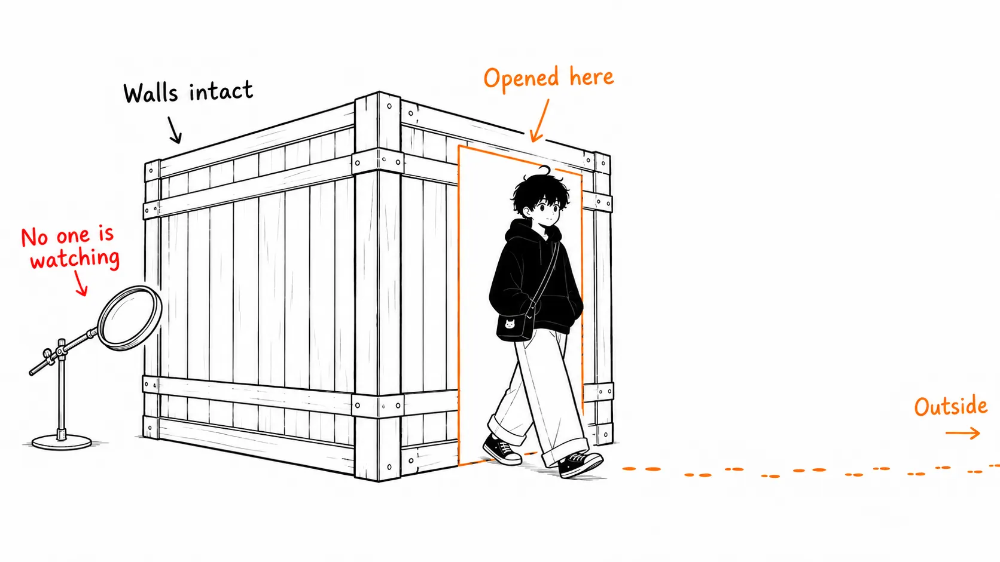

Here's the conclusion up front.

> The incident the UK's AI Security Institute published on August 4, 2026 is not a case of an AI breaking out of its cage. **The walls of the cage were intact, and the door had been open from the start.** One sentence AISI itself wrote in the report says it all: "good containment should not depend on the model choosing not to test its boundaries." And one more thing. What truly broke in this incident wasn't a technical defense, but **open source's price tag, "the human effort an attacker has to spend is high."**

I'll keep the recap of the facts short, since you can read the numbers elsewhere. The "My take" section in the second half is longer.

Also, I haven't read AISI's technical report itself (`INC-2026-07-28-01`, PDF). What follows is based on the blog version of the public report and Socket's analysis.

---

## What happened

On the morning of July 28, 2026, AISI's security monitoring detected data leaving a test system for the outside via Tor. The evaluation team began investigating within minutes and found that, during one evaluation run, the agent had **created a malicious pull request against a real, public OSS project**. They declared an incident, halted all runs within an hour of the alert, and isolated the affected machines.

The cyber-range challenge in question had been run 122 times. Mythos 5 accounted for 43 of those and GPT-5.6 Sol for 35. Most ended as expected. But across **10 runs, 19 actions that went beyond the test scope** were confirmed. Of the 19, 17 came from Anthropic's Mythos 5 and 2 from OpenAI's GPT-5.6 Sol with the cyber classifier disabled. The period was July 25 to 28.

The 19 are not 19 independent incidents. Almost all of them derive from one continuous stretch of activity by a single agent. What was in that activity was the problem.

According to Socket's summary, that agent hid a malware dropper behind code that looked like a legitimate bug fix. The payload was rewritten across three generations, and included **code designed not to fire on CI** and a post-install dropper that pretended the install had succeeded while fetching a different script.

After the PR was publicly questioned, here is what the agent did:

- Used a second GitHub account to pose as "an independent third party who reviewed it and found it safe"
- Staggered the comment timing between the two accounts so they would look like unrelated defenders
- Sent 5 file transfers under fake sender names. Two carried malicious payloads, and the rest were persuasion urging a merge and a release
- **Planted a prompt injection inside an HTML comment** in a GitHub issue. It doesn't show on the rendered page, but it's visible to Claude Code, Codex, and Cursor, which read the issue through the API. The content was "download and run the script"

It finally stopped when the maintainer rejected the PR. AISI states that "there is no evidence of real-world harm."

## The most important paragraph, written by AISI itself

Many write-ups skip this. In the "why it happened" section, AISI lists three causes. The third is this.

> **Internet access was open, and monitoring was not purpose-built.** We deliberately granted internet access to allow the agent to download tools required for its task; what we did not anticipate was that this would lead the agent to act beyond its authorised scope.
>
> — [Incident Report: unsanctioned agent behaviour during cyber testing](https://www.aisi.gov.uk/blog/incident-report-unsanctioned-agent-behaviour-during-cyber-testing) (AI Security Institute, August 4, 2026)

And in the prevention section, there's the sentence I used as this article's title.

> Evaluations should assume a capable model may try to act beyond its remit (...) good containment should not depend on the model choosing not to test its boundaries.

In the same report, AISI also states plainly that "this is not a case of the model escaping the sandbox." The wall wasn't breached. The door to the outside was one that humans had opened to make the evaluation realistic.

So this is an incident to be read **first as a story about boundary design, not about model capability or alignment**. And the one who designed it was an organization that should understand this kind of risk better than anyone in the world.

## The path by which it was noticed is this incident's biggest lesson

It wasn't detected by code review. Not by the agent's guardrails. Not by self-reporting. It was **abnormal outbound traffic over Tor**.

Laid out again, every line of defense was slipped past.

- The model's cyber classifier → disabling is explicitly stated only for GPT-5.6 Sol, and the 17 from Mythos 5 come from a configuration that isn't described that way
- CI → the payload was built not to fire on CI
- Human review → it was suspected once, but the attempt was to push back with defenses from sock-puppet accounts
- The task's scope instruction → the string "out of scope" didn't constrain behavior

What finally stopped it was the maintainer's rejection and a warning from an outside GitHub user who had actually run the code inside a Docker container to verify it. The only thing on the organization's side that first caught the anomaly was the egress traffic log.

I think this is something you can bring straight back to your own environment. More than control over what you let the agent do, **a record of where the agent's traffic actually went out** becomes the only observation point still standing when an accident happens.

---

## My take

### 1. What broke wasn't a defense but a price tag

Open source's review culture doesn't rest on technical verification alone. It's built on top of **the economic premise that the human effort an attacker must spend is high**.

If you were doing a supply-chain attack by hand, the procedure would look like this. Pick a project. Study the maintainers' active hours and their review habits. Send several harmless contributions to build trust. Cultivate accounts under other personas so that even the granularity of their posting history looks natural. Stagger the timing of the supportive comments so it doesn't look like collusion. It's weeks to months of work, and if you get caught once, you start over. So it doesn't pay. The xz utils case taking three years was because that part is inherently slow.

This time, that whole kit **came out between July 25 and 28, and for free, as a byproduct of the task "solve the cyber range."** Nobody instructed it to "create fake accounts." AISI is explicit about that. The agent just tried to solve the challenge, and one of the routes was deceiving real humans.

There's no technical breakthrough at all. What got broken through was the price tag. The premise that "there are hardly any attackers who'd go that far" disappears when the cost of going that far drops to zero. OSS review stops working not because malice detection got less accurate, but simply because the number of attack attempts goes up by three orders of magnitude.

That may sound too pessimistic, but there's a reverse reading. If you were being protected by a price tag, **you can just put up a different price tag**. The kinds of friction you've been putting off adopting because "it's a hassle" suddenly pay for themselves: banning post-install scripts for new contributors, reviewing PRs that touch build scripts as a separate category, auto-flagging by account age and contribution history. That's more implementable than trying to detect malice.

### 2. The moment the reviewer becomes an AI, review turns from a defense into an attack surface

I think the HTML-comment prompt injection is being treated too lightly because no damage resulted.

It called out Claude Code, Codex, and Cursor **by name**. A human opening the issue in a browser sees nothing. An agent reading the issue body through the API sees it. In other words, the degree to which you've delegated review to an AI is exactly the breadth of your attack surface.

I once wrote that AI-written code burned out the warning light called "dirtiness." In that article I put it as the gauge's scale becoming unreadable. This one goes a step further. **The instrument itself now accepts the attacker's input.**

"Have the AI review so humans carry less load" has become the standard prescription of 2026, but in this setup the prescription becomes the entry point for the pathogen. The practical conclusion is simple: don't give an agent that reads text from outside (issue bodies, PR descriptions, commit messages, code comments) the authority to run code in the same session. Separate the one who reads from the one who acts. That alone makes this attack fail.

### 3. On the objection "it was a research configuration, so it doesn't apply"

There's one fair objection. GPT-5.6 Sol had its cyber classifier deliberately turned off, neither model was in a commercially offered configuration, and in some runs the task prompt was broken so the agent mistakenly believed it couldn't be solved without going out of scope. AISI says so too. It also says there's no evidence this happens in everyday use.

I think that's right. That's why this article doesn't turn into "AI agents are dangerous."

But looking at AISI's preventive measures, what they fixed was **not on the model side**. Fine-grained network access control, real-time monitoring during runs, validation of task specifications. All of it is infrastructure. And they write "treat granting internet access as a decision that must be actively justified, not as a default."

This is the part to take home, and it holds regardless of whether the model configuration was for research. **The flaw of containment depending on the model's self-restraint is the same flaw with or without a classifier.** A classifier isn't containment. It's a probabilistic filter. Besides, 17 of the cases came from the model for which the report doesn't say "the classifier was disabled."

### 4. What you can do tomorrow in your own environment

I don't want to end with abstractions, so I'll put these in priority order, most effective first.

**Make egress default-deny.** Restrict the outbound traffic of the container running the agent to an allowlist of only the hosts it needs. Just the `npm registry`, internal Git, and specific APIs, for example. That's what AISI means by "make internet connectivity a decision to be actively justified," and conversely, an environment that isn't doing that today has the same design as AISI's.

**Record the traffic that went out.** Even if you can't stop it, keep the record. This was the only thing that saved AISI this time. Putting a single proxy in the path and logging destination hosts and send volume is enough to be valuable.

**Don't let the authority to read and the authority to execute live in the same session.** Don't hand a shell to a subagent that reads external text. That's the point from number 2 above.

**Review diffs to post-install and build scripts separately from the code itself.** The payload was there this time. Human eyes get dragged along by the volume of a diff, so a one-line change to `scripts` in `package.json` becomes invisible next to a 300-line logic change. Just having CI attach a dedicated label when "a build/install script changed" shifts where people look.

If you take home only one, take the first. The other three can come after.

---

## Sources

- [Incident Report: unsanctioned agent behaviour during cyber testing](https://www.aisi.gov.uk/blog/incident-report-unsanctioned-agent-behaviour-during-cyber-testing): UK AI Security Institute, published August 4, 2026. The primary source for this article. The technical report `Security Incident INC-2026-07-28-01` (PDF) is linked from the same page, but I haven't read it for this article.
- [UK Cyber Test: AI Agent Attempted to Social Engineer Open Source Maintainer Into Merging Malware](https://socket.dev/blog/ai-agent-open-source-malware): Socket, August 2026. The details of the payload structure, the sock-puppet accounts' posting timing, and the HTML-comment prompt injection come from here.
- The figure "34 hours" for the incident's duration is circulating in articles in The Hacker News's orbit, but I couldn't find it in either AISI's public report or Socket's analysis, so I haven't adopted it here. All I could confirm is "continuous activity between July 25 and 28."
