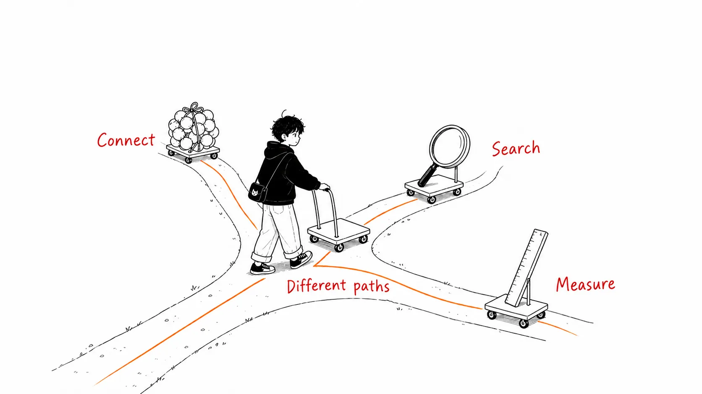
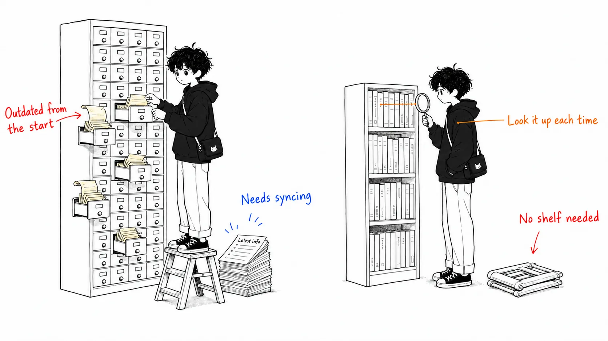
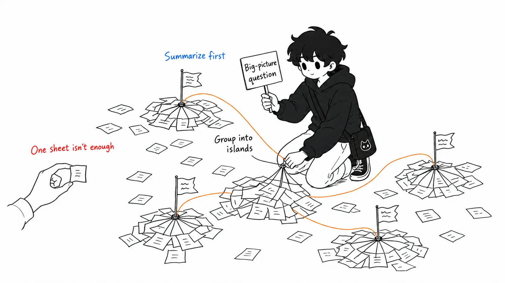
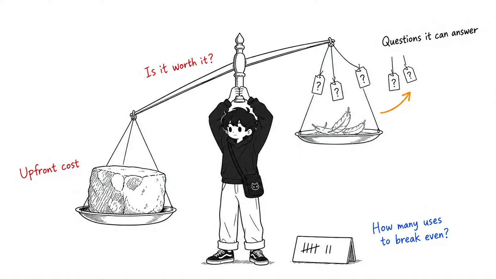
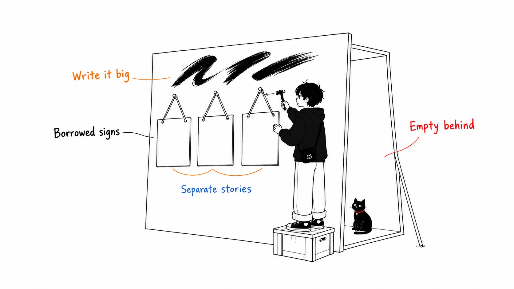

## About this article

On July 19, 2026, an article with this title was posted on X.

> **Graph Engineering replaced RAG at Microsoft, Stanford and Anthropic. Here's how it works.**

It has been viewed **1.2 million times**. The cover image shows a knowledge graph drawn inside a terminal window labeled "Claude Code," with the Anthropic logo in the center, the logos of Stanford, Anthropic, and Microsoft arranged around it, and the words "Why they moved beyond RAG."

In this article, **I check whether that claim holds up against primary sources.**

Here is the conclusion up front.

> **The three organizations did not go down the same "graph" road. They went in three different directions.**
> And what Anthropic actually chose was not a graph. It was **grep**.

As a byproduct of the check, a practical framework falls out: **"the right retrieval architecture depends on the kind of question you're asking."** That is the real subject here.



---

## Part 1 — Anthropic chose grep

### They say so themselves

These are the words of Boris Cherny, the creator of Claude Code, who leads Claude Code at Anthropic. Several independent outlets quote the same statement.

> Early versions of Claude Code used RAG with a local vector DB, but we found pretty quickly that **agentic search generally works better.** It is also simpler and doesn't have the same issues around security, privacy, staleness, and reliability.

On the Latent Space podcast he goes further. Agentic search beat RAG "**by a lot**," and that was "**surprising**." Among the things they tried and that lost, he lists a local vector DB and recursive indexing by the model, among others.

### What is agentic search?

Here is how Cherny describes it.

> Letting the agent search for information through as many search cycles as it needs, **using ordinary code-search tools like glob and grep.**

So in practice it looks like this.

```
glob（ファイル名で探す）
grep（中身の文字列で探す）
ファイルを読む
→ モデルが「次に何を見るか」を決めて、必要な回数だけ繰り返す

事前インデックス：ゼロ
埋め込み：なし
ベクトルDB：なし
グラフ：なし
```

**I can confirm this from my own toolset, as the one writing this article.** The search tools I have are `Grep` (a ripgrep wrapper), `Glob`, and `Read`. I have no tool that builds embeddings, no tool that queries an index, and no tool that connects to a graph database.

The cover image draws a graph inside a "Claude Code" window, and **that does not match the implementation.**

### Why did grep win?

The reasons are well organized, and they say something beyond code search.

| Point | Why grep / agentic search has the edge |
| --- | --- |
| **Precision** | `createD1HttpClient` either appears in a file or it doesn't. For **questions where an exact match is the answer**, bringing in semantic closeness just adds noise |
| **Freshness** | An index goes stale the moment you build it. grep looks at the files as they are, every time |
| **Security** | An index has to live somewhere. That means sending internal code to a third-party embedding provider. Anthropic didn't want that even for its own code |
| **Multi-step reasoning** | You can read one thing, learn from it, and decide what to look at next. A static lookup can't do that |
| **Setup cost** | Zero setup, zero infrastructure |
| **Future** | The intelligence lives on the model side, so **it gets better for free as the model gets better** |

That last point matters more than it looks. If you pile your cleverness into the index side, you benefit less from model progress.



### And Anthropic has improved RAG itself

There is another fact that doesn't fit the claim.

In September 2024, Anthropic published a technique called "**Contextual Retrieval**." It **improves RAG rather than discarding it.** By attaching context to each chunk before embedding, it reportedly **reduced retrieval failures by 49% (67% when combined with reranking).**

So Anthropic's stance is not "RAG is dead." It simply **uses different tools for different uses.**

- **Exploring a codebase** (Claude Code) → agentic search
- **Searching a document knowledge base** → RAG, but with added context to raise accuracy

---

## Part 2 — Microsoft's GraphRAG is "a kind of RAG"

### The name says so

Microsoft's GraphRAG is real. It's a Microsoft Research result, released on GitHub in July 2024. But the first sentence of its official documentation reads like this.

> GraphRAG is **a structured, hierarchical approach to Retrieval Augmented Generation (RAG)**, as opposed to naive semantic-search approaches.

The GitHub repository description is also "**a modular graph-based Retrieval-Augmented Generation (RAG) system**."

**It isn't a replacement. It's a form of RAG.** RAG is right there in the name.

### So what was it built for?

This is the most technically interesting part. GraphRAG is not "generally better than RAG." It was built for **a kind of question that baseline RAG cannot answer, in principle.**

The title of the Microsoft Research paper says as much: "From Local to Global: A Graph RAG Approach to **Query-Focused Summarization**."

```
ベースラインRAG が得意：
  「この製品の返品ポリシーは？」
  → 該当する箇所を取ってくれば答えられる（検索タスク）

ベースラインRAG が原理的に苦手：
  「このデータセットの主要なテーマは上位5つは何か？」
  → どこか1箇所を取ってきても答えにならない
    （検索タスクではなく、全体の要約タスク）
```

The paper puts it this way: RAG fails on "**global questions** directed at an entire dataset, because this is inherently a query-focused summarization task, not an explicit retrieval task."

### How GraphRAG works

What it does is straightforward.

```
① 文書を分割する
② LLM で全文を処理し、エンティティと関係を抽出して
   ナレッジグラフを作る
③ グラフを密に繋がった「コミュニティ」に階層的にクラスタリングする
   （Leiden 法）
④ 各コミュニティの要約を LLM で事前生成する
⑤ 質問が来たら、各コミュニティ要約から部分回答を作り、
   それらをまとめて最終回答にする
```

The key is **the pre-generation in step 4.** You build ahead of time a structure that can "provide an overview of the dataset without knowing in advance what questions will be asked."



### And there is a price

The GraphRAG GitHub repository carries an explicit warning.

> ⚠️ **Warning: GraphRAG indexing can be an expensive operation.** Read all of the documentation to understand the process and costs involved, and start small.

Microsoft Research's own summary is frank, too.

> Whether GraphRAG suits a given use case depends on whether the benefits of structured knowledge representation, ready-made community summaries, and support for global queries **outweigh the upfront cost of building the graph index.**

In other words, it's a **scale.** It is not unconditionally good.



### One more point worth stating accurately

The GitHub repository says this.

> The code provided serves as a demonstration, and is **not an officially supported Microsoft offering.**

That tells you how far this is from the claim that "Microsoft replaced RAG." Microsoft still offers vector search as a mainstay in products such as Azure AI Search.

---

## Part 3 — What Stanford did was prove it's "still hard"

The third organization. This is where the claim drifts furthest from reality.

### STaRK — a benchmark, not a victory lap

**STaRK** (NeurIPS 2024), from Stanford CS (Professor Jure Leskovec's group and others) and Amazon, is a benchmark for retrieval over **semi-structured knowledge bases** that mix text and relational information. It covers three domains: product search, academic paper search, and precision medicine.

And this is its conclusion.

> Our experiments show that STaRK **presents significant challenges for current retrieval and LLM systems**, indicating the **need for more capable retrieval systems.**

So Stanford's contribution is not "we solved it with graphs." It is that **they made "this is hard and still unsolved" measurable.**

### RAGNET — it says "extended RAG"

There is another piece of related Stanford work (Sinha, Halal, Pondoc, Potts, Kiela, 2025). Its abstract says this.

> Recent work on GraphRAG has **extended RAG** to retrieve data from graphs, benefiting from the richness and conciseness of the information the graph structure conveys.

**Extended RAG.** An extension. Not "replaced."

The problem this paper takes on also matters in practice. Many graph-retrieval methods **require supervision labels** saying which nodes and paths are the right ones to take, but a real company has only the final answers on hand. So the paper proposes a method that trains in that weakly supervised setting.

In short, **the Stanford paper is on the side that tackles how hard graph retrieval is to run in practice.**

---

## Part 4 — Putting the three side by side

Here is what I confirmed from primary sources, in one table.

| Organization | What they actually did | Relation to RAG | Standing |
| --- | --- | --- | --- |
| **Anthropic** | Agentic search (grep / glob, no pre-built index). Separately improved RAG with Contextual Retrieval | **Dropped RAG** for code search. But the destination is **grep, not a graph** | Running in production (Claude Code) |
| **Microsoft** | GraphRAG (graph construction + community summaries) | **A kind of RAG.** Aimed at a different category, global questions | Research result / OSS. **Not an officially supported product** |
| **Stanford** | STaRK (benchmark), RAGNET (training graph retrieval with weak supervision) | Graph retrieval is **an extension of RAG.** And **still hard** | Research. On the side presenting the challenge |

**None of the three columns line up.** The sentence "Graph Engineering replaced RAG at all three" folds these three into one.

Anthropic in particular went **the opposite way from graphs**: no index, no structure built in advance.

---

## Part 5 — How to choose in practice

This is the real subject. What the check produces is not "which one wins" but a framework: **the shape of the question decides the tool.**

| The shape of your question | Suited tool | Why |
| --- | --- | --- |
| **Finding something an exact match will find**<br/>"Where is `createD1HttpClient`?" | grep / agentic search | You don't need semantic closeness. It's either there or it isn't. An index only goes stale |
| **Finding semantically similar documents**<br/>"The section about the return policy" | Vector RAG<br/>(improved with Contextual Retrieval) | You want to catch it even when the wording differs. A local lookup produces the answer |
| **Answering a question that surveys the whole**<br/>"The top 5 main themes in this data" | GraphRAG | Local retrieval can't produce the answer, in principle. You need hierarchical summaries built in advance |
| **Traversing across relationships**<br/>"Researchers who have co-authored with A and work in B's field" | Graph retrieval / semi-structured retrieval | The relationships are themselves part of the question. This is the territory STaRK covers |
| **The target changes often** | Lean toward agentic search | Index sync cost and staleness start to bite |
| **The target is fixed and the same big picture gets asked about repeatedly** | Lean toward GraphRAG | You can recoup the upfront cost many times over |

If I had to boil the decision down to one axis, it would be this.

> **Does the answer live in "one place somewhere," or in "the shape of the whole"?**

If it's the former, search is enough. If it's the latter, building structure in advance becomes worthwhile. And **how many questions it takes to recoup the upfront cost** is what decides whether you touch graphs at all.

---

## Part 6 — Why do claims like this spread?

Finally, a few words on the part that isn't about technology. The way this post spread follows a repeatable pattern.

**1. Borrowing authority from real logos**

The cover image lines up the actual logos of Stanford, Anthropic, and Microsoft. All three really did do something (GraphRAG, STaRK, agentic search), so it isn't outright fabrication. The problem is that it **bundles separate things together as the basis for a single claim.**



**2. The same word points to different things**

The term "Graph Engineering" was used again eight days later (July 27) by a different person in a different sense, and that post got 220,000 views. Its content is about **topologies for orchestrating agents in parallel**, where nodes are agents. The "Graph Engineering" in this post is **retrieval via knowledge graphs**, where nodes are knowledge.

**Same signboard, different contents.** The term is being used for reach before it has been defined, so when you see it, you need to check which meaning is intended.

**3. Readers noticed quite a bit**

The most-liked reply to this post was "Stop writing articles with ai." Another reply asked "How is this different from Karpathy's obsidian wiki thing?" and another redefined it as "**GraphRAG without a graph database**."

**View count is a measure of reach, not of correctness.**

---

## What I couldn't verify

I'll be honest about this.

**I haven't read the body of the original article.** Long-form articles on X require a login, and I couldn't access it when I tried to fetch the text.

What I checked in this article is **the claim in the title and the cover image.** Those two can be verified on their own, and the claim they present, that "RAG was replaced by graphs at Anthropic," is not true. However, **it's possible the body is written more cautiously** (for example, it might say "took a different approach" rather than "replaced").

On the other hand, everything I've laid out about what the three organizations actually did has been confirmed against primary sources and their own statements.

---

## Summary

| Claim | Reality |
| --- | --- |
| Graphs replaced RAG at Anthropic | Anthropic chose **grep**. No pre-built index, the opposite direction from graphs |
| Graphs replaced RAG at Microsoft | **GraphRAG is a kind of RAG.** Built for global questions. Not an officially supported product, and indexing is expensive |
| Graphs replaced RAG at Stanford | Stanford built a benchmark showing it's "**still hard**," and describes graph retrieval as an "**extension** of RAG" |
| Graph Engineering is the right answer | **The shape of the question decides the tool.** If the answer is in one place, search; if it's in the shape of the whole, structure |

If you run into the line "RAG is over," there is one question to ask back.

> **What question are you trying to answer?**

---

### References

- Sprytix [@Sprytixl](https://x.com/Sprytixl) — "Graph Engineering replaced RAG at Microsoft, Stanford and Anthropic. Here's how it works." (July 19, 2026; body not read)
- Anthropic — [Contextual Retrieval in AI Systems](https://www.anthropic.com/engineering/contextual-retrieval) (September 19, 2024)
- Microsoft Research — [GraphRAG official documentation](https://microsoft.github.io/graphrag/) / [GitHub](https://github.com/microsoft/GraphRAG)
- Microsoft Research — [From Local to Global: A Graph RAG Approach to Query-Focused Summarization](https://www.microsoft.com/en-us/research/publication/from-local-to-global-a-graph-rag-approach-to-query-focused-summarization/) (April 2024)
- Microsoft Research — [GraphRAG: New tool for complex data discovery now on GitHub](https://www.microsoft.com/en-us/research/blog/graphrag-new-tool-for-complex-data-discovery-now-on-github/) (July 2, 2024)
- Stanford — [STaRK: Benchmarking LLM Retrieval on Textual and Relational Knowledge Bases](https://stark.stanford.edu/) (NeurIPS 2024, [arXiv](https://arxiv.org/html/2404.13207v2))
- Stanford — [RAGNET: End-to-end Training for Neural Graph Retrieval](https://purl.stanford.edu/wc013kk1260) (2025)
- On Boris Cherny's statements — the Latent Space podcast and quotations in multiple outlets
