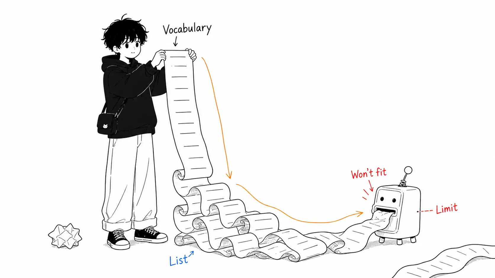
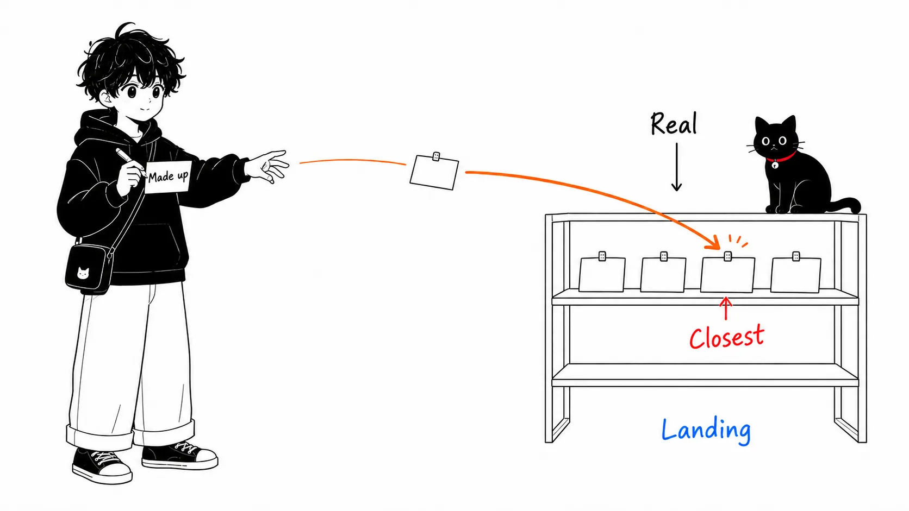

## About this article

On August 10, 2026, search engineer Doug Turnbull published a short post on his blog titled "[Don't classify. Hallucinate!](https://softwaredoug.com/blog/2026/08/10/hypothetical-classifications)". I found out about it because Simon Willison introduced it on August 14 as a [link post](https://simonwillison.net/2026/Aug/14/dont-classify-hallucinate/). I read it on August 18, 2026.

A disclosure first. I haven't run the [Colab notebook](https://colab.research.google.com/drive/1ljk72SBRuqWIijuEusCnDbhG1WAfZFcC) or the [cheat-at-search repository](https://github.com/softwaredoug/cheat-at-search/blob/main/cheat_at_search/enrich/vocabulary.py) that Turnbull published, not with my own hands. This article is commentary based on the original post and on OpenAI's official specification, which I checked separately.

Conclusion first.

> The technique itself takes three lines to explain. That's not the interesting part. The interesting part is that **a design that crams the whole vocabulary into an enum physically breaks much earlier than you'd think.** And that when you bring this technique in as the alternative, failures change in character, from failures that raise errors to failures that are plausible and silently wrong. What you saved is paid for in evaluation cost.

The first half is short. For the technique itself, reading the original is enough. I'll spend the word count on "my view" in the second half.



---

## Part 1 — A design that stuffs the vocabulary into an enum hits a wall at a few hundred entries

What we want to do is ordinary. We want to assign a search query like "wood coffee table" to one of Wayfair's product categories. The categories look like this.

```
Furniture / Living Room Furniture / Coffee Tables & End Tables / Coffee Tables
Décor & Pillows / Decorative Pillows & Blankets / Throw Pillows
Furniture / Bedroom Furniture / Dressers & Chests
```

The standard approach is Structured Outputs. With Pydantic you build a giant `Literal` that lists only the correct values, and constrain the LLM's output to it.

```python
FullyQualifiedClassifications = Literal[
 'Furniture / Bedroom Furniture / Beds & Headboards / Beds',
 'Furniture / Living Room Furniture / Chairs & Seating / Accent Chairs',
 'Rugs / Area Rugs',
  ...
  # times 500
]
```

Turnbull describes this as "this works, but there's a cheaper way to do it." The original touches on the existence of a limit but leaves the concrete numbers to a link to the official docs. That bothered me, so I went and read them myself. [OpenAI's Structured Outputs guide](https://developers.openai.com/api/docs/guides/structured-outputs) says this.

> Across the whole schema, up to 1000 enum values.
>
> When a single enum property has string values, if there are more than 250 enum values, the total string length of all enum values cannot exceed 15,000 characters.
>
> (my translation)

That second condition is nasty. The character limit kicks in only once you exceed 250 entries. So up to 250 entries, it passes no matter how long the paths are (as long as it fits within the schema-wide 120,000 characters).

The problem is the 251st. The `Furniture / Living Room Furniture / Coffee Tables & End Tables / Coffee Tables` above is 78 characters. Wayfair's full-path categories run about that long. The moment you list 251 entries, the character limit kicks in and the total must be within 15,000 characters. But 15,000 ÷ 78 ≈ 192, so only 192 entries fit. There is no way to satisfy "251 or more entries" and "192 or fewer entries" at the same time.

So with full-path classification, **the 251st entry cannot exist.** The limit is not a vague "a few hundred or so" but exactly 250. The 1000-entry enum count limit never comes into play. You hit the cliff at a quarter of that. The category count Turnbull wrote as "hundreds" is not a coincidence; it's exactly where the cliff is.

For Simon Willison's use case it's even more blatant. His blog has 1,856 tags. Even with tags around 13 characters like `generative-ai`, 1,856 × 13 ≈ 24,000 characters. Out on both count and characters, so this design is not an option from the start.

"Hand the LLM a list of choices and have it pick" often just doesn't work at real-world vocabulary sizes. This is decided not by gut feeling but by the specification.

---

## Part 2 — The procedure ends in three lines

Turnbull's proposal is this.

1. Have a cheap model make up classifications that **don't exist**
2. Build embeddings for all the real categories locally, in advance
3. Take the embedding of the made-up classification and land it on the set of real categories by inner-product nearest-neighbor search

The prompt hands over no vocabulary at all. It hands over only the "shape."

> Your task is to create a new, previously nonexistent classification of furniture, household goods, and hardware that best fits the search query.
>
> Product classifications look like this:
>
> `Furniture / Living Room Furniture / Coffee Tables & End Tables / Coffee Tables`
> `Décor & Pillows / Decorative Pillows & Blankets / Throw Pillows`
> `Furniture / Bedroom Furniture / Dressers & Chests`
> (rest omitted)
>
> The query to generate a classification for:
>
> `brown coffee table`
>
> (From the original prompt, my translation)

What comes out is nonexistent nonsense. For example, `Furniture / Living Room / Tables / Coffee`. One line from the original does the work.

> That's not useful at all.
>
> Actually, it's extremely useful.
>
> (my translation)

If you embed all the real categories with MiniLM in advance and take the inner product with the embedding of this nonsense, it lands on `Furniture / Living Room Furniture / Coffee Tables & End Tables / Coffee Tables`. The real categories' embeddings can be held in memory, so it's cheap. And you don't have to send the schema to the LLM every time.

That's the whole explanation.



---

## My view

From here on is the real subject.

### Once you notice this is just HyDE flipped over, the range of applications becomes visible

Gao et al.'s HyDE (Hypothetical Document Embeddings, 2022) stopped searching for documents directly with the query. Instead it first had an LLM write "a hypothetical document that would answer this question," then used the embedding of that hypothetical document to search for real documents. Queries and documents differ in style and length, so they don't end up close in embedding space. So it goes through a fake to align the shape.

This one is the same thing in the other direction. HyDE **makes a hypothetical document and matches it to a real document.** Turnbull's technique **makes a hypothetical label and matches it to a real label.** Both make the same move.

> Stop constraining the output to a vocabulary. Let it generate freely, send it into embedding space, and land it on the real value by nearest neighbor.

Re-framed with this abstraction, there's no reason the target has to be tags or categories. Internal API names, Jira components, error-code schemes, account titles, part numbers: every situation where you want to map natural language onto "a vocabulary that is finite but too large" has the same shape. What I found interesting was not the classification trick but this: **mapping onto a closed vocabulary was a search problem, not a schema problem.**

The idea of stuffing it into an enum treats the vocabulary as a "constraint." This technique treats the vocabulary as an "index." A constraint doesn't work unless you hand it to the model, so it doesn't scale, but an index can be kept locally, so it does. That one point settles it.


### Calling it "hallucination" makes the exchange that's really happening harder to see

The title works, but I don't think it's accurate. The LLM isn't hallucinating here. It's just generating, as instructed, a representation with the meaning normalized. What's nonsense is the string, not the meaning. If anything, this prompt is using the LLM not as a classifier but as a **normalizer of meaning.**

It may look like wordplay, but if you call it the wrong thing you make the wrong design decisions. If you think of it as "a trick that exploits hallucination," you feel like a smarter model should raise accuracy. In reality, accuracy is decided by the later stage: the embedding model and the representation on the real-vocabulary side.

And here is the part that bothered me most. **This design changes how failure shows up.**

Structured Outputs breaks when an out-of-vocabulary value comes out. It becomes a validation error. Noisy, but you can notice it. Nearest-neighbor search is different. For any input, it always returns something. Whether the similarity is 0.9 or 0.2, the closest thing comes back. By default there is no exit for returning "no match."

If the query is `wood coffee table`, there's no problem. The problem is the ones in the corners of your business data, like `hvac damper actuator 24v`, that have no place in the taxonomy to begin with. With an enum, it falls to "no match," or it's forced to pick and an obviously wrong value stands out. With this technique, it's quietly sucked into something like `Home Improvement / HVAC / Vents & Registers` and mixes into the aggregates without anyone noticing.

So I think that when you put it into real use, putting a threshold on the nearest-neighbor similarity and building a rejection lane is not optional but mandatory. The original doesn't touch on this.


### The most important thing to say is that "there's no evaluation"

The original has no accuracy numbers. It uses the WANDS dataset and even publishes a Colab notebook, but the text has no comparison like "X% accuracy versus the Structured Outputs version." Unless I've missed it, this is left blank.

This isn't meant to blame Turnbull. That's a short idea post, and it calls itself one. If there's anyone to blame, it's the side that summarizes techniques like this as "cheap and equivalent" and propagates them (this article included).

What's claimed is two things: "cheap" and "you don't have to send the schema every time," and those are self-evident from the structure. What isn't claimed is "it hits just as well." And whether to adopt this in practice is decided precisely by that unmeasured part.

On top of that, the evaluation has an awkward shape. Classification hits and misses are a product of the LLM's generation quality and the embedding model's neighborhood quality, and when it misses it's hard to separate which was at fault. I'm also bothered that full-path strings (`A / B / C / D`) are fed raw to a MiniLM-class model. Embedding models are trained on natural sentences, and slash-delimited hierarchical paths fall outside the training distribution. Differences deep in the hierarchy, such as `Coffee Tables` versus `End & Side Tables`, could be almost crushed together in the embedding because the upper levels are shared. You can't know without measuring. That's why we need a conversation about measuring.

### So when do you use it?

My dividing line is this.

If the vocabulary is over a few hundred, mistakes aren't fatal, and it's a use where **mistakes can be flushed out later**, such as aggregation or search filtering, use it without hesitation. Simon's "assign tags to past posts across 1,856 tags" is a perfect fit. The enum version can't even be built per the spec, and nobody dies if a tag is off by one.

Conversely, if the vocabulary fits within 200 entries and an enum goes through fine, there's no reason to go out of your way to add an embedding pipeline. A mechanism that tells you when it's broken is worth more. I'd avoid areas where mistakes take effect silently, like billing account titles, for the same reason.

So this is not a "superset of Structured Outputs" but **a tool for vocabularies of a size that physically won't fit in an enum.** Positioned that way, I think it's a pretty good tool.

---

## Summary

If you take home just one thing, make it not the technique itself but the fact that comes before it.

**A design where you hand the LLM a list of options and have it choose has a concrete ceiling.** In OpenAI's case, the moment you exceed 250 entries the condition of 15,000 total characters across all enum values kicks in, so with long hierarchical paths it effectively stops at exactly 250 entries. It's worth counting once where your own taxonomy currently stands against that. 250 is not that far away a number.

Having done that, if you're over the ceiling there are two options. Split the hierarchy into multi-stage classification, or switch to "generate, embed, and land by nearest neighbor" as Turnbull does. If you choose the latter, build the similarity threshold and rejection lane into the design from the start. Errors stopped appearing not because mistakes decreased.

---

## Sources

- Doug Turnbull, "[Don't classify. Hallucinate!](https://softwaredoug.com/blog/2026/08/10/hypothetical-classifications)," softwaredoug.com, August 10, 2026
- Simon Willison, "[Don't classify. Hallucinate!](https://simonwillison.net/2026/Aug/14/dont-classify-hallucinate/)," simonwillison.net, August 14, 2026 (link post)
- [Colab notebook](https://colab.research.google.com/drive/1ljk72SBRuqWIijuEusCnDbhG1WAfZFcC) / [cheat-at-search](https://github.com/softwaredoug/cheat-at-search/blob/main/cheat_at_search/enrich/vocabulary.py) (Turnbull's implementation)
- OpenAI, "[Structured model outputs](https://developers.openai.com/api/docs/guides/structured-outputs)" (enum limit description, checked August 18, 2026)
- Luyu Gao et al., "[Precise Zero-Shot Dense Retrieval without Relevance Labels](https://arxiv.org/abs/2212.10496)," 2022 (HyDE)
