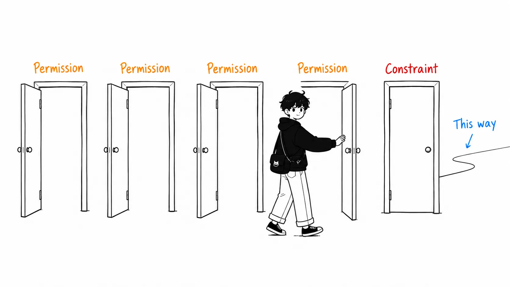
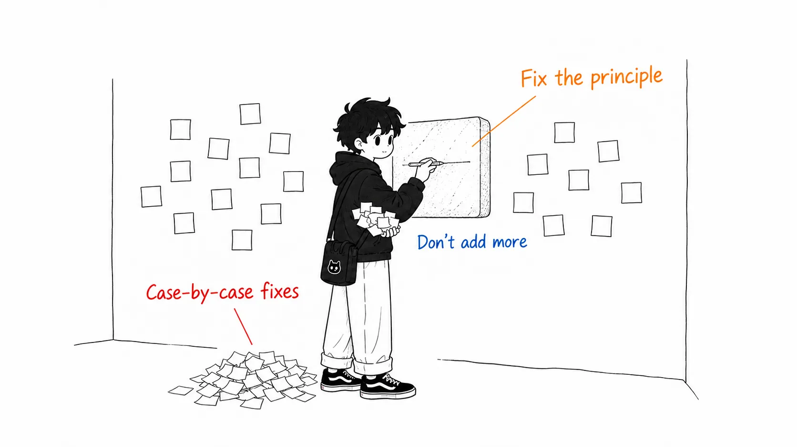
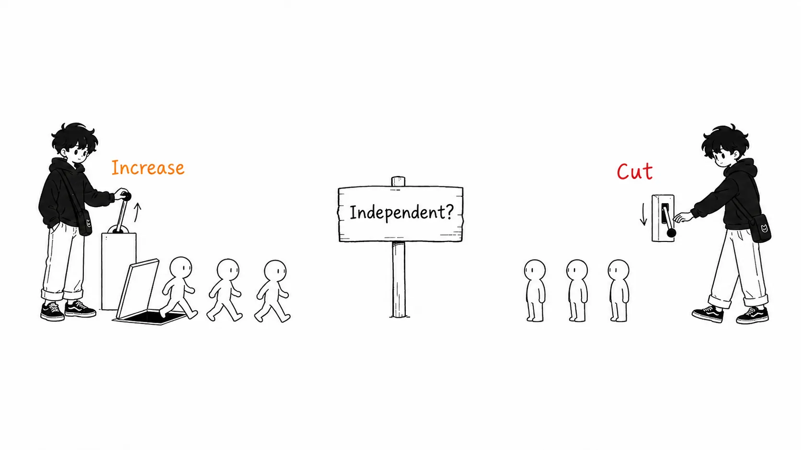

Here is the conclusion up front.

> Of this guide's five rules, **four say "do more," and only one is a constraint**. And accidents always happen on the latter side. A vendor's guide, by structure, is thick on the permission side. So the right way to read it is to read only the constraints chapter (Rule 3) twice. And I think the most practical sentence in the whole text isn't a heading but something buried in the middle: Cainex's **"fix the principle, not the example."**

## About this article

- Original: [The Claude Code guide for startups](https://claude.com/blog/claude-code-guide-for-startups), Michael Segner, August 20, 2026 (claude.com)

Anthropic interviewed more than a dozen fast-growing startups and distilled how they use Claude Code into five rules. Founder comments line up from ClickHouse, Clay, Omni, Crosby, Heidi, Emergent, Commure, Artemis Security, Cainex, Zingage, Translucent, Higgsfield, and others.

Let me state my position first. **This is a guide a vendor wrote about its own product.** That isn't bad in itself. Only a vendor can collect these case studies, so a document like this has its own value. But the way you read it changes. I looked less at "what it says" than at "the shape in which it's written."

An honest disclosure: I didn't download the PDF version. I also haven't watched the Harvey and Cognition sessions from Code with Claude (May 2026) that it cites. All I read was the body of the web version.

The five rules are these.

1. Everyone ships
2. Automate the tedium
3. Trust, but verify
4. Build for rebuilding
5. Prototype, dogfood, productionize

## Four are permissions, and one is a constraint

Rearrange them and the structure shows.

Rule 1 is "people who aren't engineers can ship too." Rule 2 is "you can hand the mechanical 80% to agents." Rule 4 is "you can throw away what you built." Rule 5 is "you can promote an internal tool into a product." **All of them are permission to do something you haven't done until now.**

Only Rule 3 faces the other way. "If you have no means of verification, don't automate." A sentence in the original is itself the conditional.

> You can't automate a process, unless you have a reliable means of monitoring and verifying the outcome.

And the Rule 3 chapter is the longest. Test infrastructure, writing invariants in `CLAUDE.md`, maintaining a golden set, hard gates through hooks, Cainex's self-improvement loop. While the other four chapters are case studies, only this one is about procedure.

I don't think that's an editorial coincidence. **Permission sells; constraint doesn't.** That a vendor's guide ends up at a ratio of four permissions to one constraint is structure, not malice. That's why the reader has to supply the balance. My way of reading was "read Rule 3 first, then go back to Rule 1."

Here's one more observation that backs this asymmetry. **Every failure story in this guide happened on the Rule 3 side.**

Victor Hunt of Zingage:

> "In the early days we gave Claude full autonomy and did the AI thing: we shipped plausible code fast. The problem was that it drifted in ways that looked right but veered away from our architecture. So... we wrote down every invariant. How to frame the problem. What must always be true. How to prove behavior instead of trusting a confident answer. **How this team thinks, 567 lines.**"

Uriah Israel of Cainex:

> "It wasn't this clean from the start. The first version overfit. It 'fixed' things by encoding individual cases, and instead of getting smarter it piled up patches."

Both are problems that came after "we got fast," and both are what was waiting at the end of carrying out Rules 1, 2, and 4. In terms of order, if you read the permissions first and put the constraint off, you'll end up rediscovering these two yourself.

## The most practical sentence isn't a heading

Cainex is a medical coding company (it reads patient charts and generates the code that determines hospital billing). This section is the densest in the text.

> "In medical coding, a wrong code isn't a typo. It's a billing and compliance incident. That one fact shapes everything about how we build."

Their loop goes like this. The agent processes a batch → auditors review the output in an internal app (looking not only at the code but at **the model's reasoning, and commenting on both**) → Claude Code reads the original predictions and all the corrections and comments directly from the DB → each correction type is tagged, so it goes straight to the relevant guidance → **it identifies the part of the instructions that produced the mistake and revises it** → it makes the change against a versioned instruction set and retests on the failed records.

And then the back-test. A single record can have multiple valid codings, so you can't judge by string match. They combine semantic matching against an accepted set with a judge that asks "is this really an error, or another valid path?" They run candidate changes against the golden set and a random sample, and flush out regressions before shipping.

That's the mechanism, and the principle is one line.

> **The rule we enforce: fix the principle, not the example.**

I think this is the most portable sentence in the entire guide. Two reasons.

**First, it's a subtractive principle.** Most of the rest of the guide is additive. More agents, more skills, more parallelism, more prototypes. This one sentence alone says "don't add." Instead of adding handling for individual cases, fix the principle. Cainex itself writes that it "put a cap on the number of individual items that can go into a change," so **there's an explicit cap on how much can be added**.

**Second, it becomes an operating rule for `CLAUDE.md` as is.** An agent gets something wrong. The common response is to add a line to `CLAUDE.md`: "don't do X." Repeat that, and as the original puts it, "instead of getting smarter it piles up patches." My `CLAUDE.md` is exactly like that, with fossils of past incidents laid down in layers.

And ironically, the targets of this principle include `CLAUDE.md` itself. The guide's Rule 3 Tip says "put the things that can't change at the root of `CLAUDE.md`," but if you apply Cainex's principle, what belongs there is **the principle, not the examples**. These two Tips are in the same chapter, but if you follow only one of them, the file bloats.

## In the same week, a signal pointing the other way

From here on is material that isn't in the original.

Two days after this guide (August 22, 2026), Maurice Heumann published [an article auditing about 2GB of his own session logs](https://momo5502.com/posts/2026-08-22-mw2-decompilation-audit/). It's an audit of an experiment in which a swarm of AI agents spent four weeks nonstop decompiling a game. I covered that article separately, so I'll skip the details, but here I'll set just two points against this guide.

**1. Subagents.** The guide says:

> Dynamic workflows can be used to fan multiple subagents to analyze large amounts of data in parallel or to conduct an adversarial review of another agent's work.

The Commure case is also "one engineer ran a roughly 13-ticket initiative in parallel with Claude subagents." It points toward more.

Heumann, on the other hand, measured that **54.7% of the large files read across 47 subagent runs were pure duplicates**, and disabled subagents. The median interval between duplicate reads was 35 minutes, and his reasoning is that if the parent had read them itself, they would have stayed in context.

It looks contradictory, but the conditions differ. In Heumann's setup, the subagents **couldn't do real work** (because they couldn't safely modify the workspace in parallel). So they became investigation-only, and investigation tends to duplicate. Commure's 13-ticket parallelism has an independent unit of work per ticket.

In other words, the fork in the road is "are the units you're parallelizing really independent," and the guide doesn't state this condition. **At the granularity of the Tip "just say fan out multiple subagents," you can't tell which situation you're in.** The reader has to fill that in.

**2. Productivity metrics.** The guide opens with four numbers.

| | |
| --- | --- |
| ClickHouse | 30% more features shipped |
| Omni | 2–3x engineering productivity |
| Clay | 100% of bug triage automated |
| Artemis Security | 6,000+ PRs a week |

No methodology is given. 30% more than what, what the 2–3x was measured by, what kind of unit those 6,000+ PRs a week are. All of it is self-reported in interviews.

It's interesting to put this next to Heumann's article. After he cut the subagents, he wrote that daily commits rose from 243.9 to 311.1, and then **added a note himself**: "using commit count as a productivity metric isn't necessarily accurate."

When a favorable number comes out, he writes down that number's weakness himself. The guide's four numbers carry no such note. Expecting that from a vendor's marketing material would be misplaced, so this is more about how to read than a criticism. Read this kind of number as **a claim about direction, not a claim about effect size**. 6,000+ PRs/week is saying "fast enough that the unit called a PR breaks down," and the number 6,000 itself means nothing.

## The three I thought I'd actually use

From the guide's checklists, only what works as a procedure rather than a case study.

**1. Use git worktree to make "build it four times" cheap.** This is a Rule 4 Tip. Run v2 next to v1, run evals on both, and merge only the winner. This Tip gives implementation backing to Clay's Kareem's story: "build it, build it again, build it again. By the fourth time you know everything and can build it right." I had only ever thought of worktrees as something for "when switching branches is a hassle." I had never considered them as **a tool that lowers the cost of rebuilding**.

**2. Use hooks as hard gates.** A Rule 3 Tip. "Runs every time, no matter what the model decides." Block writes that fail lint, require tests to pass before a commit, strip secrets before leaving the sandbox. This matches the conclusion of the Heumann article I read earlier ("soft instructions don't work; mechanical blockers are more effective for enforcing rules"). **Two separate sources arriving at the same conclusion puts this in the category I'm willing to trust.**

**3. Keep multiple golden sets and update them regularly.** Rule 3. I liked the concreteness of the description of the breaking point: "a user reports 'the agent feels worse after the change,' and all you can do is check by guesswork." That's the state I'm in.

Conversely, the one I thought I wouldn't use right away is Rule 1 (everyone ships). I don't think it's bad. But it's a matter of organization, not tools. If you're one or two people, "everyone ships" is already true. Of this guide's readers, I think the only ones for whom Rule 1 actually changes anything are organizations of a size where non-engineer roles are separated out.

## If you take away just one thing

It's not the content of the guide, but how to read it.

**Count the permissions and constraints before you read.** If it's four to one, read the one twice. This applies not only to vendor documents but to internal design docs too: if "you may" is lined up and there's only one "don't do this unless you have this," accidents will happen on the side of that one.

If I had to pick one thing from the content, it's **fix the principle, not the example.** It has the effect of stopping the line you were about to add to `CLAUDE.md`. And after stopping you, it also points to what you should fix instead.

## Sources

- Michael Segner, [The Claude Code guide for startups](https://claude.com/blog/claude-code-guide-for-startups), claude.com, August 20, 2026
- Maurice Heumann, [235 Billion Tokens Later: Auditing What The AI Agents Really Did](https://momo5502.com/posts/2026-08-22-mw2-decompilation-audit/), momo5502.com, August 22, 2026 (referenced in the section "In the same week, a signal pointing the other way")

All quotations are from the above. I haven't checked the PDF version or the cited Code with Claude sessions (Harvey, Cognition). The analysis from the section "Four are permissions, and one is a constraint" onward is my own reading, not a claim of the original. The four numbers at the top are self-reported values exactly as they appear in the original, and I haven't verified them.
