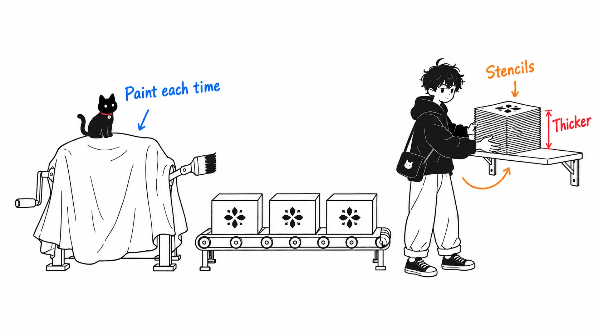
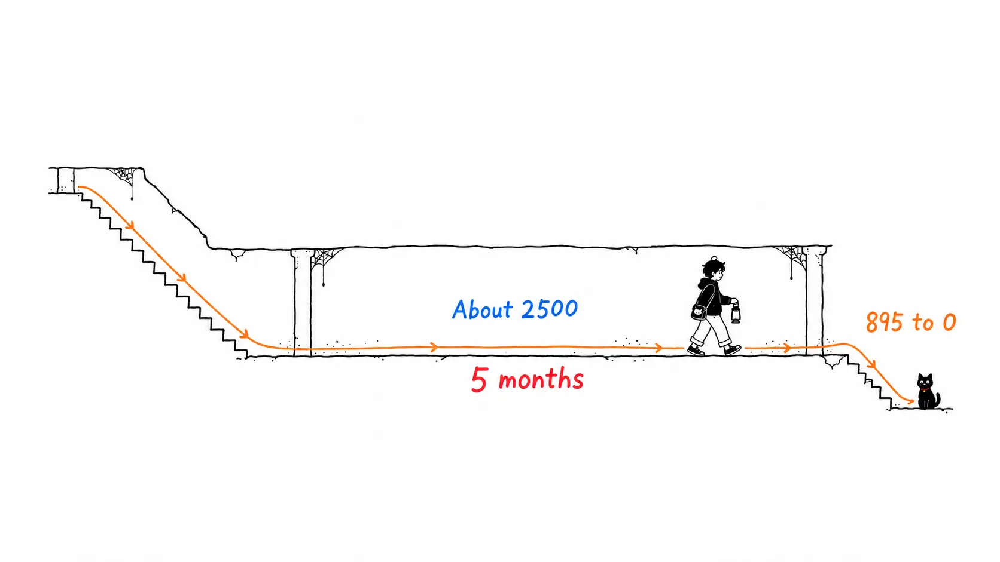

The `@primer/react` npm package had no CSS files at all as of v36.0.0, released in October 2023. In v38.40.0, from September 18, 2026, there are 104 CSS files under `dist/`, totaling 337KB. That is the trail left by Primer, GitHub's design system, as it moved from CSS-in-JS with styled-components to CSS Modules.

The GitHub Blog post was titled "Improving site performance by shipping more CSS." After reading it, I opened the published package, and the title turns out to be not a figure of speech but almost literally true.

Here is my reading up front.

> "We got faster by shipping more CSS" is a story about swapping a computation we used to pay for on every page render for bytes that can be cached. The post describes the side that received the benefit (SSR got 55% faster) but doesn't write a single line about the side that paid (how much more CSS there is now). And I think what carried a years-long migration to the end wasn't Copilot. It was the dashboard that kept counting the remaining `sx` usages, and the compatibility package that was retired the day that number hit zero.

The source is [Improving site performance by shipping more CSS](https://github.blog/engineering/architecture-optimization/improving-site-performance-by-shipping-more-css/) on the GitHub Blog, by Josh Black and Marie Lucca, published September 25, 2026.

A caveat first. The performance numbers in the post (SSR −55% and so on) are GitHub's own claims, and I have no way to verify them. All I checked myself were the versions, dates, and file sizes of the packages left on the npm registry. I did not measure how much CSS github.com actually sends to the browser.

---

## What the Post Says

A short summary. Around 2023, the number of components on some pages exploded, and the runtime cost of CSS-in-JS became visible. Style initialization on the client delayed first paint, style collection made SSR heavy, and style updates grew with the number of components.

The destination is CSS Modules. Styles are written in a `.css` file next to the component, and class names are local by default. No runtime work remains on either the client or the server, and the styles arrive with the HTML as a static stylesheet.

They went component by component, in four steps.

- Add a new file that translates the existing styles into CSS Modules
- Put that component behind a feature flag that switches between old and new styles
- Use the existing visual regression tests to confirm the old and new snapshots are identical
- Widen the flag from the team to GitHub staff to all users

After every Primer component had been migrated in December 2024, the post says:

> 55% less time to server-side render a page
> 25% less time for components on a page to initialize

It doesn't say which page these numbers are from.

The hard part came after that. Primer components have an `sx` prop that lets you override any style with an inline object. In GitHub's own code this had been the de facto standard for years, and at its peak there were about 7,760 of them. Until all of those were rewritten in CSS Modules, styled-components couldn't be removed.

So they built an intermediate package, [`@primer/styled-react`](https://github.com/primer/react/blob/main/packages/styled-react/README.md). It is a wrapper that lets migrated components accept `sx`: places that use `sx` import from it, and places that don't import directly from `@primer/react` to get the speed. After that, they translated `sx` into CSS Modules package by package, swapped the imports, tried it in a pre-production environment, and shipped.

The work started in April 2025, was nearly automated with an in-house VS Code extension and a codemod, and migrated 6,419 usages over six months with a rotation of eight people. SSR time improved by 1% to 22% depending on the page. When work resumed in April 2026, 895 remained, and two engineers and "a large number of Copilot coding agents" took that to zero in three weeks. After that came two months to cut the JavaScript side of the themes (seven of them, each with a high-contrast variant) loose from styled-components. As of June 2026, the post concludes, GitHub runs on 100% CSS Modules.

---

## The Migration's Trail in npm

The post barely mentions packages, so I downloaded the `@primer/react` tarballs from the npm registry and counted what's inside. I compare only what's under `dist/` (through v37, `lib/` and `lib-esm/` hold two more copies of the same content, so comparing whole packages would make them look inflated).

| Version | Published | Depends on styled-components | CSS in `dist/` | JS in `dist/` |
| --- | --- | --- | --- | --- |
| 36.0.0 | 2023-10-31 | Yes | 0 | 836KB |
| 37.0.0 | 2024-10-21 | Yes | 26KB | 1,315KB |
| 37.31.0 (last of v37) | 2025-08-12 | Yes | 173KB | 1,198KB |
| 38.0.0 | 2025-10-27 | **No** | 268KB | 1,251KB |
| 38.40.0 (latest) | 2026-09-18 | No | 337KB | 1,346KB |

Three things stand out.

First, CSS grew from 0 to 337KB. The "more CSS" in the title is literal.

Second, the JS in `dist/` did not shrink. It went from 836KB to 1,346KB. The components themselves also grew during this period, so it isn't a clean comparison, but at the very least this is not a "cut JS and replaced it with CSS" shape. What shrank was outside Primer: the runtime code of a separate package, styled-components, and the work it did on every render (I did not measure the size of styled-components itself).

Third, even after "all components were migrated in December 2024," the v37 line kept depending on styled-components until August 2025. The dependency came off in v38.0.0 on October 27, 2025, which matches the post's "when we migrated `@primer/react` in late 2025." The components' appearance had moved to CSS Modules, but the dependency stayed so that `sx` could still be accepted.

The intermediate `@primer/styled-react` can also be checked on npm.

- First published July 30, 2025 (`0.0.0-20250730150946`)
- The last version, 1.0.8, is from May 12, 2026. No newer version has come out since, and that version is now marked deprecated, with the message "The styled version of @primer/react is no longer maintained. Use @primer/react instead."

The date of the last release matches the post's claim that `sx` hit zero in May 2026. But npm's deprecation mark doesn't keep a date, so I can't tell when it was applied. The package info was last updated on September 25, 2026, the same day as the blog post. The styled-components maintenance-mode announcement was on March 17, 2025, in an [Open Collective post](https://opencollective.com/styled-components/updates/thank-you). That also matches the post's "the announcement came out right before we started the work."

---

## Where the Numbers Don't Quite Line Up

The post includes an area chart called "Total SX props," and reading it, there are small mismatches with the numbers in the text.

- The text gives the peak as "about 7,760," but the left edge of the chart is around 7,300, and only a brief spike in early May reaches 7,760
- 7,760 minus 6,419 is 1,341. The remainder when work resumed was 895, so there is a gap of 446
- From October 2025 to March 2026 the chart is nearly flat at about 2,500. For about five months, the remaining count barely moved
- From August to November there are several spikes where the count jumps by thousands in a few days and then drops right back

The flat stretch fits the text's wording, "picked this work back up." The work had been stalled in the middle. The reason it stalled isn't given. For the gap of 446, I couldn't tell from the chart whether someone removed them some other way while work was paused, or whether new `sx` usages were added and removed (the spikes hint at that possibility, but they could also be a bug in the aggregation).

There's another thing that nags me in the SSR improvement table. Out of 13 rows, 4.54% appears four times, 6.01% three times, and 3.05% and 7.46% twice each, as the same value for unrelated controllers. They look less like raw measurements and more like values rounded into some kind of bucket. The text says "1% to 22%," but the table's minimum is 3.05%, and no row shows 1%.

One more, on the timeline. `sx` hit zero in May 2026, then the theme cut-over took "two months," and then "as of June 2026, 100% CSS Modules." Add them up in order and you land in July. The theme work may have run in parallel with `sx`, but the post doesn't say.

---

## My View

### 1. "Shipping more CSS" means paying bytes instead of computation

What's interesting about the title is that, in a story about frontend performance, it says "more" instead of "less." I don't think that's wordplay. I think it honestly states the direction of the trade.

The cost of CSS-in-JS is paid on every render. Styles are collected in SSR on each request, initialized on the client, and the cost grows with every added component. The cost of CSS Modules is paid once, as the byte size of the stylesheet, and after that it's cached. They swapped a per-render computation for reusable bytes. For a service like GitHub, where the same person opens the same screens over and over, that swap is almost certainly a win.

But the post only writes about the receiving side. SSR got 55% faster, initialization 25% faster. The paying side doesn't appear: how much more CSS reaches the user, and what happened to first-visit rendering (with an empty cache). In npm, the CSS in `dist/` goes from 0 to 337KB. What GitHub actually sends is a different thing (it should bundle only the components in use), so reading this number as a github.com figure would be wrong, but it's certainly not zero.

If the title says "we got faster by shipping more," I wanted to see numbers for what was added and how much. If that were written, readers considering the same migration could estimate the trade-off for their own service.

### 2. What Copilot cleaned up was the last 895, on scaffolding built over six months

I think the part of the post most likely to be quoted is the story of taking 895 to zero in three weeks in April 2026. In numbers:

| Period | People | Count | Per person per week |
| --- | --- | --- | --- |
| 6 months (about 26 weeks) | 8 | 6,419 | about 31 |
| 3 weeks | 2 people + Copilot coding agents | 895 | about 149 |

About 4.8 times. But reading this comparison straight as "agents made us 5x faster" is probably wrong.

By the time the second, three-week stretch began, a good deal was already in place. A VS Code extension that translates `sx` into CSS one at a time, a codemod that translates whole files, a migration guide mapping `sx` values to CSS variables, visual regression tests to check that old and new look the same, feature flags to roll back if something broke, and a dashboard that counted the remainder every day. The agents would have been repeating "translate the next one, check that the tests pass" on top of this scaffolding. The humans in the first six months built the scaffolding.

Another point. Looking at the flat stretch in the chart, the remaining 2,500 or so barely moved for about five months. Agents existed during that time too (the post itself says it brought in the Copilot coding agent "partway through the work"). The count started moving again when humans resumed the work. The agents were certainly fast, but what restarted stalled work was the decision to resume, not the agents.

I also can't tell whether the last 895 were an easy remainder or a hard one. If they were what slipped past the codemod, they should be hard; if they were miscellaneous things with no owner, they should be easy. The post doesn't say.

### 3. If you put in a compatibility layer, give it a number heading toward zero, not a removal date

What I thought the post did best was its handling of `@primer/styled-react`.

Once a compatibility layer goes in, it rarely comes out. Even if you write "remove it when the migration is done," nobody judges whether it's done. In Primer's case, this intermediate package came, from the start, with a number that decreases toward zero: the count of `sx` usages remaining in GitHub's code. And if you look at the npm dates, package updates stopped after May, when that number reached zero. That's about nine and a half months after the first release.

Because the judgment was entrusted to a single number rather than to anyone's feel for it, the compatibility layer had a lifespan. By the same logic, they put a feature flag on the work of removing the dependency on styled-components too ("we even feature flagged that"). Even deleting the dependency was done in a reversible way.

Put the other way around, I think the takeaway from this post is that you shouldn't put in a compatibility layer that has no number heading toward zero. "We'll remove it someday" can't be counted, but "895 remaining" can.

---

## If You Take Away Just One Thing

If you're considering a migration off CSS-in-JS, build a dashboard that counts every day how many items remain to migrate before you start. In the GitHub post, what tied the feature flags, the visual regression tests, and the compatibility package together to the end was that "Total SX props" chart. And that chart also honestly shows that things sat stalled for five months.

---

## Sources and How I Checked

- Josh Black, Marie Lucca, ["Improving site performance by shipping more CSS"](https://github.blog/engineering/architecture-optimization/improving-site-performance-by-shipping-more-css/), The GitHub Blog, September 25, 2026
- styled-components, ["Thank you"](https://opencollective.com/styled-components/updates/thank-you), Open Collective, March 17, 2025 (maintenance-mode announcement)
- npm registry: [`@primer/react`](https://www.npmjs.com/package/@primer/react), [`@primer/styled-react`](https://www.npmjs.com/package/@primer/styled-react) (retrieved September 28, 2026)

Here is how I counted in npm. I fetched each version's tarball from `registry.npmjs.org`, read file names and sizes from the tar headers, and summed the sizes of `.css` and `.js`/`.mjs` files by top-level directory (type definitions `.d.ts` are not included). The dependency on styled-components is determined by whether `styled-components` appears in each version's `dependencies` and `peerDependencies`. The numbers are uncompressed sizes, not gzip transfer sizes.

My readings of the chart and table are by eye from the images in the post. The underlying data isn't public.

### What I Could Not Verify

- The performance numbers: SSR −55%, initialization −25%, SSR 1% to 22%. The post doesn't say which pages or which periods were compared
- How much CSS github.com actually sends to the browser, and how first paint changed before and after the migration
- The gap of 446 between the 7,760 peak and "6,419 migrated, 895 remaining," the reason for the roughly five-month plateau in the chart, and what the spikes of thousands really are
- The post describes `@primer/styled-react` as part of the first CSS migration (completed December 2024), but its first publication on npm is July 30, 2025. It may have been used only internally before that
- The timeline mismatch in "`sx` zero in May, two months for themes from there, 100% CSS Modules in June"
- The date `@primer/styled-react` was marked deprecated. npm keeps no record, and I can't tell whether the last update to the package info (September 25, 2026) is it
- What exactly the Copilot coding agents handled, and where humans did the review
