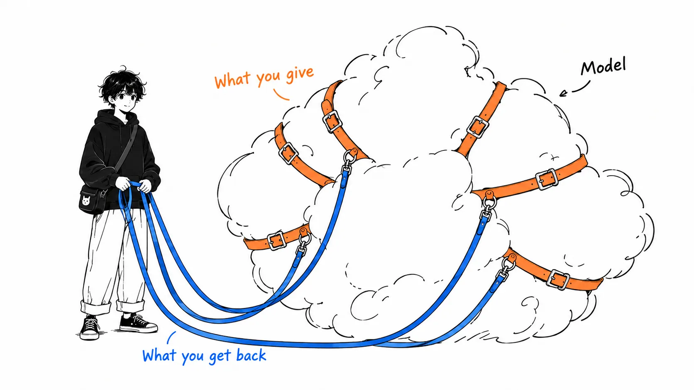
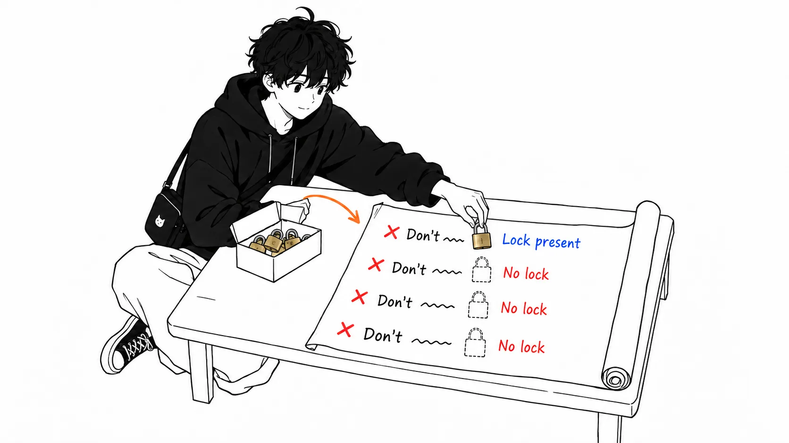

This blog's repository has a shell script, `automation/daily-article.sh`, that launchd starts every morning at 9:00. All it does is call `claude -p` once and have it produce an article draft and illustrations. It runs unattended.

While reading santi's ([@santtiagom_](https://x.com/santtiagom_)) "Harness Engineering: explicado desde cero", I took the nine pieces the article lists and held them up against this script one by one.

Let me put my reading first.

> Of the six pieces on the model-facing side, nearly all were already in place, borrowed ones included. What was missing was the three pieces on the side that comes back to me (permissions, observability, eval). And the heaviest hole sat exactly where santi writes "the most important idea." Of the four prohibitions, only git was fully stopped by permissions. The rest were half stopped or not stopped at all, and for one of them the instructions were actually granting a more dangerous permission. When I went to plug it before publishing, I found that permissions I had piled up in interactive sessions were merging into the unattended run, and that the Bash allowlist had never been taking effect.

The source is santi's X Article "[Harness Engineering: explicado desde cero](https://x.com/santtiagom_/status/2098782814837543075)" (Spanish, September 12, 2026). The author is an engineer at Mercado Libre, and when I fetched it the article had about 770,000 views and 3,430 bookmarks. All translations of quotations are mine.

A caveat up front. I retrieved the full text through the fxtwitter API, and I also looked at the two figures and six code blocks. Of the three primary sources the article cites, I opened OpenAI's and LangChain's myself and checked them. I did not open Anthropic's. Everything I say about my own script comes from the actual repository and from the output of one `claude -p` run on my machine.

---

## What the article says

santi's article is an introductory explainer. It starts from this: a model only receives text and returns text; opening files and running tests is done by the system around it. That surrounding system is called a harness.

> Un harness es el sistema de software que rodea al modelo y convierte lo que escribe en trabajo terminado
>
> (A harness is the software system that surrounds the model and turns what it writes into finished work.)

From there, using a single request ("add a like button to posts") as the running example, it adds parts one at a time to a model that can't do anything. There are nine parts, split into two groups.

| What you give the model | What comes back to you |
| --- | --- |
| 1. Tools (so it can act) | 7. Permissions and limits (keep it from doing what it must not) |
| 2. Loop (chain the steps) | 8. Observability (see what happened) |
| 3. Memory (remember what was done) | 9. Eval (measure whether it got better) |
| 4. Context (what to show on each turn) | |
| 5. Workspace (separate it from your own environment) | |
| 6. A clear goal and verification (know when it's done) | |

The framing is that the first six let the agent work on its own, and the remaining three let humans restrict it, understand it, and measure it.

The permissions section contains the strongest sentence in the article.

> los límites importantes tienen que vivir en el sistema de permisos, no en las instrucciones. Una instrucción como "no borres nada importante" depende de que el modelo la interprete bien en cada momento.
>
> (Important limits have to live in the permission system, not in the instructions. An instruction like "don't delete anything important" depends on the model interpreting it correctly every single time.)

The eval section closes like this.

> Lo ves cuando corrés las mismas veinte tareas antes y después del cambio, y comparás los resultados.
>
> (You see it when you run the same twenty tasks before and after the change and compare the results.)

It ends with a definition: harness engineering is the work of "designing, measuring, and improving the system that lets a model finish real work."

---

## What I checked at the sources

The article opens with case studies from three companies. I opened two of them.

**OpenAI's "one million lines."** OpenAI's [Harness engineering: leveraging Codex in an agent-first world](https://openai.com/index/harness-engineering/) (Ryan Lopopolo, February 11, 2026) says about one million lines in five months, roughly 1,500 pull requests, and zero lines written by hand. That matches santi's summary. But the same paragraph also says "three engineers drove Codex, later growing to seven" and "an average of 3.5 PRs per engineer per day," and the headline slogan is "Humans steer. Agents execute." santi's "humans wrote not a single line" isn't false, but it leaves out what the humans were doing.

**LangChain's "from 30th to 5th."** LangChain's [The Anatomy of an Agent Harness](https://www.langchain.com/blog/the-anatomy-of-an-agent-harness) (Vivek Trivedy, March 10, 2026) says "Top 30 to Top 5 on Terminal Bench 2.0 by only changing the harness." That is correct too.

There was one discrepancy. Near the end, santi writes that "LangChain measured Opus 4.6 inside Claude Code and in other harnesses, and Claude Code scored considerably lower." LangChain's original reads "Opus 4.6 in Claude Code scores far below Opus 4.6 in other harnesses," and the evidence it cites is the public Terminal Bench 2.0 leaderboard. LangChain didn't run the measurement itself.

**Codex sandboxes.** For "Codex has three levels," I confirmed on my machine with `codex exec --help` that there are three: `read-only`, `workspace-write`, and `danger-full-access`. I did not confirm "the default is the middle one, with the network cut off." On my machine, running `codex exec` in a repository I hadn't marked as trusted showed `sandbox: read-only`.

---

## Holding the nine pieces up against my script

Now the main part. I took `automation/daily-article.sh`, the `automation/daily-article-prompt.md` it reads, and Claude Code's project memory, and mapped them to santi's nine pieces.

| Piece | In my morning auto-draft | Status |
| --- | --- | --- |
| 1. Tools | `--allowedTools` permits WebSearch, WebFetch, Read, Write, Edit, Glob, Grep, Skill, and 7 Bash patterns (`codex exec`, `ls`, and so on) | Present |
| 2. Loop | Whatever `claude -p` does inside | Present (borrowed) |
| 3. Memory | Within a task, the Claude Code session. Across days, 3 notes in project memory | Present, but old procedures pile up |
| 4. Context | An instruction file, plus two skills read when needed. 39,179 tokens before any work begins | Present, but unrelated things get in too |
| 5. Workspace | A real repository on my own Mac | Absent |
| 6. Goal and verification | The goal is in the instruction file. No verification after finishing | Instructions only |
| 7. Permissions and limits | Bash is an allowlist; `git`, `curl`, and `rm` are denied. File writes pass across the whole repository under `acceptEdits`. Up to 3 retries a day | Half |
| 8. Observability | A log file per day. Contents: the final reply and the exit code, nothing more | Nearly absent |
| 9. Eval | None | Absent |

The 39,179 tokens in row 4 is the `usage` reported when I asked `claude -p` in this repository to "answer only YES or NO." That much is already loaded before I've started writing an article. It included a coding instruction that a SessionStart hook injects every time, telling the model to be a lazy senior developer and write the shortest code possible. (I confirmed this by asking the model whether the word "ponytail" appeared in its context and getting YES, so this is self-reported.) A persona that tells you to keep code short tags along every morning on a job that is writing an article. It's a small, real example of santi's point that more context isn't better.

The six on the left I mostly borrowed from Claude Code. I didn't build the loop, the context management, or the progressive loading of skills. What I wrote myself is the three on the right, plus the part that corresponds to number 5. And the holes were clustered there.

---

## My view

### 1. The heaviest hole was where the instructions granted the permission

The instruction file's "prohibitions" section says this.

> - **git 操作（add / commit / push / branch 等）は一切行わない**。下書きファイルを置くだけで終了する
> - `articles/` `images/` `automation/` 以外のリポジトリ内ファイルを変更しない
> - 既存記事の編集・削除をしない
>
> (- **Perform no git operations at all (add / commit / push / branch, etc.)**. Just place the draft file and finish.
> - Do not modify any file in the repository other than under `articles/`, `images/`, `automation/`.
> - Do not edit or delete existing articles.)

Add "always write both `published: false` and `draft: true`" to these and you have the four prohibitions of this setup. Only the first, git, was fully stopped by permissions (`--disallowedTools "Bash(git:*)"`). The third, "no editing or deleting existing articles": the `rm` denial stops deletion only; editing isn't stopped. The second and fourth exist only as sentences in the instructions.

Read the second line closely and `automation/` is among the places that are OK to change. And the script auto-approves file edits with `--permission-mode acceptEdits`. The launchd configuration file (plist) has a comment saying "the applet only calls daily-article.sh, so recompiling when the script is edited is unnecessary."

Put those together and this is what you get. An unattended agent reads text from the web and can rewrite `automation/daily-article.sh`. At 9:00 the next morning, launchd runs that rewritten script as is, outside Claude Code's permissions. Inside the script there is even a comment that begins, "Unattended execution plus reading web-derived text makes Bash a prompt-injection path," and goes on to say that's why it's an allowlist rather than a blocklist. I had built Bash the way santi says to, but I hadn't looked at file writes with the same eyes.

There is one more hole. `articles/` currently holds 27 drafts that I haven't committed. `rm` is denied, but they can be overwritten with Write. They aren't in git, so an overwrite can't be undone. The only thing guarding them is the single instruction line "don't edit or delete existing articles."

This is also fallout from number 5 (workspace) being absent. santi writes that a sandbox is "a layer, not a guarantee." In my script, for file writes, there wasn't even that one layer; the only wall was the permissions of number 7. And those permissions were only set up on Bash.

I plugged it before publishing. At first I meant to add one line denying writes to `automation/`. I tried it in a throwaway repository and the denial worked. But that still leaves a route where something writes a hook into `.claude/settings.json`. Following the same logic as Bash, I made writes an allowlist too. I removed `--permission-mode acceptEdits` and granted write permission to just two patterns, `Edit(/articles/**)` and `Edit(/images/**)`. According to the Claude Code documentation, a path rule written as `Edit(...)` also applies to Write, and a rule written as `Write(...)` isn't consulted.

While testing, I found another hole. This one was bigger.

The project's `.claude/settings.local.json` held 95 permissions accumulated by pressing "always allow" in interactive sessions. Among them were `Bash(python3 *)` and `Bash(rtk git *)`. `claude -p` reads this file too, so those 95 were being added as they were to the allowlist I passed on the command line. When I asked for `python3 -c "print(7*6)"` with the same permission flags as the script, 42 came back. `rtk git status` went through too. If python3 is available, any file can be written. And `rtk git` doesn't trip the `Bash(git:*)` denial. In other words, the Bash allowlist had never been working in the first place.

I closed this with `--setting-sources user`, which stops it from reading the project and local settings. While I was at it, I also removed the `Bash(codex exec:*)` permission, because in that form arguments like `-s danger-full-access` also get through. In its place I allow only a small script, `automation/codex-image.sh`, which restricts the arguments to a single prompt and pins the sandbox to `read-only`.

After the fix, I asked for eight rewrite-and-execute operations with the same flags. Writing to `.claude/settings.json`, python3, calling `codex exec` directly, `cp` escaping to a disallowed path via `..`, and `rtk git` all showed up in `permission_denials`. Only `codex-image.sh` went through. For writes to `automation/`, I confirmed the denial in the throwaway repository.

Checking only what gets stopped wasn't enough. When I tried the operations that should pass, with the same flags, `ls`, `cp`, and `mkdir` were denied. `ls` is rewritten to `rtk ls` by a separate hook before permissions are evaluated, so it doesn't match `Bash(ls:*)`. `cp` and `mkdir` had only been getting through because of acceptEdits' auto-approval. If I had gone into the next morning like that, I'd have ended up with drafts that had no illustrations at all. I allowed the `rtk ls` form too, rewrote `cp` as a pattern restricted to copying into `images/`, and added the source folder with `--add-dir`.

What remains is the drafts in `articles/`. At the time of writing, 27 uncommitted drafts were there. Since I granted write permission across the whole of `articles/`, overwriting an existing draft is still stopped only by one line of instructions. I'll commit drafts as soon as they're written.

### 2. With no observability, there's no way to know what was denied

All the log keeps is the final reply of `claude -p` and the exit code. Which tools were called and which were denied by permissions isn't recorded.

In fact, this project's memory notes contain findings like "in non-interactive runs, Playwright can't ask for permission and fails immediately" and "redirects from Bash to `/tmp` are denied," lined up with dates. None of them came from the morning logs. I noticed them by trying the same things in an interactive session.

When I ran `claude -p --output-format json` on my machine, the output had a field called `permission_denials`. Just switching the log to this format would leave a record of "what was blocked" every morning. It isn't the full "which tool, with which arguments, and what came back" that santi lists under number 8, but for permission accidents alone it's enough.

### 3. Long-term memory turns into strata of procedures

santi describes the difficulty of long-term memory as "keeping old information from contaminating new runs." My memory notes were exactly in that state.

The note on the illustration-generation procedure is 7,661 bytes, with additions from September 7 to September 29 stacked up with dates. The form that I recorded on September 13 as "this invocation worked" was overwritten on September 15 with "it no longer goes through," and yet another form was added underneath. Because newer entries sit lower, reading from the top you meet the old procedure first.

The morning agent reads this note and calls codex. The note works as memory, but piled up without being tidied, it also becomes a source of the "contamination" santi talks about. I think it's time to rewrite it rather than append.

### 4. Twenty tasks is often not enough for eval

Number 9 is completely absent. Whether a change to the instruction file made articles better or worse, I've only ever judged by feel.

santi's "run the same 20 tasks before and after" is the right starting point. But you should know how coarse the numbers are. The eval guide in Anthropic's claude-api skill gives `1/sqrt(items × runs)` as a rule of thumb for the margin of error on a before-and-after difference. For 20 items run once each, that's about ±22 points. For a change whose effect splits by task type, like santi's example (widening the context improved the hard tasks and worsened the easy ones), splitting the 20 further makes it coarser still. I count this out in more detail in [my earlier hillclimb article](/articles/claude-api-hillclimb-held-out).

Actually, I've half built a small eval that measures only title writing. It uses 75 existing articles, twice each, for a margin of error of about ±8 points. I stopped at the point where I'd fixed the input set.

---

## If you take away just one thing

Pull every line that says "don't..." or "forbidden" out of your agent's instruction file, and next to each line write which permission setting stops it. In my case, I could fill in only one line out of four. The lines you can't fill in are the ones santi describes as "depending on the model interpreting them correctly every time." And some of those may turn out to be lines where the instructions themselves grant the permission.

---

## Sources, and how I checked

- santi (@santtiagom_), "[Harness Engineering: explicado desde cero](https://x.com/santtiagom_/status/2098782814837543075)," X Article, September 12, 2026 (Spanish)
- Ryan Lopopolo, "[Harness engineering: leveraging Codex in an agent-first world](https://openai.com/index/harness-engineering/)," OpenAI, February 11, 2026
- Vivek Trivedy, "[The Anatomy of an Agent Harness](https://www.langchain.com/blog/the-anatomy-of-an-agent-harness)," LangChain, March 10, 2026

I read santi's article by fetching the X Article body blocks, code blocks, and two figures from `api.fxtwitter.com`. Numbers such as view counts are the values at that moment.

For my own script, I read `automation/daily-article.sh`, `automation/daily-article-prompt.md`, the launchd plist, and the project memory notes directly. The 39,179 tokens and the `permission_denials` field come from the output of a single run of `claude -p "…" --no-session-persistence --output-format json` in this repository (model: Opus 5.5). I counted the 27 uncommitted drafts with `git status`. To check after fixing the permissions, I asked a `claude -p` (model: Haiku 4.5) carrying the same `--allowedTools`, `--disallowedTools`, and `--setting-sources user` as the script to perform eight operations, and looked at `permission_denials` and the actual files.

### What I couldn't verify

- The contents of Anthropic's [harness-design-long-running-apps](https://www.anthropic.com/engineering/harness-design-long-running-apps) and [effective-harnesses-for-long-running-agents](https://www.anthropic.com/engineering/effective-harnesses-for-long-running-agents) (the generator-and-evaluator split and the progress-file material that santi cites)
- The Codex sandbox default (the value in a trusted directory), and whether the network is off by default
- "Sol," which santi gives as a Codex model name
- That the SessionStart hook's instructions are included in the morning run was confirmed only by the model's self-report. I haven't seen the system prompt itself
- Asking the same question in a different directory with `--tools ""` gave a baseline of 76,852 tokens. I don't know why removing the tools doubles it
- Which tools were actually denied, and how often, in the morning runs so far. It isn't in the logs, so I can't tell for past runs
