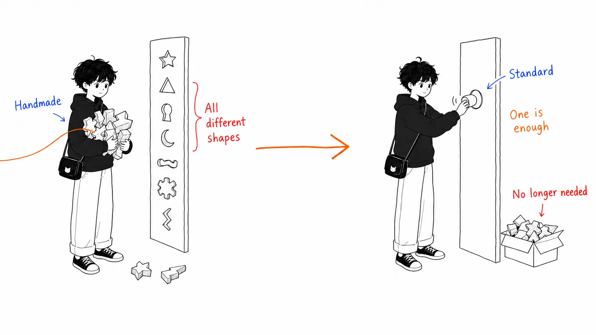
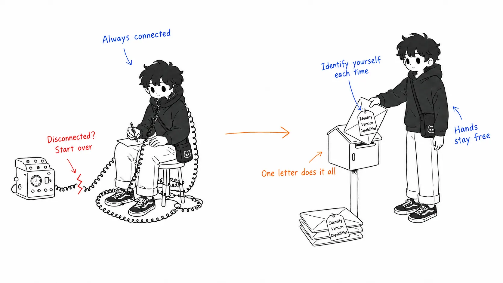
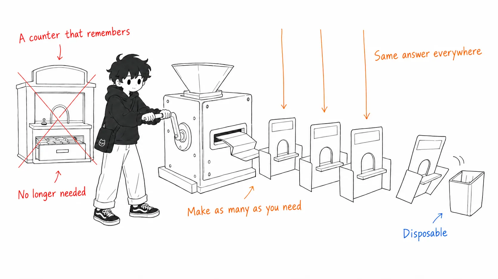
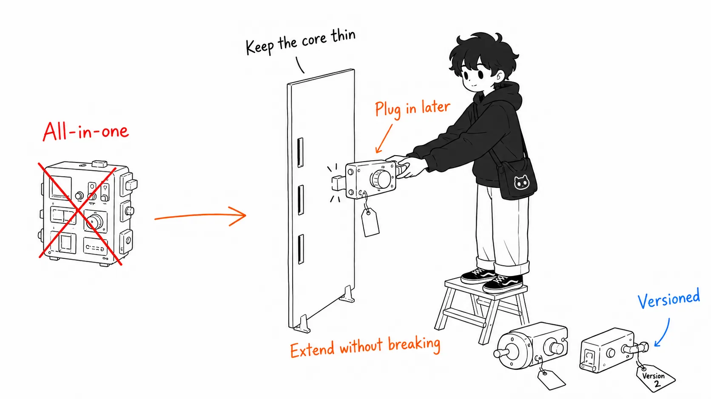
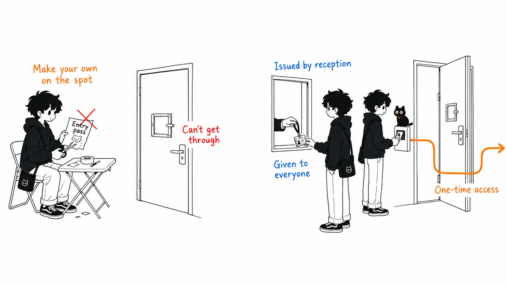
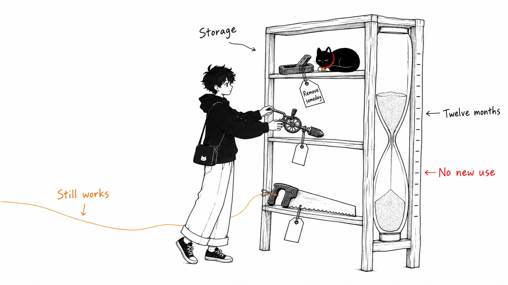

## About this article

On July 28, 2026, the fifth revision of the Model Context Protocol (MCP), **MCP 2026-07-28**, was published. Based on Anthropic's announcement, [Bringing MCP 2026-07-28 to Claude](https://claude.com/blog/bringing-mcp-2026-07-28-to-claude), and the [spec's changelog](https://modelcontextprotocol.io/specification/2026-07-28/changelog), I'll walk through:

- **What problem MCP was created to solve in the first place** (what it has meant so far)
- **What fundamentally changes in this revision** (going stateless, extensions, auth)
- **What each kind of reader should do starting tomorrow** (what comes next)

I'll keep the jargon as plain as I can.

Here is the conclusion up front.

> MCP has gone from "a standard for connecting AI to tools" to **"plumbing you can leave running in production infrastructure."** To get there, it threw out the very assumption it was built on: that you keep a connection open.

---

## Part 1: What MCP was in the first place

### The real problem was never "AI can't use tools"

Before MCP showed up in November 2024, getting an AI to use tools was already possible. You define a function and let the model call it. The problem was somewhere else: **the number of combinations**.

With N AI apps and M tools or data sources you want to connect, you need **N × M** pieces of connection code. You write the Slack integration for Claude, write the same thing again for another app, do it all over again for GitHub, and so on.

What MCP did was put **one common socket** in the middle. A tool side writes one "MCP server," and an AI side implements one "MCP client." The combinations go **from N × M to N + M**.

That structure is why MCP is so often described as "USB-C between AI and tools."

### MCP has only three basic building blocks

The details of the spec grow every year, but the core ideas from the beginning are still these three.

| Building block | What it does | In a nutshell |
| --- | --- | --- |
| **Tools** | Operations the AI can call and run | The "verbs" you have the AI perform |
| **Resources** | Data the AI can read | The "nouns" you show the AI |
| **Prompts** | Canned instructions prepared on the server side | Frequently used "templates" |

Of these, Tools is the one used most in practice. When someone says "I'm writing an MCP server," they usually mean adding a few Tools.

### How big it is

According to Anthropic's announcement, MCP SDK downloads have passed **400 million per month**, up **4x** this year. It is no longer an Anthropic-only mechanism. It is treated as the industry standard for connecting AI agents and applications.

That fact, that it has become a standard, is the very background of this revision.

---

## Part 2: Where was MCP heading across five revisions?

MCP versions use the `YYYY-MM-DD` format, and the name is **the date a backward-incompatible change landed**. Compatible improvements don't bump the number. So every new version means someone judged, each time, that the fix was worth breaking things for.

| Version | Main contents | Direction |
| --- | --- | --- |
| **2024-11-05** | First release. Tools / Resources / Prompts, stdio and HTTP+SSE | Ship something that works |
| **2025-03-26** | Introduced the Streamable HTTP transport (HTTP+SSE deprecated), an OAuth-based authorization framework | Make it usable over a network |
| **2025-06-18** | Asking the user back (elicitation), structured tool output, authorization reorganized around OAuth resource servers | Tidy up dialogue and data types |
| **2025-11-25** | OIDC Discovery support, metadata such as icons, incremental scope consent, URL-mode elicitation, Client ID Metadata Documents, **tasks added experimentally** | Fill in the details of real-world operation |
| **2026-07-28** | **Going stateless**, formalizing extensions, production-grade authorization, a feature deprecation policy | Make it hold up as production infrastructure |

Lined up like this, the direction is clear. It is **five years of movement from "works in a demo" to "can be operated in production."** And 2026-07-28 is the version that finally went after the biggest obstacle left at the end of that journey: **the assumption that you keep a connection open.**

---

## Part 3: The essence of 2026-07-28 is three things

### (1) Going stateless: we stopped making phone calls and started sending letters

This is the biggest change this time.

Until now, MCP was a protocol where you **establish a connection first, then talk**.

1. The client sends `initialize`
2. The server replies, "I'm this version, and I have these capabilities"
3. The client sends back `notifications/initialized`
4. Only now can you use `tools/list` and `tools/call`
5. Over HTTP, this whole sequence is tied together as one session with the `Mcp-Session-Id` header

In other words, a **phone call**. You first connect a line to the other party, introduce yourselves, and only then get to the point. It's convenient, but if the line drops you start over, and the whole time the server has to remember "who it's talking to."

2026-07-28 got rid of all of that.

- The `initialize` / `notifications/initialized` handshake is **removed**
- The `Mcp-Session-Id` header is **removed** from Streamable HTTP
- Instead, **every request carries everything itself**. Each one includes the protocol version (`io.modelcontextprotocol/protocolVersion`) and the client's capabilities (`io.modelcontextprotocol/clientCapabilities`) in the `_meta` field. The client should also include its own name every time (`clientInfo`), and the server should identify itself in each response's `_meta` (`serverInfo`)
- If the versions don't match, an `UnsupportedProtocolVersionError` is returned for that individual request

It became a **letter**. One envelope has everything written on it, from sender to the version in use to what the sender can do, so the receiver doesn't need to remember any earlier context.

What was added in its place is `server/discover`. Servers are **obligated to implement it**, and it returns the supported versions, capabilities, and the server's own info in a single request. The client only needs to call it when it wants to check the version first. It's also fine to skip it, call `tools/call` directly, and handle the error if one comes back. The closest way to put it: **a mandatory handshake became an optional preview.**

### (2) What does going stateless buy you?

This is the practical heart of it.

Having no session means **the server doesn't need to remember anything between requests**. Then you can line up as many copies of the same server as you like, and whichever one a request hits, the answer is the same. If one goes down, the next request can be handled by another.

This translates directly into **running on serverless and at the edge**. For environments like AWS Lambda or Cloudflare Workers, which spin up only when called and vanish when done, the biggest constraint was that they can't hold state. With MCP now stateless, it no longer collides with that constraint.

In Anthropic's announcement, Figma's VP of Engineering said this:

> 利用が増えていくなかで、我々のステートレスなアーキテクチャは一緒にスケールできる。
> (As usage grows, our stateless architecture can scale along with it.)

From the user's side, the effect is lower running costs for MCP servers. You no longer need to stand up and maintain an always-on server, which lowers the bar for individuals and small teams to keep an MCP server published.

Of course, cases where you want to **keep state across calls** remain. The answer is to **make it a plain tool argument, not a protocol feature**. The server returns a handle (an identifier) that it issued, and you have the caller pass it back as an ordinary argument on the next call. The protocol stopped looking after it and handed it down to application design.

The notification mechanism was tidied up at the same time.

| Before | After |
| --- | --- |
| HTTP GET endpoint + `resources/subscribe` / `unsubscribe` | Consolidated into a single `subscriptions/listen`. A long-lived POST response stream, subscribing only to the kinds you need |
| Liveness check with `ping` | Removed. It's stateless, so there's no line to keep alive |
| Setting the log level with `logging/setLevel` | Removed. Specify it per request with `logLevel` in `_meta`. The server is forbidden from streaming logs on requests that didn't specify one |

The picture is that features that depended on "the assumption of keeping a connection" were all cleaned up at once.

### (3) Extensions: slim down the core and plug features in

The other big change is the **separation of core and extensions**.

Until now, new features were added to the spec itself. That's convenient, but as the core fattens up you reach a state where "you have to implement everything to claim compliance," and writing a server gets heavy.

In 2026-07-28, an `extensions` field was added to `ClientCapabilities` / `ServerCapabilities`, so **official extensions can now be distributed independently, with versions**. And two representative features moved there.

| Extension | What it does | Change in status |
| --- | --- | --- |
| **MCP Tasks** (`io.modelcontextprotocol/tasks`) | Fire off a long-running job that takes minutes to hours, and come back for the result later | **Moved to an official extension and redesigned**, from "experimentally inside core" in 2025-11-25 |
| **MCP Apps** | The server draws an interactive UI inside the conversation | Formalized under the extension framework |

The Tasks redesign also goes in a practical direction. Instead of `tasks/result`, which keeps waiting until a result comes back, you now **poll** with `tasks/get`. In a stateless world, waiting around is itself a cost, so this makes sense. On top of that, `tasks/update` lets the client pass in input midway, `tasks/list` was removed, and the server can return a task handle even without being asked.

**Keep the core thin, and plug in features later with versions.** This is the cleanup every long-lived protocol goes through, and MCP has entered that stage.

### (4) Auth: stop making your own badge, and use the one issued by the company's front desk

The third is making authorization production-grade. The goal is clear: **to connect to an enterprise's existing identity infrastructure, such as Entra or Okta, with no workarounds.**

The most symbolic piece is the **deprecation of Dynamic Client Registration (DCR, RFC 7591)**. DCR lets a client register itself on the spot, which was handy in MCP's early days. But enterprise authorization servers generally don't allow self-registration by clients of unknown origin. What's recommended instead is **Client ID Metadata Documents**, where "you put your own information at a public URL, and the authorization server comes to look at it." DCR stays for compatibility, but it is no longer what new implementations should choose.

The finer points are also settling in a direction that helps production operation.

- The authorization response should include `iss` (the issuer), and clients **must validate it** (RFC 9207)
- Client credentials are **bound to the authorization server that issued them**. Store them keyed by issuer, never reuse them with a different authorization server, and re-register when the authorization server changes

In short, it's a tightening from "it's fine as long as it works" to "it runs safely in someone else's environment."

### (5) What goes away or gets deprecated

This is the part most easily overlooked. **Three existing features were deprecated.**

| Deprecated feature | What it was | Recommended alternative |
| --- | --- | --- |
| **Roots** | The client tells the server "which directories we're working in" | Pass directories and files through tool arguments, resource URIs, or server config |
| **Sampling** | The server has the LLM run inference via the client | Call the LLM provider's API directly |
| **Logging** | Stream logs with `notifications/message` | `stderr` for stdio, or OpenTelemetry |

In addition, the HTTP+SSE transport (deprecated since 2025-03-26) was formally classified as Deprecated, making the move to Streamable HTTP explicit.

And a quiet but important point: **the rules for deprecation themselves were established.**

- A feature's state is one of three: **Active / Deprecated / Removed**
- From deprecation to removal takes **at least 12 months** (at least 90 days even for an exceptional fast-track removal)
- Deprecated features are listed, along with their migration paths, in a **dedicated registry**

So nothing disappears tomorrow. Deprecated things keep working. The right reading is: **don't use them in anything new.**

Getting this kind of etiquette for how to retire things in place is a sign the spec has moved from a hobby to a standard.

### (6) Changes that don't stand out but matter

They won't make a headline, but they're welcome in real operation.

- **Cache hints became mandatory**: results such as `tools/list` must carry `ttlMs` (how many milliseconds they can be considered fresh) and `cacheScope` (`public` / `private`). Clients can cache results, and pointless polling drops
- **`tools/list` should return in a deterministic order**: if the order changes every time, neither the client's cache nor the LLM's prompt cache will hit. Simply fixing the order cuts cost
- **OpenTelemetry trace propagation is now standardized**: `traceparent` / `tracestate` / `baggage` in `_meta`. Calls across MCP can ride on your existing distributed tracing
- **Standardized request headers**: `Mcp-Method` / `Mcp-Name` are required on Streamable HTTP POSTs. Intermediate proxies and gateways can route without opening the body
- **Schema restrictions were relaxed**: `inputSchema` / `outputSchema` can freely use JSON Schema 2020-12 keywords, and `$ref` is resolved

Caching, tracing, routing by header. **All of these are features for running a lot of traffic.** Just looking at this list tells you who this version was written for.

---

## Part 4: What to do, by role

### If you build MCP servers

There are three things to do.

1. **Implement `server/discover`.** This is a new server-side obligation this time
2. **Take stock of whether you use Roots / Sampling / Logging.** If you do, check where to migrate. There's no rush, but stop building new features on top of them
3. **Find the session-dependent design.** If you have an implementation that "remembers what it received in the first `initialize`," change that part to take it from per-request `_meta` or from a server-issued handle passed as a tool argument

Migration itself isn't being rushed. Versions are **negotiated per request**, and the design lets both clients and servers support multiple versions at once. On STDIO you can use `server/discover` as a probe for backward compatibility. SDKs will follow, so for many implementations an SDK update should cover most of it.

### If you just use it (Claude Desktop / Claude Code users)

**There's nothing to do right now.** That said, the announcement says "support in Claude products is rolling out in stages," so it isn't fully supported yet.

Two things you can reasonably expect in the medium term:

- **More MCP servers you can use.** Because they can run on serverless, the cost of publishing and maintaining one drops, which pushes the number and lifespan of connectors up
- **More things you can finish inside the conversation.** With MCP Apps, a connector can draw a UI in the conversation. It changes the experience: you operate things on the spot instead of jumping to another tab

### If you're an enterprise IT admin

The authorization work this time is effectively a change for admins. On Anthropic's side, **Enterprise-managed auth** is provided, a mechanism where admins distribute connectors organization-wide through the identity provider. Once an admin approves, users inherit access through their existing IdP groups and are already connected at first login, so there is zero setup work for end users.

If you want to connect servers inside your internal network without exposing them, there are **MCP tunnels** (research preview). The positioning is that you need no inbound firewall rules, no public endpoint, and no origin IP allowlist.

---

## Part 5: Where this is going

From here on, it's my reading of the spec and the announcement.

### MCP becomes "plumbing," not a "feature"

The whole change comes down to this: **MCP is moving out of the things people have to think about.** It's stateless, it runs on serverless, it carries cache hints, it rides on your existing distributed tracing, and it connects straight to the enterprise identity infrastructure. These are not the traits of a "hot new technology." They are **the traits of infrastructure.**

Nobody thinks about water pipes day to day. MCP is aiming for that.

### The core probably won't move much from now on

Now that the `extensions` framework exists, new features go into extensions, not core. That means **the next breaking change (a new dated version) is unlikely to come for a while.** One reason it broke so much this time must also be to "get the breaking over with in this one."

Flip that around, and **2026-07-28 is a version well worth migrating to.**

### What it means that "how to retire things" is now in place

Having a feature lifecycle policy and a deprecation registry may matter more than adding features. Whether a standard lives long is decided not by how it grows but by **how it shrinks.** Making a 12-month grace period and stated migration paths into rules comes close to a declaration that it's safe to build a long-lived system on MCP.

### Things to keep in mind

- **Support on the Claude product side is still rolling out.** The day the spec is published and the day you can use it in your own tools are different days
- **Deprecated doesn't mean "stops working now."** There's no need to rush a rewrite. Just don't choose them in new implementations
- **Going stateless moved a design assignment to you.** Since the protocol no longer holds state, you have to design use cases that need state yourself. Issuing handles, expiry, and permission checks are now in the server implementer's court

---

## Summary

| Aspect | Until now | From now on (2026-07-28 onward) |
| --- | --- | --- |
| Connection | Handshake first, then keep the session | No handshake. Each request carries everything itself |
| Where it runs | Always-on server | Serverless and edge are fine too |
| Adding features | Add to the spec itself | Plug into versioned official extensions |
| Authorization | Self-registration on the spot was allowed | Connects head-on to enterprise identity infrastructure |
| Retiring features | Decided case by case | An official rule with a 12-month grace period |
| Position | A standard for connecting | Plumbing you can leave running |

MCP's first five years were a search for the answer to "how do we connect AI and tools?" What 2026-07-28 answers is the next question: **"how do we make what we've connected hold up in production?"**

The quickest way to start is to look at the [spec](https://modelcontextprotocol.io/specification/2026-07-28/) and the [SDKs](https://modelcontextprotocol.io/docs/sdk). If you plan to put your own MCP server in Claude's [connector directory](https://claude.ai/directory/connectors), check the [submission steps](https://claude.com/docs/connectors/building/submission) as well.

---

### References

- [Bringing MCP 2026-07-28 to Claude](https://claude.com/blog/bringing-mcp-2026-07-28-to-claude) — Anthropic, July 28, 2026
- [MCP 2026-07-28 Key Changes](https://modelcontextprotocol.io/specification/2026-07-28/changelog) — the spec's changelog
- [MCP Versioning](https://modelcontextprotocol.io/specification/versioning) — how version negotiation works
- [MCP 2025-11-25 Key Changes](https://modelcontextprotocol.io/specification/2025-11-25/changelog) — the previous version's changelog
- [Feature lifecycle](https://modelcontextprotocol.io/community/feature-lifecycle) — the feature deprecation and removal policy
