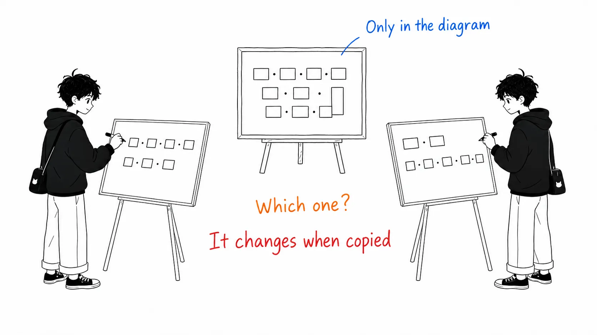
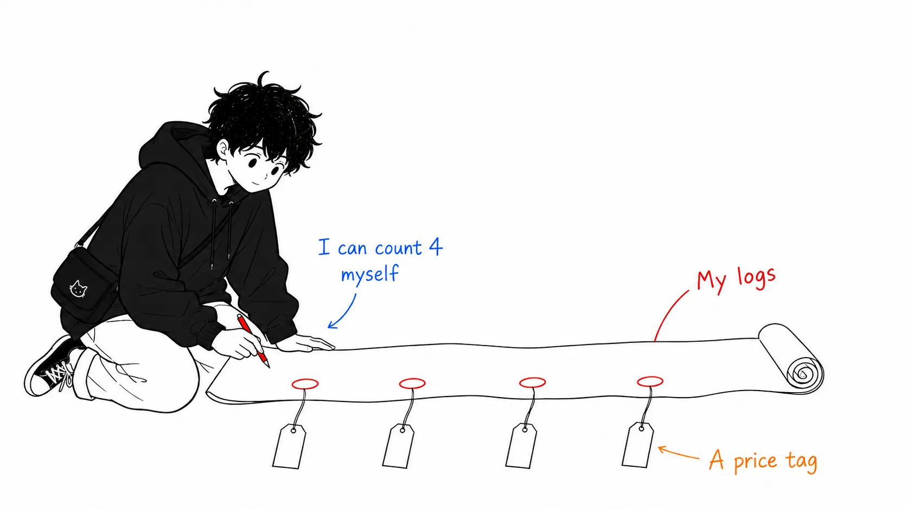

Here's the conclusion up front.

> This post is circulating as "at Uber, 70% of PRs come from agents," but that's not what it's really about. **It's a story about driving the unit cost down while usage grew 7x, not about cutting the total**, and the biggest single lever was **pushing MCP tool definitions out of the context window**. With 100 tools, 50K to 70K tokens of schema were being resent every turn. They eliminated that with CLI resolution and tool search, then cut another 50% to 90% with code-mode.

## About this article

- Original: [Running a Software Factory Efficiently at Uber Scale](https://www.uber.com/us/en/blog/efficient-software-factory/), Uber Engineering, August 27, 2026
- Full text posted on X: [@UberEng](https://x.com/ubereng/status/2093444169037762840) (August 28, 2026, posted by @udaykiran)
- Related talk: [The Software Factory vision at AI Engineer 2026](https://youtu.be/17-YSUHo6Lk)

An honest disclosure first. **I haven't been able to read the figures in the original.** I read this piece from the full-text post on X, and the main figures in the body (the four layers, the six-term cost equation, the table of weekly and monthly metrics, the uReview Pareto chart, the code-mode measurement table) are inside images and weren't carried over as text. I haven't watched the talk either. So for what's inside the figures, as I'll explain below, I either **don't quote it** or I mark it clearly as secondhand.

## Let me get the numbers out of the way first

The scale, from the opening.

- Over **70%** of PRs are **attributed** to local or cloud agents
- Engineers have built over **3,600** agent skills, run over **30,000 times a day**
- From February to mid-August 2026, weekly active users are up **7x** and weekly agent requests are up **9.4x**
- Meanwhile, total AI spend has been **roughly flat since April**
- Holding the model fixed and isolating only their own optimizations (February to July), **cost per 1,000 model requests is down about 34% from its peak**, and **cost per session is down 52% from the June peak**

"70%" is the kind of number that tends to wander off on its own, but the original's word is "attributed." It says **attributed to agents**. It doesn't say the agents wrote them, and it doesn't say no humans were involved. The original itself goes on to list "code review, CI self-healing, E2E PRs, on-call triage, bug debugging" and says these **involve human review or escalation**.

As for the risk of using PR counts as a productivity metric, I covered that in another post (the one about someone who measured their own commit count and noted themselves that "using commit count as a productivity metric isn't necessarily accurate"). I won't repeat it here. **The value of this article lies not in the percentage but in how the unit cost is broken down.**

## The cost equation: grow the top two terms

The backbone of the original is breaking agent-session cost into six multiplied terms. And what matters is that **they're not trying to reduce all of them**.

> The first two terms represent adoption and engagement, which we want to keep growing across the entire user base. (...) The middle three terms provide the optimization opportunity: **the work the agent does for itself** on top of what the engineer actually asked for. This is where most of our effort goes.

This split is the design of the whole article.

- The top two terms (how many people use it, how often) = **grow**
- The middle three terms (what the agent adds for its own sake) = **cut**
- The last term (price per token) = **choose through routing**

So the conclusion reads the same way.

> Rather than relying on a lower unit price or downgrading tools, **we eliminated wasteful, zero-value token consumption**, which let us grow usage 7x while lowering unit cost on every metric and improving or maintaining output quality.

What I liked was the phrase "the work the agent does for itself." The tokens when an engineer says "fix this bug" and the tokens the agent spends on "where was that file again?" look the same on the invoice. Because they built the framework for counting them separately first, what to cut became clear.

## The figure for that equation has already been miscopied

Here's what looks like a digression but isn't.

**What the six terms actually are exists only inside the figure (Figure 4).** The body text only says "it can be broken down into six terms." I haven't been able to read the figure, so I can't quote it.

So I looked at two secondary sources, and this is what I found.

- One write-up: users × sessions per user × turns per session × requests per turn × tokens per request × price per token
- Another write-up: users × requests per user × input tokens per request × output tokens per request × price per token × turns

**They disagree.** The number of terms matches, but the contents differ. One separates input and output tokens and the other doesn't. One has sessions per user and the other doesn't.

A day or two after publication, two different equations from the same single figure were already in circulation. Which is right can only be settled by looking at the figure in the original. I haven't, so **this article doesn't list the six terms**.

This is the same structure as what I wrote earlier about the TokenOps article (headlines survive the summary, definitions get dropped). That time, a one-step summary had swapped the control group. This time, **information that lives in an image forks when it's converted back into text**. A figure is hard to quote, so the writer puts it into words based on their own understanding. That's the fork point.

The practical lesson, I think, is that **if you put an equation, a definition, or a schema in a figure, it breaks in the summary**. This isn't a criticism of the original (figures are indeed easier to read), but the person quoting has no choice but to go look at the figure.

## The main point: push MCP out of the context window

This is the center of what to take away.

Uber has consolidated MCP behind **a single gateway**. Internal and third-party SaaS together add up to **over 1,000 MCP servers**. The design is to do authentication and policy enforcement in one place.

The problem starts here.

> But standard MCP loads **every tool schema into every session**, regardless of whether the engineer ever calls it in that session. With, say, 100+ tools installed, this preloading adds **roughly 50K to 70K tokens of schema overhead** to the initial prompt, and it **gets resent on every turn of context**.

50 to 70K for 100 tools. And every turn. The SaaS side is worse: in the original's examples, **a workspace suite is 49 tools at about 22K tokens**, a messaging one is 34 tools, and a project-management one is 46 tools. The original's phrasing is spot on.

> Load two or three vendor servers and **the agent is carrying more schema overhead than the files it's editing, before the user has typed a prompt**.

The fix comes in three layers.

**1. CLI tool resolution.** Stop connecting MCP directly and have the model run shell commands. The CLI resolves tools dynamically against the gateway at call time. As a result, **Uber's MCP schemas disappear from the session context**. All 1,000+ MCP tools on the internal gateway are projected as CLI commands.

**2. Tool search.** The model searches the tool catalog and loads only what it needs, on demand. The original also notes that selection accuracy doesn't drop as the number of tools grows.

**3. code-mode.** This was the most interesting one. If tools can be called directly as shell commands, the model can **bundle multiple actions into a single script**. The chattier the protocol, the better it works.

> For example, running a single SQL query takes sending the request, polling the status 2 to 5 times, and fetching the output. code-mode turns this entire flow into an automated Python loop and **keeps the intermediate polling outside the model's active context**.

And then the measurements.

> The first three rows show the key finding: **even for the smallest result sets, well under the response-size cap, code-mode cuts token usage by more than 50%.** These efficiencies don't come from avoiding large data payloads; they come from **eliminating unnecessary overhead** such as schema initialization, multi-turn polling, and redundant step-by-step reasoning.
>
> Bulk workflows compound the effect. A loop that would have been N model turns becomes a single script, so the savings compound to **more than 90%**.

(The per-query reduction rates are in the original's table, which is an image. I haven't been able to read it, so I don't quote the figures.)

And the final move is **making the cheaper path the default**. They've prepared **25+ code-mode skills in advance** for commonly used MCP servers, so that standard workflows automatically take the cheapest route.

### I think this is a story about design, not about how to use MCP

From here on it's my reading.

MCP's central design decision was "put tool definitions in the context." The model can only call what's in front of it, so it's the natural design. **And it's correct when you have 10 tools.**

The problem is that this design's cost scales with **number of tools × number of turns**. With 10 tools and 5 turns it's noise, but with 100 tools and 50 turns, **spend that's already fixed before you've typed a single character of prompt** can make up most of the total. Uber's numbers (50 to 70K × every turn) are exactly that.

Uber's answer wasn't "get rid of MCP." The gateway is still there. What they stopped was **putting MCP in the context**. They kept MCP as a protocol (unified authentication, policy, discovery) and **moved only the execution path to the shell**.

There's an obvious objection to this: "tool search is available on the MCP side too, and lazy loading of schemas is a solved problem." I think this objection is half right. The half is that **lazy loading doesn't produce the effect of code-mode**. What code-mode cuts isn't "schema size" but "**the number of turns**." When you fold five polls into one script, what disappears is all five round trips (and all the context that gets resent each time). However you tweak how tool definitions are loaded, that part doesn't shrink.

So the implication of this article, as I understand it, is this. **Between the agent and its tools, running scripts is structurally cheaper than calling functions.** MCP defines the former, and getting to the latter takes machinery on the outside.

## Four defaults you can copy today

The article is full of Uber-scale stories, but there were four things you can take home as settings, as they are.

**1. Auto-compaction at 400K. Even with a 1M-context model.** The original's reason is "balancing model performance against cache bursts and the repeated cost of input tokens." That's 40% of 1M.

This is where I stopped. This number points the same direction as Maurice Heumann's audit that I covered in another post (they had been compressing only after using 93 to 100% of the 1M window, and brought it down to 60%). **One comes from tens of thousands of hours of fleet operation, the other from one person's four-week experiment, and they independently arrive at "compress much earlier than the default."** I think that falls into the category you can trust. But one says 40% and the other says 60%, so the exact value depends on your own workload.

**2. Default reasoning effort to Medium.** The reason is clear: output tokens, including reasoning tokens, are billed at several times the rate of input tokens on the major models. It's a setting that **directly cuts the most expensive category**.

**3. Prompt-cache TTL of 1 hour (interactive only).** Cache reads cost 0.1x the normal input rate. The write premium differs, though: 1.25x for 5-minute entries and 2x for 1-hour entries. Anthropic offers 5 minutes and 1 hour; OpenAI offers 30 minutes.

> Engineers often leave interactive sessions idle for more than five minutes, so we moved from the default 5-minute TTL to a 1-hour window. These frequent idle gaps used to invalidate the prefix cache and force a full context rebuild.

Keeping **subagents at 5 minutes** is a nice detail. Their runs are short-lived, so there's no reason to pay the 2x write premium.

**4. Default subagent model to the weaker one.** The original calls this "the highest-impact lever, proven, and growing in importance." The reason: "subagents execute well-defined tasks with specified inputs, so they often don't need frontier-level reasoning." The main model does task decomposition and evaluation, and subagents do the execution.

## The choice not to set a hard cap

One more part that was interesting as a contrast.

Uber **doesn't stop agents with a spending cap**. The original's phrasing is "to avoid imposing strict caps," and what they put in place instead is the following.

- A real-time cost counter in the status line (always visible in the terminal)
- Shared spend tiers across harnesses (not per-tool budgets)
- **Slack notifications at 50/80/100% of expected spend** (to give time to plan)
- Tier increases need manager approval, with fast turnaround
- A dashboard skill that shows the cost breakdown

This is the opposite choice from Microsoft's TokenOps that I covered earlier (a mechanism that HALTs a run when it exceeds its budget). TokenOps aims to "stop runaway behavior," while Uber aims to "let engineers judge ROI on their own." In the original's words: "**enable engineers to independently evaluate the ROI of a task while mitigating runaway spend**."

It's not a matter of which is right; I think **what they're stopping is different**. What TokenOps is trying to protect is automated runs, where there's no human to make a call. What Uber is handling here is interactive sessions, with a person in front of the screen. If there's a person, showing beats stopping. In fact, Uber has set up **a separate tier** for managed agents.

**Visibility for paths with a human, a cutoff for paths without.** That's how I make sense of the two side by side.

## The session-analysis dashboard's 16 items

Finally, the part I most wanted to copy. The status line only shows the total, so to fill in what lies beyond it there's the "session-analysis dashboard." It's built into the runtime, with no setup or opt-in. Run the `cost dashboard` skill and it analyzes all of that user's session traces across local and remote sandboxes.

And rather than output aggregate numbers, it **detects 16 kinds of anti-patterns and shows each with its dollar impact and a concrete fix**. Examples given:

- **Model routing mistakes**: running a simple multi-turn session on Opus when Sonnet would do
- **Context-window bloat**: a large MCP payload (say, a 40KB response) stays in context and gets billed again on every later turn
- **Cache-expiry inefficiency**: resuming a session after a long break, where an expired prompt cache forces a full prefix rebuild
- **Prompt-initialization overhead**: preloading 100K tokens of system instructions and tool definitions before any user input

All four of these are things **you can count in your own logs**. The full list of 16 isn't public, but even these four work as a checklist. Or rather, the last one probably applies to me.

## If you take away just one thing

**Count the spend that's already fixed before you type a prompt.**

I think Uber's biggest finding is that the room to cut wasn't inside the prompt but **before the prompt**. 50 to 70K of tool definitions, 100K tokens of system instructions, and the resend on every turn. "Write a good prompt" doesn't remove a single token from that.

Counting it in your own environment is easy. Open a session without doing anything and look at the input tokens of the first turn. That's the constant that's about to be multiplied across dozens of turns.

## Sources

- [Running a Software Factory Efficiently at Uber Scale](https://www.uber.com/us/en/blog/efficient-software-factory/), Uber Engineering, August 27, 2026
- [Full-text post by @UberEng](https://x.com/ubereng/status/2093444169037762840) (August 28, 2026). This is the text I read
- [Talk at AI Engineer 2026](https://youtu.be/17-YSUHo6Lk) (not watched)

All quotations are from the body text of the original. **I haven't been able to read the original's figures and tables (the four layers, the six-term cost equation, the metrics list, the uReview Pareto chart, the code-mode measurement table), so I don't quote any numbers from them.** The two write-ups mentioned in the section "The figure for that equation has already been miscopied" deliberately aren't cited (I can't judge which one is right, and naming only one of them as wrong wouldn't be fair). The analysis from the section "I think this is a story about design, not about how to use MCP" onward is my reading, not a claim made in the original.
