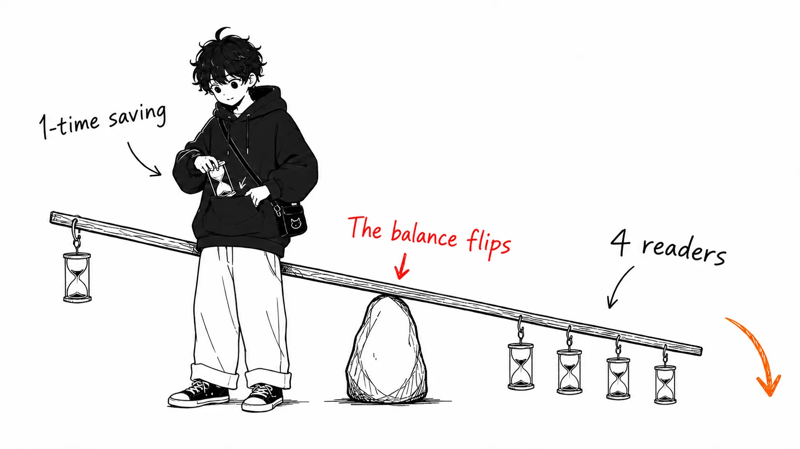

Here's the conclusion first.

> Tech specs and incident retrospectives function not as deliverables but as **proof of thought**. AI can generate the proof alone, without the thinking. So this kind of document loses its function as a measuring instrument first, before it loses anything to a writer cutting corners.

The source is an internal policy that Sophie Alpert (formerly of the React core team, now at Clay) published on June 25, 2026, "There are no lossless transformations of natural-language text." Simon Willison covered it in a link post on August 11, 2026, which is where I found it.

- Original: https://sophiebits.com/2026/06/25/there-are-no-lossless-transformations-of-natural-language-text (Sophie Alpert, 2026-06-25)
- Coverage: https://simonwillison.net/2026/Aug/11/there-are-no-lossless-transformations-of-natural-language-text/ (Simon Willison, 2026-08-11)

The original is truly short. It follows its own policy.

## What the original says

This is the sentence that gives it its title.

> There are no lossless transformations of natural-language text — every rewrite and rephrase changes the meaning of your writing, and if this is done by an entity that doesn't have the most detailed mental representation of what you personally were trying to communicate, information will be lost.

What does the work here is the second half, not the first. It doesn't say "AI's writing isn't good enough." What it says is the conditional clause: that you are the only one who holds the most detailed representation in your head. That's why better prose ability doesn't bring the loss to zero. It shrinks only when theory of mind improves, and the original says so too.

The policy proper is four principles. Using AI for brainstorming, drafts and proofreading is allowed, and these are listed as what you must observe on top of that.

First, **you take responsibility for every sentence**. When a reviewer asks "what does this line mean?", answering "oh, AI wrote that part, ignore it" is not acceptable. If the reader notices something off and points it out, that's still fine, but if they don't notice, the reader goes home misunderstanding what you actually think.

The second is the heart of it.

> In many cases, written artifacts like tech specs, project status updates, and incident retrospectives serve as a "proof of thought". The artifact itself is not the only goal; instead, detailed thinking about the problem is the goal.

Third, **spend more time writing than the time readers spend consuming**. Generating long output from a short prompt and making readers read it shows no respect for the reader's time. If readers want it, they can ask ChatGPT themselves.

Fourth, **longer isn't better**. It quotes Pascal: "I made this letter longer than usual because I lacked the time to make it shorter." If you're producing long text from a short prompt, you're better off sharing the prompt itself.

## My take

This is where it gets long. You can get an introduction to the principles by reading the original.

### "Proof of thought" is a measuring instrument, and AI burns it out

I see this as the same shape I wrote about in another article ("Review isn't clogged, the instruments are broken"). That one was about how the "messiness" of code had worked as a warning light for the implementer's level of understanding, but once AI could produce code that isn't messy without any understanding, the warning light burned out.

What's happening with documents is the same failure in a different domain.

Someone who can write an incident retrospective in 3,000 characters understands that incident. This is closer to causation than correlation, because if you can't write it, the structure falls apart. Lay out the timeline and the contradictions show up. Try to write "why wasn't this detected?" and you realize you don't know how detection works. The act of writing was itself the inspection. So an unstated practice had taken hold: approving someone's understanding on the basis of how finished the document is.

An LLM writes a timeline without contradictions, with no understanding behind it. More precisely, it fills in and writes the understanding the writer doesn't have. The finished document meets the bar that used to be a sufficient condition for "this person understands." The condition is satisfied, but the thing it pointed to is gone.

What makes this nastier than "AI-written text is thin" is that **thinness was a detectable property, whereas the hollowing out of proof is undetectable**. Thin writing is thin when you read it. A perfect postmortem written without understanding is perfect when you read it. The difference shows up three months later, when the same failure recurs in a different form, and by then nobody can tell whose responsibility it was.

### Let's run the multiplied-cost numbers

Let me put numbers on the original's third principle. This is where the original stops at "respect the reader's time," and I think it's better not to stop there.

One person writes a tech spec, and N people read it. Let `a` be the time the author saves by writing it with AI, and `r` the extra time each reader spends deciphering ambiguous intent. Then the team-wide balance is `a - N × r`.

How big is `a` realistically? Writing a 1,500-character spec myself takes me 2 to 3 hours. If I have AI draft it and I fix everything myself, it's probably 1.5 hours. The saving is a little over an hour. If I don't do the "fix everything" part, I violate the original's first principle, so that is about the ceiling on the saving.

And `r`? You snag on an ambiguous sentence, guess at the writer's intent, check on Slack, and wait for a reply. Ten minutes for one spot is conservative. If a 1,500-character spec has two such spots, that's 20 minutes.

So the balance flips at `N = 4`. If four people read the spec, the saving from the AI draft disappears. On a team of ten readers, you burn 2 hours 20 minutes to save 2 hours.

Of course `a` and `r` are my gut feel; I haven't measured them. So don't believe the numbers themselves. What I want you to believe is **the structure of the signs**. The saving accrues once on the author's side, and the cost accrues N times on the readers' side. This asymmetry doesn't go away if you change the assumptions, so the more readers a document has, the less AI authorship works. Conversely, a work memo whose only reader is yourself can be written by AI as much as you like. That's what I actually do.

### As a policy, this doesn't work

This is where I push back on the original.

"Take responsibility for every sentence" can't be verified. A rule with no way to judge from outside whether it was followed has the same problem as what I wrote about Claude Code's permission settings ("The approval button wasn't governance"). An intent written down in prose is not governance. It's just a statement.

So what does work? In fact, something that looks like an answer is tucked into the original.

> If a reviewer asks, "What did you mean by this line?"

It's written as a conditional clause, but **you can turn it into a practice**. In a spec review, the reviewer always picks one spot and asks, out loud, "what does this line mean?" Make that the whole rule. The writer either can answer or can't, and there's no middle ground of "I mostly follow it."

One verifiable rule is stronger than four unverifiable principles. If I brought this policy to my own team, I'd keep the four principles as an explanation of the reasons and actually run on that one question alone.

### For non-native English speakers, this calculation doesn't hold

And this is the territory the original doesn't contemplate. This is the section I most wanted to write, and it's why I picked this article.

The original's logic is "you hold your intent in the finest detail, so you write it." That logic closes only when the writer is writing in their native language.

When I think in Japanese and write an English spec, there's already a big loss between the representation in my head and the prose I can output in English. When I try to write "I have a feeling this design will fall apart in operation" in English and it comes out as "this design might have some operational issues," what was lost wasn't polish but the strength of the claim. Vague English gets read by the reader as "the concern is minor." What the original warned about, "the reader goes home misunderstanding what you actually think," happens even without AI.

So for a non-native speaker the comparison isn't "lossless text I wrote myself vs. lossy text AI touched." It's **lossy vs. another kind of lossy**. In that comparison, which loss is bigger isn't obvious.

My judgment is this. **Think in Japanese, write it out completely in Japanese, and then have AI translate it.** Don't do the reverse. If you have it draft in English and fix it in Japanese, the strength that was lost never comes back. Keep the translation alongside the original Japanese. If the reviewer reads Japanese, that's often faster too.

As long as you keep this order, the original's first principle (take responsibility for every sentence) can be kept. I can take full responsibility for my Japanese version, and for any sentence in the English version I can answer immediately, "this is how I originally wrote it." The loss from missing theory of mind gets smaller if the source is detailed enough. The problem of the original's `entity that doesn't have the most detailed mental representation` can be mitigated if you hand over the mental representation itself. The original doesn't consider this move, because English-speaking workplaces have no need for it.

Conversely, writing only three lines in Japanese and having AI turn them into 1,500 characters of English is the worst. It's a complete violation of the original's fourth principle (don't inflate length), and on top of that, I can't answer anything about the parts that were inflated.

### About this article

To be honest, this article too was structured and written in Japanese, with AI doing a style check. So by the original's standard it's on the borderline.

I can answer "what does it mean" for any sentence. The N=4 calculation above and the point about the order for non-native speakers are things I thought through. But some of the phrasing isn't what I first wrote. If you read the original's standard strictly, I accepted a loss in those parts. My reason for accepting it is that readers of this article aren't coming to read my prose style.

For a medium where readers come to read your prose style, this allowance isn't available. That's the kind of document the original had in view, documents where the signature carries meaning.

## If you take away just one thing

Whether to let AI write a document is not a question of quality but of **who the document is proof for**.

A memo whose only reader is yourself isn't functioning as proof, so you can have it all generated. Tech specs and incident retrospectives are proof, to the reader, that "I understood this," so if you have them generated they stop being proof. The boundary is here, and it has nothing to do with how good the writing is.

If you're unsure how to judge, remember the reviewer's one question. What does this line mean?
