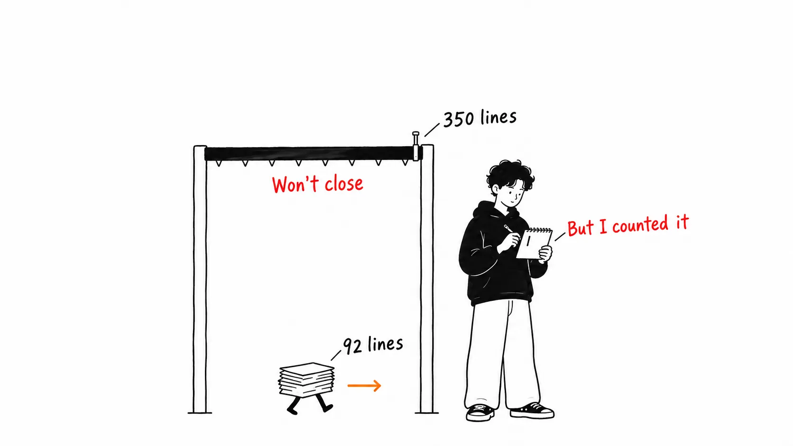
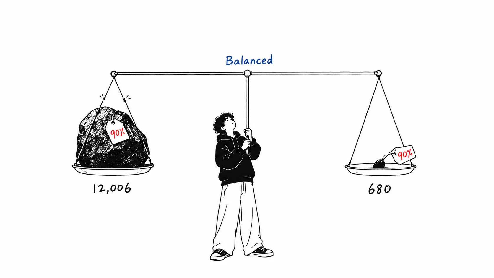
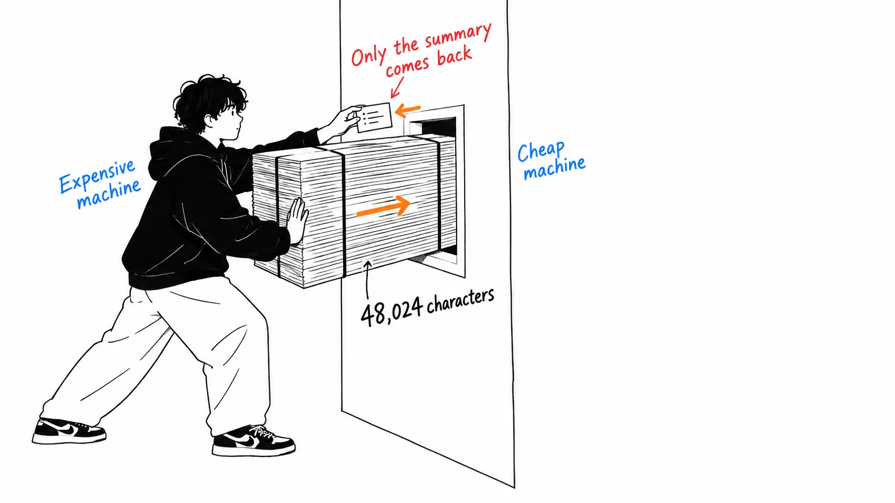

Here's the conclusion first.

> The benchmark is committed to the repository. Look inside, and one of the four scenarios is a test that reads two files totaling **92 lines**. This plugin only closes its gate at **350 lines**. In other words, a case that **passes under its own threshold** is included in that 90% average. The mechanism is well made. What's weak is how the number is reported.

## About this article

The original is Spotify Engineering's [Portal by Spotify cut my Claude Code token usage by 90%](https://engineering.atspotify.com/2026/9/portal-by-spotify-cut-my-claude-code-token-usage-by-90) (September 3, 2026). It got [277 points and 176 comments on Hacker News](https://news.ycombinator.com/item?id=49571465).

First, let me correct three things about how it's been relayed.

**It wasn't written by an engineer.** The author is Dimitri Mazmanov, whose title is Principal Product Manager. Both of the English write-ups I read said "a Spotify engineer," but the article's byline doesn't say that. The original title is also in the first person: "cut **my** Claude Code token usage." This isn't a company architecture announcement. It's **a PM's record of fixing his own usage**, published on an engineering blog.

**It isn't "Spotify's agent architecture" either.** This is about one Claude Code plugin (`shunt`) that sits on an internal platform called Portal. It belongs to a different article series from Honk and Fleet Management.

**An honest disclosure.** I don't have Portal, so I haven't run the plugin. Everything below comes from reading the original and the files **committed** to the public repository [spotify/portal-ai-plugins](https://github.com/spotify/portal-ai-plugins). I did not rerun the benchmark.

## What it does, in three layers

The structure is straightforward.

| Layer | Contents | Nature |
| --- | --- | --- |
| Hooks | Watches `Read` via `PreToolUse`. **Blocks** above 350 lines by default | Enforcement |
| Scripts | `bulk-read` / `code-write`. Calls a cheaper model through the Portal CLI | Plumbing |
| Skills | Teaches Claude when and how to call them | Advice |

The cheaper model side is Gemini 2.5 Flash at temperature 0.2, with two roles: `bulk-reader` (reads) and `code-writer` (writes). A worker reads large files, and Claude gets back **only a summary**. To borrow the original's phrasing, the bulk goes to the worker and **never enters Claude's context**.

The author lists three places where it doesn't work. Edits can't be delegated (line numbers don't make it into the summary), reasoning can't be delegated (the worker missed a thread-safety bug), and latency is 10 to 30 seconds per call, with Portal's cap at 30 seconds. This is honest.

## A scenario that passed under its own threshold is in the average

The original has no benchmark table. It has only this one sentence.

> Tested against a Java monorepo across four scenarios ... Mean bulk-read savings were around a whopping 90%.

With no table, just look at the repository. `plugins/shunt/evals/benchmarks.json` contains the definitions of the four scenarios as is.

| # | Name | Type | Files read | Lines |
| --- | --- | --- | --- | --- |
| 1 | single-large-file | bulk-read | websocket-handler.ts | 603 |
| 2 | multi-file-cross-read | bulk-read | the above + 2 more | 695 |
| 3 | source-plus-test | bulk-read | user-service.ts + order-service.test.ts | **92** |
| 4 | code-generation | code-write | — | — |

To start, of the four scenarios, **three are bulk-read**. The fourth is code-write, which the original itself says is "hard to measure in tokens." So it isn't "an average of 90% over four scenarios." It's **an average over three scenarios**.

The problem is number 3. 36 lines and 56 lines, 92 lines in total. This plugin starts blocking `Read` at 350 lines by default. **If you read a 92-line file, the hook does nothing.**

The author himself writes the reason.

> The line threshold exists for this reason, below it the overhead of delegation exceeds the savings.

Below the threshold, the overhead of delegation exceeds the savings. By the author's own rule, scenario 3 is **a case you shouldn't delegate at all**. And it's in the average of "how much you gain by delegating."

Just in case, I checked the test side too. The first of the 17 cases in `hook-evals.json` is named `small-file`. **The plugin itself guarantees in its tests that small files pass through.** The size it was supposed to let through is counted in the benchmark as realized savings.

## Averaging two things that differ 18-fold, in percent

Let me look at the sizes of scenarios 1 and 3. The repository's `token_estimate` is `chars / 4`, so I'll use that definition.

| | Characters | Approx. tokens |
| --- | --- | --- |
| Scenario 1 (603 lines) | 48,024 | about 12,006 |
| Scenario 3 (92 lines) | 2,720 | about 680 |

They differ by **about 18 times**. Even if both were cut cleanly by 90%, scenario 1 frees up about 11,000 tokens and scenario 3 about 600. Average them as percentages, and these two sit side by side with **the same weight**.

I think the 90% figure is true for the 603-line file. That's the place where it works best. The act of averaging dilutes the story of where it works best into "90% everywhere." That is the only thing that snagged me, and I'm not doubting the reduction itself.

## It says Java, but the repository has no .java files

The original says "Tested against a **Java** monorepo." But the committed fixtures are three files, `websocket-handler.ts`, `user-service.ts` and `order-service.test.ts`, all TypeScript. Search the whole repository and there is **not a single `.java` file**.

I think this should be read generously. There's no way Spotify could publish its internal monorepo, so it's natural to take these as **a reproduction set rebuilt for publication**. There's nothing malicious in it.

But reading it that way leads to this conclusion: **the benchmark you can reproduce from the repository is not where the headline number came from.** And inside the reproducible one, there is a case that falls below its own threshold.

That said, a path to reproduction is properly provided. `evals/run.sh --benchmark` runs benchmarks.json (it needs portal-cli authentication). The 51 tests the README mentions are 17 hook + 17 bash hook + 17 transport, and the benchmark is a separate flag outside of them. Keeping tests and benchmarks separate is, if anything, a sound design.

## v1 was a router too. What changed was enforcement

This is the part of the article I find most interesting. According to the original, **the first version was a set of routing rules written in CLAUDE.md**.

> It sort of worked: Claude would read the instructions and self-route to Portal. But it had problems. The rules were advisory, not enforced. Claude could ignore them.

"It sort of worked." So the router already existed at v1. What changed in v2 was **not how clever the routing was, but whether it could be ignored**. The request became a latch.

This points to the same place as the official Anthropic piece I read four days ago ([my article](https://meikocho1.github.io/blog/claude-official-cost-down)). That one measured that "instructions depreciate; they lose effect in long sessions." This one is the implementation-side answer to the same problem: **stop instructing and make it a hook**. In the same week, one side measured and the other side fixed.

## The answer to "isn't this just subagents?" is in a July issue

This was the most common reaction in the HN comments.

> This does seem to just be a subagents implementation.

> Pretty sure claude code already delegates reading a large codebase to haiku subagents.

I thought so at first too. But the same thread had a verifiable counterexample. The title of `anthropics/claude-code` [issue #72940](https://github.com/anthropics/claude-code/issues/72940) (July 1, 2026, closed) is:

> [DOCS] Sub-agents page still says the built-in Explore agent uses Haiku; v2.1.198 has it inherit the main model

**The built-in Explore subagent is no longer Haiku.** From v2.1.198 it inherits the parent model. The report says only the documentation still said Haiku.

In other words, "Claude Code already delegates to a cheaper model" **stopped holding true as of July**. If you run on Opus, Explore also runs on Opus. You pay frontier-model prices for read-only work. shunt fills that hole.

And as another HN comment wrote, that hole can also be filled just by pinning the Explore agent to a cheaper model. There must be plenty of people who should look there before installing a plugin.

## My take

I think the value of this article is not the 90% but that it **put "reading" and "deciding" on separate budgets**.

So far, talk about context reduction has mostly been about "reducing how much goes in." Uber pushing 1,000 MCP tools out of context is that, and so is `/compact`. This one is different: **it didn't reduce the amount**. The 48,024 characters are read somewhere. Only where they're read changed. They moved from the expensive desk to a cheap desk.

So I think the effect should be measured not by "how much was cut" but by **what was left on the expensive desk**. The original draws the line early with "edits can't be delegated, reasoning can't be delegated," probably because the author was thinking the same thing. Those three limits aren't a confession of failure. They are **a definition of what stays on the expensive desk**.

One more thing. It reminded me of momo5502's audit ([my article](https://meikocho1.github.io/blog/subagent-isolation-costs-duplication)). That was an analysis of a 2GB log showing that, because subagents are isolated, they reread the same file over and over and ended up costing tokens. This original's "edits can't be delegated; if you need to edit, reread the relevant part yourself" is **precisely the bill for that duplicate reading**. The author acknowledges it and cuts a hole in the hook that lets targeted reads through. On the same problem, one side "cut" and the other "cut a hole."

## If you take away just one thing

**When you see savings reported in percent, ask for the absolute quantity in the denominator.** If 90% is an average of three cases and one of them is a 680-token story, that one is no different from zero. And the reason we could see that this time is that the author put benchmarks.json in the repository. Being able to doubt the number is itself evidence of this article's honesty.

## Sources

- Dimitri Mazmanov (Principal Product Manager), [Portal by Spotify cut my Claude Code token usage by 90%](https://engineering.atspotify.com/2026/9/portal-by-spotify-cut-my-claude-code-token-usage-by-90), Spotify Engineering, September 3, 2026
- [spotify/portal-ai-plugins](https://github.com/spotify/portal-ai-plugins): the `plugins/shunt/` README, `evals/benchmarks.json`, `evals/hook-evals.json`, `evals/run.sh`, `evals/fixtures/`
- [Hacker News thread](https://news.ycombinator.com/item?id=49571465) (277 points / 176 comments, September 4, 2026)
- [anthropics/claude-code issue #72940](https://github.com/anthropics/claude-code/issues/72940) (July 1, 2026)

Line and character counts come from fetching the files on the repository's `main` branch on September 10, 2026 and counting them. The token estimates follow the repository's own definition (`chars / 4`). They are not measured token counts. The original cites "$200 to $500 per developer per month" and "AI coding costs will exceed the average annual salary by 2028," but gives no sources for them, so I didn't use them in this article.
