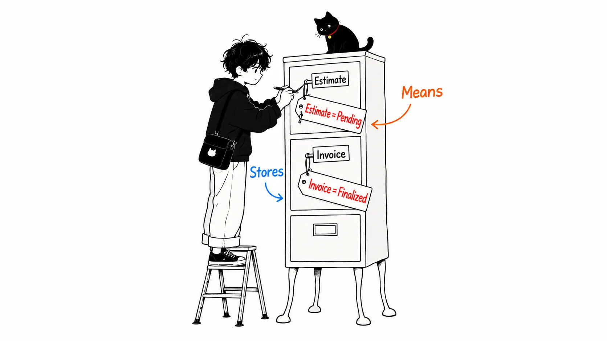
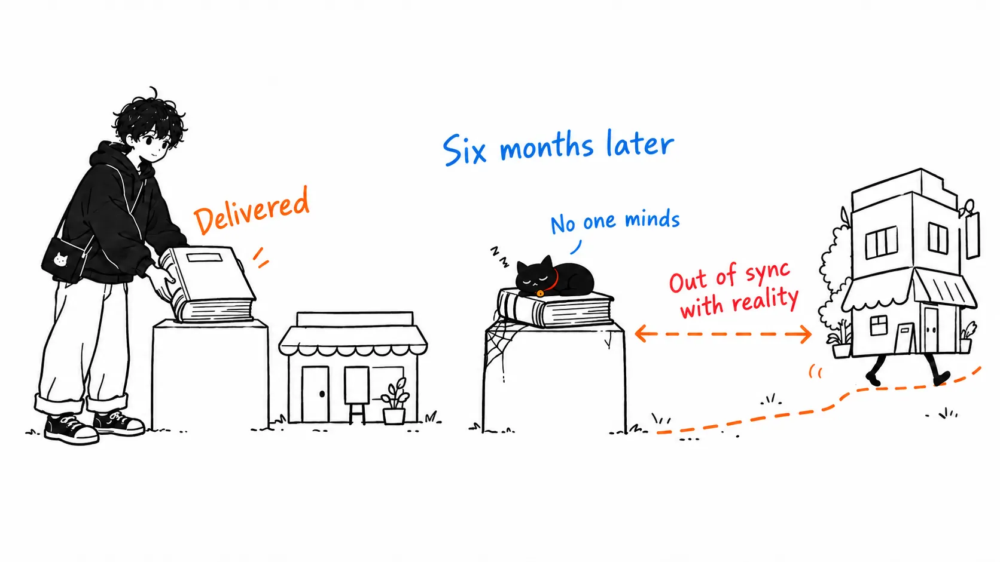
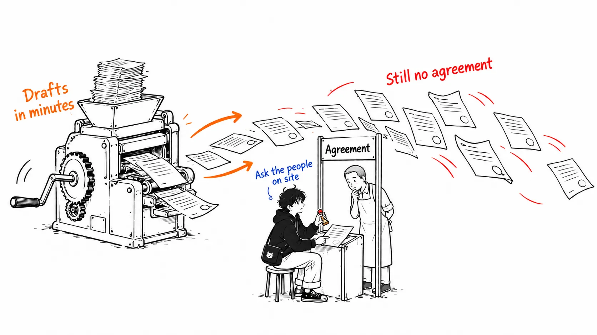
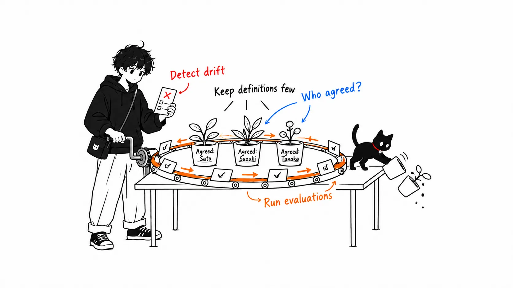

For about the past year, I've been seeing the word "ontology" a lot in the context of AI agents. Palantir puts its Ontology at the center of its own product, and it tends to come up whenever people talk about data platforms.

But the word itself isn't new. Ontology had its proper moment of popularity during the Semantic Web of the 2000s and in the SI (system integration) projects that followed. And in many workplaces it ended up as something that was "built but never used."

So in this article, I'll line up the steps for building an ontology, and what you should do, in the SI days versus now. A caveat up front: the SI-era steps described here are my summary of the generally common way of proceeding at the time, not an account of any specific project.

Here is the conclusion up front.

> What AI made easier is the "writing" step. The core of an ontology, the step of "agreeing on definitions with the business side," has not gotten easier. Because drafts now appear instantly, the bigger danger is that ontologies that skipped the agreement get mass-produced. What to do now is to keep definitions few and verifiable, on the premise that agents will read them.

---

## What is an ontology

The frequently cited definition is from Tom Gruber's 1993 paper.

> An ontology is an explicit specification of a conceptualization.

That alone is hard to grasp, so in my own words: "a written description of what exists in the world of some line of business and how those things relate, in a form that both humans and machines can read with the same meaning."

For example, take a neighborhood bicycle repair shop. It has things like "customer," "bicycle," "repair," "part," and "estimate," and relationships like "a customer brings in a bicycle" and "an estimate refers to a repair and parts." Up to here, an ER diagram can express it too.

What differs from an ER diagram is that it carries meaning as well. A "person who brought it in" is a kind of "customer," but isn't necessarily "the bicycle's owner." An "estimate" and an "invoice" are similar but different: an estimate is before confirmation, an invoice is after. You write these distinctions in the language of the business, not to suit table design. A close way to split it: the database handles "what to store," and the ontology handles "what that means."

## The steps in the SI days

Ontology building in the SI days generally proceeded in this order.

1. **Scope and glossary**: Decide the target business, and collect terms through interviews. Wipe out inconsistencies here, such as one thing having three names.
2. **Conceptual model**: Decide the hierarchy of classes (concepts) and the properties (relationships and attributes). It was often written as OWL in an editor like Protégé.
3. **Mapping to existing data**: Decide which class and property each RDB or CSV column corresponds to, and build the ETL that converts it to RDF.
4. **Inference and search**: Derive implicit facts with an inference engine, and build screens or APIs that query with SPARQL.
5. **Delivery and maintenance**: Deliver together with specification documents, and take changes under a maintenance contract.

Of these, steps 1 and 3 ate up most of the effort. Wiping out terminology inconsistencies required many rounds of interviews, and the mapping was work of absorbing the quirks of the existing systems one by one.

And step 5 was where things tended to fail. Once the ontology becomes a "deliverable," nobody updates it even when the business changes. An ontology that isn't updated drifts from reality within six months, and what has drifted stops being used. Since it isn't being used, nobody is bothered that it has drifted. I suspect many projects ended quietly in this cycle.

One more thing: back then, expectations leaned too heavily on "machines doing the inferencing." If you wrote it rigorously in OWL, the inference engine would derive new knowledge for you. But what the actual business wanted, more than inference, was "a state where everyone has the same answer to what this word refers to," and that didn't need an inference engine.

## The steps now

I see the steps as having changed like this with LLMs in the picture.

1. **Work backward from the judgment you want the agent to make**: Don't start with "cover the whole business." Decide on one judgment you want to hand to the AI, such as "determine the reason an estimate was sent back," and pick up only the concepts needed for it.
2. **Have the LLM propose candidates from existing materials**: Have it read manuals, DB schemas, and inquiry history, and propose candidate concepts and relationships. This part really did get faster.
3. **Humans agree**: Check the candidates against the business side and settle the definitions. Whether "we may accept repairs for someone who isn't the owner" is something only people on the ground can answer, not the LLM.
4. **Hold them as objects and actions**: Define not only concepts but what can be done with them (confirm an estimate, order a part). I think this is why Palantir's Ontology makes actions first-class citizens.
5. **Expose it as the agent's tools**: Turn the ontology as is into functions the agent can call, and descriptions of their arguments.
6. **Run it with evaluation**: Check with test cases every time that the agent judged according to the definitions. If it drifts, fix the definitions.

Here is a table of the differences from the SI days.

| | SI days | Now |
| --- | --- | --- |
| Who reads it | Inference engines and developers | LLM agents and business staff |
| Scope | Cover the whole business | Only what the judgment to delegate needs |
| Heaviest step | Collecting terms and ETL | Agreeing on definitions |
| How it's written | Rigorously in OWL / RDF | Typed schemas and natural-language descriptions |
| How it ends | Delivery | Operated as long as evaluations keep passing |

## Only the writing step got easier

This is what I most want to say.

Step 2 of the current process, which would have taken weeks in the SI days, now finishes in minutes. The LLM produces a plausible class hierarchy with plausible explanations.

But it's only plausible. The definition of "estimate" the LLM produces is the generic definition of an estimate, not that company's estimate. That company might separate "provisional estimate" from "final estimate," or might call an amount communicated verbally an estimate. Only people on the ground know that, and you can't tell without asking.

In the SI days, writing was slow, so while you were writing, you inevitably had to ask people. You could say the slowness forced the agreement. Now things take shape without asking. And once something has taken shape, the reviewing side also finds it easy to wave through with "looks about right."

That's why I think the danger in ontology building today isn't "being unable to build" but "being able to build things nobody agreed on." And this time agents read it and actually act, so it can't end with "going unused" as in the SI days. With a wrong definition in place, the action to confirm an estimate gets called.

## What to do now

From this view, what to do narrows to three things.

**Keep definitions few.** Suppress the urge to cover everything, and include only what the judgment you delegate to the agent needs. The more definitions there are, the more the cost of agreement grows, and the higher the probability that unagreed definitions get mixed in.

**Record "who agreed" for each definition.** Make it possible to tell whether it's a candidate the LLM proposed or something someone on the ground confirmed. It's information that the SI-era specification documents contained but that today's schemas tend to lack.

**Build the evaluation first.** Create cases of the form "for this input, judge like this" together with the business side, and run them every time you change the ontology. Drop the SI days' "done once delivered," and make "evaluations keep passing" the condition of completion. This lets you detect definition drift when the business changes.

If you take away just one thing: don't let a draft the LLM produced stand in for agreement. Ontology, then and now, is first of all "the work of aligning words," before it is technology. AI made that work faster, but it doesn't take it over for you.
