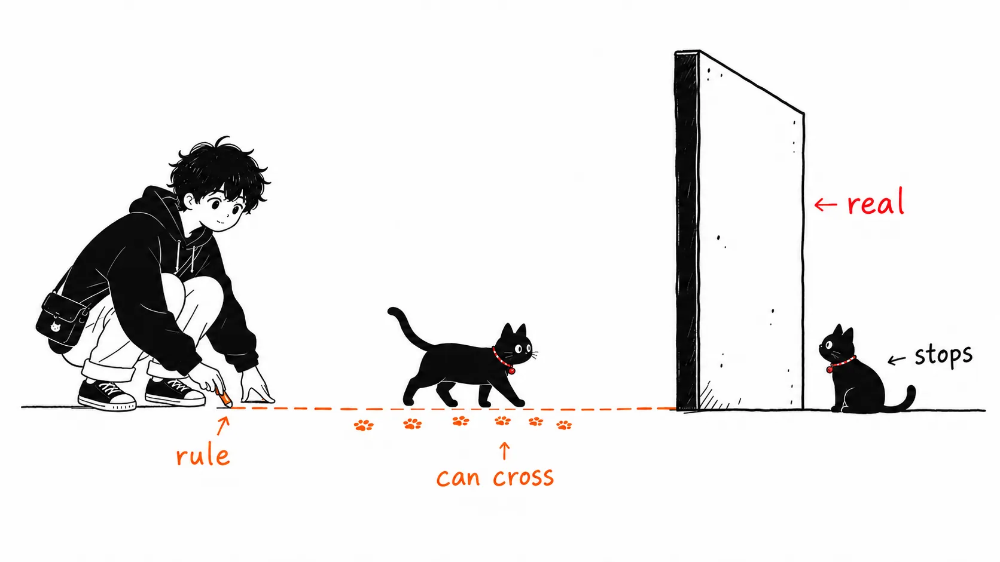
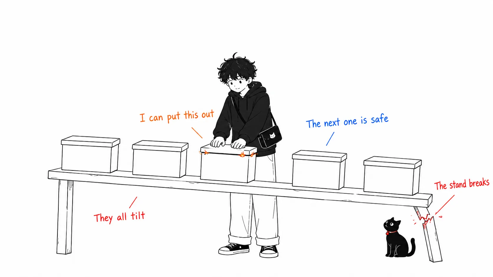
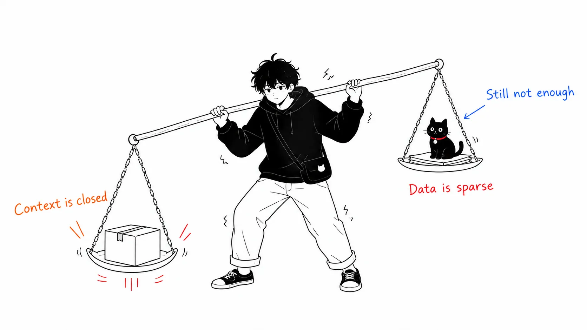

Here is the conclusion first.

> Separate finely in logic. Don't separate in the physical until you need to.

When I tried to put into words why I'm drawn to Phoenix, this one line is where I ended up. It's not because I like real-time (Channels or LiveView). The order is reversed: real-time is the entrance.

A caveat up front: this article is not an operations report. It isn't based on experience running BEAM in large-scale production. It's putting into words a design judgment I'm assembling while learning.

:::message
**Terms assumed in this article**

- **BEAM**: The virtual machine that Erlang / Elixir run on. Think of it as Erlang's JVM, though it differs in that its design is centered on concurrency and recovery from failure.
- **OTP**: A set of standard libraries and design practices that sits on top of BEAM. GenServer and supervisors are part of it.
- **Process**: Not the same thing as an OS process. A lightweight unit of execution inside BEAM, creatable at a few KB each. You can run hundreds of thousands of them.
- **deployment unit**: "The unit that gets swapped in a single deploy." Microservices are a design that increases these; a monolith is a design that keeps it at one. This is the central term of the article.
:::

## We Stopped Asking Why We Split Things

For the last several years, microservices have been treated as one ideal form for backends. Build small services in Go or Node.js, package them with Docker, and put them on Kubernetes. REST or gRPC between services, Kafka or SQS for async, Redis for shared state, Datadog for monitoring.

It's a rational setup. But lately I've been asking more strongly whether we need to split things that finely. The more I thought about it, the more I was pulled toward the design philosophy of BEAM and OTP.

## In Most Runtimes, "Logical Separation" Is Only a Convention

You split modules, cut layers, and decide the direction of dependencies. That's a coding convention. It breaks the moment someone adds one `import`. Shared mutable state sits in the same place in memory no matter how cleanly it's separated on the blueprint.

So the argument becomes "if you're serious about isolation, split the process, meaning put the network in between." What microservices were buying was **a physical wall that enforces isolation**.

BEAM puts this wall somewhere else.



Each BEAM process has its own heap, mailbox, and state, never touches shared memory directly, and communicates only by message passing. Scheduling is preemptive, so if one runs wild the others don't stop. And a supervisor restarts a crashed process with a predetermined strategy.

```text
BEAM

Supervisor
├ UserProcess #1
├ OrderProcess #100
├ AudioJobProcess #200
└ NotificationProcess
```

:::message
**The OTP components that appear**

- **GenServer**: A template for a process that holds state and responds to messages. It feels like standing up one "small server."
- **Supervisor**: A parent process that watches its children and restarts them with a predetermined strategy when they crash. It helps to think of it as Kubernetes's restart policy, done inside the VM.
- **Message passing**: A way for processes to communicate by sending messages to each other instead of touching shared memory. The advantage is that it doesn't turn into a design where you fight over locks.
:::

In other words, what microservices got using Kubernetes and the network (isolation, restart, message communication) is **guaranteed by the runtime inside a single deployment unit**. Not by convention, but by the runtime.

This is the heart of the appeal. The choice to "not split" becomes a design decision, not a surrender.

## This Isn't About Go Being Inferior

For a simple API server, Go is very strong. It starts fast, uses little memory, ships as a single binary, and earns you container density. If the goal is to handle a large number of HTTP requests cheaply, it's simply an excellent choice. This isn't a claim that Phoenix is faster.

And arguments about scale usually calm down when you bring them back to numbers. 10 million requests a day is about 116 req/s on average. Even with a 10x peak, that's 1,000 to 2,000 req/s. Either can handle that.

What matters is not the number of requests but concurrent connections × state held × communication frequency. Chat, delivery locations, kitchen displays, POS, collaborative editing, progress of audio processing. In applications that hold large numbers of these "live connections and state," the one-process-per-connection model becomes natural.

## Complexity Comes After the Split

At first it's a single Go API, but as it grows you need workers, a scheduler, a WebSocket server, and Redis and queues multiply. Split it into services from there, and for each one you have to think about Docker, Deployment, health checks, logs, metrics, CI/CD, API schemas, service discovery, retries, timeouts, circuit breakers, and distributed tracing.

Each individual service gets simple. The system as a whole gets complicated.

When a team of 10 to 20 people splits things into dozens (User / Email / Profile / Preference / Notification and so on), every simple feature addition brings network failures, timeouts, eventual consistency, distributed transactions, and schema compatibility into view.

:::message
**Homework that appears when you split**

- **Eventual consistency**: A design that assumes data split across multiple services will be out of sync for a moment. A state like "the order came in but hasn't been reflected in inventory yet" has to be handled on the application side.
- **Circuit breaker**: A mechanism that, when the callee is down, stops calling and fails immediately. Without it, one failure cascades to the callers.
- **Distributed tracing**: A mechanism that tracks the path of one request across multiple services. What a single stack trace used to cover in a single process becomes work that needs dedicated infrastructure.

Each is the right countermeasure on its own. The problem is that if you hadn't split, you **wouldn't have needed them in the first place**.
:::

In other words, **to tidy the code, we're creating a new problem called network failure.** That's a pretty big price.

Redis is the same pattern. When you run multiple Go servers, state held in A's memory isn't visible from B. So you push it out to shared storage. Redis is excellent, but it isn't magic. What it really is is **RAM on another server**. From the app's point of view, it's RAM on the other side of TCP and serialization.

With Phoenix, some of that state can be held inside the VM in processes or ETS, so in some situations that round trip disappears. It doesn't make Redis unnecessary; it means you can **push its adoption back**.

:::message
**ETS / PubSub / Presence / Oban**

- **ETS** (Erlang Term Storage): BEAM's built-in in-memory table. Readable and writable across processes, and very fast. But it lives in RAM, so it disappears if the VM goes down.
- **PubSub**: A mechanism for distributing events within the same app (and across nodes if you form a cluster). It saves you from putting Redis Pub/Sub outside.
- **Presence**: A mechanism for sharing "who is connected right now" across nodes. Used for online indicators and collaborative editing.
- **Oban**: Elixir's job queue. It's really a PostgreSQL table, so unlike Sidekiq you don't need to add Redis.
:::

## That Was the Claim; Now the Objections to Myself

What's above is the kind of thing that feels good even to me as I write it. So I'll poke holes in it myself.

**A BEAM cluster is not shared memory.** The RAM of Node A and Node B doesn't become one. If the process for User #123 is on A, then B has to send it a message to fetch from it. It's distributed processes, not distributed shared memory. Confuse the two and you get the design wrong.

**A process is not a database.** The "what's happening now" things, such as connected users, running jobs, progress at 42%, suit processes and ETS. The "what happened" things, such as orders, payments, inventory, point balances, go in PostgreSQL. Facts that must not disappear must not be placed in BEAM. ETS is fast, but it's in RAM and can't be the source of truth.

**Nothing but process crashes is isolated.**



What the supervisor protects you from is a process crashing. What physical separation was buying was a different blast radius: a bad deploy, a memory leak, the VM itself stopping. If a NIF crashes, the whole VM dies. Push a bad deploy and 30 logically isolated components die at the same time. BEAM can't isolate that.

:::message alert
A **NIF** (Native Implemented Function) is a mechanism for calling native C or Rust code from Elixir. You use it to offload heavy computation like image conversion or cryptography, but **a crash inside a NIF takes down the whole VM**. The supervisor won't help. BEAM's fault isolation works only on code written inside BEAM.
:::

**Independent deployment is an organizational requirement, not a technical one.** The real reason many teams choose microservices wasn't performance or fault isolation but "we don't want to wait for other teams' releases." There's clear value in the payments team being able to run deploys and rollbacks on their own. BEAM doesn't solve this. As long as it's one deployment unit, there is one release.

So, to be precise, the claim narrows to this. **While the team is small, logical separation alone is genuine enough.** Where you need physical separation, headcount comes before load.

## What to Integrate and What to Put Outside

Even picturing a giant e-commerce site, putting everything into one is extreme. I would put Accounts / Cart / Orders / Checkout / Inventory / Promotion / Point / Notification into one Phoenix and build the internals with PubSub, Oban, and supervisors.

What goes outside is only what has no reason to be integrated. Search engines, payments, fraud detection, AI and recommendations, object storage, analytics infrastructure. AI/ML in Python, CPU-burning audio processing in Rust or C++, full-text search in a dedicated engine. There's no point in forcing things with a different runtime toward Elixir.

Not using Phoenix as a do-everything language, but **using it as the application's orchestrator**. That's the form I'm most convinced by right now.

## The AI Era: Tailwind and Headwind Sit on the Same Scale

One reason monoliths got disliked was that the codebase got too big for humans to understand. The more practical agents become that can read across code search, ASTs, Git history, dependencies, tests, and types, **the weaker the reason becomes to split just to lower cognitive load**. If you can say "this change affects Orders, Inventory, and Promotion," part of the disadvantage of a huge codebase disappears.

Where agents fail most is where context breaks. Across repositories, across service boundaries, with the contract in a different file and the actual behavior in a different deployment unit. There they happily do "fixed the caller but didn't look at the callee." Fewer deployment units means fewer boundaries for the agent to read.

That's the tailwind. The headwind is talked about less.



**An agent's ability is blatantly proportional to the amount of training data.** Compared to TypeScript or Python, the absolute amount of Elixir code that's been written is orders of magnitude smaller. Have the same model write it and the quality of the output differs. OTP patterns, choosing a supervision strategy, `handle_info` clauses that miss messages. In these areas the agent quietly gets things wrong.

And the more you stand on the premise that "AI raises productivity," the heavier this difference becomes as a reason for choosing. The gain from context closing in a single codebase and the loss of the model not writing that language well sit on the same scale. Count only one side and you get the conclusion wrong.

My judgment is this. **For a team whose limiting factor is the amount it writes, the headwind wins; for a team whose limiting factor is the amount it reads and incident response, the tailwind wins.** The payoff of BEAM shows up not when writing but when things fall over and when you're chasing them. Phoenix at the stage of mass-producing new features isn't that fast. It's a design where, once you're in operations, you can say you chose well.

Also, security boundaries, independent scaling, team ownership, runtime differences, isolation of failure domains: the original benefits of microservices don't vanish as AI advances. All that vanishes is "splitting to tidy up the code."

## If You Take Away Just One Thing

Whether to choose Phoenix isn't decided by whether you need real-time features. What decides it is **whether you buy isolation with the network or with processes**.


If you buy with the network, you get independent deployment and a smaller blast radius, and you pay in operating cost and broken context. If you buy with processes, you get isolation and restart inside the deployment unit, and you give up independent deployment.

The point where you need the former is usually when headcount arrives before load. Until then the latter is enough, and if you're already using BEAM, it's not a compromise. First isolate as processes inside BEAM, and promote to external services only the boundaries that truly need it. That's what feels most right to me at the moment.
