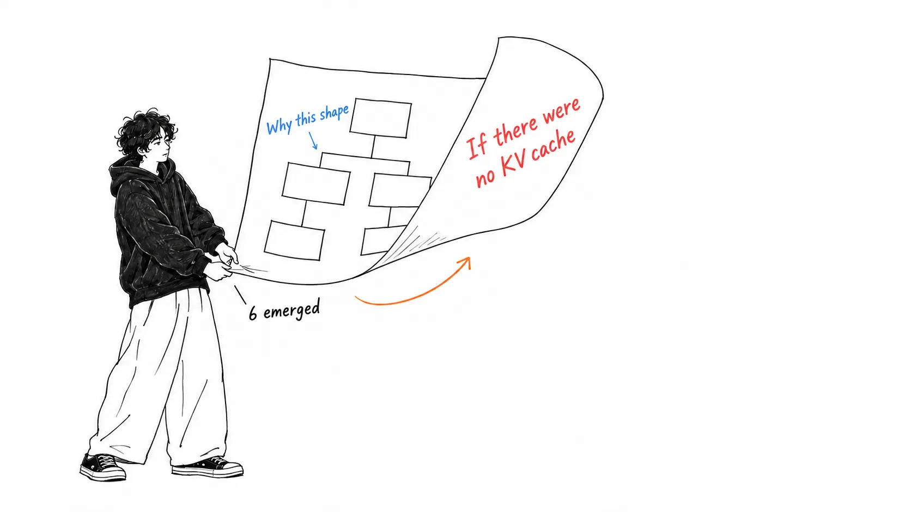
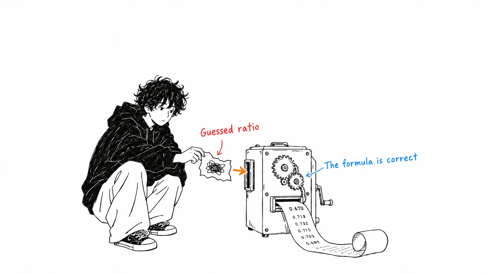
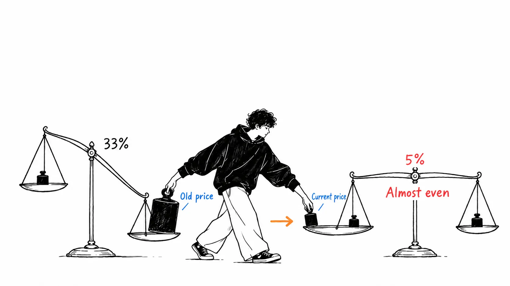
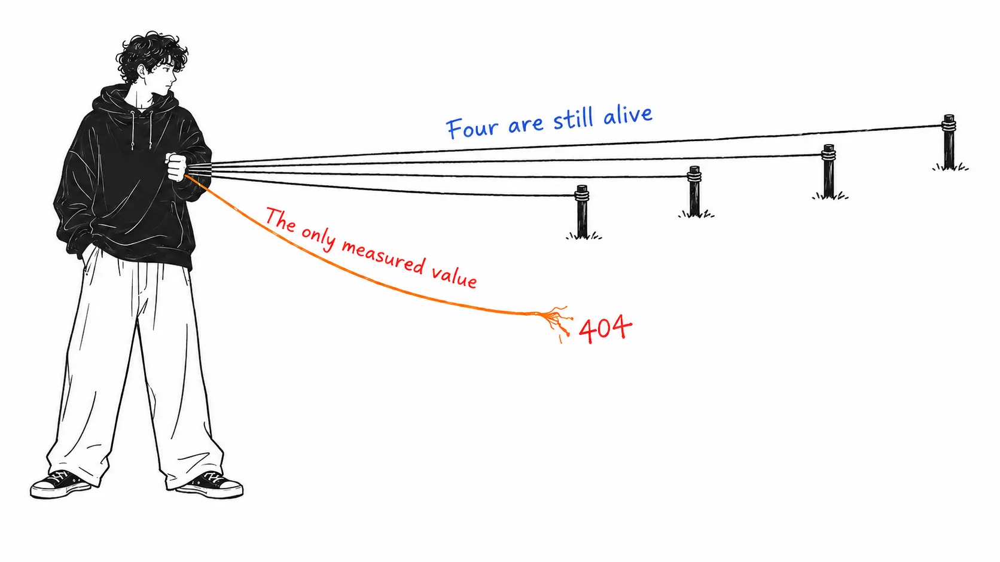

Conclusion first.

> It includes a calculation showing that "handing work to a cheaper model and handing it back ends up costing more." The formula is right, and when I reproduced it, the author's claim that "pure opus costs 2/3" came out exactly. However, **the Sonnet price used was one generation old.** Just swapping in current prices shrinks the advantage from 33% to **12%**, and counting cache reads brings it to **5%**, practically even. The conclusion is not "routing doesn't work" but "**at today's prices it's within the margin of error**."

## About this article

What I read was not [@CompleteSkeptic's post](https://x.com/CompleteSkeptic/status/2101894250401271876) (September 21, 2026, 513,493 views) but the [Google Doc](https://docs.google.com/document/d/1G61uUB0FifUnmmrPzFQojZ3KpczYKmXGpgEXDJ2l_Zg/edit) linked from it. The post itself is three lines, and all the substance is in the document.

The author is Diogo Almeida. According to his profile, he was involved in launching RLHF / ChatGPT at OpenAI and is now CEO of TypeSafe AI. So this is not a neutral analysis but **an in-house design memo on "why build yet another coding agent."** The title literally starts with "Why yet another agent."

And the author himself writes this.

> we likely will never have time (ever again) to play ourselves, but hope the that the community goes WILD (**and makes me look like a naive idiot**)

He's written that he wants to be made to look like an idiot. So I rechecked. What follows is the record.

**An honest disclosure.** I haven't touched TypeSafe's product. I read the whole document (14,661 characters). The prices are based on the materials I have on hand, as described below, and I state the date.

## The question "what if there were no KV cache?"

The good part first. At the center of this document is a single question.

> One of my favorite questions I ask people here is “**how would you design a coding agent if LLMs had no KV cache?**”

How would you design a coding agent if LLMs had no KV cache?

I think it's a good question. Many of the designs that are taken for granted now were in fact derived backward from the constraint of "don't break the cache." The author calls this "the tyranny of the KV cache" and lists six.

| # | Claim |
| --- | --- |
| 1 | **Routing doesn't pay off** (the only one with a calculation) |
| 2 | Tool definitions all have to be declared up front, eating context |
| 3 | Compaction can only be justified on the premise that "all turns share one state" |
| 4 | Subagents are underwhelming (because handing off state is a hassle) |
| 5 | The very idea of restarting comes from assuming state gets broken |
| 6 | The tug-of-war over whether to go batteries included |

Number 3 landed for me personally. The point is that compaction tries to solve a compression problem, but **compression is far easier if you know what you're looking for**, so compressing without knowing the query deliberately picks the hardest form.

## I redid the calculation

Of the six, only number 1 has numbers in it.

The premises: opus is 5 for input / 25 for output, sonnet is 3 for input / 15 for output (dollars per million tokens). X = context tokens, Y = output tokens, Z = extra tokens generated by commands and file reads.

- **Path 1 (opus alone)**: 25Y + 5Z
- **Path 2 (opus → sonnet → opus)**: 3X + 20Y + 8Z

The point is the 3X attached to path 2. sonnet has to load the context from scratch. On the opus side it's already in the cache, so there's no re-read charge. That's the substance of the "tyranny."

The author sets the proportions. And the way he sets them is written with maximum honesty.

> let's have chatgpt **vibe** some proportion of X / Y / Z
> X = 0.65, Y = 0.12, Z = 0.23

It says in plain words that he had ChatGPT come up with them casually.

Calculating with these values gives 4.150 / 6.190 = **0.670**. The author's "pure opus is 2/3 the cost" comes out as is. **The formula and the arithmetic are right.**

What caught me was the price. The sonnet 3 / 15 is **Claude Sonnet 4.6's price**, and the current Claude Sonnet 5 is **2 / 10**. I swapped it in and redid the calculation.

| Condition | opus alone | via route | Ratio |
| --- | --- | --- | --- |
| As in the original (Sonnet 4.6 price) | 4.150 | 6.190 | **0.670** (33% cheaper) |
| Swapped to Sonnet 5's current price | 4.150 | 4.710 | **0.881** (12% cheaper) |
| Also counting opus's cache reads | 4.475 | 4.710 | **0.950** (5% cheaper) |

A note on the third row. The original formula has no X term at all in path 1. opus's context is treated as "free because it's in the cache." In reality cache reads are billed at about 0.1x the normal input rate, so 0.5X also goes onto the opus side. With that included, the gap is 5%.

**If the proportions ChatGPT guessed move by as little as 5%, the sign flips.**

In other words, what this calculation supports is not "routing doesn't work" but "**at current prices, the calculation can't decide which is cheaper.**" The direction of the conclusion is the same, but the strength is completely different. It changes whether you can use it for a design decision.

The prices I used are from the table in the materials I have on hand (as of June 24, 2026): Sonnet 5 at 2 / 10, Opus 5 at 5 / 25, cache reads at about 0.1x, and cache writes at about 1.25x. **I have not rechecked them against today's official prices.** It remains possible that my numbers are the outdated ones.

## The cited source had vanished

I checked one more thing. The document's appendix lists five reference projects. Four of them are alive and, what's more, large.

| Repository | stars | Last updated |
| --- | --- | --- |
| `chopratejas/headroom` | 73,469 | 2026-09-22 |
| `rtk-ai/rtk` | 81,413 | 2026-09-21 |
| `ast-grep/ast-grep` | 16,001 | 2026-09-21 |
| `dmtrKovalenko/fff` | 10,840 | 2026-09-21 |
| `microsoft/fastcontext` | **404** | — |

Only the last one is gone. And it was **the only place in the document that cites an external measurement.**

> Interesting claim: In our analysis of GPT-5.4 trajectories, reading and searching account for **56.2%** of all tool-use turns and **46.5%** of the main agent's total tokens

Reading and searching account for 56.2% of tool calls and 46.5% of tokens. If true, it's a far heavier number than the other claims in this document.

I followed it. A GitHub search turns up several mirrors of "FastContext, deleted by Microsoft," and from there you get to the paper. [arXiv 2606.14066](https://arxiv.org/abs/2606.14066), "FastContext," is real, published June 12, 2026 and **updated today, September 22**. The paper argues for separating repository exploration from the solving itself, and says it improves resolve rates by up to 5.5% on SWE-bench Multilingual / Pro / SWE-QA and **cuts token consumption by up to 60%**.

However, **56.2% and 46.5% don't appear in the paper's abstract.** They aren't in the READMEs of the three mirrors either. Those two numbers were only in the README that disappeared, and there's no way to check now. The URL the paper puts in its body is also `github.com/microsoft/fastcontext`, which is a 404.

The direction of the claim is supported by the paper (separating exploration reduces tokens). Only the numbers are left hanging in the air.

## My view

This is not an article that bashes the document. My position is that **something written in a form you can recheck has value for that alone.**

Let me compare. Another guide I read earlier was built on the foundation that "production tool calls fail 3 to 15% of the time," and when I traced the source it came down to a single personal blog ([my article](https://meikocho1.github.io/blog/three-to-fifteen-came-from-one-blog)). There was no way to recheck that. This one is different: the formulas are all written out, so you can replicate it just by swapping prices. And he writes himself that he "had ChatGPT vibe it." **A document that states its own weak points can be fixed by its readers.**

With that said, let me write down the scariest part. **This document was written to explain why the author is "building yet another agent."** All six "tyrannies" are stories about how existing agents' designs are bound by constraints, and the conclusion naturally lands on "so there's room to build something new."

That's exactly why it matters that the one calculation was built on prices from a generation ago. This isn't about malice. **Price tables change in three months, and design memos don't.** The prices I used are also three months old. This article will go stale in the same way.

One last thing. About `rtk`, the document says "projects like this help agents in theory but not in practice. The reason is probably that LLMs don't natively understand them." That is a strong assessment of a project with 81,413 stars that was updated yesterday. And the author himself writes "My guess," with no measurement attached. **Within the same document, he attaches formulas to his own calculation and guesses to other people's tools.** I felt this isn't symmetrical.

## If you take just one thing home

**When you see someone else's cost calculation, just check the date on the price table.** Even if the formula is right, if the unit prices are a generation old, the strength of the conclusion changes. This time a 33% advantage became 12%, and with cache reads included, 5%. At 33% you can decide a design; at 5% you can't. **Stale unit prices work far more quietly than a bug in the formula.**

## Sources

- [Post by @CompleteSkeptic (Diogo Almeida)](https://x.com/CompleteSkeptic/status/2101894250401271876) (September 21, 2026; 513,493 views / 3,019 likes / 4,276 bookmarks)
- The linked [Google Doc "Why yet another agent"](https://docs.google.com/document/d/1G61uUB0FifUnmmrPzFQojZ3KpczYKmXGpgEXDJ2l_Zg/edit) (14,661 characters in total, retrieved September 22, 2026)
- [arXiv 2606.14066 "FastContext"](https://arxiv.org/abs/2606.14066) (published June 12, 2026, updated September 22)
- Star counts and last-updated dates were retrieved from the GitHub API on September 22, 2026

Prices are based on the materials I have on hand (as of June 24, 2026): Claude Opus 5 at $5 input / $25 output, Claude Sonnet 5 at $2 input / $10 output, Claude Sonnet 4.6 at $3 input / $15 output, and cache reads at about 0.1x. **I have not rechecked them against the official pricing page as of today.** My reading that the original's 3 / 15 refers to Sonnet 4.6 is also a guess, since the author doesn't say so. If the author had set 3 / 15 with a different intent, this article's point misses.

Treating cache reads as 0.5X added to path 1 is also an assumption I made. In reality it varies with how much of the context is in the cache. The formulas and values are as in the tables in the body, so please redo the calculation with your own prices and proportions.
