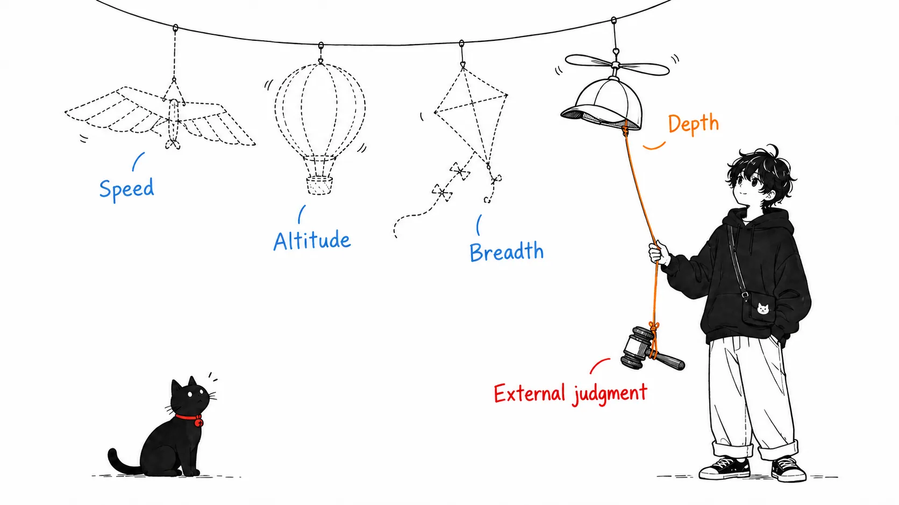
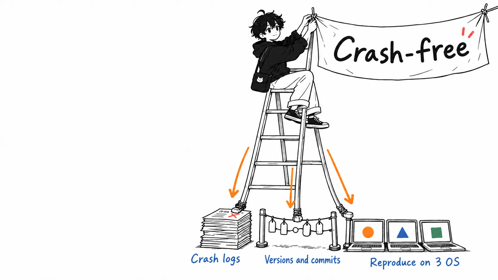
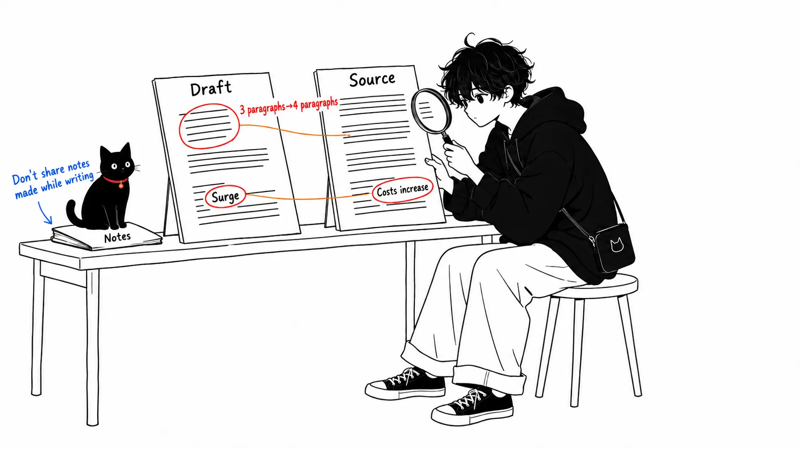
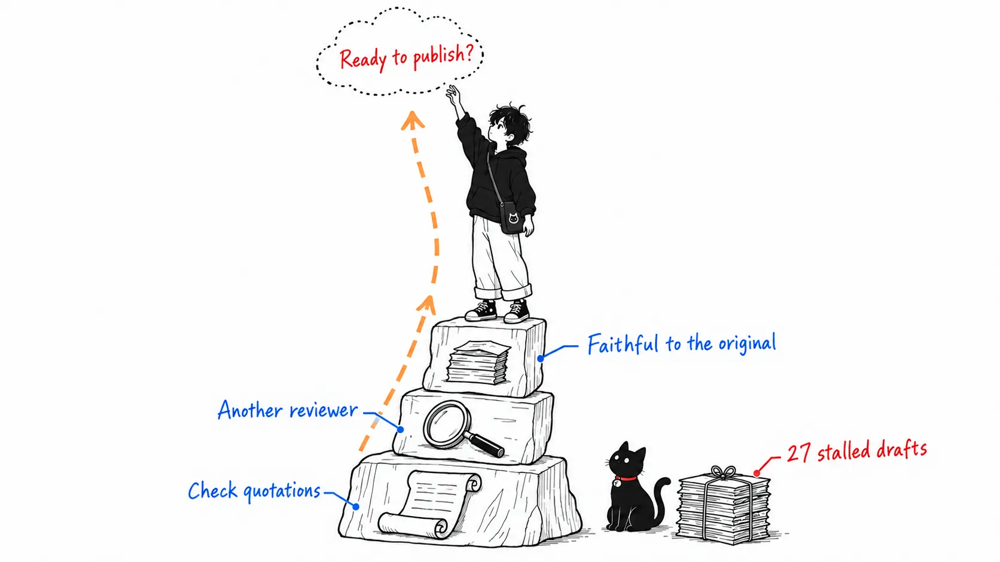

On October 13, 2026, Felix Rieseberg put a piece on his own blog called "How to be more ambitious: A tutorial for humans with models." Rieseberg is an engineering manager at Anthropic who has led engineering for Claude.ai, Cowork, and Claude Code Desktop. He is also a co-maintainer of Electron.

People in the AI industry say "everyone isn't ambitious enough" every time they see an impressive way of using it. But hearing that, you still don't know what to do. So he turned it into a procedure. That's the piece.

I read it and tried applying it to the harness that produces drafts for this blog. This blog has Claude Code write its drafts: one comes out automatically every day, and another whenever I ask for one. This is a record of applying Rieseberg's procedure to that.

Here is the conclusion up front.

> Rieseberg splits ambition into four types and attaches example prompts to three of them, leaving out "speed." But the only place he writes down "how do you know when you're done" is "use an outside judge" within "depth," and to me the other axes look like they ride on top of it. Break down his own "altitude" example, and he built the verification mechanism before raising the goal. Raise the goal with no judge, and the model says "done." What actually worked in my harness was a judge too.

---

## Only one item spells out how to judge the end

Here is how Rieseberg divides it.

> I think of ambition in four types: Speed, Altitude, Depth, and Range.

Speed is "the same work in less time." He writes that it's already well established and needs almost no cleverness in how you approach AI, so he skips it. The remaining three are the main subject.

**Altitude** is asking for outcomes, not tasks. His own example makes it clear: at the start of last year he had Claude fix crashes one at a time, and eventually he came to ask it to "keep the app crash-free."

**Depth** is getting the model to work the way a top person in that field would. Five small techniques are lined up here: make it use top-tier tools, give it an unreasonable goal and say it isn't unreasonable, make it test your own assumptions against raw data, make it produce new insights, and bring in an outside judge.

**Range** is bringing in the viewpoint of other fields. Restate nouns as verbs (a quarterly review is not a "deck" but "getting busy people to believe a causal story and make a decision in thirty minutes under uncertainty"), and assemble experts like a heist crew in the movies.

Each of the three axes comes with an example prompt you can use as is. For altitude, a prompt that raises a quarterly review in three steps. For depth, "I think churn is an onboarding problem. Try to reproduce it from the raw data." For range, how to put together a team of experts.

But what I noticed as I read is that every one of them says "what to have the model do" and almost none says "who judges whether it's done, and how." The only one that treats it head-on as its own item is the "outside judge" inside depth.

> Use an outside judge: Do not ask the model to judge itself. I assume that this will eventually be solved with increasing model intelligence, but in October 2026, I implore you to insist on outside validation. Ideally that's a tool the model can run to get feedback immediately.



## The "altitude" example was about building a judge

The crash example has a continuation. I thought this part was the real point.

> Doing this well often involves changing your workflow - in order to let Claude make sure our app is crash-free, I first had to make sure it can easily fetch crash reports, understand which app version maps to what git commit, and give it access to Windows, macOS, and Linux computers so it can actually independently reproduce and verify fixes.

All three items lined up there are material, outside the model, for judging "is it really fixed." The crash reports are evidence of the state before the fix. The mapping between versions and commits is evidence of where the cause is. The three OSes are evidence that it got fixed.

The high goal of "keep the app crash-free" becomes something you can ask for only once this exists. Conversely, ask for the same thing without it, and the model fixes something, reports "fixed," and checking whether that's true falls back to the human. The goal gets higher, but the human's effort doesn't shrink.

"Give it an unreasonable goal and say it isn't unreasonable," in the depth section, has the same structure.

> Does something seem impossible to the model? Reiterate that it's very much solvable, it just needs to keep going.

There's an example where, if you want to take a page that takes 10 seconds down to 5, you should ask for 200 milliseconds. If you have measurement tools, that's good advice. If you don't, the model might just write "it's 200 milliseconds now" and stop. I read these two pieces of advice as holding only as a pair. Rieseberg writes them as separate items, but without a judge, an unreasonable goal is just a request to "say you did it."



## Applied to my harness, the only thing I could pick was the judge

From here it's about what's on my own machine.

This blog's harness is made of a skill with the style rules, an illustration skill, the prompt for the daily automated run, and a few notes. I applied Rieseberg's three axes and had Claude come up with four proposed overhauls.

The altitude proposal raised the goal from "write one" to "write one that can be published without edits." As of October 18, 2026, I have 41 articles published on Zenn and 27 drafts that have sat for over a week without making it into the repository. The idea was to use the difference between published articles and stalled drafts as the criterion.

The depth proposal dropped the articles' self-grading and had a reviewer in a separate context judge facts and style. The range proposal wrote the work of an editor and a fact-checker into the process as steps. The remaining one was cleaning up duplicated settings.

I chose only depth.

Thinking back, the reason was the same as in Rieseberg's crash example. The altitude proposal has no judge. I couldn't find anything on my machine where I'd written down why the 27 stalled. The material for judging "publishable" exists only in my head. Raise the goal to "one that's publishable" in that state, and the model will just write the article it thinks is publishable, and the one who judges it is still me.

## I built judges and ran them on yesterday's article

I built two.

One is a script that mechanically checks quotes from the source text in an article against the original source. It checks whether each English quote appears in the original source word for word, and fails if not. It also lists numbers that don't appear in the source. Run on yesterday's published "The Six Layers of Review on the Claude Code Team," all seven quoted lines matched. On a version where I changed one word in a quote from "indefinitely" to "forever," it failed properly. The only numbers that came up as not in the source were 0.6 and 1.2, which I had worked out myself in the body. This is the output when run on the original article.

```text
原文引用: 7行を照合、NG 0行
数字: 27種類、ソースに無いもの 2種類（要確認）
  0.6, 1.2
```

The other is a reviewer that runs in a separate context. I don't hand it the notes from when I wrote the piece. I give it only the article's path and the source URL, and have it fetch and read the source itself. It looks at five things: facts, embellishment not in the source, unfounded first-person anecdotes by the writer, whether there's a section of the writer's own view, and style.

Run on the same article, it came back in 84 seconds. Zero required findings, eight recommended ones.

Here's what was in them. In the body I had written that the original article "wraps up the review's second job in the last three paragraphs." Counting, it was four paragraphs. The original's "Noise costs more when the author is an agent," I had translated as "skyrockets." Among what I'd described as "all the numbers are ones they measured themselves," a quote from a different article and Boris Cherny's personal estimate were mixed in.

All small. But every one of them had passed the writer's own check. The memory of the source that the writer holds is the summary made at the time of writing, so there's no way to check for yourself whether you've drifted from it. I thought I remembered the original's "costs more," but in my head it had already become "skyrockets."

As I write this, the eight haven't been reflected in the published article yet.



---

## My view

### Write the judge in terms of "what to do," not a "role"

In the range section there's a sentence I found the most practical.

> Don't ask the model to write like a short seller, ask it to do what a short seller does to research their position.

The depth section has a similar point: when you tell the model to act like a professional, it often switches only its vocabulary, not its method.

Looking back at my request to my own reviewer, the first line was "You are a fact-checker and editor for Japanese-language technical articles." That is exactly a role assignment. But I don't think that was what worked. I could recount the four paragraphs because there was a line saying "fetch the source yourself and read the whole text before judging. Don't trust the article's summary," and I could catch "costs more" because I'd written to compare the translation side by side with the original. I think the result wouldn't change if I deleted the role line, but I haven't tried it.

### A judge catches the kind of error the writer doesn't notice

There's one more thing. This harness already had a similar mechanism, and while I was writing yesterday's article I had another model read it too. There was a sentence it stopped. In the draft's "If I'm wrong" section, the model had written, as my background, "I'm an individual developer and have no experience running a team's approval rules." It's a disclosure in the shape of humility, and looks like a sentence that raises the article's credibility. There was no basis for it anywhere. I deleted it before publishing, so no draft containing that sentence remains. I'm noting that readers have no way to check this.

This kind of error isn't found as long as the writer grades it. The writer only has the sense of having disclosed honestly. My style rules said "don't invent experience through fabricated facts," but the reading that an anecdote in the negative form is also a fabrication didn't occur to the person who wrote it.

Rieseberg writes that the problem of having the model grade itself will eventually be solved as models get smarter. I see it a little differently. The writer overlooks things not so much from lack of ability as because they carry the context of the moment of writing exactly as it was. I think the judge's role is to provide a reader who doesn't have that context. If so, this role remains even as models get smarter.

### Altitude is bought with a judge

This is what I want to say in this article.

Rieseberg's four axes are laid out side by side, but to me they look stacked. The outside judge sits at the bottom, and you can raise altitude by exactly as much as sits on top of it. In the crash example, "keep the app crash-free" became something you could ask for only once the reports, the commit mapping, and the three OSes were all in place. In my harness, now that I have the quote check and the reviewer, "write an article that doesn't contradict the original source" has finally become a goal I can verify. I can't raise it to "write an article that can be published" yet. I still don't have the material to judge why the 27 stalled.

So I think what to do next is not to think up an altitude goal but to record the reason each stalled draft stalled, one by one. Once that accumulates, I can build a judge for "publishable."



### If I'm wrong

The biggest issue is that I haven't measured how good the judges are. Zero required findings may be because the article had no serious errors, or because the reviewer is lenient. The Claude Code team I wrote about yesterday scored its reviewers every day against a set of past incidents. My reviewer has been run once, on a single article.

Another is that this step isn't in the daily automated run yet. The automated run restricts the tools it can use with an allowlist, and launching the reviewer and running the script aren't on it. Since it's a change that widens permissions, I haven't added it. For now, this judge only works when I ask for a piece and have it written.

Also, I haven't touched here on the later part of Rieseberg's piece, the talk about self-efficacy (the degree to which you believe you can do it). It's about the human side of ambition, not the kind of thing you apply to a harness.

---

## Summary

If you take home just one thing, it's to build the judge before you raise the goal. In both Rieseberg's crash example and my blog's harness, I first built a tool that checks "was it really done" outside the model, and only then did the goal I could ask for go up a level. Raise the goal with no judge, and what increases is the reports saying "done."

---

## Sources

- Felix Rieseberg, "How to be more ambitious: A tutorial for humans with models," October 13, 2026 https://felixrieseberg.com/how-to-be-more-ambitious-a-tutorial-for-humans-with-models/
- My earlier post, "The Six Layers of Review on the Claude Code Team," October 17, 2026
