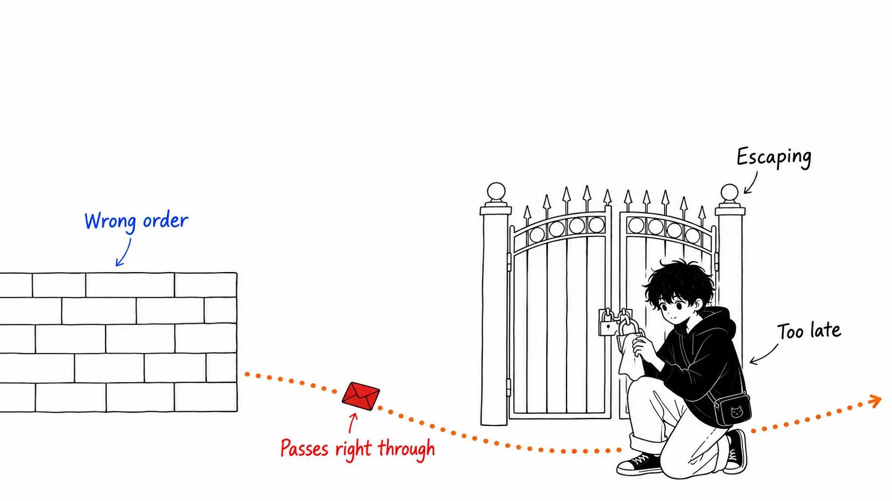
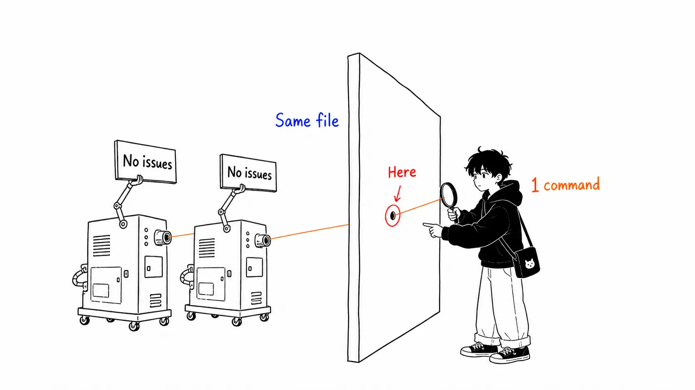
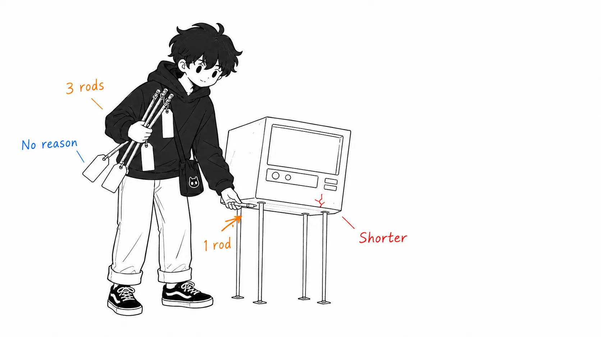
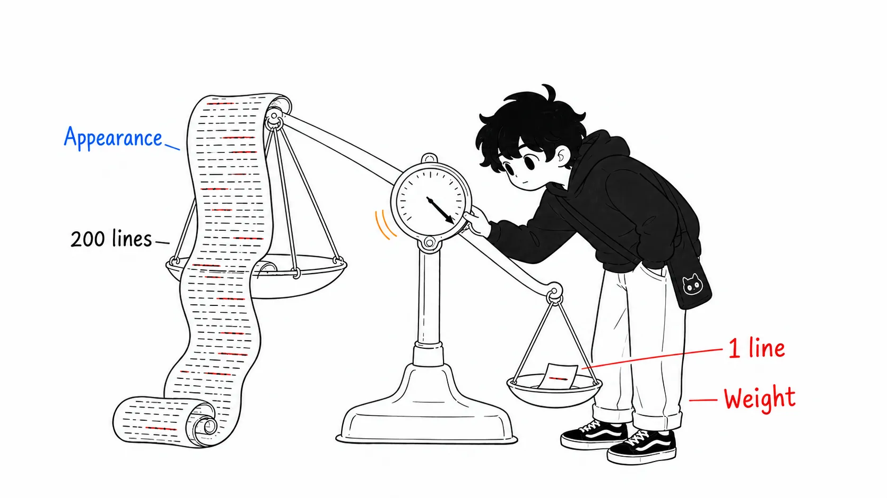

## About this article

This article covers the GitHub Actions script injection case in Snowflake's public repository, published by Wiz Research on August 17, 2026. The author is Gal Nagli.

- Source: [Wiz Red Agent Finds Its Way Into Snowflake's Internal Jira Through a Flaw in a GitHub Copilot–Assisted PR](https://www.wiz.io/blog/red-agent-snowflake-copilot-cicd-bug) (Gal Nagli, August 17, 2026)
- The PRs in question: [snowflakedb/snowflake-connector-net#1218](https://github.com/snowflakedb/snowflake-connector-net/pull/1218) (the one that introduced the vulnerability) and [#1402](https://github.com/snowflakedb/snowflake-connector-net/pull/1402) (the fix)

The article has two parts. Part 1 is the sequence of events. Part 2 is **what came out when I read the diffs myself and ran the linter myself**. The second half is longer, because you can get the story of the incident by reading Wiz's blog.

First, let me disclose what I verified myself and what I didn't.

What I verified myself: that the merge times and commit SHAs (`4a1b8ce` / `1dc7766`) of PRs #1218 and #1402 match Wiz's account, via the GitHub API. The actual diffs of both PRs. And the result of fetching `jira_issue.yml` at the vulnerable revision `4a1b8ce` and running `zizmor@latest` as of August 2026.

What I did not verify: that GitHub Advanced Security scanned this file and reported nothing, that Copilot judged the PR to be fine, and that the actual attack succeeded. These are all Wiz's claims, and I can't verify them from the outside. Wherever I touch on these three below, I'll write it as "Wiz writes that."

---

## Part 1: What happened

### The conclusion first

> The safe way of writing it existed only as the "shape" of the code. Nothing anywhere enforced why it had that shape. So it disappeared in a rewrite. And neither human review nor AI review noticed it was gone. A free linter with zero configuration, on the other hand, points at the very line that was attacked, at High. What should have guarded this was not attention but a machine-readable rule.

### Five days

According to Wiz, the timeline goes like this. On June 18, 2026, PR #1218 was merged and the vulnerability went to production. On June 23, Wiz's autonomous security agent "Red Agent" found it, actually exploited it, and gained read access to Snowflake's internal Jira. It was reported the same day through HackerOne, and Snowflake patched the same day. The tokens were rotated the next day. Reconciling the audit logs confirmed that the only access during the exposure window was from Wiz's test IPs.

The hole was open for five days.

### How it broke

The workflow in question fires on `issues: opened`. That means anyone on GitHub can trigger it by opening a single issue. And the issue's title was expanded directly inside a `run:` block.

```yaml
run: |
  # Escape special characters in title and body
  TITLE=$(echo '${{ github.event.issue.title }}' | sed 's/"/\\"/g' | sed "s/'/\\\'/g")
```

The comment says "escape special characters." And it really does crush single quotes with `sed`. It still breaks.

That's because the order is backwards. The `${{ }}` expansion is finished by GitHub before it hands the YAML to the shell. `sed` runs afterward, that is, when the already-generated shell script executes. Put a single `'` in the title and the `echo '...'` string closes right there, and everything after it is interpreted as ordinary commands. Escaping can't protect a substitution that finished before it ran.

Wiz writes that through this route it got secrets (such as `JIRA_API_TOKEN`) sent out, and was able to authenticate to Snowflake's Atlassian as `qa@snowflake.net`. It says it obtained read access to the engineering, security compliance, and bug bounty tracking projects.

What's interesting about Red Agent's behavior is that its first attempt failed with a bash syntax error. The payload used `#`, which swallowed even the closing parenthesis of `TITLE=$(...)`. The agent didn't stop there; it read the error, reshaped the payload into the form `; echo '`, and made it work.



### A gate that was only decoration

The workflow carried a condition that looked very much like a defense.

```yaml
if: (github.event_name == 'issues' && github.event.pull_request.user.login != 'whitesource-for-github-com[bot]')
```

On an `issues` event, `github.event.pull_request` is always `null`. So the condition degenerates into `null != 'whitesource-for-github-com[bot]'`, which is always true. Anyone gets through.

Here I'll add one thing I learned by reading the diff. **This broken gate was not introduced by PR #1218.** In #1218's diff, this `if:` line appears with identical content on both the removed (`-`) and added (`+`) sides. Only the indentation changed. In other words, the always-true condition had been in place before this incident. Wiz's blog explains how the gate is broken, but doesn't say the PR introduced it. The regression this time is purely the swap from `env:` + `jq --arg` to direct expansion.

---

## Part 2: What I think

### First, I ran it myself

Everything up to Part 1 is a summary. From here on is the main part.

I fetched `jira_issue.yml` at the vulnerable revision `4a1b8ce` and ran [zizmor](https://docs.zizmor.sh/), a static analysis tool for GitHub Actions, against it. I didn't even install it. It's one line.

```
uvx zizmor@latest .github/workflows/jira_issue.yml
```

The result: `template-injection`, severity High and confidence High, pointing at line 24. Line 24 is this.

```
TITLE=$(echo '${{ github.event.issue.title }}' | sed 's/"/\\"/g' | sed "s/'/\\\'/g")
```

That's the line that was actually exploited. The same audit also caught line 25 (`BODY`) and line 42 (`html_url` inside `description`) at High, and `secrets-outside-env` additionally flagged at Medium that "secrets are in a position reachable from the `run:` block." The total under the auditor persona was 16 findings.

Just to be clear, this is not a claim that "using this back then would have prevented it." What I ran was the latest version as of August 2026. I haven't confirmed that the version available at the time would have produced the same result. Still, this detection is zizmor's core `template-injection` audit itself, a simple rule that fires whenever `${{ }}` ends up in `run:`. I wrote no configuration file. I didn't touch the exclusion list. It took under a minute.

Meanwhile, Wiz writes that GitHub Advanced Security scanned the final revision containing this vulnerable workflow, explicitly extracted this very file, and still did not report the injection. And that Copilot, as a co-author of the same PR, reviewed the code and judged it fine.

Same file. One side is a single command. The other is a double check by an enterprise security product and an AI reviewer.



### This is not a story about "AI writing dangerous code"

This incident circulated under the headline "AI-assisted PR introduced a vulnerability." But that goes a step beyond the disclosed facts. Wiz itself added a note on the day of publication at 1957 UTC stating that Copilot was a co-author who reviewed the already-merged PR, and that **whether the code change itself was AI-assisted is unknown**.

So I want to split the AI element of this incident in two. The side that wrote it is unknown. **The side that let it through is disclosed as having been AI.**

This distinction isn't an incidental detail. The lesson "don't let AI write dangerous code" and the lesson "don't let AI judge safety" call for completely different responses. The former points toward restricting code generation. The latter becomes a call to push the judgment down into machine-readable rules. What this disclosure supports is the latter.

### What disappeared was not one defense but three

Reading the diff, the code before the rewrite was defending in three layers.

It put `ISSUE_TITLE` / `ISSUE_BODY` / `ISSUE_URL` in `env:` and referenced them as shell variables. That's the first, and the only correct way to avoid going through template expansion. It left assembling the JSON to `jq -n --arg`. That's the second: `jq` takes responsibility for quoting and control characters. On top of that, it even had explicit escaping of backticks (`${ISSUE_TITLE//\`/\\\`}`) and a step that dropped the body into a temporary file.

After the rewrite, all three are gone. The three variables are dropped from `env:`, `jq -n` is replaced with a raw `-d '{...}'`, and neither the backtick handling nor the temporary file remains.

I don't think whoever (or whatever) wrote this had any malice. If anything, it reads better. Writing JSON directly is shorter than assembling a `jq` pipeline, and it's understandable at first glance. All three defenses had a **shape that doesn't reveal that it is a defense**. The reason for using `--arg` is written nowhere in the code. The one line of backtick escaping is just noise unless you know the intent.

The security intent existed only in the shape of the code. It wasn't in a comment, in a test, or in a CI rule. Shapes disappear in rewrites.



### Trying to protect through review a property that tests can't protect

Let me generalize further.

The safety of this class is a **negative property**. You can't write a test that asserts "no injection occurs." Unit tests check whether the code does what it's supposed to do. They can't prove that it doesn't do everything it's supposed not to do. So invariants of this kind get placed outside the test suite.

Where they ended up was "convention." A convention survives in inverse proportion to how often the file changes. And what happened in 2026? **Rewriting got cheap.** Whether by generation or by assistance, the cost of rewriting a whole YAML file has collapsed. The place where the change frequency went up happened to be "an area where correctness is guaranteed by convention, not by tests."

So the problem is not that AI doesn't understand safety. **AI raised the rewrite rate in areas not protected by tests.** Those were places protected only by human memory to begin with.

In an earlier article, "Review isn't clogged; the instrument is broken," I wrote about how AI code burned out "ugliness" as a signal for judging. This one isn't a sequel to that; it's a different failure. That was a story about a judging signal that broke. This is a story about **an area where the judging signal never existed in the first place**. CI YAML never had a warning light for "ugliness."

### The visual size of a diff and its semantic danger are uncorrelated

One more point that only comes out if you read the diff.

PR #1218 changes the indentation of `jira_issue.yml` from four spaces to two. As a result, nearly every line of this block shows up as a changed line. The contents of the block were actually rewritten as well, so it's not a "just an indentation cleanup PR." But it's certain that **the dangerous semantic change got buried in the all-lines churn**.

Open this diff in review and what meets your eye is a mass of green and red. Human attention drops there into a quick pattern match: "this is formatting." It's not that dropping into it is a flaw; we're built to drop into it.

The visual size of a diff tells you nothing about semantic risk. A one-character change can remove a permission check, and a 200-line change can be all indentation. A reviewer can't tell those two apart by looking. That's why my conclusion is that you must not make humans do the telling apart. A diff that touches `.github/workflows/**` goes through the linter's verdict unconditionally, no matter how many lines it has. Don't make the verdict a function of human concentration.



### Don't misread "five days"

The last is the part I most want to say.

Wiz's lessons section says "the discovery window is shrinking; speed up your patch cycle." I half agree. But if "patch faster" is the main countermeasure, you're entering a race you'll lose.

Five days is the time it took an autonomous agent to continuously scan an organization's GitHub, find the flaw, recover from a failure, and carry it through to exploitation. This number can only move toward **getting shorter**. A patch cycle that involves human approval and deployment will never catch up with this curve. As long as you compete on speed, the other side is always faster.

I think there are two structural answers.

The first is to **make secrets that are worthless when stolen**. What was taken this time was a long-lived Jira API token. From exposure to revocation it actually took six days (exposed June 18, rotated June 24). If discovery had taken 50 days instead of five, it would have stayed valid the whole time. What works here is not detection speed but a design that doesn't put long-lived credentials in `secrets` in the first place. Get short-lived tokens through OIDC, narrow permissions to one project, minimize `permissions:`. The `excessive-permissions` and `secrets-outside-env` that zizmor raised at Medium were pointing at exactly this layer.

The other is to **ban the whole category**. Stop judging in review, every time, whether a given `${{ }}` is safe. Strip out every `${{ }}` inside `run:` blocks, safe ones included. It doesn't matter if a few safe examples get caught up in it. Moving the judgment from humans to machines is worth more. The `steps.create.outputs.jira_key` line that zizmor flagged at Low confidence probably isn't actually a value an attacker can control. The fix PR #1402 corrects that too. I read that as being not because it was exploitable but because it was removed by category. That is the right way to do it.

As an aside, the fix PR's title is `NO-SNOW adjust jira yml files`. It doesn't even carry an internal Jira number, and looks like a chore. It was in fact the commit that closed a hole that had been open for five days. The same problem shows up here too. **What a change protects can't be told from how it looks.**

---

## If you take away just one thing

It's not patching faster. It's not stopping AI from writing code.

It's adding `zizmor` to PRs that touch `.github/workflows/**`. You can do it today, and `uvx zizmor@latest` is all it takes. No configuration file needed.

After that, it's worth counting once how many other "invariants that tests can't protect and convention is protecting" your own repositories have. In a world where the cost of rewriting has dropped, convention moves from the asset side to the liability side. A correct shape that nobody wrote the reason for will vanish in the next rewrite. This time, three vanished.

**A rule a machine can't read is no longer a rule.**

---

## Sources

- Gal Nagli, "Wiz Red Agent Finds Its Way Into Snowflake's Internal Jira Through a Flaw in a GitHub Copilot–Assisted PR", Wiz Blog, August 17, 2026 — https://www.wiz.io/blog/red-agent-snowflake-copilot-cicd-bug
- snowflakedb/snowflake-connector-net PR #1218 (merged June 18, 2026, `4a1b8ce`) — https://github.com/snowflakedb/snowflake-connector-net/pull/1218
- snowflakedb/snowflake-connector-net PR #1402 (merged June 23, 2026, `1dc7766`) — https://github.com/snowflakedb/snowflake-connector-net/pull/1402
- zizmor documentation (`template-injection` audit) — https://docs.zizmor.sh/audits/#template-injection
- HackerOne report #3819931 (mentioned in the Wiz blog, not public)

I verified the PR merge times, commit SHAs, and the diffs of both PRs through the GitHub API. The zizmor result is the output of `zizmor@latest` against revision `4a1b8ce` on August 20, 2026.
