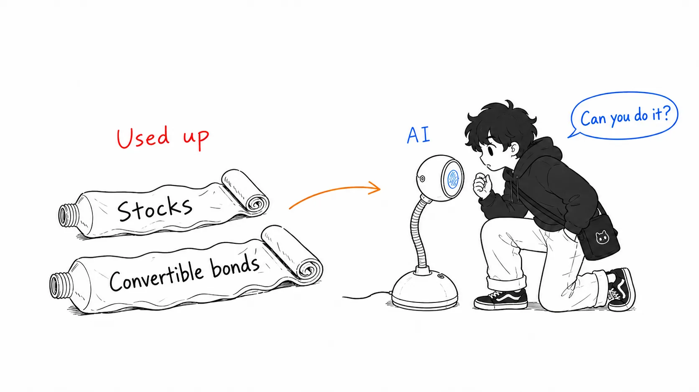
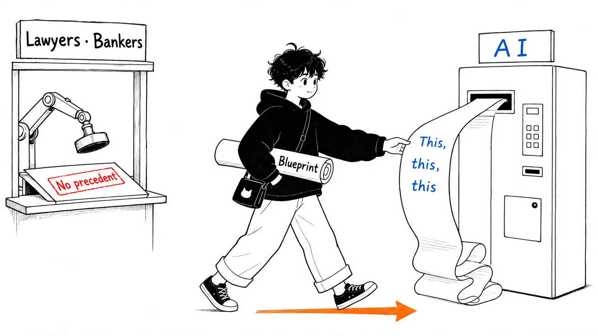
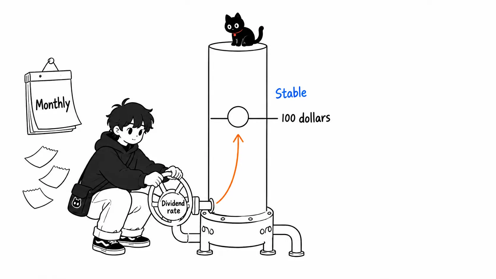
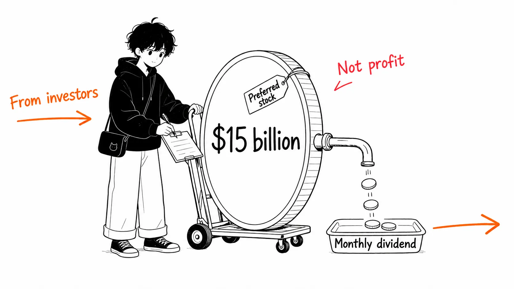
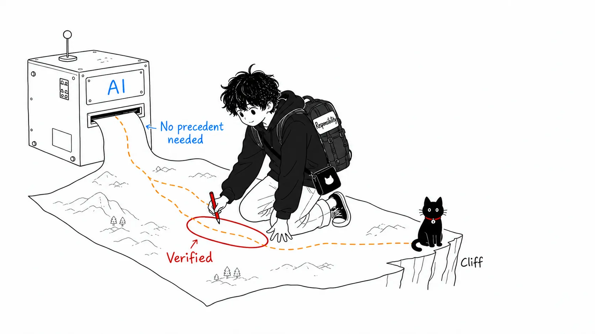

## About This Article

On August 6, 2026, Michael Saylor, executive chairman of Strategy (formerly MicroStrategy), appeared on the podcast "The Diary of a CEO" (host: Steven Bartlett). Media outlets cut out just one point, "ChatGPT made a billionaire $15 billion," but the full episode runs about two hours, and the AI discussion is only part of it.

This article is not a summary of the headlines. I pulled the full interview (YouTube's auto-generated subtitles, about 19,000 words), mechanically extracted the relevant passages, checked them against the news coverage, and then organized the piece around what he actually said. All quotations are drawn from the subtitles in my own wording, and I can't guarantee verbatim accuracy.

Here is the big picture first.

> The interview rests on three pillars. (1) How he **raised** about $15 billion with preferred stock designed together with ChatGPT ("earned" is inaccurate; legally it's equity, but economically it's closer to debt). (2) A theory of working in the AI era: "Don't try to work longer than the robot. Have AI do things no one has ever done." (3) The defense during the bitcoin decline (in 2026, BTC −26% and Strategy stock −38%). The three aren't independent stories. They're connected by a single worldview: AI as "a tool for doing what has no precedent."

## Pillar 1: How the $15 Billion Was Raised, Starting from a Dead End

The $15 billion story begins less as a success story than as a stalemate. As of 2025, Strategy held about $30 billion worth of bitcoin and was looking for money to buy more. But:

- Raising money through stock issuance was "maxed out"
- Convertible bonds: he had issued until he was the largest issuer in the world, and that was "maxed out" too

In other words, the traditional means of raising money had run dry.

Here he turns to AI.

> I went to the AI and started exploring how to design a preferred stock. I wanted to create an intermediate, hybrid security that was neither common stock nor a bond.

The first thing built was STRK, a convertible preferred backed by bitcoin. A "combination of financial engineering, digital asset engineering, legal, and securities law," with zero precedent. The experts' reactions were uniform.

> Their answer was, "No one has ever done this. People don't do things like that. So I don't think you should."

Then he went further, aiming for a "money-market-like preferred stock" that trades stably near its $100 par value. To keep the price stable, the dividend rate has to be adjustable every month. This is the core exchange.

> No one in human history has created a preferred stock with a variable dividend rate. Is it illegal? No. So why has no one done it? Because there was no reason to. No one thought of it. Lawyers, bankers, traditional investors all say, "I've never seen that. I don't know if it can be done." When we ask AI, "Can it be done?", it comes back with, "Of course. Just do this and this and this."

Asked "which AI," the answer was one phrase: "ChatGPT. OpenAI."

The variable-dividend preferred stock (STRC) born this way raised $2.5 billion in its IPO (the largest of the year at the time) and $8 billion in additional issuance, and together with about $4 billion across the other preferred series came to about $15 billion. That is what's inside "ChatGPT made me $15 billion."

## A Supplement to Pillar 1: "Earned" Is Wrong; It's Really Closer to Borrowing

Let me sort out the numbers. First, what's inside the "$15 billion." All of it is money received from selling preferred stock to investors.

| Breakdown of the "$15 billion" | Amount (per his statements) |
|---|---|
| STRC IPO | $2.5 billion |
| STRC additional issuance | $8 billion |
| Other preferred stock | about $4 billion |
| Total | about $15 billion |

Next, the balances at the time of the interview (also per his statements). Convertible bonds about $6.5 billion, preferred stock about $15 billion, holdings about $58 billion. He also claims that "even if bitcoin fell to $5,000 a coin, we'd be over-collateralized against the debt."

What tends to get overlooked is the caveat he himself attaches.

> We essentially sold $15 billion of credit. That kind of equates to the company creating $15 billion.

"Kind of equates to." This $15 billion is not profit. Then was it "a loan"? That isn't strictly right either. Preferred stock is, legally, still equity, and there's no obligation to repay principal. But a monthly dividend comes attached, and the design is such that if you don't pay it, the product's credibility collapses. His own "we sold credit" is closest to reality, which is to say **funding that takes the form of equity but is closer to debt**. The headline that reported it as "earned" is inaccurate twice over.

## Pillar 2: His Theory of AI, "Govern the Search Space"

This is the part the media have barely picked up. The famous passage at the start went like this.

> Don't try to work longer than the robot. What you should do is have AI do "things no one has ever done."

Heard alone, that's self-help, but in the full episode it gets one level more concrete. When Bartlett shows off how he uses it ("I ask AI 'what books should I read,' have it write that book in 20 pages, turn it into an MP3, and listen during my 43-minute commute"), Saylor replies:

> You're using that as an example, but in the end you need to **govern the state space**. Anyone can say "what should I listen to." The real question is: what are the constraints on the input? A baker in Lagos and a firefighter in Los Angeles have completely different conditions. Which state space do you explore to produce a contribution?

It's rare for an executive to talk about using AI in an engineering term like "state space." The $15 billion story was brought up as an instance of this general principle (the space explored: "a security design that was legal but that no one had a reason to try").

He also leaves an ironic observation about writing in the AI era.

> Ironically, these days when you send someone a message, if you want to prove you wrote it yourself, you have to put in mistakes on purpose. If there are mistakes, people will believe "they probably typed it themselves." AI writes like a 20-year veteran copy editor with a PhD in English. If you've written something imperfect, it's not because you're imperfect, it's because you're lazy.

On the figure Bartlett cited, that "only 2% of households have an AI subscription," he answered that "for an entrepreneur, becoming proficient with multiple AIs is a basic education on par with reading, writing, and arithmetic."

## Pillar 3: Defense in the Downturn, and Why He Sold Bitcoin

At the time of the 2026 interview, bitcoin was down 26% year to date and Strategy stock was down 38% (Cryptopolitan). Bartlett also confronted him frankly: "A few months ago everyone was saying 'currency of the future,' and now everyone's saying 'it was a Ponzi after all.'" The latter half is nearly all defense.

What's interesting is how he recasts the much-criticized "selling bitcoin to pay dividends" as a proactive move.

> The short sellers operate on the premise that "the biggest buyer can't sell bitcoin. If they sell, it collapses." To break that, you have to actually sell and show it. When we sold, the price actually went up. Our break-even is 3.2% a year, and if bitcoin rises by that much, we can pay the dividends forever from sales alone.

In other words, the narrative of "can't sell" itself damages the price of a credit product, so he deliberately sold to prove it "can be sold." I can't judge whether that's bravado or rational. But the structure in which the $15 billion fundraising story and this defense are told together (selling off the underlying asset to protect the dividends on the credit product raised) is something you'd never see from the article headlines.

## My View

Three points.

### 1. ChatGPT wasn't competent; the lawyers' "no" had a structural reason

What I find most interesting in this episode is why the experts' answer and ChatGPT's diverged. I don't think it's a difference in ability. It's a **difference in incentives**.

When lawyers and bankers say "don't" to a scheme with no precedent, it isn't because they're incompetent but because they're the ones who bear their careers and liability if something goes wrong on an unprecedented deal. "No one has ever done it" works as a rational reason for rejection in the experts' world.

ChatGPT has no career. No liability. So it can answer immediately. What Saylor got was not superhuman financial intelligence but **a search space without the bias of self-protection**. In his own words, AI doesn't prune the state space that experts prune for the sake of their incentives.

### 2. But that same property also helps push someone, somewhere, toward ruin

"Not afraid of having no precedent" and "doesn't stop bad ideas" are two sides of the same property. With the same confidence that ChatGPT told Saylor "of course it can be done," it must be telling someone else's poorly conceived scheme "of course it can be done." We can hear this story only because the fundraising worked (so far), which is classic survivorship bias. And the stock price of the company in question is down 38%.

It's hard to see in Saylor's story, but in practice, after AI's "it can be done," the lawyers' securities-law review, the underwriting, and the SEC registration all ran. **AI proposed, and humans took the responsibility.** "We'll do it because ChatGPT said yes," with that division of labor missing, is just recklessness.

### 3. What engineers can take home is not the "don't compete with the robot" part

Generalizing what Saylor did: "He explored, with a tool that has no reason to say no, a domain where experts have reasons not to act." In the world of code, that corresponds to a use where, when someone says "this architecture has no precedent," you have AI separate whether that "no precedent" is a technical constraint or merely custom.

Conversely, the moment you use an AI answer as the basis for "it can be done because it said so," this picture collapses. Exploration is AI's; verification and responsibility are yours. Saylor's $15 billion also, in the end, holds up on that division of labor.

## Summary

If you take away just one thing: **AI isn't afraid of having no precedent. But it doesn't take responsibility either.** The headline "ChatGPT earned $15 billion" drops both the nature of the amount (not profit but funding closer to debt) and this division-of-labor structure.

Saylor also talked about the same thing at his company's developer conference in May 2025 (saying he designed the convertible preferred with ChatGPT's Deep Research; per Forbes JAPAN), so this isn't its first appearance. It was an interview worth going to the primary source for, including the context of why he's pushing this story to the front now, in the downturn.

### Sources

- The Diary of a CEO (August 6, 2026) "The Man Who Owns 4% Of All Bitcoin: 'I Made $15 Billion By Using ChatGPT!'" (YouTube: 1aGpJQ8BMLI)
- Coverage by Fortune (August 6, 2026), Forbes / Forbes JAPAN (August 9-10, 2026), CryptoSlate, Benzinga, and Cryptopolitan
