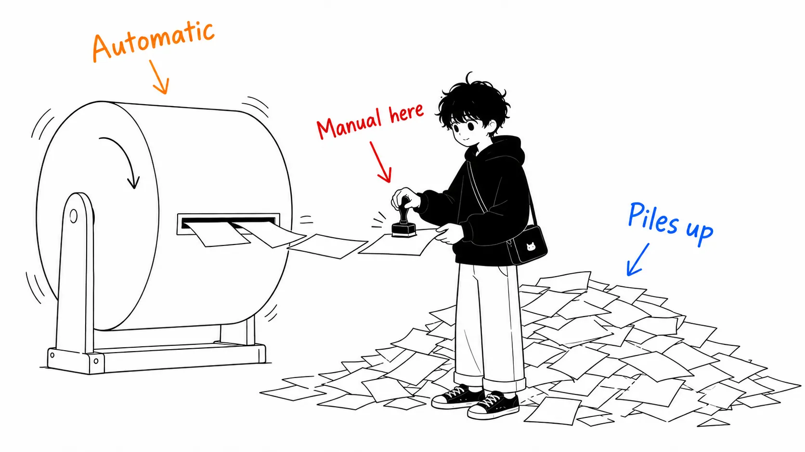
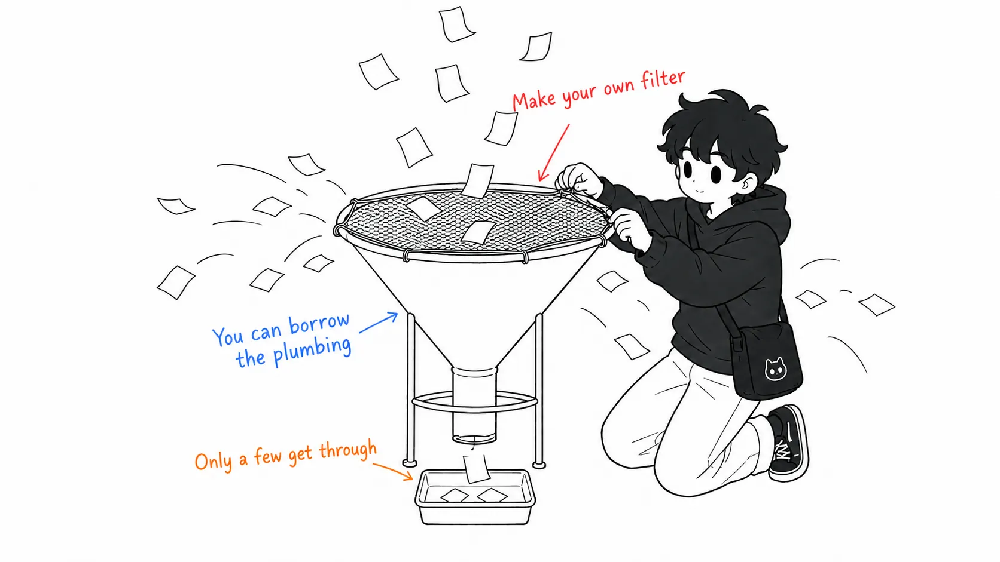

Here is the conclusion first.

> What Warp's "self-improving agent" automates is **everything up to bundling feedback into a proposed diff to a skill**. After that it's an ordinary PR: review, approve, merge. That's not a weakness. It's the right design. But once you understand it that way, one line item gets added to the cost. **What you review grows beyond code to include "skill PRs."** And the heaviest sentence in the original wasn't in the body. It was in the FAQ table at the end: "assume the feedback is wrong." The hard part isn't the loop. It's the entrance.

## About This Article

- Original: [How Warp builds self-improving agents on Claude](https://claude.com/blog/how-warp-builds-self-improving-agents-on-claude) by Michael Segner, August 26, 2026 (claude.com)

It's a case study of Warp, the AI terminal (founded in 2020, CEO Zach Lloyd), which built a skill-based self-improvement loop after the output of its internal code-review agent turned out to be unusable.

As with the last one, this is an article from Anthropic's own blog, so the way to read it as vendor material is the same. The numbers lined up at the top (800K monthly developers, 56% of the Fortune 500, a cumulative 10 million Claude Code sessions run inside Warp, over 400,000 per week) are also self-reported, and I haven't verified them. I covered that point last time, so I won't repeat it. **The value of this article lies not in the numbers but in the mechanism being concrete.**

An honest disclosure: I haven't watched the webinar linked at the end of the article (it comes with a live demo). I don't use Warp either. All I read was the body of the web article.

## The Mechanism Really Is Simple

First, the mechanism. This part is short.

- **inner / base skill**: Holds domain knowledge and procedure. When a PR is opened, the code-review agent reads this skill and produces a review
- **Human feedback**: A person writes about the output: "good," or "this is off, because in our conventions…" The place for writing it is the comment field of the PR or issue, that is, where the work is already happening
- **outer / improver skill**: An observer agent. It runs **on a schedule**, not per task. It pulls in the accumulated feedback, matches the agent's proposals against the humans' reactions, and proposes **small, focused edits** to the base skill

A skill is just a file, so the edits arrive as a PR. You review, approve, and merge. The next time the inner skill runs, the improvement is reflected.

In Zach Lloyd's words:

> "The framework is really simple: there's a domain-specific base skill, and there's an improver skill that refines it. That simplicity is the beauty of this approach."

It really is simple. And because it's simple, you can copy it. I honestly thought this was a good article.

## So What Exactly Is Automatic in "Self-Improving"?

What snagged me was the name.

What the machine does in this loop is **read the feedback, write the diff, and open the PR, and that's where it stops**. What goes into the base skill is decided by the human who approves at the end. The original says so too.

> A human reviews, approves, and merges, and the next run of the triage skill inherits the new knowledge. That final human step closes the loop and keeps a person in control of what actually changes.

So, to be precise, it's **not self-improving but auto-drafting**. Not self-improvement, but automatic drafts.

This isn't a criticism. The mechanism is usable because a person stands at the end, and nobody would put a skill into production if it rewrote itself on its own. **What I want to say is that the name hides a cost.**

"Self-improving" sounds hands-off. What actually happens is the opposite: **one more queue of reviews**.

- Before: review code PRs
- After adoption: review code PRs + **review the skill PRs the improver sends**

And the latter review is harder than the former. With a code PR you just look at "is this change correct?", but with a skill PR you're looking at "**is this generalization correct?**" Is a principle extracted from one piece of feedback safe to apply to the next 100 you haven't seen yet? That is a kind of question that's hard to judge by eye.

Take the example in the original: the triage agent failed to apply the `ready to spec` label, a maintainer pointed it out with a reason, and the improver proposed an edit saying "if the problem is real, apply `ready to spec` even if the shape of the UI/UX isn't settled yet." Whether that edit is sound **can't be told from looking at this case**. Its soundness is decided by future issues.

Warp is at a scale that can bear this load (hundreds of contributors to open-source repositories, thousands of code reviews). **If a small team adds this loop, the review budget may fall short of the skill PRs it generates**, is my concern. The original doesn't touch on this.

## The FAQ Weighs More Than the Body

At the end of the original there is a Q&A table called "Best practices from the Warp team." The heaviest part was in there.

> **What happens when the feedback is wrong?**
> Assume it will be. Don't let the agent accept feedback blindly — give it context to sanity-check, filter whose input counts, and keep a human in the loop at either the filtering or final-review stage.

"Assume the feedback is wrong." And "**filter whose input counts**."

And another row:

> Where you must use human feedback, restrict it to domain experts — don't open the floodgates.

The body's claim is "make it easy to collect feedback; the lower the friction, the more signal flows" (Make feedback effortless to give). The FAQ's claim is "narrow down whose voice gets through." They're compatible, but **they don't point the same way**. One says widen the entrance, the other says put a selection step at the entrance.

I think the tension between these two is the hardest part of this mechanism. And the body and the FAQ weigh them in reverse. The reason is the same as what I wrote in the last article: **widening is easy to write about, narrowing is hard to write about**.

What's more, these two differ in reusability. Zach himself says:

> "Apart from the domain-specific knowledge, this is a pretty reusable mechanism. The improver skill for a code-review agent isn't all that different from the improver skill for any other agent."

In other words, **the pipe is reusable**. The filter is not. "Whose feedback qualifies to go into a skill" is a per-organization judgment, or rather a per-person one, and it can't be copied. **The simple part is the plumbing; the hard part is the entrance.** When the original says "this simplicity is the beauty," it means the plumbing, and that's right. But whoever borrows the plumbing has to build their own filter.

## A Third Thing, Neither Skill Nor Memory

The first row of the FAQ was good too, so I'll quote it.

> **Are you conflating skills with memory?**
> Skills are procedural and stable—"how to do X," run-agnostic, changed deliberately. Memory is auto-written by the agent at inference time and never stops changing.

Skills are procedural and stable, independent of any run, and **deliberately** changed. Memory is written automatically by the agent at inference time and never stops changing.

The distinction itself has been made before, but the interesting part is that **Warp's loop creates a third thing that is neither of these**.

| | Who writes it | When it changes | Approval |
| --- | --- | --- | --- |
| memory | The agent | Every inference | None |
| skill (conventional) | A human | When a person edits it | Implicit (whoever wrote it) |
| Warp's loop | The agent drafts it | Every scheduled run | **Explicit PR review** |

It combines memory's "the agent writes it" nature with a skill's "changes deliberately" nature. It changes automatically, but a change needs approval.

The reason this matters is that you can see **what makes memory hard to use isn't "automatic" but "no approval."** I used to treat memory features as "can't be trusted because it remembers weird things on its own," but the problem wasn't the automatic writing itself. It was that there was no veto over the writes. Warp's design puts a veto there, in the form of a PR.

Thinking of it that way, I believe **"reviewable self-modification"** points more accurately at what's new than the "self-improving" in this article's title.

## Put the Three Side by Side and They Reach the Same Conclusion from Three Directions

By chance I read three pieces on nearby topics over the last few days. Putting them side by side showed their positions relative to each other, so I'm writing it down.

**1. Warp (this article): "Write principles, not rules"**

> "Structure your skill like instructions to a smart person, not like programming a computer. An instruction like 'look for duplicated code' steers better than an exhaustive list of variable-naming rules."

It goes on to say to explain the why. With a reason, an agent can reason; with rules alone, it goes rigid.

**2. Cainex (from the [guide for startups](https://claude.com/blog/claude-code-guide-for-startups)): "Fix principles, not cases"**

A medical-coding company "fixed" things by encoding individual cases, and instead of getting smarter, ended up accumulating patches. The principle comes from that failure. They **set a cap on the number of individual items that can go into a single change**.

**3. Maurice Heumann (auditing 2GB of session logs): "Soft instructions don't work. Mechanical blockers are more effective"**

He kept telling the agent "don't run tests locally" and it didn't listen, so he disabled test execution on the code side.

1 and 2 say the same thing. **Warp supplied the mechanism, and Cainex supplied the cap.** The improver skill "proposing the smallest edit" and Cainex "limiting the number of concrete examples that can go in" are different prescriptions for the same problem. Two independent companies landing in the same place puts this in the category I'd trust.

3 seems at first to point the opposite way. A skill is a soft instruction, so it looks like a head-on collision with "soft instructions don't work." But put them side by side and you can draw a boundary.

**What can be blocked mechanically doesn't go in a skill. A skill holds only the judgment that can't be mechanized.**

Everything Heumann eliminated could be mechanized (don't run tests → disable execution; don't poll CI → notify by webhook; don't check whether an issue is closed → auto-close with `Fix #N`). What Warp's skill handles, on the other hand, is "does this variable name match our conventions?" and "is this issue in a state where we can start writing a spec?" Hooks can't judge those.

Reduced to one sentence, my understanding of the three is this: **rules go to the machine, principles go to the skill, and when you change a skill, take only the smallest generalization from a single piece of feedback.**

## The Minimal Version I'd Actually Do

I can't copy Warp's scale, so I cut what can be cut.

**What I'd do: collect feedback in one place.** This much you can do starting today. Decide where to write it the moment you think "this is wrong, because…" about an agent's output. As the original points out, **the place to write it should be where the work is happening**, and the moment you make people open a separate form, it stops getting written.

**What I wouldn't do: make the improver a scheduled run.** That's a story of a growing PR queue, and I think it doesn't pay off while you're working alone. Instead, decide for yourself when to look at the accumulated feedback, and only then say "read this and propose the smallest edit to the skill." What gets automated is the generation of proposals, not the frequency of execution. That's the split.

**A rule for the entrance: don't wave through even your own feedback as is.** The FAQ's "assume the feedback is wrong" reads like it's about other people, but if you're working alone, the one it applies to is you. A "why does it do that?!" written in irritation is not signal. Half of my feedback is probably this.

## If You Take Away Just One Thing

**Check how far the automation goes by the boundary, not by the name.**

The actual boundary of "self-improving" was "up to drafting the diff." Once you check the boundary, you can see what remains beyond it (that is, the work you end up doing). In this case what remained was **review**, and a kind of review harder to judge than code review: "is this generalization correct for future inputs?"

I think it's worth adopting. But it's not only the quality of the skills that grows.

## Sources

- Michael Segner, [How Warp builds self-improving agents on Claude](https://claude.com/blog/how-warp-builds-self-improving-agents-on-claude), claude.com, August 26, 2026
- Michael Segner, [The Claude Code guide for startups](https://claude.com/blog/claude-code-guide-for-startups), claude.com, August 20, 2026 (referenced for the Cainex case)
- Maurice Heumann, [235 Billion Tokens Later: Auditing What The AI Agents Really Did](https://momo5502.com/posts/2026-08-22-mw2-decompilation-audit/), momo5502.com, August 22, 2026 (referenced in the section "Put the Three Side by Side")

All quotations are from the above. I haven't watched the webinar, and I don't use Warp itself. The growth figures at the top are self-reported, as in the original, and unverified. The analysis from the section "So What Exactly Is Automatic in 'Self-Improving'?" onward, and how I position the three pieces, are my reading, not claims of the original.
