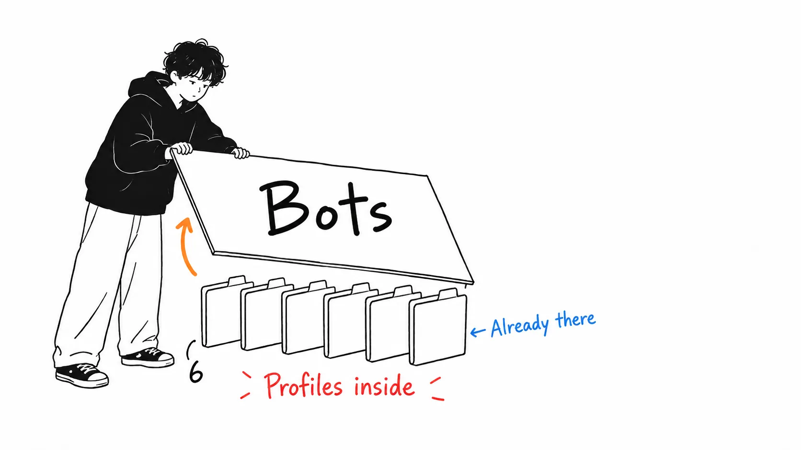
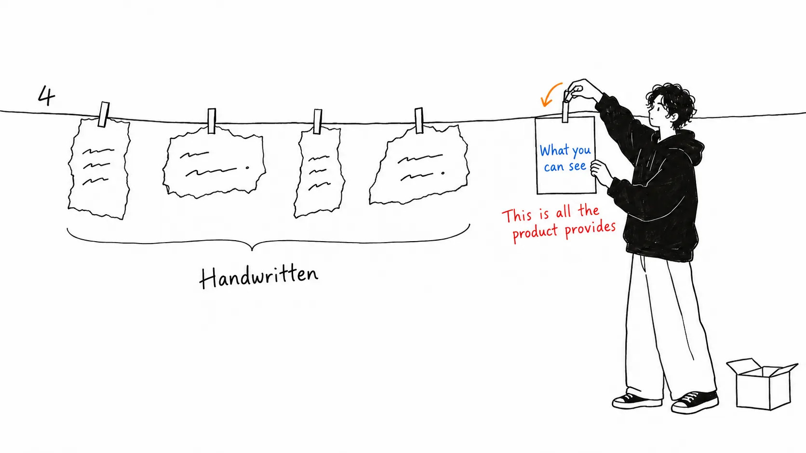
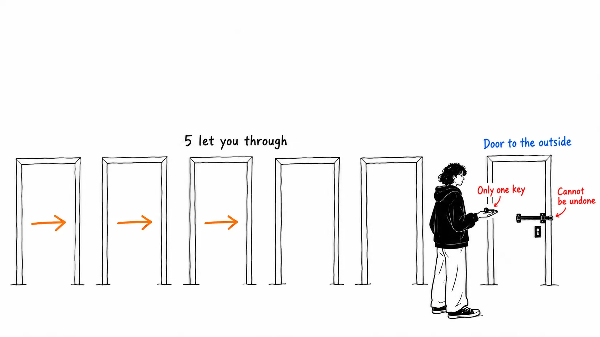

Conclusion first.

> The product is real. Bot Mode was also released on August 16, as the article says. But the official documentation itself says "**there is no new primitive to learn; a Bot is a Hermes profile.**" The six role contracts and the handoff records that the article presents as its value are a design that **holds up even without Bot Mode.** That's what's portable.

## About this article

The original is [@VibeMarketer_'s X Article](https://x.com/vibemarketer_/status/2093330541177352217), "How to Build a One-Person Media Company With Hermes Bots" (August 28, 2026). It explains a setup for building a one-person media company out of six bots.

First, checking the product. It matched the article's description.

| The article's description | Reality |
| --- | --- |
| hermes agent's August 16 release | `NousResearch/hermes-agent` **v0.20.3 (v2026.8.16.2), August 16, 2026**. MIT |
| bot mode | Bundled with desktop and default-on in the same release |
| profiles (separate memory, sessions, skills) | Isolated under `~/.hermes/profiles/<name>/` |
| kanban (dependencies, comments, review, retries) | sqlite-based. The first plugin on the plugin SDK |

**An honest disclosure.** I haven't installed Hermes. What follows is the result of reading only the original article, Hermes's official documentation, release notes, and GitHub diffs, and MarkTechPost's coverage. I haven't actually run the six bots.

## The official docs were more modest than the article

The Bot Mode documentation says this.

> **There is no new primitive to learn: a Bot is a Hermes profile** — isolated config, memory, skills, credentials, and chat history under `~/.hermes/profiles/<name>/`. **Bot Mode is a UI over that primitive**, so everything you do in it is visible from the CLI too.

On top of that, it even includes a correspondence table.

| Action in Bot Mode | Shell equivalent |
| --- | --- |
| Talk to a bot | `hermes -p <name> chat` |
| A bot's files, skills, memory | `~/.hermes/profiles/<name>/` |
| Routines (scheduled runs) | `hermes cron list` (listed under names like `[bot:<name>]`) |
| Create and inspect profiles | `hermes profile create`, `hermes profile list` |

Messages between bots, according to MarkTechPost, are in substance CLI handoffs too. `hermes -p <name> chat -c "Agent Inbox" -q "..."` is what's being sent.

In other words, the "six-bot team" is **six profile directories, a sqlite board, and a UI with a face layered on top.** The article says "the three layers of bot mode / profiles / kanban supplied the pieces that were needed," but profiles were there before. What was added on August 16 was **being visible.**

## The article lists four things you need, and the product hands out one of them

Here I'll quote the article's own best sentence.

> this is why six independent chatbots are not a media company. they need **clear ownership, shared context, structured handoffs, and one feedback loop**.

I think that's right. And when you line them up, **Bot Mode hands out none of these four.**

| What's needed | Where it comes from |
| --- | --- |
| Clear ownership | The role contract the author wrote (owns / reads / returns / must not / done when) |
| Shared context | The structure of the obsidian vault the author designed |
| Structured handoffs | The campaign record fields the author decided |
| One feedback loop | The performance → playbook line the author drew |
| (Visibility) | **Bot Mode** |

All four are the author's design. What Bot Mode adds is the fifth row, visibility, and nothing else. kanban is a container that **carries** handoffs, but what gets carried is decided by the author's field definitions.

That's why it's portable. Any mechanism that lets you separate profiles will do. Claude Code's settings directory, separate repositories, six folders. **The format of the role contract is the real substance.**

- **owns**: the decisions this bot is responsible for
- **reads**: the files and handoff fields it may use
- **returns**: the shape of the deliverable the next bot receives
- **must not**: decisions that belong to another bot or a human
- **done when**: an observable condition under which the handoff can be called complete

The last two are what count. Without `must not` and `done when`, every bot ends up with the same broad instruction to "make good content." By the article's own phrasing, that's the shortest path to breaking a multi-agent workflow.

## There's one limit the article doesn't mention

I found it while reading the release notes and the documentation. Group chats have a restriction.

> Group chats open a shared room for **two to six bots**. Your message triggers up to **three serial rounds** of member turns.

Two to six bots, at most three rounds. The article's setup is exactly six bots, so **a room with everyone in it is exactly at the headcount cap.** And it gets cut off at three rounds.

The article's design doesn't run into this. It's a serial flow of signal scout → researcher → strategist → writer → distribution → editor, in a form that kanban carries. The article states explicitly that you should **keep state in files and kanban rather than coordinating through conversation.**

> use conversation for coordination. use files and kanban for state.

That one line ends up making a design that doesn't hit the three-round cap. Whether the author wrote it knowing about the cap or by chance, I can't tell from the article. But I think **the decision not to keep state in conversation is right whether or not there's a cap.** Conversations disappear, and order isn't guaranteed.

## There's one number from someone else, and I can't check it

The article says this.

> this is the exaxt system that has helped me generate over **5.8 million impressions** on X account in just the past 4 weeks.

5.8 million impressions in 4 weeks. It's self-reported, and there's no way to verify it. For reference, this article itself has **750,902 views** by fxtwitter's count and 9,568 bookmarks. If one post gets that, 5.8 million in 4 weeks is within reach. But the part about "thanks to this setup" can't be checked by any means.

This isn't about blaming anyone; it's that **the numbers in this kind of guide are all in this form.** In another article I wrote earlier, when I traced the number "production tool calls fail 3 to 15% of the time," it ended up at a single personal blog ([my article](https://meikocho1.github.io/blog/three-to-fifteen-came-from-one-blog)). That one was borrowed, and this one is homemade. Neither is a measurement.

## My view

What I find most interesting in this article is not the breakdown of the six, nor obsidian, but **the editor's authority.**

> editor can approve, request a revision, or reject an asset. **it cannot publish.**

It can approve, send back, or reject. **Only publishing it can't do.** The final irreversible action isn't handed to any of the six.

Another guide I read the same week (about building a back office with the OpenAI Agents SDK) has exactly the same rule. Of eight seats, seven produce candidates and only one commits. Writers from different ecosystems and different languages independently drew the line in the same place.

**Work that can be undone can be parallelized as much as you like, and work that can't be undone gets concentrated in one place.** This isn't new, and it isn't specific to agents. It's the same as narrowing deploy permission to one person. But once it's written in an agent context, it's suddenly forgotten. When you have six bots, you want to put all six to work.

One more thing. This article instructs you to write the role contract in Hermes's `SOUL.md`. I wrote earlier about a different paper concerning SOUL files. It was a measurement that **an empty SOUL file is the most susceptible to influence.** When you write six SOULs, you'll inevitably end up with a mix of filled and empty files, and I think that's a hole the article doesn't touch. Between the four bots whose role contracts were written and the two just thrown together, the response to the same instruction could differ.

## If you take just one thing home

**Before you split the roles, write `must not` and `done when` first.** Splitting itself has no effect. If where you split to doesn't have "what it must not do" and "when it's finished," six bots will do the same thing under the same broad instruction. These two lines don't depend on any product, so you can write them today.

## Sources

- [@VibeMarketer_, "How to Build a One-Person Media Company With Hermes Bots"](https://x.com/vibemarketer_/status/2093330541177352217), X Article, August 28, 2026
- [Bot Mode — Hermes Agent official documentation](https://hermes-agent.nousresearch.com/docs/user-guide/bot-mode)
- [NousResearch/hermes-agent release v0.20.3 (v2026.8.16.2)](https://github.com/NousResearch/hermes-agent/releases/tag/v2026.8.16.2) (August 16, 2026)
- Michal Sutter, ["Nous Research Ships Bot Mode for Hermes Agent"](https://www.marktechpost.com/2026/08/17/nous-research-hermes-bot-mode/), MarkTechPost, August 18, 2026

I haven't installed Hermes and haven't run the six-bot setup. The CLI equivalent commands, the group chat's two-to-six bots and three-round cap, and the profile paths are all from the official documentation and release notes. I haven't confirmed them myself. The 5.8 million impressions figure is the author's self-report, and there's no means of verifying it.
