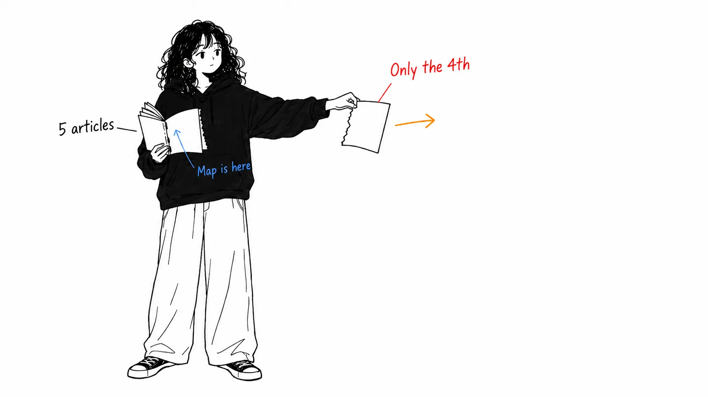
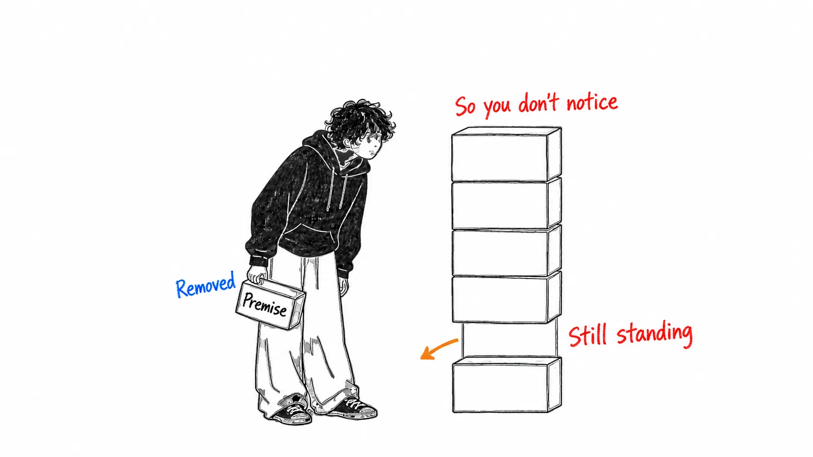
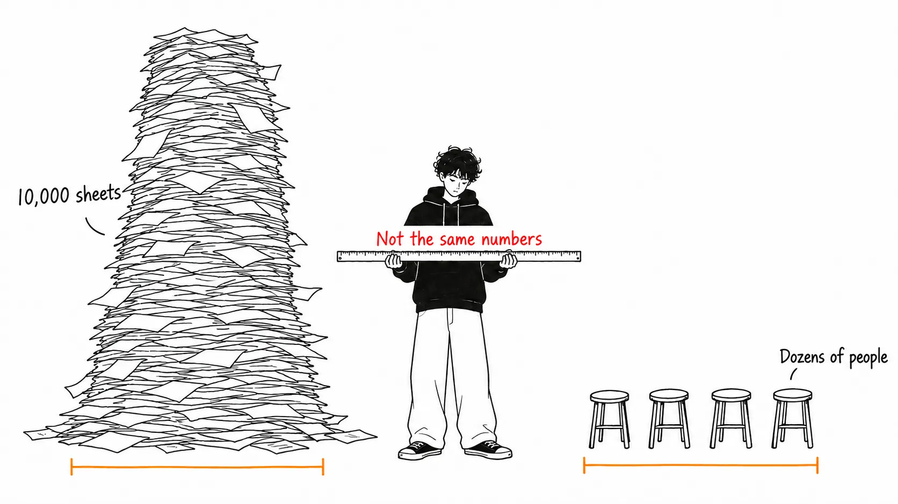
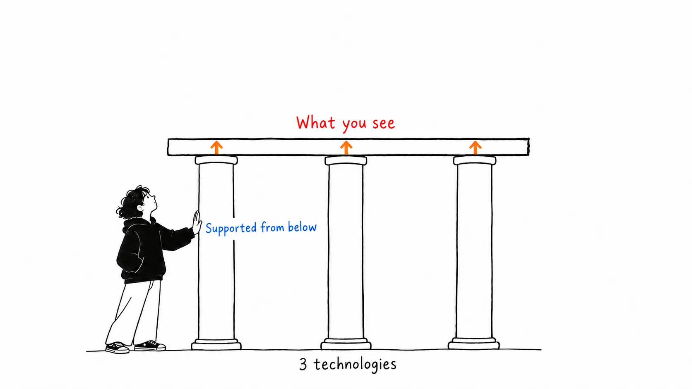

Here's the conclusion up front.

> What showed up on X was **the final installment of a five-part series**, expanding just one of its four skills. And **the one-sentence premise that makes that skill necessary isn't in the X version.** "Agents can now build from a spec. So the work shifts toward deciding what goes in the spec." That's the original argument, while the X version starts from "the boundaries between roles are blurring." The conclusion is the same, but the grounds have been swapped.

## About this article

What I read was [@AndrewYNg's X Article](https://x.com/AndrewYNg/status/2098459474608672916), "AI Engineering Skills Map: Shaping the build" (September 11, 2026). 848,829 views, 7,402 bookmarks.

I snagged on something right away. The title says Map, but no map appears. I looked into it, and DeepLearning.AI's `The Batch` has a **five-part series**.

| Issue | Date | Content |
| --- | --- | --- |
| issue-366 | August 14 | **The map itself.** The four skills, and how it was built |
| issue-367 | August 21 | (i) Building and deploying AI applications |
| issue-368 | August 28 | (ii) Software engineering fundamentals |
| issue-369 | September 4 | (iii) Using coding agents |
| issue-370 | September 11 | **(iv) Shaping the build** ← this is what showed up on X |

**Full disclosure.** I read the body of all five. I fetched two figures (the overall map and the expanded Shaping the build diagram) and looked at them. However, the raw survey data and the list of job postings aren't public, so I haven't verified what's inside the methodology.

## What appeared on X was the fourth branch

The whole map is in issue-366. There are four.

1. Building and deploying AI applications
2. Software engineering fundamentals
3. Using coding agents
4. **Shaping the build**

**The first three are technical.** What showed up on X was the fourth, the only non-technical branch.

Read on its own, it looks like a piece saying "AI engineering means product sense, initiative, communication, and a sense of ownership." In fact, the four sub-skills are these.

- Driving the build loop
- Making product decisions
- Communicating and leading
- High-agency ownership

Not one is technical. Meanwhile, the sub-skills of (i), expanded in issue-367, number six: LLM foundations, Grounding models with data, Building agentic systems, Evaluation-driven development, Operating in production, and Machine learning foundations. All technical.

**On the map, technical skills are the majority at 3:1, but looking only at the single piece that appeared on X, it looks like 0:4 non-technical.**

## What had vanished was the premise

This is the main point. In the map (issue-366), when Ng introduces (iv), he writes this.

> **Given a clear spec, coding agents are rapidly improving at delivering to it.** Thus, our work as engineers is shifting toward deciding what should be in the spec.

Given just a clear spec, coding agents are getting able to implement it. **So** the engineer's work is shifting toward deciding what goes in the spec.

A non-technical conclusion is drawn from a technical premise. The observation that agents' implementation ability has risen comes first, and from it comes "so what do humans do?"

The X version (issue-370) opens like this.

> Before modern AI tools accelerated and expanded what a single developer could do, tech companies established the practice of having product managers (PMs) and designers specify what should be built and then developers build it. However, these roles are blurring.

The roles are blurring.

**I searched the body of issue-370, and neither `clear spec` nor `deciding what should be in the spec` appears.** The premise is gone and only the conclusion remains.

The difference looks small, but it matters. "Roles are blurring" is an observation about society that anyone can make and anyone can disagree with. "Agents can now implement a spec, so people move to the side that decides the spec" is a technical claim, and **it doesn't hold unless agents' implementation ability keeps rising.** One is a description of a trend, and the other is a conditional claim.

## There is a methodology. But it's easy to misread

This isn't in the X version either. It's only in issue-366.

> Based on an analysis of over **10,000 job postings**; carrying out **dozens of structured interviews** with AI experts, hiring managers, and recruiters; gathering data through **surveys**; and synthesizing other online data

Among the AI engineering guides I've read over the past several pieces, **this is the first that wrote down its method.** In an earlier article, when I traced the figure "tool calls fail 3 to 15% of the time in production," I ended up at a single personal blog ([my article](https://meikocho1.github.io/blog/three-to-fifteen-came-from-one-blog)). The difference by comparison is big.

Even so, I think three cautions are in order.

**10,000 is the number of job postings, not the number of people.** The number of people they spoke to is "dozens," a few dozen sessions. If only the number 10,000 sticks in memory, you misjudge the sample size by one or even two orders of magnitude.

**The author himself writes "informal."** "You can informally think of our process as akin to clustering on a massive dataset." It's phrased as being comparable to clustering, and doesn't say clustering was done.

**They're still collecting.** The postscript of issue-366 is a request to take part in a survey, saying "we'll update the map as AI changes." In other words, this is not "a result of measurement finished" but "an interim report from partway through measuring."

## The figures are only on the blog

There are two figures on the map. The first is a tree with the four branches lined up. The second is a tree in which only Shaping the build is highlighted in a different color, with its four sub-skills hanging below.

The second is well made. **Next to the highlighted branch, the three non-highlighted branches always appear.** Looking at the figure, you see at a glance that "this is a story about a quarter."

And the X Article doesn't have this figure. The body is 18 blocks, all text. **The one device that restores the proportions isn't on the version with 848,829 views.**

## My take

This isn't an article blaming Ng. Since it was split into five installments, each one being read on its own is unavoidable, and issue-370 itself is good writing.

What I want to write about is **the asymmetry of excerpting.**

Of the five, only the final installment has spread outsize. I think I see why. The three technical ones are "learn the foundations of LLMs," "understand the trade-offs," "command your agents," which we've heard before. Only the fourth says "the scope of your job is changing," and the number of people it concerns is an order of magnitude larger. **The installment in the series that touches career anxiety the most flies the farthest.**

And when it flies, the technical premise falls off. It falls off because the text still holds together as writing without it. "Roles are blurring, so let's have product sense" reads fine without the premise. Because it reads fine, nobody notices when it's cut.

There's one way of reading I draw from this. **When you read a text that says "you should...," look for the conditions under which the claim would stop holding.** If you can't find any, you may be reading a version where the premise has been dropped. Ng's original sentence has a condition. If "agents can implement when there's a spec" collapses, the importance of (iv) falls too. A conditional claim looks weaker, but **the one with a condition is the stronger claim.** Because the shape in which it would be wrong is defined.

One more thing. In issue-369 there's this sentence.

> The rapid pace of evolution for coding agents means this skill, too, is evolving rapidly — **faster than other top-level AI engineering skills**.

The map's author himself writes that of the four skills, only (iii) goes stale faster than the others. I think that's a rare, honest annotation for a map. The map says "this part gets outdated sooner than the rest."

## If you take away only one thing

**When one installment of a series floats your way, look for the first one.** The first installment of a series usually holds the big picture and the methodology. And the first installment isn't what spreads. This time one of the five has been viewed 840,000 times, and the first installment, which contains the map and the methodology, isn't linked from it.

## Sources

- [@AndrewYNg, "AI Engineering Skills Map: Shaping the build"](https://x.com/AndrewYNg/status/2098459474608672916), X Article, September 11, 2026 (848,829 views / 4,622 likes / 7,402 bookmarks / 270 replies)
- [The Batch issue-366](https://www.deeplearning.ai/the-batch/issue-366/) (August 14, 2026): the whole map and the methodology
- [issue-367](https://www.deeplearning.ai/the-batch/issue-367/) (August 21) / [issue-368](https://www.deeplearning.ai/the-batch/issue-368/) (August 28) / [issue-369](https://www.deeplearning.ai/the-batch/issue-369/) (September 4) / [issue-370](https://www.deeplearning.ai/the-batch/issue-370/) (September 11)

The body of the X Article is nearly identical to issue-370. "The `clear spec` sentence isn't in the X version" means that I searched the body of issue-370 and found no match. I haven't ruled out the possibility that the X Article isn't completely identical to The Batch version.

I fetched the two figures from The Batch's image URLs and looked at them. The survey responses, the 10,000 job postings, and the structured-interview records aren't public, so I haven't verified the methodology itself. The point that "the method is written down" and "the method can be verified" are different things applies to this article's own claims as well.
