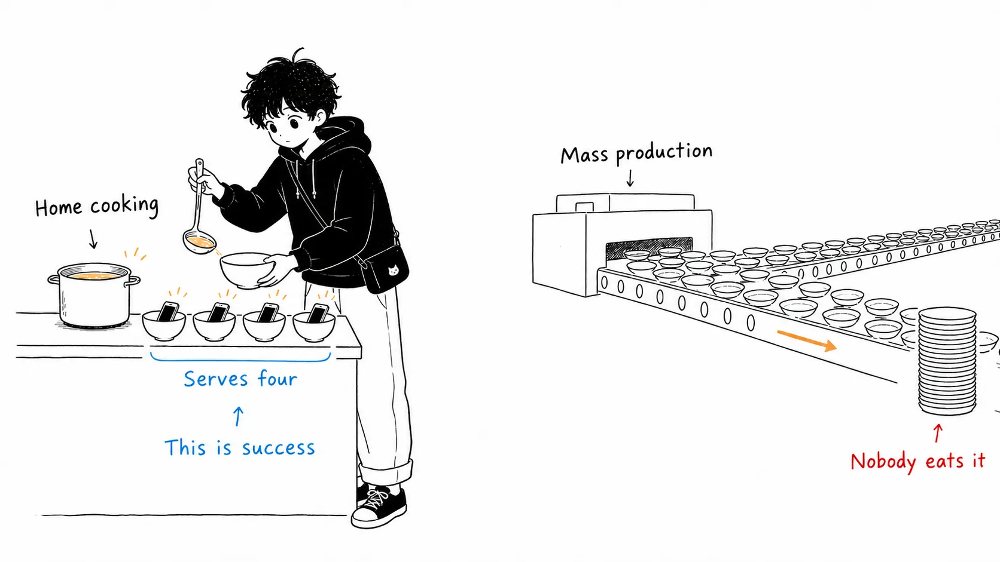
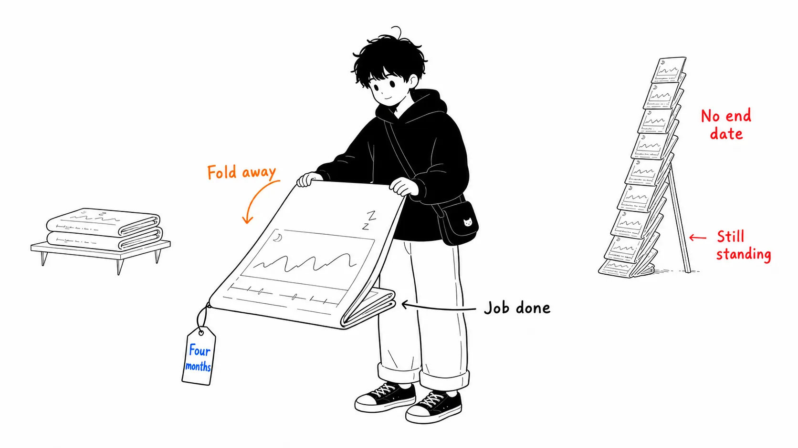
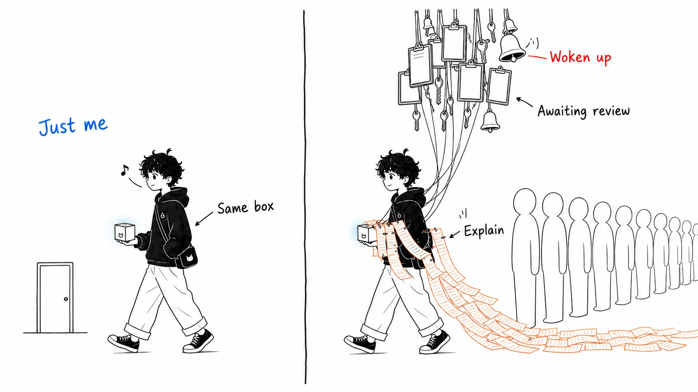
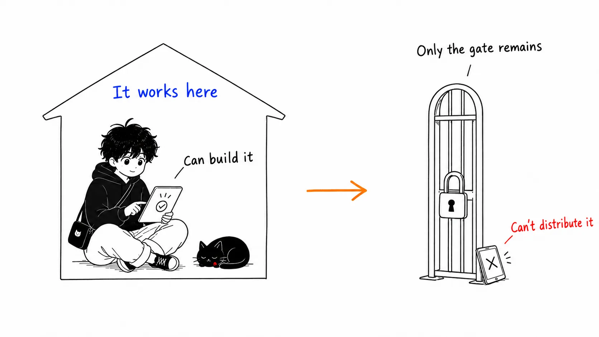

## About this article

This piece is about **"Software for One,"** an essay Adam Waxman ([@ajwaxman](https://www.ajwaxman.com/)) published on July 29, 2026. It drew 266 points and 279 comments on Hacker News.

The article has two parts.

- **Part 1**: What Waxman built and what it cost (the facts from the original)
- **Part 2**: **What I think about this phenomenon.** A reading that appears neither in the original nor in the HN discussion

The second half is longer. You can get the facts by reading the original.

A disclosure up front. I have not used Waxman's apps, and I'm in no position to speak from experience about building personal apps on his stack. What I read was the original, the HN thread, and Robin Sloan's 2020 essay. Part 2 is an interpretation that came out of setting those three side by side. It is not a measurement.

---

## Part 1: What happened

### The conclusion first

> The cost of personal apps collapsed because AI learned to write code, but **most of that cost was never the code in the first place**. What disappeared was the obligation we owe to other people, and AI made the condition for eliminating it (having exactly one user) a realistic option for the first time.

### 2020: an app for four people

The starting point is "An app can be a home-cooked meal," which Robin Sloan wrote in February 2020. He built **BoopSnoop**, a messaging app for his family. It had four downloads. Four people scattered across three time zones stayed daily active users for years afterward. He called it a huge success.

An app can be a home-cooked meal. It doesn't need scale or a user count. You can build it for someone you love.

But he is honest about what it cost at the time. It took a week to make, and **half of that melted away in code-signing hell**.

> In a better world, I'd have been able to make this in a day, using some kind of modern, flexible, iOS version of HyperCard.
>
> (Sloan, February 2020. All translations of quotations below are my own.)

The essay has a series of follow-ups, and there's a running gag in it. Every year's update says, "At my mother's request, I added one (1) feature." In the world of 2020, that was the right frequency. A single change meant a fight with Xcode.

### 2026: a smoothie that knows your mileage

Six years later, in six months, Waxman builds an amount of personal software that he himself calls "too much."

- A **sleep app** that runs a sleep consultant's plan as-is
- A **fitness app that sets the size of your smoothie** based on that morning's running distance
- A **marathon plan** built from his own race results instead of his age
- A **"Duolingo for jazz"** that quizzes him on the chord voicings from his piano lessons
- A **medical-records tool** that finds gaps in his records before a specialist visit

The sleep app has the most concrete motivation. The consultant's plan arrived as a PDF full of conditional branches: the maximum time awake, the cap on naps, what to do when a nap fails. He turned it into an app in a week of evenings. The result is that his wife, the nanny and he himself share **a single schedule that rebuilds itself automatically when a nap runs short**.

The fitness app pulls data scattered across four apps (Strava, Oura, Withings, FatSecret) into one place and adjusts the day's calorie target based on the distance and intensity of the run.

### The stack and the price

The original lists the stack. I'll note it here as fact.

- **Framework**: Next.js on Vercel
- **Front end**: Tailwind + shadcn/ui
- **Auth**: Better Auth
- **DB**: Postgres on Neon + Drizzle ORM
- **Jobs**: GitHub Actions
- **AI**: Claude Code, the Vercel AI SDK, custom skills

The monthly cost is about **$160**. The breakdown is $100 for Claude Code Max, $10 for the Anthropic API, $20 for Vercel and $30 for Neon. But as he notes himself, most of the Neon and API spend goes to other projects (nycjazz.guide and Claude Code Daily), not the personal apps. Before he upgraded from Claude Pro to Max, it was under $100. He writes that for one or two apps, a $20/month coding subscription plus $5 to $10 of API usage would probably do.

### Build time

This is where the gap with 2020 shows most.

- Sleep app: one week of evening work
- Fitness app: one weekend
- Jazz quiz: one evening after putting the kids to bed

> A year or two ago, I wouldn't have thought of building any of these. Too slow to build, and harder still to maintain. **Now the constraint is imagination.**

On maintenance, he also writes something that contrasts with Sloan's "one feature a year." Bug fixes, new features and dependency updates are easier than ever. Nine times out of ten, sharing a screenshot with Claude is enough.

---

## Part 2: My take

From here on, it's a reading that appears neither in the original nor on HN.

### The most radical line is "it's fine to throw it away"

The original lists six lessons, but the one that stopped me was the fourth.

> **It's fine to throw it away.** I used the sleep app for about four months. My son started sleeping through the night, so I retired it. If this app had taken months, that might have stung a little. Since it took a week, all I think is that I'm glad it worked when I needed it.

This looks like a story about cost, but it actually breaks one assumption of software.

We have treated "working software gets maintained" less as a choice than as a law of physics. That's why we look at maintenance frequency when we choose a library, and why someone asks "what happens if the person who built it leaves?" when we build an internal tool. That worry is right. **As long as you assume the software lives indefinitely.**

The lifespan of Waxman's sleep app was four months. And that wasn't a failure. It was **part of the design**. The end condition, that his son would start sleeping through the night, existed from the start.

Software known to have a finite life doesn't need half of the costs we habitually pay. Abstractions for future expansion, documentation written on the assumption that others will read it, worry about a framework migration in five years. That isn't cutting corners. **The requirements are different.**

What I find interesting is that this idea can be carried outside personal apps. How many organizations could write "expected operating period: six months, then discard" in an internal-tool proposal? I think almost none. Yet in practice there are plenty of cases where a tool used for only six months was built on the assumption of permanence, and a maintainer is still assigned to it after nobody uses it anymore.

### In that same 2026, professional teams are getting slower

Here I'll line up what looks like a contradiction.

Waxman writes that maintenance is "surprisingly easy." Meanwhile, in the data from the AI-coding debate that I covered in another article ("The AI coding debate isn't a fight over facts"), the numbers from professional settings point the other way. In METR's controlled experiment, experienced developers were **19% slower** when using AI, yet believed they had gotten faster. In the DORA / Faros AI data, merged PRs rose 98% while review time swelled 91%.

Same tool, same year, opposite results. Is one of them lying?

I don't think so. I think **they're just measuring different costs**.

Break down what makes code expensive in a professional setting, and you get this:

The time to write code. The time for others to read and approve it. The time to keep it in a state that someone other than its author can understand. The time to confirm whose mouth a spec came from. The time to decide who gets woken up when it breaks. The time to tell the people using it about changes.

Of these, what AI cuts directly is **only the first**. All the rest arise from "there are other people." So when only generation gets faster, the rest swells in relative terms and the bottleneck moves to review. The DORA numbers show exactly that.

In Waxman's environment, all of that remainder is zero. There are no reviewers. The source of the spec is himself. If it breaks, he fixes it. The people using it are himself, his wife and the nanny, all in the same house.

So here is the point. **AI didn't make software cheaper. Having a single user made it cheaper, and AI made it possible to build something practical even under that setting.** I think this is a point where the order tends to get told backward.

### So the right question becomes "how few users can I narrow it to?"

If this reading is correct, the question changes when you build internal tools with AI.

The usual question: "Can AI build this?"

The question I think works: "**How far can I reduce this tool's users?**"

Because the answer to the former is usually "yes, it can," and being able to build it guarantees nothing. The moment you ship it, "other departments want it too," "what about permissions?" and "what if the owner changes?" begin, and the cost returns to pre-AI levels. All that increased was the amount of code.

The latter question, on the other hand, has a practical answer. With one person, you don't need authentication. With three people who are all on the same team, you don't need permission management. With a whole department, you do. The number of users almost directly determines the amount of requirements.

"Reducing users" is usually a defeat as a business. Only in the context of personal software does it become a **strategy**. I think this is the most counterintuitive part of this story.

Waxman himself writes something in the same direction, in terms of markets.

> AI floods the big markets and unlocks the small ones.

The first half (AI-made throwaway apps flooding the stores) is something everyone says. What I find weighty is the second half. His claim is that territory that is **too small to be a business but worth serving** has become viable for the first time. If a single household is the whole market, nobody was ever going to come and build for it.

### What I doubt: being able to build isn't being able to deliver

Here is my reservation about the optimism.

Waxman himself admits it is "still too technical for most people." You have to be comfortable with terminals, databases and deploy pipelines. He then predicts that this barrier won't last long. As evidence he cites a post in which Sam Altman sent a single message from his phone and got "a trip-planning site for nine friends, with coordination and invite emails."

In the HN thread, this was the comment I found weightier than the original.

> This is great. But Apple has effectively blocked sideloading (outside the TestFlight environment), and Google is moving the same way. **It has never been so easy to build personalized software, and never so hard to run it on the official platforms.**

The reason this bites is that the optimism in Waxman's article rests on the condition that "the only people it's delivered to are me (and my family)." His main stack is Next.js on Vercel, that is, the web. Going by the stack he lists, nothing goes through the App Store. That's why it works.

And the moment a third and fourth person join, the costs that had vanished come back one by one. You need authentication. You need to separate data. A report comes in that it doesn't work only in someone's browser. You owe an explanation for "it worked yesterday."

The code-signing hell Sloan fought in 2020 was **not a technical difficulty but a gate for delivering to other people**. AI hasn't solved code signing. It has only made it realistic to use software in a way that doesn't cross the gate.

This is not a rebuttal but a delineation of scope. The phenomenon is real up to "me and the few people right next to me," and beyond that the world of 2020 awaits. At least for now.

### The caveat "at least for now"

I'll point to the passage in the original I found most honest. It's the first sentence of the lesson about maintenance.

> Maintenance is surprisingly easy. **At least so far.**

That "at least so far" matters. His data covers six months. How many Next.js major upgrades has he been through? What happens if Neon changes its pricing? What happens in the month he cancels his Claude Code subscription? Six months doesn't answer those.

Sloan's BoopSnoop is still being mentioned in an article six years later. I think the real evaluation of personal software only comes on that kind of timescale. So I read this article not as "personal software is solved" but as a report that "**personal software can, for the first time, be started**."

With that said, let me write down one concrete worry I have about the lifespan of AI-generated code. An app built on the assumption that it's disposable usually **doesn't end up disposable**. The sleep app he dropped after four months could be dropped because it had a clear end condition. But a marathon-plan app has no end condition. Neither does the jazz quiz. A personal app with no end condition will eventually become "software that still runs but whose insides nobody remembers." This happens even with one user. If anything, it proceeds quietly precisely because there's no reviewer.

---

## If you take away just one thing

It's not "AI can build anything." That's only half right, and it doesn't change your behavior.

What to take away is the diagnosis: **most of the cost of software is not the code but our obligations to other people, and the amount of obligation is largely set by the number of users.**

With that in hand, two judgments change. For tools aimed at individuals or small groups, things you would have dismissed as "not worth building" move to the side worth actually building. Conversely, when you grow the number of tools using AI inside a company, what determines cost-effectiveness is not how fast the code comes out but **how few users you can confine it to**.

In 2020, Sloan wished for "some kind of modern, flexible, iOS version of HyperCard." Let me quote Waxman's closing.

> What he got was something stranger. You describe what you want in plain English, and an agent builds it. The better world he wanted has arrived.

I think only half of it has arrived. The building side really has changed. The delivering side is still in 2020.

---

## Sources

- Adam Waxman, "[Software for One](https://www.ajwaxman.com/writing/software-for-one)," published July 29, 2026 (the Hacker News posting date; viewed August 17, 2026)
- Hacker News thread: [item?id=49096605](https://news.ycombinator.com/item?id=49096605) (266 points / 279 comments). The quoted comment about sideloading is from this thread
- Robin Sloan, "[An app can be a home-cooked meal](https://www.robinsloan.com/notes/home-cooked-app/)," February 2020
- Maggie Appleton, "[Home-Cooked Software and Barefoot Developers](https://maggieappleton.com/home-cooked-software)," May 2024 (a talk at the Local-first Conference. I don't quote it directly in this article, but it is an important piece in this lineage)
- Lee Robinson, "[Personal software](https://leerob.com/personal-software)" (mentioned in Waxman's article. I have not checked the original)
- The AI-coding productivity data I referred to in Part 2 (METR's controlled experiment, DORA / Faros AI) comes from the same sources as in another article on this blog, "The AI coding debate isn't a fight over facts." Some of the "developers feel 20% faster but are 19% slower" numbers circulating in 2026 have mixed-up sources, so here I refer only to METR's controlled experiment and the DORA / Faros AI report
