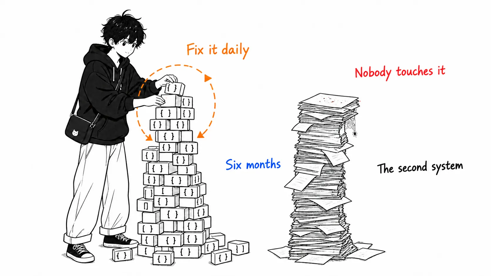
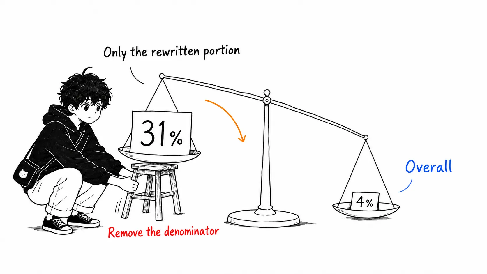
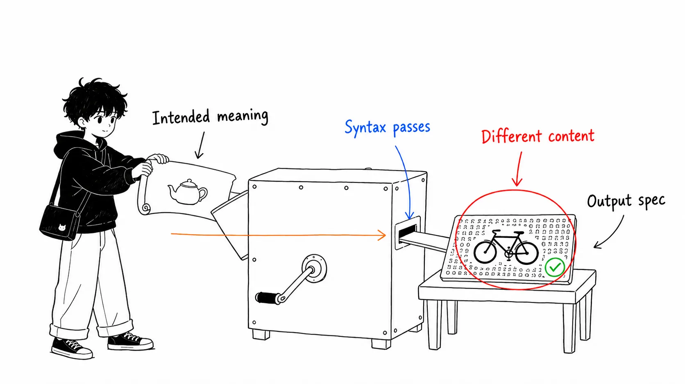

## About This Article

This article deals with Markus Eisele's piece "When AI Writes the Code, Specifications Need an Exit Strategy," published by O'Reilly Radar on August 17, 2026. The body states explicitly that the original is an expanded and rewritten version of an article from his newsletter, The Main Thread.

- Source: [When AI Writes the Code, Specifications Need an Exit Strategy](https://www.oreilly.com/radar/when-ai-writes-the-code-specifications-need-an-exit-strategy/) (Markus Eisele, August 17, 2026, an 18-minute read)
- Original version: [The Main Thread — Spec-Driven Development Exit Strategy](https://www.the-main-thread.com/p/spec-driven-development-exit-strategy)

This article has three parts. Part 1 is Eisele's argument, Part 2 is **my account of checking the research numbers he cites against the primary sources myself**, and Part 3 is **my own take**. Part 3 is the longest, since you can get the introduction to his argument by reading the original.

First, what I checked and what I didn't.

What I checked. I went through the O'Reilly body section by section (I haven't seen the figures themselves, only the captions). And I retrieved the abstracts of the three arXiv papers Eisele gives as evidence and compared them with his summaries. On the third one, as I'll describe later, one number is off.

What I didn't check. The Main Thread version of the original. The IBM Research empirical study listed in the references, the HumanLayer context engineering article, and Dexter Horthy's talk. Also the full text of the three arXiv papers (abstracts only). And above all, I have no experience operating a repository that has six months of spec-driven agent work piled up in it. Where I write about that state below, it's my inference.

---

## Part 1: What Eisele Is Saying

### The Conclusion First

> Open a repository that has run on spec-driven development for six months, and another system has been built next to the code. Requirements, research notes, high-level design, low-level design, implementation plans, task lists, review reports. The code changed a lot last Tuesday, but the documents were last updated weeks ago. That's why specifications need an exit strategy. Written words are for the delta (the change you're about to make); facts that should remain after release get promoted to native artifacts, and the rest is allowed to expire.

### The "Second Codebase"

The opening paragraph is the whole article. The original begins like this.

> Open a repository after six months of spec-driven agent work and you may find a second system sitting next to the code.

Eisele then says this isn't a new phenomenon. Software and documentation growing separately in parallel has been the case for as long as he can remember. It's what we used to call waterfall. The one where you read a folder full of paper over the weekend and join the project on Monday. He writes that it was "complete from a management standpoint and nearly useless from an engineering standpoint."

What's new is speed. Agents can reproduce that excess documentation in a short time.

What he finds especially dangerous is **the pattern of having the agent generate the first version of the spec**. A single workflow run derives requirements, design, and plans straight from research, and even stacks review artifacts on top. It looks highly polished, but in reality the amount of material you have to review and approve has grown enormously. Creating real consistency out of chaos remains hard even as models get faster.

### Written Words Are for the Delta

The prescription is that the necessary writing is short. The intended outcome, the non-goals, the constraints that differ from current behavior, the evidence needed for acceptance. When a new feature crosses an architecture boundary or introduces a pattern that doesn't yet exist in the code, technical design elements go in too. He also writes that it's worth considering the cost of rolling the change back. If the existing system has several different implementations of the same pattern, there's a high risk the agent will invent one more kind.

Extra prose like research notes, prototypes, and design records gets added to the project "only when uncertainty justifies it." **It must not become a required stage of every pull request.**

### Hold Permanent Facts in Native Form

This is the concrete part I like. When he says "promote permanent constraints," Eisele states plainly that it doesn't mean turning every decision into permanent Markdown. That would just redo the old documentation problem in another form. Software engineering already has better places for most permanent facts.

- API shape and compatibility → OpenAPI, AsyncAPI, protocol schemas, types, compatibility tests
- Data invariants → types, DB constraints, validation, migration checks
- Architecture boundaries → module structure, dependency rules, architecture tests
- Reliability requirements → load tests, SLOs, telemetry, alerts
- Release rules → CI/CD policy

And then the decisive sentence.

> A failed schema check or alert needs to be fixed and handled while the corresponding paragraph in an old design folder does not.

Natural language still has a role. Business policy, trade-offs, architectural rationale. Things that don't fit into executable artifacts. But keep the prose short and place it right next to the thing it explains. A small ADR is worth leaving only when a future team would otherwise repeat expensive research, and when a code comment can't justify the implementation.

> Recording every local choice just hides the few decisions that matter and confuses the agents that are supposed to build the software.

### The Five Steps

This is the entire operating model he proposes.

> 1. リポジトリの証拠から始める（既存の挙動を読む）
> 2. 意図したデルタ、重要な境界、既知の未知を記した小さな change brief を書く
> 3. リスクが要求する場合にのみ、調査・プロトタイプ・設計合意・強い検証を足す
> 4. 計画ではなく実装を読んでレビューする
> 5. リリース時に、一時的な推論を破棄し、生き残った事実をそれぞれのネイティブな正典成果物に保存する
>
> (1. Start from the repository's evidence (read the existing behavior)
> 2. Write a small change brief stating the intended delta, key boundaries, and known unknowns
> 3. Add research, prototypes, design agreement, and strong verification only when the risk demands it
> 4. Review the implementation, not the plan
> 5. At release, discard temporary reasoning and save the surviving facts in their respective native canonical artifacts)

He also draws on the lessons from Research-Plan-Implement. When human review was moved ahead of implementation, teams ended up holding plans that reached 1,000 lines, and engineers, while reviewing those plans, treated the generated code almost like compiler output. The implementation can drift from the plan.

The "let the agent decide" part draws on Simon Willison's July 3, 2026 article. It's a hint from the Claude Code team that it's better to delegate the judgment itself than to specify in a branching table whether tests should be written.

---

## Part 2: Checking the Numbers Against Primary Sources

Eisele cites three papers as "this behavior is backed by research." I retrieved the abstracts of all three myself.

### The Denominator Behind "About 31%"

The original's statement is this.

> Choosing a more targeted repair approach around the identified defects (change brief) improved the results by roughly 31%.

The paper in question is Jia et al.'s "Automated Repair of Ambiguous Problem Descriptions for LLM-Based Code Generation" (arXiv:2505.07270). It evaluates a tool called SpecFix on four models (GPT-4o / GPT-4o-mini / DeepSeek-V3 / Qwen2.5-Coder-32B-Instruct) and three benchmarks (HumanEval+ / MBPP+ / LiveCodeBench). The relevant part of the abstract.

> Without human intervention or external information, SpecFix modified 43.58% of descriptions, improving Pass@1 on the modified set by 30.9%. This yields a 4.09% absolute improvement across the entire benchmark.

Eisele's "about 31%" is **correct**. It isn't a misreport. But to be precise, SpecFix rewrote 43.58% of the descriptions overall, and the 30.9% is the Pass@1 improvement on that rewritten subset. The absolute improvement across the whole benchmark is 4.09%.

31% and 4.09% are both numbers from the same experiment. Even so, the picture left in the reader's head differs. "Fix the ambiguity in a targeted way and get 30% better" versus "fix the ambiguity in a targeted way and get 4 points better across the benchmark" changes whether you get budget approved internally. This is the second time in two weeks that I've seen this kind of denominator. When a number isn't false but invites misreading, I think the writer should attach the denominator in one phrase.

Incidentally, the transfer number is interesting too. A description repaired for one model improves other models' performance by 10.48%. That's evidence that **ambiguity isn't a model-specific weakness but a defect in the description itself**. It directly supports Eisele's claim (a brief must be short but must not be ambiguous), so I was a little surprised he didn't cite it.

### SWT-Bench Is Right as Is

> SWT-Bench found that generated tests could filter proposed fixes and double the precision of a software repair agent.

It's written as is in the abstract of Mündler et al.'s SWT-Bench (arXiv:2406.12952).

> we find that generated tests are an effective filter for proposed code fixes, doubling the precision of SWE-Agent

This is the basis for Eisele writing that "the agent that proposes the implementation must not be the only source of its requirements and tests." His summary was accurate.

### The TLA+ Numbers Are 26.6/8.6, Not 27/9

The third one. "Can LLMs Write Correct TLA+ Specifications?" (arXiv:2606.05792). Eisele writes "27% syntactic correctness, 9% semantic correctness." The actual numbers in the abstract are these.

> LLMs achieve up to 26.6% syntactic correctness but only 8.6% semantic correctness, with successes exclusive to progressive prompting.

26.6% and 8.6%. The rounding goes upward, but it isn't a big difference. The substance matters more. 30 models across 8 families, a dataset of 205 TLA+ specifications, 2,600 runs of 25 open-weight models x 4 prompting strategies, and 130 runs of 5 proprietary models with few-shot. Verified with the SANY parser and the TLC model checker.

And there are two findings that I weigh more heavily than Eisele does.

> model size does not predict quality, e.g., DeepSeek r1:8b outperforms its 70B variant across all strategies

> Code-specialized models consistently underperform due to negative transfer from mainstream language training.

Syntax passes in 26.6%, semantics is right in 8.6%. These are both best values with an "up to," so dividing them to get a ratio is rough, but even so the order-of-magnitude sense that **most specs that got through the parser said something different once they did** doesn't move. Since this is an article that complained about denominators itself, I'll note that this is only a rough guide. Eisele sums this up as "formal notation helped detect mistakes, but didn't guarantee correctness or preservation of the original intent." I think that's too modest. What these numbers say is that the very step of "translating" natural-language intent into machine-readable form barely works at present.

And in my view this is a much stronger argument for Part 1's claim than the 31%. The reason that writing thick specs in Markdown is wasteful isn't just that they rot. It's that **there's no path from thick prose into a formal representation that preserves meaning**. So the promotion destinations must be things that don't require translation: types, DB constraints, tests, CI policy. It can't be a coincidence that Eisele's list is composed entirely of "things that need no translation."

---

## Part 3: My Take: An Exit Strategy Can't Be Implemented as Policy

Now for the main point.

Of Eisele's five steps, four get done if you write them down. Start from the repository's evidence. Write the brief. Add weight according to risk. Read the implementation. All of them are acts where the person doing them actively benefits. Skip the brief and the agent runs wild; skip reading the implementation and bugs ship. Motive and action line up.

Only step 5 is different.

> At release, discard temporary reasoning and preserve each surviving fact in its native authoritative artifact.

**This is an act from which nobody actively benefits.** And the expected timing of its execution is release, the moment when attention is most depleted.

I saw the same structure before, when I wrote about the GitHub Actions injection incident. The "safe way to write it" existed only as the shape of the code, and nothing anywhere enforced why it was that shape, so it quietly disappeared during a rewrite. Neither human review nor AI review noticed. A zero-config linter flagged it in one shot. The lesson then was "what should have been guarded wasn't attention but a machine-readable rule."

"Discard temporary reasoning at release" is **the exact opposite direction of that, and the same mistake.** It writes deletion as a policy that depends on attention.

### Why It Doesn't Get Thrown Away

I think three frictions are at work. In order of weight.

First. Deletion doesn't get praised in review. The psychological cost until a PR deleting `docs/plans/2026-08-payment-refactor/low-level-design.md` gets an "LGTM" is higher than for a PR adding it. Adding looks like an act that increases information, and deleting looks like an act that loses it. In reality it's the reverse: a single rotten low-level design is enough to contaminate the judgment of the next agent that reads that directory, but that loss shows up in nobody's review.

Second. Generation cost being near zero raises the hurdle to deletion. This is where it differs from before AI. A design doc a human spent three days writing looks like it's worth three days, so it's hard to throw away. That I understand. Yet a design doc an agent generated in 40 seconds is just as hard to throw away. The reason has swapped. Not "because we went to the trouble of making it," but "because deleting something this polished feels like it must be wrong." Formatted Markdown has the look of authority regardless of whether its content is right. Eisele writes that "high polish makes everything look controlled and defined," which is about generation time, but the same effect works at deletion time.

Third. The misconception that "we keep it because the agent will read it." This is the point most likely to draw objections, so I'll deal with it first. "If you delete the spec, the next time the agent works there'll be no context, won't there?"

There won't. What the next agent should read is the code, tests, and type definitions. For a released feature, the implementation plan is an older source of information than the code. Eisele writes the same thing: "After release, the code and the production behavior are the primary evidence of what the system does." Even so, if the repository has a `docs/` with detailed prose in it, the agent reads it. Reading alone would be one thing, but if it contradicts the code, which one it believes is luck. **A rotten spec doesn't just eat the context budget; it actively lies.**

### A Proposal: Don't Put the Brief in the Repository

My conclusion is this.

> Stop writing the exit strategy as an operating rule of "discard at release." **Put it from the start in a place where it disappears even if you don't discard it.**

Concretely, make the pull request body the canonical home of the change brief. Don't commit it as a file in the repository.

What changes? The brief is fully alive during the change. Both humans and agents can read it (you can get it with `gh pr view`). The review discussion gathers there too. And the moment you merge, it automatically becomes "the body of a past PR." Nobody made a deletion decision, yet it's gone from the `main` tree. The tense the brief had, "this is a description of a change we're about to make," is enforced by the structure of Git.

If you want to keep it in your working worktree, put `.brief.md` in `.gitignore`. Tell the agent, "the brief is here, but it's a document for this session only; don't write permanent facts here." I haven't run this setup over the long term yet, so this is a proposal, not a report of results.

And the facts that were worth keeping go into native form, as in Eisele's list. What matters here is **making it possible for a machine to confirm whether the promotion happened**. A checklist item like "did you write an ADR?" doesn't work. I think things like these do.

- Put a line-count limit on `AGENTS.md` (and `CLAUDE.md`) and fail CI on it. Once you hit the limit, you have no choice but to trim the content or promote some rule into a linter rule
- Check whether the identifiers that Markdown under `docs/` refers to (class names, endpoint paths, config keys) actually exist in the code. A document containing a nonexistent identifier makes its evidence of rot machine-readable
- Require an OpenAPI diff on PRs that include API changes. This blocks the path of writing "watch backward compatibility" in prose

The third one many teams already do. The second one, as far as I know, I rarely see. It shouldn't be hard to implement. Even without any parsing, just picking up strings inside backticks in `docs/` and cross-checking them with `rg` should find, I think, 80% of the rotten paragraphs.

### Conversely, Where Policy Is Enough

For fairness, I'll write this. Step 3 (varying the weight according to risk) is better not made into a mechanism. The moment you enforce it in CI, it goes back to the heavyweight method Eisele criticizes, where "every change goes through the same documents, reviews, and test classification." Leave judgment as judgment. Willison's point, cited above, that "it's better to leave whether to write tests to the agent's own judgment," is the same story.

Turn judgment into a mechanism and you get bureaucracy. Leave deletion to judgment and it rots. This is where the line should be drawn.

---

## If You Take Away Just One Thing

The value of Eisele's article isn't "make your specs thinner." That's been said for a long time. The value is that he put out a list saying **"each permanent fact already has a canonical home."** API shape goes in OpenAPI, invariants in types and DB constraints, boundaries in architecture tests. Prose fills only the gaps between them.

On top of that, there's one line I'd like to add. What an exit strategy needs isn't the resolve to throw things away but **a place where things don't remain even if you don't throw them away**. The pull request body is that place, already provided by Git.

One word on the primary sources too. I think the strongest number in this article is the TLA+ 8.6%, which Eisele placed modestly third. If the probability that translation from natural language to a formal spec preserves meaning is under 10%, the return on investment of writing a thick spec is already bad before it rots.

---

## References

- [When AI Writes the Code, Specifications Need an Exit Strategy](https://www.oreilly.com/radar/when-ai-writes-the-code-specifications-need-an-exit-strategy/) — Markus Eisele, O'Reilly Radar, August 17, 2026
- [Automated Repair of Ambiguous Problem Descriptions for LLM-Based Code Generation](https://arxiv.org/abs/2505.07270) — Jia, Morris, Ye, Sarro, Mechtaev, arXiv:2505.07270 (first version May 12, 2025)
- [SWT-Bench: Testing and Validating Real-World Bug-Fixes with Code Agents](https://arxiv.org/abs/2406.12952) — Mündler, Müller, He, Vechev, arXiv:2406.12952 (first version June 18, 2024)
- [Can LLMs Write Correct TLA+ Specifications?](https://arxiv.org/abs/2606.05792) — Bisharat et al., arXiv:2606.05792, 2026
- [Judgement](https://simonwillison.net/2026/Jul/3/judgement/) — Simon Willison, July 3, 2026
